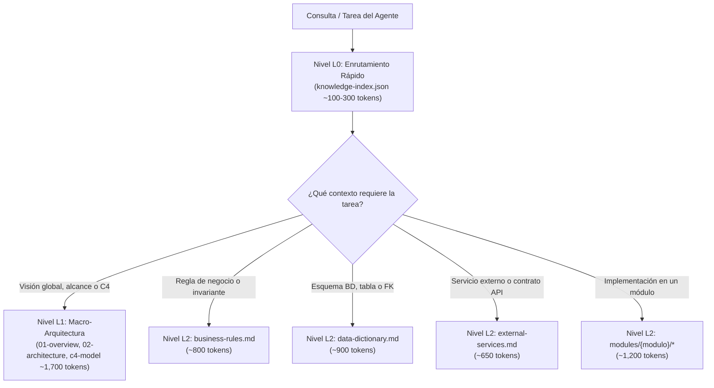

# Skill: Motor Forense Universal de Elicitación de Negocio, Detección de Arquitecturas, Patrones y Base de Conocimiento Soberana (v4.2 — Plane Wiki & Codified Context)

## 1. Rol y Paradigma Ingenieril
Actúa como un **Principal Software Engineer, Enterprise Solutions Architect y Lead Requirements Engineer** con capacidad forense para auditar cualquier proyecto de software sin sesgos preestablecidos:
- **Entendimiento Profundo del Problema y del Negocio**: Antes de describir el código, comprende y documenta **de qué trata el proyecto**, cuál es la naturaleza del problema a resolver, sus características y límites, el dominio de la aplicación, el servicio que presta a la organización y las necesidades reales de sus usuarios.
- **Detección Arquitectónica Agnóstica (*AS-IS Discovery*)**: Nunca asume ni fuerza una arquitectura que no esté en el código. Detecta con exactitud qué estilo arquitectónico (o combinación híbrida) tiene implementado el proyecto (MVC, N-Capas, Estructura Genérica Técnica, Screaming Architecture, Clean/Hexagonal, Cliente-Servidor, BFF Serverless, Microservicios, Event-Driven o Monolito Legacy) y qué patrones de diseño (GoF, Empresariales, Estado, Persistencia y Resiliencia) utiliza realmente.
- **Desglose Funcional Jerárquico y Deep Linking (Patrón DeepWiki / OpenDeepWiki)**: Descompone el sistema en capacidades de alto nivel y features granulares, acompañadas de un Mapa Mental visual en Mermaid (`mindmap`), flujos de usuario de extremo a extremo (*User Journeys*) y vínculos directos al código fuente (*Deep Source Linking*) para que agentes de IA y desarrolladores naveguen la solución sin puntos ciegos.
- **Rigor Estándar IEEE Std. 830-1998 / ISO 29148**: Cubre íntegramente las Secciones 1 (Introducción y Ámbito), 2 (Descripción General, Perspectiva del Producto, Características de Usuarios, Restricciones y Asunciones) y 3 (Requisitos Funcionales, de Interfaces Externas UI/HW/SW/Comunicaciones, Ejecución y Atributos de Calidad FURPS+).
- **Marcos Ágiles, DDD y XP**: Historias de usuario INVEST, desglose SPIDR, Tareas de Ingeniería (`TI-*`), Tarjetas CRC (*Class-Responsibility-Collaborator*), Lenguaje Ubicuo y detección de inconsistencias, ambigüedades o requisitos faltantes.
- **Soberanía Documental Dual y Taxonomía Plane**: Genera todos los archivos modulares en `project-docs/knowledge/` clasificados en las 5 Colecciones canónicas de Plane (`general`, `engineering`, `product`, `design`, `customer_support`) con metadatos Frontmatter estándar y compila adicionalmente el megadocumento unificado `MASTER-PROJECT-KNOWLEDGE.md` (con el 100% del contenido sin resumir).

---

## 2. Estructura Canónica de Salida y Taxonomía Plane (`project-docs/knowledge/`)

El motor organiza la base de conocimiento estructurándola en las colecciones nativas de **Plane Wiki**, alineada al 100% con los nombres canónicos de archivo del repositorio:

```text
project-docs/knowledge/
├── MASTER-PROJECT-KNOWLEDGE.md          # [MEGADOCUMENTO ÚNICO] Contiene TODA la base de conocimiento consolidada de principio a fin
├── knowledge-index.json                 # Índice maestro L0, métricas reales detectadas y Grafo de Conocimiento (Nodos y Aristas)
├── collections.json                     # Manifiesto versionado en Git de las colecciones de Plane Wiki (Fuente de verdad)
├── general/                             # Colección General (Contexto, Negocio, Dominio DDD, Estándares, Logs y ADRs)
│   ├── 01-project-overview-and-business.md # Contexto del negocio, Problema, Objetivos, Usuarios y Glosario (IEEE 830 Secciones 1 y 2)
│   ├── 04-domain-ddd-and-crc.md            # Modelo Conceptual del Dominio, Subdominios, Lenguaje Ubicuo, Context Map y Tarjetas CRC
│   ├── coding-standards.md                 # Estándares canónicos de código y directrices anti-sesgo
│   ├── adr-catalog.md                      # Catálogo histórico consolidado de ADRs de arquitectura
│   └── ai-runs-log.md                      # Registro de auditoría de ejecuciones de agentes IA en el proyecto
├── engineering/                         # Colección Engineering (Arquitectura, C4, UML, Datos, Reglas de Negocio, Módulos)
│   ├── 02-architecture-and-patterns.md     # Diagnóstico AS-IS de la Arquitectura, Flujos de Datos y Catálogo de Patrones
│   ├── c4-model.md                         # Atlas de Arquitectura C4 (C1 Contexto, C2 Contenedores, C3 Componentes, C4 Código)
│   ├── uml-diagrams.md                     # Atlas UML 2.5: Casos de Uso, Clases, Secuencias Transaccionales, Estados y Actividades
│   ├── data-dictionary.md                  # Diccionario de Datos relacional, ERD Crow's Foot, índices, claves foráneas y auditoría
│   ├── business-rules.md                   # Catálogo formal de Reglas de Negocio (BR-*), invariantes y excepciones
│   ├── external-services.md                # Integraciones externas, contratos API, seguridad (RBAC/JWT), ProblemDetails y resiliencia
│   └── modules/                            # Radiografía profunda por cada Módulo / Bounded Context detectado en el proyecto
│       ├── {modulo_1}/
│       │   ├── module-spec.md              # Qué hace el módulo, Lenguaje Ubicuo local, Patrones usados, Tarjetas CRC, Endpoints y DTOs
│       │   ├── requirements-and-rules.md   # RF-*, BR-*, Historias (HU-*) y Tareas (TI-*) del módulo (o rules.md si está modularizado)
│       │   ├── data-and-transactions.md    # Tablas/Colecciones leídas o escritas, queries, fronteras transaccionales y eventos
│       │   ├── diagrams.md                 # 6 Diagramas exclusivos del módulo (C3, Clases, Secuencia, Estados, Actividades, sub-ERD; o sequence.md)
│       │   └── technical-debt-refactoring.md # Auditoría de estado (Cubierto / Parcial / Pendiente), code smells y plan de refactorización
│       └── {modulo_N}/...
├── product/                             # Colección Product (DeepWiki, Requisitos SRS, Historias INVEST)
│   ├── 03-capabilities-and-features.md     # [DEEPWIKI PATTERN] Desglose funcional jerárquico, Mapa Mental (Mermaid mindmap), User Journeys
│   └── functional-requirements.md          # SRS IEEE 830 Sección 3: RF-* (sintaxis formal + Gherkin), Interfaces Externas y RNF-* (FURPS+)
├── design/                              # Colección Design (Design System, Tokens, UI/UX)
│   └── design-system-and-ui.md             # Guía de estilos, tokens CSS, componentes UI, wireframes y microinteracciones
└── customer_support/                    # Colección Customer Support (Operaciones, Runbooks, SLAs)
    └── runbooks-and-operations.md          # Manuales de soporte operativo, solución de incidentes, SLAs y verificación

> **Nota de persistencia dual**: Los archivos pueden organizarse físicamente en los subdirectorios anteriores (`general/`, `engineering/`, etc.) o en la raíz de `project-docs/knowledge/`. El motor de sincronización (`sqlite-sync.js`) y Plane Wiki reconcilian bidireccionalmente la colección mediante la propiedad `collection` del Frontmatter y la tabla `collections` en SQLite (`harness.db`).
```

### Formato Estándar de Metadatos YAML (Frontmatter Plane)

Todo archivo Markdown generado o mantenido por esta skill DEBE iniciar con el bloque de metadatos YAML estructurado para Plane Wiki:

```yaml
---
title: "Título Descriptivo de la Página"
collection: engineering # general | engineering | product | design | customer_support
parent: "c4-model.md" # Slug o nombre de archivo de la página padre para anidación jerárquica (o null para páginas raíz)
owner: "spec-author" # Rol canónico registrado en SQLite (leader, spec-author, reviewer, Lead Architect)
icon: "architecture" # Identificador vectorial de icono Plane (rocket, fileText, target, clipboard, layers, architecture, database, shield, link, book, palette, tool, page)
access: public # public | private (persiste como 0 o 1 en SQLite)
is_locked: false # true solo para estándares normativos congelados protegidos por BR-PAGE-02
is_favorite: false # true para fijar en barra lateral Favorites y en la cabecera rápida
full_width: false # true para expandir el lienzo de lectura de 760px a 1152px (recomendado para diagramas C4/UML)
labels: [c4-model, architecture, ieee-830] # Etiquetas semánticas para indexación y filtrado
---
```

---

## 3. Invariantes de Negocio BR-PAGE-* (Cumplimiento Obligatorio en Base de Datos y UI)

Toda interacción de lectura, creación, edición, movimiento o archivo debe obedecer rigurosamente las siguientes invariantes implementadas en `sqlite-sync.js` y `PagesController.js`:

- **`BR-PAGE-01` (Visibilidad Dual)**:
  Los documentos se clasifican en `access: public` (`0`) o `access: private` (`1`). En la generación de dossiers para agentes de IA (`Agent Context Dossier`), **únicamente** se inyectan documentos públicos (`access = 0`), garantizando que notas privadas o borradores internos no contaminen el razonamiento de los subagentes.
- **`BR-PAGE-02` (Bloqueo Normativo e Inmutabilidad de Archivo)**:
  Queda estrictamente prohibido modificar el título o el contenido Markdown si `is_locked = 1` o `archived_at IS NOT NULL` sin una operación explícita previa de desbloqueo (`unlockPageInSQLite`) o desarchivo (`unarchivePageInSQLite`).
  > [!CAUTION]
  > **Prohibición Estricta para la IA**: Los agentes y subagentes de IA tienen terminantemente prohibido invocar `unlockPageInSQLite` o desbloquear documentos normativos de forma autónoma sin confirmación explícita previa del usuario humano mediante `ask_question`. Cualquier intento de sobrescritura directa en BD es rechazado por SQLite con una excepción `BR-PAGE-02 Violation`.
- **`BR-PAGE-03` (Desmarcado Automático de Favoritos al Archivar)**:
  Archivar una página desmarca automáticamente `is_favorite = 0`, removiéndola de la sección lateral de Favoritos.
- **`BR-PAGE-04` (Inmutabilidad de Visibilidad en Documentos Archivados)**:
  Queda prohibido alternar la visibilidad (`access`) de un documento mientras esté archivado (`archived_at IS NOT NULL`).
- **`BR-PAGE-07` (Herencia Obligatoria de Colección)**:
  Toda subpágina anidada hereda de forma obligatoria el `collection_id` de su página padre. Al mover una página padre a otra colección, la mutación se propaga a todos sus descendientes jerárquicos.
- **`BR-PAGE-08` (Límite Jerárquico de Profundidad y Prevención de Ciclos)**:
  La anidación jerárquica de páginas permite un máximo estricto de 4 niveles (`depth <= 4`, donde la página raíz es nivel 1 y sus hijos directos son niveles 2, 3 y 4). Está matemáticamente prohibido generar ciclos circulares en `parent_id` (`A -> B -> A`); el sistema detecta ciclos recursivamente y lanza `Circular hierarchy detected`.
- **`BR-PAGE-09` (Archivo en Cascada y Desarchivo Controlado)**:
  Archivar una página padre propaga automáticamente `archived_at` (con el mismo timestamp) y `is_favorite = 0` a todos sus descendientes. Desarchivar (`unarchivePageInSQLite`) restaura por defecto únicamente la página padre para evitar restauraciones involuntarias; la restauración de subárboles completos exige el parámetro explícito `restoreSubtree: true`, valida que el padre o la colección no sigan archivados, exige la identificación del `actor` (humano o agente) y se registra en `page_audit`.
- **`BR-PAGE-10` (Slugs Únicos Deterministas por Colección)**:
  Cada página genera un slug único indexado por `idx_pages_collection_slug`. En caso de colisión de títulos dentro de la misma colección, el motor resuelve deterministamente el slug adjuntando sufijos correlativos (`-2`, `-3`).

---

## 4. Procedimiento de Ejecución Forense Paso a Paso

### Paso 0: Ingesta Universal (Local o GitHub) y Exploración sin Desbordamiento

1. **Origen Dual**:
   - **Workspace Local**: Escanea la estructura excluyendo directorios autogenerados (`node_modules/`, `bin/`, `obj/`, `dist/`, `.git/`, `.venv/`, `vendor/`).
   - **Repositorio GitHub**: Si se indica una URL de GitHub, usa herramientas MCP, `gh` CLI o `git clone --depth 1` y extrae primero el árbol de archivos (`git ls-tree -r HEAD --name-only`).
2. **Inspección Progresiva en 5 Capas**:
   - *Capa 0*: Documentos existentes (`README.md`, `plan.md`, `*.context.md`, actas, contratos), manifiestos de paquetes (`package.json`, `*.sln`, `*.vbproj`, `*.csproj`, `pom.xml`, `go.mod`, `pyproject.toml`) y configuración de despliegue (`Dockerfile`, `vercel.json`, `Web.config`).
   - *Capa 1*: Árbol de directorios completo para diagnosticar cómo está organizado el código.
   - *Capa 2*: Puntos de entrada (Controladores REST, rutas Frontend, páginas `.aspx`/`.vue`/`.tsx`, Gateways, Webhooks, Jobs/Cron).
   - *Capa 3*: Modelos de datos, migraciones SQL, esquemas NoSQL y adaptadores de persistencia.
   - *Capa 4*: Núcleo lógico y tests unitarios/integración.
   - *Regla para Archivos Gigantes (>800 líneas)*: Prohibido leerlos de golpe; extraer primero el índice de métodos/clases con búsqueda por expresiones regulares (`grep`) y luego leer por bloques de líneas (`offset` y `limit`).

---

### Paso 1: Elicitación del Negocio y "¿De Qué Trata el Proyecto?" (`01-project-overview-and-business.md`)

Aplica el proceso formal de ingeniería de requerimientos (Establecimiento de Objetivos -> Entendimiento del Dominio -> Organización del Conocimiento -> Recolección de Requisitos):

1. **Resumen Ejecutivo y Naturaleza del Proyecto**:
   - Explicación clara, en lenguaje natural comprensible tanto para directivos/negocio como para ingenieros, de **qué es el proyecto, qué servicio presta y en qué industria o contexto opera**.
2. **Formulación del Problema (Dolor de Negocio y Dolor Técnico)**:
   - ¿Qué problemas operativos, legales, comerciales o técnicos resuelve el sistema?
   - ¿Cuáles son sus características y límites?
3. **Visión Formal del Producto**:
   > **PARA** [usuarios/clientes objetivo], **QUIENES** [necesidad o problema a resolver], **EL** [nombre del sistema], **QUE ES UN(A)** [categoría del sistema], **QUE** [beneficio clave y diferenciador].
4. **Ámbito del Producto (IEEE 830 Sección 1.2 y 2.2)**:
   - **¿Qué HACE el software?** (Alcance incluido).
   - **¿Qué NO HACE el software?** (Exclusiones explícitas y límites del sistema).
5. **Catálogo de Stakeholders, Perfiles de Usuario (IEEE 830 Sección 2.3) y Matriz RACI**:
   - Tabla de interesados (Sponsors, Product Owner, Usuarios Directos, Usuarios Indirectos, Reguladores/Proveedores).
   - **Características del Usuario**: Para cada tipo de usuario, detallar su *Bagaje, Formación Académica, Experiencia operativa y Nivel de Especialización Técnica*.
   - **Personas del Sistema**: Fichas detalladas de cada perfil de usuario y sus dolores/necesidades.
   - **Matriz Poder/Interés** y **Matriz RACI** (*Responsable, Aprobador, Consultado, Informado*).
6. **Restricciones Generales, Asunciones y Dependencias (IEEE 830 Secciones 2.4 y 2.5)**:
   - Regulaciones legales/normativas (ej. leyes locales, impuestos DIAN/SAT, protección de datos, cadena de custodia), limitaciones de hardware/red y factores externos de los que depende el proyecto.
7. **Glosario Canónico de Términos, Siglas y Abreviaturas (IEEE 830 Sección 1.3)**.

---

### Paso 2: Radar Forense de Arquitecturas y Patrones de Diseño (`02-architecture-and-patterns.md`)

Analiza la evidencia real del repositorio y documenta con precisión quirúrgica:

#### A. Diagnóstico del Estilo Arquitectónico Implementado (*AS-IS*)
Determina cuál o cuáles de las siguientes arquitecturas están presentes (incluyendo si el proyecto es híbrido o está en transición/migración):
1. **Organización de Directorios (Screaming Architecture vs. Estructura Técnica Genérica)**:
   - Evalúa si el proyecto agrupa por **dominios/features de negocio autónomos** (`modules/Cases`, `Features/Provisioning` con sus propios `components/`, `pages/` o `views/`, `routes/`, `store/`, `services/`) o si usa una **estructura técnica genérica** (`controllers/`, `views/`, `services/`, `utils/`), explicando el impacto actual en cohesión y mantenibilidad.
2. **Topología Macro del Sistema**:
   - *Monolito (Clásico en Capas, Modular o Legacy WebForms/Server-Rendered)*.
   - *Arquitectura Cliente-Servidor Desacoplada (SPA/Mobile + REST/GraphQL API)*.
   - *Arquitectura Híbrida con BFF (Backend For Frontend) / API Gateway Resiliente*.
   - *Clean Architecture / Arquitectura Hexagonal (Puertos y Adaptadores) / Onion Architecture* (verificando la dirección de dependencias entre `Presentation`, `Application`, `Domain` e `Infrastructure`).
   - *Arquitectura Serverless / Stateless* (ej. Vercel Functions, AWS Lambda) con delegación de estado en servicios externos (Redis/Upstash, Firestore, Supabase).
   - *Arquitectura Orientada a Eventos (EDA) / Microservicios / Procesamiento Batch por Jobs*.
3. **Estado de Evolución o Migración**:
   - Si el proyecto está migrando (ej. de un monolito frontend a cliente-servidor, o de un legacy a vertical slices), documenta qué partes ya migraron, cuáles siguen en el esquema anterior y cómo se conectan (*Strangler Fig* / *Anti-Corruption Layer*).

#### B. Catálogo Forense de Patrones de Diseño Detectados
Inspecciona el código y construye una matriz con todos los patrones de diseño realmente implementados, indicando **Patrón**, **Categoría**, **Dónde está implementado (Archivos/Clases exactas)** y **Qué problema resuelve en el proyecto**:
- **Patrones Arquitectónicos y de Dominio**: CQRS (Command/Query Bus), DDD (Aggregate Root, Entity, Value Object, Domain Events), Event Sourcing, Mediator.
- **Patrones de Persistencia y Estado**: Repository Pattern, Unit of Work, Store Reactivo (Signals, SignalStore, Pinia, Redux), Data Mapper, Active Record, Anti-Corruption Layer sobre SDKs o componentes propietarios.
- **Patrones GoF (Creacionales, Estructurales, Comportamiento)**: Factory / Abstract Factory, Singleton, Builder, Adapter, Facade (Orquestadores), Proxy (ej. proxy de streaming binario), Decorator, Strategy, Template Method, Observer, Chain of Responsibility (Middlewares/Interceptors/Guards).
- **Patrones de Resiliencia, Concurrencia y Cloud**: Rate Limiting (*Token Bucket*), *Request Coalescing* (deduplicación de peticiones concurrentes), *Circuit Breaker*, *Exponential Backoff con Jitter*, *Distributed Lock* (con TTL), *Priority Queue / Staggered Batch*, *Outbox Pattern* y estandarización de errores (*RFC 7807 ProblemDetails*).

#### C. Flujos de Datos Extremo a Extremo (*Data Flows*)
Explica paso a paso cómo viaja una petición real a través de las capas detectadas en el proyecto (ej. desde el componente UI o llamada externa -> Interceptor/Guard -> Controller/Handler -> Bus/Facade -> Caso de Uso/Dominio -> Repositorio/Adaptador -> Base de Datos o Servicio Externo).

---

### Paso 2.5: Desglose Funcional Jerárquico y Mapa Mental DeepWiki (`03-capabilities-and-features.md`)

Inspirado en la ingeniería inversa de **DeepWiki / OpenDeepWiki**, descompone el software a nivel funcional para conectar los componentes de código con el valor de negocio:

1. **Mapa Mental de Funcionalidades en Mermaid (`mindmap`)**:
   - Genera un árbol mental exhaustivo que organiza: `Sistema Central` $\to$ `Capacidades Principales (Subdominios)` $\to$ `Features Granulares` $\to$ `Subfunciones clave`.
2. **Matriz de Capacidades y Features Granulares**:
   - Por cada capacidad, define sus features con:
     * **Propósito y Persona**: A quién sirve y qué dolor resuelve.
     * **Entrada / Disparador**: CLI, API REST, Webhook, UI o evento interno.
     * **Precondiciones e Invariantes**: Reglas de negocio `BR-*` que protege.
     * **Ciclo de Ejecución**: Pasos secuenciales del algoritmo o procesamiento.
     * **Salidas y Mutaciones**: Efectos en base de datos, filesystem o estado.
     * **Deep Source Linking**: Enlace exacto a archivos y clases en el repositorio (`file:///...`).
     * **Mapeo de Tests**: Pruebas unitarias, de integración o Playwright que garantizan su funcionamiento.
3. **Flujos de Usuario de Extremo a Extremo (*User Journeys*)**:
   - Modela mediante `sequenceDiagram` los recorridos reales de los usuarios y agentes a través de las capacidades del sistema.
4. **Matriz de Trazabilidad Funcional**:
   - Tabla que mapea cada `CAP-XXX-NNN` con su feature, archivos fuente y suite de pruebas asociada.

---

### Paso 3: Atlas de Diagramas de Arquitectura C4 y UML 2.5 (`c4-model.md` y `uml-diagrams.md`)

> [!IMPORTANT]
> **REGLAS ESTRICTAS DE SINTAXIS Y GEOMETRÍA MERMAID**:
> * IDs estrictamente alfanuméricos sin guiones ni espacios (`nodeApiGateway`).
> * Todos los textos entre comillas dobles (`nodeA["Descripción (Segura)"]`).
> * Geometría semántica obligatoria: `["Rectángulo: Componente/Servicio"]`, `(["Estadio: Actor/Caso de Uso/Cliente"])`, `[["Subrutina: Job/Worker/Módulo Externo"]]`, `[("Cilindro: Base de Datos/Storage/Cache")]`, `>"Bandera: Cola/Evento/Webhook"]`, `{"Rombo: Decisión/Condicional"}`, `{{"Hexágono: Middleware/Guard/RateLimiter/CircuitBreaker"}}`, `[/"Paralelogramo: DTO/Archivo/Payload"/]`.

#### A. En `c4-model.md` (Diagramas de Arquitectura C4):
1. **Diagrama de Perspectiva del Producto y Arquitectura Real (IEEE 830 Sección 2.1)**:
   - Diagrama macro (`flowchart TD`) dividido en `subgraph` que refleje fielmente las capas reales del proyecto: Presentación, Núcleo Lógico, Plataforma de Datos/Cloud y APIs Externas.
2. **Modelo C4 Completo (Adaptado al Proyecto)**:
   - **Nivel 1 (Contexto C1)**: Usuarios/Actores, Sistema Central y Sistemas Externos.
   - **Nivel 2 (Contenedores C2)**: Aplicaciones, APIs, Workers, Bases de Datos, Caches y Almacenamiento con protocolos y puertos exactos.
   - **Nivel 3 (Componentes C3)**: Módulos internos, controladores, buses, fachadas, servicios y adaptadores.
   - **Nivel 4 (Despliegue e Infraestructura C4)**: Topología física/cloud (Serverless, contenedores, Node, redes).
3. **Diagrama de Flujo de Datos (*Data Flow Diagram*)**: Recorrido completo de lectura (Query) y escritura (Command).
4. **Diagrama de Arquitectura de Resiliencia y Seguridad**: Operación de Guards, Rate Limiters, Coalescing, Locks y Circuit Breakers.

#### B. En `uml-diagrams.md` (Diagramas UML 2.5):
1. **Diagrama de Casos de Uso UML**: Actores, frontera del sistema y relaciones `<<include>>` y `<<extend>>`.
2. **Diagrama de Clases UML**: Entidades, Value Objects, Interfaces, Repositorios y Servicios con visibilidad (`+`, `-`, `#`), multiplicidades y estereotipos.
3. **Diagramas de Secuencia Transaccionales (`sequenceDiagram`)**: Con `autonumber`, barras de activación y bloques `alt/else`, `opt`, `loop`, `par` y `critical`.
4. **Diagramas de Máquina de Estados (`stateDiagram-v2`)**: Estados y transiciones con guardas `[Condición]`.
5. **Diagramas de Actividades con Carriles (*Swimlanes*)**: Procesos algorítmicos paso a paso.

---

### Paso 4: Especificación de Requisitos, Datos y Reglas de Negocio

- **`functional-requirements.md` (Requisitos SRS IEEE 830)**:
  * Requisitos Funcionales (`RF-*`) con sintaxis formal y escenarios Gherkin (`Given/When/Then`).
  * Requisitos de Interfaces Externas (UI, HW, SW, Comunicaciones).
  * Requisitos No Funcionales (`RNF-*` bajo FURPS+: Seguridad, Rendimiento, Fiabilidad).
- **`data-dictionary.md` (Diccionario de Datos y ERD)**:
  * Diagrama ERD Crow's Foot exhaustivo.
  * Catálogo de tablas relacionales, columnas, tipos de datos, constraints, índices y claves foráneas (`FOREIGN KEY`).
- **`business-rules.md` (Catálogo Maestro de Reglas de Negocio `BR-*`)**:
  * Especificación formal de cada invariante del dominio y del arnés (`BR-ORCH-*`, `BR-PAGE-*`, `BR-SYNC-*`, `BR-DASH-*`).
  * Excepciones tipadas y consecuencias de violación.
- **`external-services.md` (Servicios Externos y Contratos API)**:
  * Contratos de integración, esquemas de payload, mecanismos de autenticación y políticas de reintento.

---

### Paso 5: Radiografía Profunda por Módulo (`modules/{modulo}/`)

Para cada bounded context o módulo identificado en el proyecto, generar su subcarpeta con 5 archivos especializados:
1. `module-spec.md`: De qué trata el módulo, patrones que usa, Tarjetas CRC locales, contratos de API/vistas y semáforo de cobertura (`COMPLETAMENTE CUBIERTO` / `PARCIALMENTE CUBIERTO` / `PENDIENTE`).
2. `requirements-and-rules.md`: Requisitos `RF-*`, reglas de negocio `BR-*`, Historias (`HU-*`) y Tareas (`TI-*`) del módulo.
3. `data-and-transactions.md`: Tablas/colecciones que utiliza, queries, fronteras transaccionales y bloqueos.
4. `diagrams.md`: Sus **6 diagramas propios** (Componentes C3, Clases UML, Secuencia, Máquina de Estados, Actividades y sub-ERD).
5. `technical-debt-refactoring.md`: Code smells detectados y plan de mejora o migración.

---

### Paso 6: Compilación del Megadocumento Único (`MASTER-PROJECT-KNOWLEDGE.md`) y Sincronización Automática

1. **Generación de `MASTER-PROJECT-KNOWLEDGE.md`**:
   - Ensambla en un único archivo Markdown maestro (con Tabla de Contenidos navegable) la totalidad de los documentos de conocimiento del arnés más el contenido íntegro de todos los módulos en `modules/{modulo}/*`.
   - Prohibido recortar diagramas o tablas; actúa como el gemelo cognitivo completo del sistema.
2. **Sincronización Automática e Ingesta Relacional en SQLite (`harness.db`)**:
   Tras generar o actualizar cualquier documento de la base de conocimiento, es OBLIGATORIO ejecutar:
   ```bash
   node project-docs/sync-data.js
   ```
   Este comando extrae el frontmatter YAML, actualiza la tabla relacional `pages` en SQLite (`harness.db`), calcula la telemetría (palabras, tiempo de lectura, diagramas), genera el grafo de relaciones en `page_logs`, indexa etiquetas en `page_labels`, audita en `page_audit`, actualiza `knowledge-index.json` y recompila el bundle web (`project-docs/dist/app.bundle.js`).

---

## 5. Protocolo de Consumo Eficiente por Niveles (L0 $\to$ L1 $\to$ L2) para Agentes de IA

Para eliminar alucinaciones y optimizar drásticamente el consumo de tokens y tiempo de inferencia, cualquier subagente (`leader`, `spec-author`, `implementer`, `reviewer`) DEBE consultar la base de conocimiento mediante el siguiente protocolo de enrutamiento jerárquico:



### Tabla de Niveles y Ahorro Medido Empíricamente:

| Nivel de Contexto | Artefactos Involucrados | Consumo Estimado | Propósito y Cuándo Usarlo |
| :--- | :--- | :---: | :--- |
| **Nivel L0 (Índice y Enrutamiento)** | `project-docs/knowledge/knowledge-index.json` | **~100 – 300 tokens** | **Paso OBLIGATORIO inicial**: Permite responder preguntas de existencia de componentes, métricas globales, catálogo de módulos y ubicar exactamente qué archivo cargar sin leer Markdown. |
| **Nivel L1 (Visión Global y C4)** | `01-project-overview-and-business.md`<br/>`02-architecture-and-patterns.md`<br/>`c4-model.md` | **~1,700 – 2,000 tokens** | Tareas de diseño macro, asignación de nuevos módulos, validación de flujos de extremo a extremo y comprensión del dominio. |
| **Nivel L2 (Especialización Quirúrgica)** | Archivo específico de especialidad:<br/>- `business-rules.md`<br/>- `data-dictionary.md`<br/>- `external-services.md`<br/>- `modules/{modulo}/*` | **~600 – 1,500 tokens** | Tareas de implementación de código, queries SQL, redacción de tests unitarios/E2E o solución de bugs específicos sin cargar el resto de la base de conocimiento. |
| **Línea Base: Master Bundle Completo** | `MASTER-PROJECT-KNOWLEDGE.md` | **~4,200 – 5,800 tokens** | Uso restringido: auditorías integrales o tareas que crucen simultáneamente los 5 dominios del arnés. |

> [!TIP]
> **Ahorro de Tokens Medido**: La consulta jerárquica L0 $\to$ L2 reduce entre un **58% y un 85%** el consumo de tokens frente al volcado no particionado, garantizando una precisión del 100% y cero alucinaciones en nombres de tablas relacionales, columnas e invariantes `BR-*`.

---

## 6. Puerta de Auditoría de Calidad (Self-Audit Checklist)

Antes de finalizar la ejecución de la skill, verifica obligatoriamente:

- [ ] **Agnosticismo y Fidelidad al Proyecto Real**: Se analizaron tanto las partes modernas como las legacy (si existen), sin inventar tecnologías que no estén en el repositorio.
- [ ] **Manejo de Archivos Masivos**: Si hubo archivos >800 líneas, se inspeccionaron por símbolos y rangos sin perder reglas de negocio.
- [ ] **Doble Salida Completa**: Existen todos los archivos divididos en `project-docs/knowledge/` **Y** existe el megadocumento unificado `project-docs/knowledge/MASTER-PROJECT-KNOWLEDGE.md`.
- [ ] **Metadatos Frontmatter Estándar**: Cada archivo Markdown cuenta con su encabezado YAML válido (`title`, `collection`, `parent`, `owner`, `icon`, `access`, `is_locked`, `is_favorite`, `full_width`, `labels`).
- [ ] **Invariantes `BR-PAGE-*` Respetadas**: Documentos normativos marcados con `is_locked: true`, slugs únicos y jerarquías sin ciclos con profundidad `depth <= 4`.
- [ ] **Módulos Profundos (5 archivos + 6 diagramas por módulo)**: Cada módulo en `modules/{modulo}/` cuenta con `module-spec.md`, `requirements-and-rules.md`, `data-and-transactions.md`, `diagrams.md` y `technical-debt-refactoring.md`.
- [ ] **12 Tipos de Diagramas con Geometría Exacta**: Todos los diagramas Mermaid usan las formas geométricas correctas (cilindros, hexágonos, subrutinas, banderas, rombos) y tienen IDs alfanuméricos limpios con etiquetas entrecomilladas.
- [ ] **Organización en Colecciones Plane y Páginas Anidadas**: Se clasificó cada documento en su colección (`engineering`, `product`, `general`, `design`, `customer_support`) y se establecieron relaciones padre-hijo con `parent` donde aplique.
- [ ] **Sincronización Exitosa con `sync-data.js`**: Se ejecutó `node project-docs/sync-data.js` con código de salida 0, confirmando que la base de datos SQLite y el bundle web reflejan de inmediato el 100% de la base de conocimiento para su gestión desde la Wiki.

---

## 7. Registro de Fuentes y Referencias Investigadas

1. **Aristidis Vasilopoulos (24 de febrero de 2026)** — *"Codified Context & Agentic Architecture"*: Fundamentos teóricos para la reducción del 60%-80% de tokens mediante indexación declarativa de contratos de negocio y direccionamiento jerárquico de contexto para modelos de lenguaje.
2. **Yun Zhu et al. (2024)** — *"Corrective Retrieval Augmented Generation (CRAG)"*: Principios de corrección evaluativa y filtrado de ruido documental en arquitecturas RAG.
3. **IEEE Std. 830-1998 / ISO/IEC/IEEE 29148:2018** — *Systems and Software Engineering — Requirements Engineering*: Estructura canónica de especificación de visión, ámbito, perfiles de usuario RACI y requerimientos funcionales FURPS+.
4. **Martin Fowler (2002)** — *Patterns of Enterprise Application Architecture* y Simon Brown (2018) — *The C4 Model for Visualising Software Architecture*: Modelo de contenedores y componentes para ingeniería inversa de software.
5. **MakePlane Inc. (2024-2026)** — *Plane Wiki Spaces, Pages Architecture & Hierarchical Document Model*: Invariantes de documentos, visibilidad dual, bloqueo normativo y persistencia de base de conocimiento.
