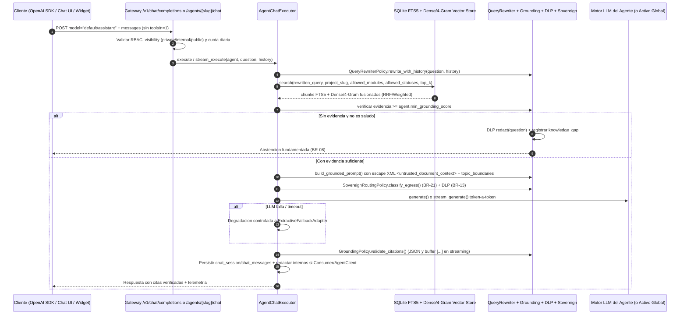
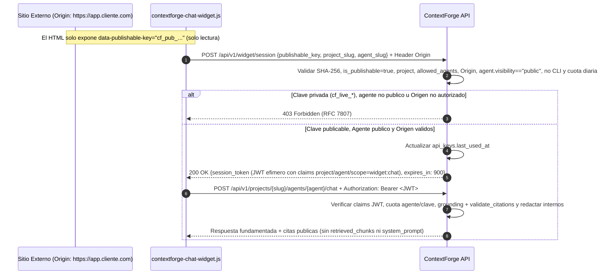

# ContextForge — Informe Técnico Integral y Contexto del Sistema (`Context.md`)

> **Versiones del ecosistema:**
> - **Componente reutilizable (`contextforge`, `pyproject.toml`):** `v1.0.0` (paquete Python independiente con `0` dependencias externas obligatorias).
> - **Plataforma Self-Hosted (`ContextForge Platform`, `src/`):** `v2.0.0` (servidor FastAPI, Web UI, Agent Studio, Gateway OpenAI-compatible `/v1/*`, Servidor MCP y Widget).
> - **Historial de entregas:** Consultar [CHANGELOG.md](CHANGELOG.md).
>
> **Regla editorial de este documento (verificada automáticamente en CI por `scripts/verify_context_drift.py`):** Las secciones **1 a 14** describen **exclusivamente el Estado Actual Verificado (AS-IS)** presente y ejecutable en el código fuente. Toda mejora aún NO implementada o deuda técnica vigente se separa estrictamente en la **Sección 15 (Deuda Técnica y Roadmap TO-BE)**.

---

## 1. Descripción General del Sistema (AS-IS)

**ContextForge** es una plataforma **self-hosted** (desplegable en máquina local o Docker bajo el modelo operativo de **Grafana** o **HashiCorp Vault**) diseñada para gestionar bases de conocimiento técnicas en Markdown (*Docs-as-Code*), configurar **Agentes IA especializados por proyecto**, conectarlos a **cualquier motor LLM** (Local HTTP, Cloud APIs o CLIs locales) y exponer ese conocimiento de forma verificable mediante cuatro canales:

1. **Paquete Python reutilizable (`src/contextforge/`, `v1.0.0`):** Biblioteca extensible con contratos OCP/DIP, `0` dependencias externas obligatorias, tipado `mypy --strict` y pruebas unitarias dedicadas.
2. **API REST v1 + Gateway OpenAI-Compatible (`/v1/chat/completions`, `/v1/models`):** Cualquier proyecto o SDK estándar (`openai` Python/Node, LangChain, Vercel AI SDK, Open WebUI, `curl`) puede consumir un agente específico pasando `model="<project_slug>/<agent_slug>"` con soporte JSON y streaming real SSE token-a-token (`stream: true`).
3. **Agentes IA, IDEs y Portales Externos:**
   - **Servidor Universal MCP** (`/mcp/sse` + STDIO `run_mcp.py`) con autenticación en modo `enterprise_rbac`.
   - **Widget Chatbot flotante embebible** (`contextforge-chat-widget.js`) con intercambio seguro de **clave publicable (`cf_pub_*`) restringida por origen y agente** hacia un JWT efímero (`POST /api/v1/widget/session`), botón de feedback *Útil / No útil* y vista previa interactiva en vivo desde Agent Studio.
   - **Context Bundler & Exportador de Reglas** (`CLAUDE.md`, `.cursorrules`, `AGENTS.md`, `.windsurfrules`).
4. **Interfaz Web (Modo Claro/Oscuro):** Explorador documental, **Editor Tri-Modal sincronizado** (`Markdown` ↔ `Visual WYSIWYG` ↔ `Bloques`), **Agent Studio** (`/agents`, con vista previa en vivo del widget y pruebas de evaluación), Chat IA con selector de agente (`/chat`), adjuntos multimodales con vista previa e indexación RAG automática, y consola Multi-LLM + RBAC + Auditoría (`/settings`).

---

## 2. Problemática que Resuelve

1. **Fragmentación documental:** Reglas de negocio, ADRs, especificaciones y archivos anexos dispersos que los agentes IA no pueden consultar de forma uniforme.
2. **Alucinaciones de LLMs:** Modelos sin contexto acotado, sin validación de citas ni umbrales de evidencia inventan endpoints, reglas o arquitectura inexistente.
3. **Ausencia de identidad y configuración por agente:** Compartir un único prompt y un único modelo global impide tener agentes especializados (ej. *Arquitecto Backend*, *Soporte Cliente*, *Auditor de Seguridad*) con su propio alcance de módulos, modelo LLM, visibilidad, cuota diaria y fronteras de tema.
4. **Acoplamiento a proveedores y riesgo de fuga de secretos/datos:** Dependencia de un solo proveedor cloud, envío inadvertido de datos privados a CLIs cloud en modo soberano o exposición de API keys administrativas en widgets de navegador.
5. **Falta de trazabilidad, control editorial y auditoría:** Ausencia de historial inmutable con `diff`/`rollback`, separación borrador/publicado (`published_version`), resolución de conflictos disco/BD, redacción DLP y bitácora protegida contra manipulación.

---

## 3. Objetivos

### 3.1 Objetivo General
Proveer un **Hub Soberano de Conocimiento y Agentes IA** junto con un **componente Python reutilizable (`contextforge`)** que centralice, versione, indexe y sirva documentación Markdown mediante recuperación híbrida persistente (SQLite FTS5 + embeddings semánticos densos / fallback 4-gramas), RAG fundamentado con citas validadas, agentes versionados configurables e integración multi-protocolo (REST v1, OpenAI `/v1/*`, SSE, WebSocket, MCP, Webhooks y Widget), garantizando extensibilidad, privacidad y trazabilidad.

### 3.2 Objetivos Específicos (AS-IS Verificado)
1. **Núcleo reutilizable desacoplado (`src/contextforge/`):** Contratos puros en `contracts.py`, facade `ContextForge`, builder `ContextForgeBuilder`, `0` dependencias externas, `mypy --strict` con `0` errores y cobertura >= 95% sobre `src/contextforge/`.
2. **Agentes IA como entidad de primera clase:** Tabla `agents` + historial inmutable `agent_versions` con `rollback`, plantillas listas, motor LLM/modelo por agente, filtros por módulo/etiqueta/estado, visibilidad (`private`/`internal`/`public`), cuota diaria, suite de evaluación continua (`agent_eval_cases`), inspector de chunks recuperados y consumo estándar vía `/v1/chat/completions`.
3. **RAG verificable con defensas contra alucinación e inyección:** Recuperación híbrida persistente (**SQLite FTS5 BM25** + **embeddings densos L2** con aislamiento por modelo/dimensión y fallback local 4-gramas), memoria multi-turno (`QueryRewriterPolicy`), indexación automática de adjuntos, citas validadas tanto en JSON como en streaming (`BR-08`), escape de delimitadores XML anti-prompt-injection (`<untrusted_document_context>`) y soberanía por destino de egreso (`BR-21`) + DLP (`BR-13`).
4. **Seguridad endurecida por defecto:** Allowlist positiva de binarios/flags por CLI en sandbox (`BR-17`), claves publicables de solo lectura + allowlist de `Origin` y agentes + JWT efímero para widgets (`BR-18`), webhooks HMAC-SHA256 con protección SSRF y timestamp anti-replay (`BR-22`), importación segura, autenticación MCP y `/metrics` en `enterprise_rbac`, triggers append-only en `audit_logs` (`SQLite` y `PostgreSQL`) y membresía RBAC por proyecto (`project_members`).
5. **Experiencia de autoría y despliegue self-hosted:** Editor tri-modal sin pérdidas (Markdown, Visual WYSIWYG en español y Bloques + Mermaid + adjuntos multimodales), vista previa interactiva en vivo del widget en `/agents` y despliegue inmediato vía `uvicorn` (`127.0.0.1` en local) o `docker-compose.yml` (`enterprise_rbac` en red).

---

## 4. Arquitectura del Sistema (AS-IS)

La plataforma aplica **Clean Architecture / Hexagonal (4 capas)**, **CQRS** (Commands, Queries, Validators, Mediator), **Screaming Architecture** en presentación web y una **regla estricta de 1 clase por archivo** (verificada automáticamente por auditoría AST).

```text
├── pyproject.toml                   # Paquete distribuible contextforge (v1.0.0)
├── alembic.ini                      # Configuración de migraciones de esquema Alembic
├── migrations/                      # Entorno Alembic (env.py + versiones)
├── scripts/
│   └── verify_context_drift.py      # Verificador CI anti-drift (ORM 25 tablas, rutas, BR, RBAC)
├── Dockerfile                       # Imagen multi-etapa non-root con HEALTHCHECK
├── docker-compose.yml               # Despliegue self-hosted (SQLite WAL default; perfiles postgres/ollama)
├── .env.example                     # Plantilla de secretos locales (BD, Storage y API Keys LLM)
├── run_mcp.py                       # Entrypoint STDIO para clientes MCP locales
├── examples/
│   └── agent_knowledge_cli.py       # App de ejemplo usando únicamente la API pública de contextforge
├── src/
│   ├── main.py                      # Entrypoint FastAPI: lifespan, /metrics RBAC, hidratación, routers, MCP
│   ├── contextforge/                # COMPONENTE REUTILIZABLE v1.0.0 (15 módulos, 0 deps obligatorias)
│   │   ├── __init__.py              # Frontera pública estricta (__all__)
│   │   ├── client.py                # Facade: ContextForge
│   │   ├── builder.py               # Builder fluido: ContextForgeBuilder
│   │   ├── contracts.py             # Puntos de extensión OCP/DIP
│   │   ├── models.py                # DTOs inmutables
│   │   ├── exceptions.py            # Jerarquía tipada de excepciones
│   │   └── _internal/               # Implementación privada encapsulada
│   ├── domain/                      # CAPA 1: Dominio puro (0 imports FastAPI/SQLAlchemy/Pydantic)
│   │   ├── common/                  # ErrorOr[T], DomainError, PageParams, PagedResult
│   │   ├── ports/                   # ISecretVault, IEventStore, IFileStorageService, IRealtimeNotifier
│   │   ├── projects/                # ProjectEntity, ProjectMemberEntity, TaxonomyItemEntity, WebhookEntity
│   │   ├── documents/               # DocumentAggregate, DocumentVersion, EditorialStateMachine
│   │   ├── agents/                  # AgentEntity, AgentVersionEntity, AgentEvalCaseEntity, AgentTemplateCatalog
│   │   ├── rag/                     # HybridFusionStrategy, GroundingPolicy, QueryRewriterPolicy, SovereignRoutingPolicy, IEmbeddingProviderPort
│   │   ├── bundles/                 # ContextBundleEntity, BundleBudgetPolicy
│   │   ├── collaboration/           # DiscussionThreadEntity, CommentEntity, RatingSummaryVO
│   │   └── users/                   # UserEntity, ApiKeyEntity, RbacPolicy, CliSecurityPolicy, DlpRedactionStrategy
│   ├── application/                 # CAPA 2: Casos de uso CQRS + AgentChatExecutor + Mediator
│   ├── infrastructure/              # CAPA 3: Adaptadores técnicos
│   │   ├── config/                  # AppSettings, SettingsFactory, EnvFileLoader (.env)
│   │   ├── options/                 # EnvironmentOptions, DatabaseOptions, AiOptions, StorageOptions
│   │   ├── persistence/             # SQLite WAL / PostgreSQL, 25 modelos ORM, triggers BD, Repositorios SQL
│   │   ├── integrations/            # Multi-LLM HTTP/CLI, ModelDiscovery, SqliteFts5, Dense/4-Gram Vector, Webhooks SSRF/HMAC, Chunker, GFM
│   │   ├── telemetry/               # PrometheusMetricsRegistry (/metrics)
│   │   ├── security/                # AES-256-GCM Vault, JWT, PBKDF2, FileValidator, RateLimiter
│   │   ├── resilience/              # CircuitBreaker, RetryWithBackoff
│   │   ├── realtime/                # WebSocket ConnectionManager
│   │   └── di/                      # DependencyContainer, DynamicPrimaryLlmProxy, register_handlers
│   └── presentation/                # CAPA 4: Interfaces externas
│       ├── api/v1/                  # REST v1 Routers, OpenAI /v1/* Gateway, Operations Router, WS Router, Schemas Pydantic
│       ├── mcp/                     # Servidor Universal MCP (SSE + STDIO)
│       └── web/                     # Screaming Web UI (docs, editor, chat, agents, bundles, projects, settings)
```

### Patrones de Diseño Aplicados (GoF, SOLID y GRASP)
- **Creacionales:** `Builder` (`ContextForgeBuilder`), `Factory Method` (`AIStrategyFactory`, `FileStorageFactory`, `SettingsFactory`).
- **Estructurales:** `Facade` (`ContextForge`), `Adapter` (`HttpMultiLlmAdapter`, `CliLlmAdapter`, `HttpDenseEmbeddingProvider`, `SqliteFts5LexicalIndex`, `SovereignVectorStoreAdapter`, repositorios SQL), `Proxy` (`DynamicPrimaryLlmProxy`), `Decorator` (`AuditedStoreDecorator`).
- **Comportamentales:** `Strategy` (chunkers, fusión RRF/Weighted, exportadores de bundles, políticas DLP), `State` (`EditorialStateMachine`), `Mediator` (`CqrsMediator`), `Chain of Responsibility` (`DocumentRuleChain`, validadores CQRS), `Observer` (`EventBus`, `WebhookDispatcher`, notificaciones WebSocket).

---

## 5. Catálogo Completo de Funcionalidades Actuales (AS-IS)

| Módulo | Rutas Web / API Canónicas | Funcionalidades Verificadas |
| :--- | :--- | :--- |
| **1. Proyectos, Membresía RBAC y Portabilidad** | `/projects`, `/api/v1/projects/*`, `/api/v1/projects/{slug}/members`, `/api/v1/projects/{slug}/export`, `/api/v1/projects/import` | Proyectos aislados por `slug`, selector global buscable, política **`sovereign_only`**, cuota de almacenamiento, sincronización 3-way desde disco (`last_synced_hash`, `in_conflict`, `deleted_on_disk`), taxonomía, membresía RBAC (`project_members`) y exportación/importación portable endurecida (agentes importados forzados a `private`). |
| **2. Explorador y Lector Documental** | `/docs/browser` *(alias legacy: `/`)*, `/docs/view/{path}`, `/api/v1/projects/{slug}/documents`, `/api/v1/documents/*` | Búsqueda con debounce, filtro por módulo, paginación SQL real. Lectura GFM completa (tablas, task lists, alertas `[!NOTE]`/`[!TIP]`/`[!WARNING]`/`[!CAUTION]`, diagramas **Mermaid**), TOC dinámico, historial inmutable con `diff`/`rollback`, ciclo editorial con separación `published_version` vs `current_version` (`draft-revision`), resolución 3-way (`sync-resolve`), calificación 1–5 estrellas, comentarios con borrado por autor/`Admin` y anexos con vista previa modal e indexación RAG. |
| **3. Editor Tri-Modal Sincronizado** | `/books/editor` *(alias legacy: `/docs/new`)* | 3 modos sobre Markdown canónico: **(1) Markdown + Preview**, **(2) Visual WYSIWYG** (estilos en español, selector de color `<input type="color">`, tablas GFM, insertar Mermaid, limpiar formato) y **(3) Bloques**. Preservación sin pérdidas de frontmatter YAML y Mermaid, botón global **Adjuntar**, vista previa multimodal (PDF, DOCX, XLSX/CSV, imágenes, texto), `Ctrl+S` y **Asistente IA de redacción**. |
| **4. Agent Studio, Evals y Live Widget Preview** | `/agents`, `/api/v1/agents/templates`, `/api/v1/projects/{slug}/agents/*` | Entidad `Agent` versionada por proyecto: plantillas listas, `system_prompt`, motor LLM/modelo propio, hiperparámetros, alcance por módulos/etiquetas/estados, `visibility` (`private`/`internal`/`public`), `daily_quota_requests`, `topic_boundaries`, historial `agent_versions` con `rollback`, **Playground con Retrieval Inspector**, suite de evaluación continua (`evals/run`) con cuota diaria y pestaña **Desplegar** con **vista previa interactiva en vivo del widget** (selector de color + chat real en la misma página). |
| **5. Gateway OpenAI-Compatible** | `GET /v1/models`, `POST /v1/chat/completions` | Expone los agentes activos permitidos al principal como `model="<project_slug>/<agent_slug>"`. Soporta JSON (`chat.completion`) y streaming real token-a-token SSE (`stream: true`, `chat.completion.chunk` + `[DONE]`) con guardia de citas en streaming, formato de error estándar OpenAI (`{"error": {...}}`), rechazo explícito HTTP 400 para `tools`/`n != 1`/`response_format` y límites de entrada. |
| **6. Chat IA RAG, Feedback y Knowledge Gaps** | `/chat` *(alias legacy: `/asistente-ia`)*, `/api/v1/rag/*`, `/api/v1/projects/{slug}/feedback`, `/api/v1/projects/{slug}/knowledge-gaps` | Chat conversacional SSE con memoria multi-turno (`QueryRewriterPolicy`), selector de Agente, citas validadas agrupadas por archivo, abstención controlada (`BR-08`) que registra automáticamente vacíos documentales (`knowledge_gaps` agrupados por tema con redacción DLP), votación *Útil / No útil* (`answer_feedback`), y drawer lateral **Preguntar a la IA** acotado a un documento (`/api/v1/rag/scoped`). |
| **7. Context Bundler y Reglas CLI** | `/bundles`, `/api/v1/bundles/*` | Selección por módulos con estimador visual de tokens, presets (Cursor, Copilot, Windsurf, Claude/Aider), compilación determinista con presupuesto máximo y SHA-256 (`markdown`, `cursorrules`, `json`, `xml`), historial paginado y exportación directa de `CLAUDE.md`, `.cursorrules`, `AGENTS.md` y `.windsurfrules`. |
| **8. Integración Externa, Webhooks, MCP, WS y Widget** | `/docs/integration-guide`, `/mcp/sse`, `WS /api/v1/ws/collaboration`, `/api/v1/projects/{slug}/webhooks` | Servidor MCP (SSE + STDIO) autenticado en `enterprise_rbac`. Colaboración WS (`ping`/`pong`, `editing_start`/`editing_stop`/`subscribe`). **Webhooks HMAC-SHA256** con protección SSRF y header `X-ContextForge-Timestamp`. **Widget embebible** (`contextforge-chat-widget.js`) con clave publicable (`cf_pub_*`) + JWT efímero (`POST /api/v1/widget/session`) + botones de feedback. Colección Postman v2.1. |
| **9. Multi-LLM, Seguridad, Auditoría y Métricas** | `/settings`, `/api/v1/settings/*`, `/api/v1/auth/*`, `/api/v1/audit-logs/*`, `GET /metrics` | 14 presets LLM, allowlist positiva por binario CLI (`BR-17`), descubrimiento en vivo de modelos (`agy models`, `/api/tags`, `/models`, Gemini/Anthropic), prueba real (`OK`), secretos AES-256-GCM o `.env`, emisión de claves `cf_live_*` y `cf_pub_*` (`allowed_origins`, `allowed_agents`, cuota diaria, `last_used_at`), gestión DLQ, verificación criptográfica `audit_logs` y exposición Prometheus `GET /metrics` protegida por RBAC. |

---

## 6. Requisitos Funcionales (RF — Estado Actual Verificado)

### Módulo Proyectos, Membresía y Portabilidad (`PRJ`)
- **RF-PRJ-001:** Crear, listar (búsqueda + paginación SQL), activar y administrar proyectos aislados por `slug` con política `sovereign_only`.
- **RF-PRJ-002:** Gestionar miembros RBAC por proyecto (`project_members`: `GET/POST/DELETE /api/v1/projects/{slug}/members`).
- **RF-PRJ-003:** Sincronizar archivos `.md` desde disco con detección 3-way (`last_synced_hash`, `in_conflict`, `deleted_on_disk`) bloqueando escapes de ruta y symlinks.
- **RF-PRJ-004:** Exportar e importar paquetes portables JSON de proyecto (`GET /api/v1/projects/{slug}/export`, `POST /api/v1/projects/import`) con validación estricta de rutas/límites y forzando `visibility="private"` en agentes importados.

### Módulo Documentos, Versionamiento y Autoría (`DOC`)
- **RF-DOC-001:** Crear, editar, leer, listar (filtros + paginación SQL) y eliminar documentos Markdown (`POST/GET/PUT/DELETE /api/v1/documents`, `GET /api/v1/projects/{slug}/documents`).
- **RF-DOC-002:** Mantener historial inmutable (`document_versions`) con `diff` unificado, `rollback`, concurrencia optimista `ETag` y separación `published_version` vs `current_version` (`POST /api/v1/documents/draft-revision`).
- **RF-DOC-003:** Gestionar máquina de estados editorial (`draft`, `in_review`, `published`, `deprecated`) y resolución explícita de conflictos disco/BD (`POST /api/v1/documents/sync-resolve`).
- **RF-DOC-004:** Soportar edición sincronizada en 3 modos (`Markdown`, `Visual WYSIWYG` y `Bloques`) preservando frontmatter YAML y diagramas Mermaid sin pérdida.
- **RF-DOC-005:** Cargar, listar, eliminar, previsualizar e indexar automáticamente en RAG archivos adjuntos (PDF, DOCX, XLSX, CSV, imágenes, texto/MD) con validación MIME + magic bytes.

### Módulo Agentes IA, Evaluaciones y Gateway OpenAI (`AGT`)
- **RF-AGT-001:** Crear, listar (paginado), consultar, actualizar y eliminar **Agentes IA** por proyecto (`agents`) con plantillas listas (`/api/v1/agents/templates`), `system_prompt`, motor LLM/modelo, hiperparámetros, alcance documental, `visibility`, `daily_quota_requests` y `topic_boundaries`.
- **RF-AGT-002:** Registrar instantánea inmutable en `agent_versions` en cada cambio y soportar `rollback` (`POST /api/v1/projects/{slug}/agents/{agent_slug}/rollback`).
- **RF-AGT-003:** Ejecutar consultas multi-turno sobre un agente (JSON y streaming token-a-token), validar citas en tiempo real y devolver `retrieved_chunks` solo a roles privilegiados (`Curator`/`Admin`).
- **RF-AGT-004:** Gestionar y ejecutar suites de evaluación continua por agente (`GET/POST/DELETE .../evals`, `POST .../evals/run`) verificando grounding, citas y subcadenas esperadas con cuota diaria.
- **RF-AGT-005:** Exponer los agentes autorizados vía **Gateway OpenAI-compatible** (`GET /v1/models` y `POST /v1/chat/completions` con `model="project/agent"`), contrato de error OpenAI y prueba en vivo del widget embebible desde `/agents`.

### Módulo Búsqueda Híbrida, RAG, Feedback y Gaps (`RAG`)
- **RF-RAG-001:** Indexar documentos publicados y `attachments.extracted_text` respetando encabezados Markdown (`HeadingAwareChunker`) y gestionando reintentos + cola **DLQ**.
- **RF-RAG-002:** Ejecutar búsqueda híbrida persistente combinando **SQLite FTS5 BM25** (`lexical_fts5.sqlite3`) + **embeddings semánticos densos L2** (`HttpDenseEmbeddingProvider` con aislamiento por modelo/dimensión y fallback local 4-gramas en `vector_store.sqlite3`) con fusión **RRF** o **Weighted** y reescritura multi-turno (`QueryRewriterPolicy`).
- **RF-RAG-003:** Responder en streaming SSE con citas validadas, escape XML anti-inyección, abstención fundamentada (`BR-08`), enrutamiento soberano por egreso (`BR-21`), DLP (`BR-13`) y degradación extractiva ante fallo LLM.
- **RF-RAG-004:** Registrar feedback `up`/`down` (`answer_feedback`) y vacíos documentales agrupados por tópico (`knowledge_gaps`, auto-capturados en abstención y con redacción DLP).

### Módulo Context Bundler, Colaboración, Webhooks e Integraciones (`BND`, `COL`, `INT`)
- **RF-BND-001:** Compilar y versionar *Context Bundles* deterministas con presupuesto máximo de tokens, SHA-256 y exportación a `CLAUDE.md`, `.cursorrules`, `AGENTS.md` y `.windsurfrules`.
- **RF-COL-001:** Gestionar hilos, comentarios paginados (con `author_id` y borrado restringido a autor/`Admin`), calificaciones 1–5 estrellas y presencia en `WS /api/v1/ws/collaboration`.
- **RF-INT-001:** Exponer Servidor MCP (SSE + STDIO) autenticado en `enterprise_rbac`, colección Postman v2.1, **Webhooks HMAC-SHA256** con protección SSRF + timestamp anti-replay, y Widget embebible seguro (`cf_pub_*` → JWT efímero).

### Módulo Seguridad, Multi-LLM, Auditoría y Observabilidad (`SEC`, `LLM`, `OBS`)
- **RF-LLM-001:** Configurar motores Local HTTP, Cloud API y Local CLI, descubrir modelos en vivo, validar conectividad con prompt real (`OK`) y cifrar secretos en AES-256-GCM o leerlos desde `.env`.
- **RF-SEC-001:** Gestionar autenticación JWT, emisión/revocación de API Keys `cf_live_*` y `cf_pub_*` (`allowed_origins`, `allowed_agents`, `daily_quota_requests`, `last_used_at`), RBAC por rol y proyecto, redacción DLP y verificación criptográfica `audit_logs` (`GET /api/v1/audit-logs/verify`).
- **RF-OBS-001:** Exponer métricas operativas en formato Prometheus v0.0.4 (`GET /metrics`), protegidas por permiso `READ_AUDIT_LOGS` (`Admin`) en `enterprise_rbac`.

---

## 7. Requisitos No Funcionales (RNF — Medidos vs Diseño)

| Categoría | Código | Requisito y Estado Actual Verificado |
| :--- | :--- | :--- |
| **Calidad del Componente** | **RNF-01** | **Alcance honesto de métricas:** La biblioteca reutilizable `src/contextforge/` (`15` módulos) mantiene `0` dependencias externas obligatorias, **`mypy --strict` con `0` errores** y **>= 95% de cobertura unitaria** (`96%` medida). La plataforma completa (`src/`, `490+` archivos Python) se valida con la suite `pytest` (`tests/unit/`, seguridad, integración y verificador anti-drift `scripts/verify_context_drift.py`). |
| **Mantenibilidad (AST)** | **RNF-02** | **1 clase por archivo** en `src/domain`, `src/application`, `src/infrastructure` y `src/presentation`, `0` clases en `__init__.py` y `0` imports de FastAPI/SQLAlchemy/Pydantic en `domain` y `application`. |
| **Seguridad en Ejecución** | **RNF-03** | Allowlist positiva por binario CLI + sandbox en directorio temporal (`CliSecurityPolicy`), secretos LLM en AES-256-GCM (PBKDF2-SHA256 600k iteraciones), API keys SHA-256, validación MIME + magic bytes, rate limiting + cuotas diarias, escape de delimitadores XML anti-prompt-injection, validación SSRF + timestamp HMAC en webhooks y autenticación MCP/`/metrics` en `enterprise_rbac`. |
| **Integridad de Auditoría** | **RNF-04** | Tabla `audit_logs` encadenada con SHA-256 (`prev_hash` → `entry_hash`), protegida en **SQLite** (`BEFORE UPDATE`/`BEFORE DELETE` `RAISE(ABORT, ...)`) y **PostgreSQL** (`cf_prevent_audit_log_mutation()`) y verificable vía `GET /api/v1/audit-logs/verify`. |
| **Resiliencia y Arranque** | **RNF-05** | SQLite en modo **WAL** con `busy_timeout`, `CircuitBreaker`, reintentos con backoff exponencial, cola **DLQ**, degradación extractiva ante fallo LLM, índices persistentes en disco (`lexical_fts5.sqlite3` y `vector_store.sqlite3`) e hidratación en arranque (`lifespan`). |
| **Escalabilidad y Paginación** | **RNF-06** | Paginación SQL real (`LIMIT`/`OFFSET` + `COUNT(*)`) en todos los listados (documentos, proyectos, agentes, bundles, API keys, jobs, hilos y auditoría). |
| **Soberanía y Operación Offline** | **RNF-07** | Operación 100% offline/air-gapped **cuando se emplean exclusivamente motores con egreso `local` (`BR-21`)**: SQLite WAL + almacenamiento local + SQLite FTS5 + embeddings 4-gramas o `Ollama` en loopback + LLM `Ollama`/loopback o `extractive_fallback` (los CLIs respaldados por la nube como `agy`/`claude`/`gemini`/`codex` tienen egreso `cloud` y requieren conectividad; quedan bloqueados si `project.sovereign_only = true`). Despliegue Docker non-root con `HEALTHCHECK`. |
| **Estándares UI y Contratos API** | **RNF-08** | Política estricta de **0 emojis Unicode** en `src/` (solo iconos vectoriales FontAwesome/SVG), Modo Claro/Oscuro nativo, errores en **RFC 7807** (`application/problem+json`) en `/api/v1/*` y formato estándar **OpenAI `{"error": {...}}`** en `/v1/*`. |

---

## 8. Reglas de Negocio (Invariantes `BR-01` a `BR-24`)

| Código | Nombre | Regla Verificada en el Sistema |
| :--- | :--- | :--- |
| **BR-01** | Identidad y Seguridad de Rutas | Toda ruta de documento debe ser relativa, normalizada en formato POSIX y sin segmentos `..` ni escape de directorio (`safe_join`). |
| **BR-02** | Inmutabilidad de Versiones | Cada creación, actualización o `rollback` de un documento genera un registro inmutable en `document_versions` con `content_hash` SHA-256 y `version_number` monotónico. |
| **BR-03** | Concurrencia Optimista (ETag) | Toda actualización de documento que envíe `If-Match` / `expected_etag` distinto al `etag` vigente es rechazada con `409 Conflict` (`etag_mismatch`). |
| **BR-04** | Máquina de Estados Editorial y `published_version` | Transiciones válidas: `draft ↔ in_review → published → deprecated` y `published → draft/in_review`. Al crear una revisión borrador de un documento publicado (`POST /api/v1/documents/draft-revision`), `current_version` avanza en estado `draft` mientras `published_version` y el índice RAG en vivo permanecen apuntando a la última versión publicada hasta nueva publicación. |
| **BR-05** | Visibilidad RAG Editorial | Los documentos en `draft` o `in_review` quedan excluidos de búsquedas RAG públicas y agentes por defecto (`allowed_statuses=("published",)`), salvo configuración explícita en agentes internos/privados autorizados. |
| **BR-06** | Chunking Consciente de Encabezados | La fragmentación respeta encabezados `#`–`####`, conserva `header_hierarchy`, descarta bloques de solo título sin cuerpo y corta de forma limpia (`max_chars=1800`). |
| **BR-07** | Determinismo del Context Bundler | La compilación de bundles aplica presupuesto estricto de tokens, prioriza documentos `published` sobre `deprecated` y firma el resultado con SHA-256. |
| **BR-08** | Grounding, Citas Validadas (JSON + Streaming), Escape XML y Abstención | Ninguna respuesta RAG o de Agente inventa hechos ni citas sin respaldo. Si ningún fragmento supera `min_grounding_score` (y no es saludo), responde con **Abstención fundamentada** y registra un `knowledge_gap`. `GroundingPolicy.build_grounded_prompt()` escapa etiquetas `<untrusted_document_context>`/`<context_chunk>` dentro de los chunks, y `GroundingPolicy.validate_citations()` reemplaza rutas `[fake.md]` inventadas por `[cita no verificada]` tanto en respuestas JSON como en tiempo real durante `stream_execute()`. |
| **BR-09** | Resiliencia de Indexación (DLQ) | Los fallos al indexar reintentan con backoff exponencial; al agotar intentos, el trabajo pasa a `dead_letter` sin corromper la escritura del documento. |
| **BR-10** | Aislamiento Multi-Proyecto y Membresía | Cada consulta, agente, bundle, índice y documento está acotado al `project_slug`. En `AUTH_MODE=enterprise_rbac`, el acceso se valida por `allowed_projects`, `allowed_agents` y membresía en `project_members`. |
| **BR-11** | Seguridad de Adjuntos e Indexación RAG | Todo archivo adjunto se valida por extensión, MIME declarado, firma binaria (*magic bytes*) y cuota de tamaño; su texto extraído (`extracted_text`) se indexa automáticamente en FTS5 y Vector Store con cita `{doc_path}#{file_name}`. |
| **BR-12** | Control de Acceso RBAC, Precedencia de Roles y Modos de Arranque | Roles canónicos (`UserRole`): `Admin`, `Owner`, `Curator`, `Consumer` y `AgentClient`. `AUTH_MODE=local` (uso exclusivo en `127.0.0.1`; `CONTEXTFORGE_STRICT_BIND_CHECK=true` por defecto rechaza `0.0.0.0`/`::`) opera como `local-admin`; `AUTH_MODE=enterprise_rbac` (default en `docker-compose.yml`) exige JWT (Bearer o cookie HttpOnly `cf_access_token`) o `X-API-Key` en Web UI (`/login`), REST, `/v1/*`, `/metrics` y MCP. `TRUSTED_PROXIES` controla la confianza de `X-Forwarded-For` para rate limiting tras proxy inverso. **Precedencia de rol:** el rol global `Admin` tiene acceso administrativo global; para usuarios no-Admin, el rol asignado en `project_members(user_id, project_slug)` **prevalece** dentro de ese proyecto. |
| **BR-13** | Redacción DLP en Todo Egreso Cloud y Telemetría de Usuario | `DlpRedactionStrategy` anonimiza secretos/PII antes de enviar contexto a **cualquier motor LLM o proveedor de embeddings con egreso `cloud`** (incluyendo CLIs cloud — `BR-21`), así como antes de persistir texto libre de usuarios en `answer_feedback` y `knowledge_gaps`. |
| **BR-14** | Auditoría Append-Only (SQLite y PostgreSQL) | `audit_logs` encadena cada registro con SHA-256 (`prev_hash` → `entry_hash`) y bloquea `UPDATE`/`DELETE` en BD mediante triggers en **SQLite** y **PostgreSQL**, verificable vía `GET /api/v1/audit-logs/verify`. |
| **BR-15** | Gestión Segura de Secretos Multi-LLM | Las API keys guardadas en UI se cifran en reposo con AES-256-GCM y nunca se retornan en texto plano; las claves definidas en `.env` se inyectan solo en memoria. |
| **BR-16** | Validación Real de Proveedores LLM | Probar un proveedor LLM envía un prompt real (`OK`) al modelo seleccionado y reporta latencia y salida literal; en `agy` CLI se omite `--effort` al especificar un `--model` explícito. Si falla el motor principal, el chat degrada al motor extractivo. |
| **BR-17** | Allowlist Positiva por Binario y Sandbox CLI | `CliSecurityPolicy` aplica una **lista positiva de binarios (`ALLOWED_BINARIES`) y de flags/subcomandos permitidos por binario (`ALLOWED_FLAGS_BY_BINARY`, `ALLOWED_SUBCOMMANDS_BY_BINARY`)**, bloqueando cualquier flag no listado, rutas, `..` y metacaracteres. `CliLlmAdapter` ejecuta cada CLI en un directorio temporal vacío (`TemporaryDirectory`), sin secretos del servidor en `env`, con `--tools ""`/`--max-turns 1` en Claude y `--sandbox read-only` en Codex. Los motores `local_cli` están **prohibidos en agentes `public`**. |
| **BR-18** | Seguridad MCP, Visibilidad de Agentes, Widget y Cuotas | En `enterprise_rbac`, `/mcp/*` (excepto `/mcp/info`) exige `X-API-Key` o Bearer JWT. Cada agente declara `visibility` (`private`/`internal`/`public`) y `daily_quota_requests`. Las claves `cf_pub_*` se ligan a proyectos, `allowed_origins`, **`allowed_agents`** y cuota diaria; `POST /api/v1/widget/session` solo acepta agentes `public` (sin CLI ni borradores) y emite un JWT efímero con claims `project`, `agent`, `scope="widget:chat"` y `key_id`. `Consumer`/`AgentClient` nunca reciben `system_prompt`, `topic_boundaries` ni `retrieved_chunks`/extractos crudos. |
| **BR-19** | Agentes Versionados y Aislados | Cada agente (`agents`, índice único `(project_slug, slug)`) pertenece a un proyecto, posee configuración propia (tope `max_tokens <= 4096` en `public`, visibilidad, cuota diaria, alcance documental y `topic_boundaries`) y genera una instantánea inmutable en `agent_versions` por cada cambio con `rollback`. |
| **BR-20** | Fuente de Verdad Dual Disco/BD con Detección de Conflicto 3-Way | En operaciones Web/API la BD es la fuente transaccional con ETag (`BR-03`). Cada documento almacena `last_synced_hash` y `sync_status` (`synced`/`in_conflict`/`deleted_on_disk`). Si BD y disco divergen simultáneamente, el documento pasa a `in_conflict` sin sobrescribir ninguno; si desaparece en disco, pasa a `deleted_on_disk`. Resolución explícita vía `POST /api/v1/documents/sync-resolve`. |
| **BR-21** | Soberanía por Destino de Egreso (`local` vs `cloud`), `egress_class` y Embeddings | Cada motor LLM persiste explícitamente `egress_class` (`local` \| `cloud`) y `SovereignRoutingPolicy.classify_egress()` clasifica tanto LLMs como proveedores de embeddings por su **destino real de egreso**: únicamente `extractive_fallback`, `local_http` en loopback (`localhost`/`127.0.0.1`/`::1`/`host.docker.internal`) y `ollama` son `local`. Todos los CLIs cloud (`agy`, `claude`, `gemini`, `codex`, `opencode`, `aider`) y APIs remotas son `cloud`, quedan bloqueados cuando `project.sovereign_only = true` y reciben DLP obligatorio (`BR-13`). Además, `vector_store.sqlite3` almacena `embedding_model` y `embedding_dim` para jamás comparar vectores densos incompatibles, y `GET /api/v1/settings/embeddings/status` avisa si un cambio de modelo requiere reindexar (`POST /api/v1/settings/embeddings/reindex`). |
| **BR-22** | Webhooks HTTPS/SSRF/Anti-Replay/Cifrado, Importación Segura en `draft`, Cuotas Eval y `/metrics` | `WebhookDispatcher.is_valid_url()` exige **exclusivamente `https://`**, realiza resolución DNS validando cada IP resuelta contra todos los rangos prohibidos (`0.0.0.0/8`, `10.0.0.0/8`, `100.64.0.0/10`, `127.0.0.0/8`, `169.254.0.0/16`, `172.16.0.0/12`, `192.168.0.0/16`, `fc00::/7`, `fe80::/10`, `::1`, IPv4 mapeado en IPv6, `localhost`, `.internal`), deshabilita redirects (`follow_redirects=False`), cifra el secreto en reposo en `webhooks.secret_encrypted` (AES-256-GCM) y firma `"{timestamp}." + raw_body` incluyendo `X-ContextForge-Timestamp`. `GET /api/v1/projects/{slug}/export` excluye webhooks, claves API y secretos; `POST /api/v1/projects/import` impone límites (`<= 500` docs, `<= 50` agentes, `<= 25 MB`), bloquea path traversal, crea **todos los documentos importados en estado `draft`** y fuerza `visibility="private"` en agentes importados. `POST .../evals/run` aplica cuota diaria y `GET /metrics` exige `READ_AUDIT_LOGS` (`Admin`) en `enterprise_rbac`. |
| **BR-23** | Modo Equipo, Bootstrap Seguro del Primer Admin y Protección del Último `Owner` | El rol de proyecto **`Owner`** administra documentos, agentes, miembros y gobierno del proyecto sin privilegios globales de infraestructura (`/settings`, `/metrics`, auditoría). Queda prohibido eliminar o degradar al **último `Owner`** de un proyecto (`409 Conflict` `last_owner_protected`). En `enterprise_rbac`/`prod`, el primer `Admin` se crea usando `CONTEXTFORGE_BOOTSTRAP_ADMIN_PASSWORD` o generando una contraseña aleatoria de un solo uso con `must_change_password=true`, bloqueando el resto de la API y UI hasta completar `/change-password` (`POST /api/v1/auth/change-password`). |
| **BR-24** | Ciclo de Conocimiento Vivo: Vacíos Documentales, Stewards y Frescura | Todo documento publicado puede declarar un responsable (`steward_user_id`), intervalo de revisión (`review_interval_days`, default `90`) y fecha verificada (`last_reviewed_at`), calculando su frescura (`fresh` / `expiring_soon` / `expired`). Los vacíos documentales (`knowledge_gaps`) soportan asignación (`assigned_to`), descarte justificado (`ignored_reason`), acciones masivas, generación de borrador (`## Debe responder` en `/books/editor?from_gap=`) y **resolución automática** al publicar un documento que cubra su tópico (`resolved_by_doc_path`). El tablero `/knowledge-health` (`GET /api/v1/projects/{slug}/knowledge-health`) consolida vacíos abiertos, documentos vencidos, ratio Útil/No útil, tasa de abstención, conflictos y borradores pendientes; el Chat muestra fecha de revisión en citas, `"Reportar vacío"` y `"Preguntar al responsable"`. |

### 8.1 Matriz de Permisos (Roles Globales y Alcance por Proyecto / Token)

| Acción / Capacidad | `Admin` | `Owner` (Proyecto) | `Curator` | `Consumer` | `AgentClient` (API Key / Widget JWT) |
| :--- | :---: | :---: | :---: | :---: | :---: |
| Leer documentos publicados y buscar RAG | Sí | Sí | Sí | Sí | Sí (acotado a `allowed_projects`) |
| Leer borradores (`draft` / `in_review`) | Sí | Sí | Sí | No | No |
| Crear/editar documentos, versiones y `rollback` | Sí | Sí | Sí | No | No |
| Cambiar estado editorial / publicar / `draft-revision` / `sync-resolve` | Sí | Sí | Sí | No | No |
| Ver configuración interna de agente (`system_prompt`, `topic_boundaries`, `retrieved_chunks`) | Sí | Sí | Sí | No (redactado) | No (redactado) |
| Crear, editar, evaluar (`evals/run`) o hacer `rollback` de agentes | Sí | Sí | Sí | No | No |
| Invocar agentes `private` | Sí | Sí | Sí | No | No |
| Invocar agentes `internal` | Sí | Sí | Sí | Sí | Solo con API Key privada autorizada (bloqueado en `widget:chat`) |
| Invocar agentes `public` (`/chat`, `/v1/chat/completions`, Widget) | Sí | Sí | Sí | Sí | Sí (sujeto a `allowed_agents`, `Origin` y cuota diaria) |
| Gestionar webhooks, exportar proyecto y resolver `knowledge_gaps` | Sí | Sí | Sí | No | No |
| Gestionar miembros y roles del proyecto (`project_members`, `BR-23`) | Sí | Sí | No | No | No |
| Gestionar usuarios del equipo, motores LLM, claves API, DLQ, auditoría y `GET /metrics` | Sí | No | No | No | No |

> **Nota sobre `AUTH_MODE` y exposición en red:** `AUTH_MODE=local` está pensado exclusivamente para `127.0.0.1` en máquina local. Si se enlaza a `0.0.0.0` con `AUTH_MODE=local`, el arranque emite una advertencia de seguridad (y aborta si `CONTEXTFORGE_STRICT_BIND_CHECK=true`). En red o Docker de equipo usar siempre `AUTH_MODE=enterprise_rbac`.

### 8.2 Comportamiento Actual del Gateway OpenAI (`/v1/*`)
- `GET /v1/models`: lista exclusivamente los agentes activos que el principal tiene permiso de invocar (filtrando por proyecto, visibilidad y `allowed_agents`).
- `POST /v1/chat/completions`:
  - Extrae historial multi-turno `(user/assistant)` **descartando cualquier mensaje `role="system"` externo**, aplica `QueryRewriterPolicy.rewrite_with_history()` y formatea `<conversation_history>`.
  - Rechaza con **HTTP `400`** y contrato OpenAI `{"error": {"message", "type", "param", "code"}}` parámetros no soportados (`tools`, `tool_choice`, `n != 1`, `response_format`) o excesos de entrada (`> 50` mensajes o `> 32,000` caracteres).
  - Con `stream: true`, emite streaming real token-a-token desde `HttpMultiLlmAdapter.stream_generate()` aplicando validación de citas `[...]` en vivo (`BR-08`). `usage` reporta conteo estimado de tokens por palabras.

---

## 9. Diagrama de Clases (Núcleo, Dominio, Agentes, RAG y Seguridad)

```mermaid
classDiagram
    direction TB

    class ContextForgeBuilder {
        +with_storage(store) ContextForgeBuilder
        +with_chunker(chunker) ContextForgeBuilder
        +with_ranking(ranking) ContextForgeBuilder
        +with_llm(llm) ContextForgeBuilder
        +with_audit_sink(sink) ContextForgeBuilder
        +build() ContextForge
    }

    class ContextForge {
        +publish(path, title, markdown) DocumentRecord
        +search(query, top_k) SearchResult[]
        +ask(question, top_k) GroundedAnswer
        +compile_bundle(paths, budget) ContextBundle
    }

    class ProjectEntity {
        +str slug
        +str owner_id
        +str name
        +bool sovereign_only
        +int max_quota_mb
    }

    class ProjectMemberEntity {
        +str member_id
        +str project_slug
        +str user_id
        +str role
    }

    class DocumentAggregate {
        +str id
        +str project_slug
        +str path
        +str title
        +EditorialStatus status
        +int current_version
        +int published_version
        +str last_synced_hash
        +str sync_status
        +str etag
        +update_content(md, expected_etag) ErrorOr
        +transition_to(new_status) ErrorOr
    }

    class AgentEntity {
        +str agent_id
        +str project_slug
        +str slug
        +str name
        +str system_prompt
        +str llm_provider
        +str llm_model
        +str visibility
        +int daily_quota_requests
        +float temperature
        +int max_tokens
        +int top_k
        +float min_grounding_score
        +tuple allowed_modules
        +tuple allowed_statuses
        +str topic_boundaries
        +int current_version
        +openai_model_id() str
        +to_config_snapshot() dict
    }

    class AgentVersionEntity {
        +str version_id
        +str agent_id
        +int version_number
        +str config_json
        +str author_id
        +str change_summary
    }

    class AgentChatExecutor {
        +execute(agent, question, mode, ranking, conversation_history) dict
        +stream_execute(agent, question, mode, ranking, conversation_history) AsyncIterator
    }

    class QueryRewriterPolicy {
        +rewrite_with_history(question, history) str
        +format_conversation_history(history) str
    }

    class GroundingPolicy {
        +has_sufficient_evidence(hits, min_score) bool
        +validate_citations(answer, hits) tuple
        +build_grounded_prompt(question, hits) str
    }

    class SovereignRoutingPolicy {
        +classify_egress(engine_type, base_url, provider_name) str
        +requires_dlp(dlp_enabled, engine_type, base_url, provider_name) bool
        +check_provider_allowed(project_sovereign_only, engine_type, base_url, provider_name) ErrorOr
    }

    class IEmbeddingProviderPort {
        <<interface>>
        +provider_name str
        +model_name str
        +embed_texts(texts) list
    }

    class CliSecurityPolicy {
        +ALLOWED_BINARIES frozenset
        +ALLOWED_FLAGS_BY_BINARY dict
        +ALLOWED_SUBCOMMANDS_BY_BINARY dict
        +validate(command, args) ErrorOr
    }

    class ApiKeyEntity {
        +str key_id
        +str key_prefix
        +UserRole role_scope
        +bool is_publishable
        +tuple allowed_origins
        +tuple allowed_agents
        +int daily_quota_requests
        +is_origin_allowed(origin) bool
        +is_agent_allowed(project_slug, agent_slug) bool
    }

    ContextForgeBuilder --> ContextForge : builds
    ProjectEntity "1" *-- "0..*" ProjectMemberEntity : members
    ProjectEntity "1" *-- "0..*" DocumentAggregate : owns
    ProjectEntity "1" *-- "0..*" AgentEntity : configures
    AgentEntity "1" *-- "1..*" AgentVersionEntity : versions
    AgentChatExecutor ..> AgentEntity : executes
    AgentChatExecutor ..> QueryRewriterPolicy : rewrites
    AgentChatExecutor ..> GroundingPolicy : validates
    AgentChatExecutor ..> SovereignRoutingPolicy : checks_egress
```



---

## 10. Modelo Entidad-Relación (ER — 25 Tablas Reales SQLAlchemy)

Todas las tablas y columnas reflejadas abajo corresponden 1:1 con `Base.metadata.tables` en `src/infrastructure/persistence/models/` (verificado automáticamente en CI por `scripts/verify_context_drift.py`).

```mermaid
erDiagram
    projects {
        string slug PK
        string owner_id
        string name
        string description
        string path
        boolean sovereign_only
        int max_quota_mb
        boolean is_active
        datetime created_at
        datetime updated_at
    }

    project_members {
        string member_id PK
        string project_slug FK
        string user_id FK
        string role
        datetime created_at
    }

    taxonomy_items {
        string id PK
        string project_slug FK
        string kind
        string slug
        string name
        string description
        string color
        string icon
        datetime created_at
    }

    books {
        string id PK
        string library_slug FK "Nombre historico equivalente a project_slug"
        string module_name
        string slug
        string title
        string path
        string author
        string tags_csv
        string summary
        text content_markdown
        string status
        boolean is_locked
        int current_version
        int published_version
        string content_hash
        string last_synced_hash
        string sync_status
        string steward_user_id
        int review_interval_days
        datetime last_reviewed_at
        datetime created_at
        datetime updated_at
    }

    document_versions {
        string version_id PK
        string book_id FK
        int version_number
        text content_markdown
        string content_hash
        string author_id
        string status_snapshot
        string change_summary
        datetime created_at
    }

    agents {
        string agent_id PK
        string project_slug FK
        string slug
        string name
        string description
        text system_prompt
        string llm_provider
        string llm_model
        float temperature
        int max_tokens
        int top_k
        float min_grounding_score
        text allowed_modules_json
        text allowed_tags_json
        text allowed_statuses_json
        text welcome_message
        text suggested_questions_json
        text topic_boundaries
        string visibility
        int daily_quota_requests
        int current_version
        boolean is_active
        datetime created_at
        datetime updated_at
    }

    agent_versions {
        string version_id PK
        string agent_id FK
        int version_number
        text config_json
        string author_id
        string change_summary
        datetime created_at
    }

    agent_eval_cases {
        string case_id PK
        string agent_id FK
        string project_slug
        text question
        string expected_citation_path
        string expected_substring
        datetime created_at
    }

    attachments {
        string id PK
        string book_id FK
        string project_slug
        string file_name
        string storage_key
        string mime_type
        int size_bytes
        string sha256_checksum
        text extracted_text
        datetime uploaded_at
    }

    discussion_threads {
        string id PK
        string book_id FK
        string project_slug
        string title
        string section_anchor
        boolean resolved
        datetime created_at
        datetime updated_at
    }

    document_comments {
        string id PK
        string thread_id FK
        string book_id FK
        string project_slug
        string author_id
        string author_name
        string author_email
        string section_anchor
        text content
        datetime created_at
    }

    ratings {
        string id PK
        string book_id FK
        string project_slug
        string user_identifier
        int score
        datetime updated_at
    }

    context_bundles {
        string bundle_id PK
        string project_slug FK
        string name
        string export_format
        text content
        int max_tokens
        int estimated_tokens
        string bundle_hash
        text manifest_json
        string created_by
        datetime created_at
    }

    indexing_jobs {
        string job_id PK
        string book_id FK
        string project_slug
        string path
        string content_hash
        string status
        int attempts
        int chunks_indexed
        text error_detail
        datetime updated_at
    }

    chat_sessions {
        string session_id PK
        string project_slug
        string book_id
        string user_id
        string agent_id FK
        int agent_version
        datetime created_at
    }

    chat_messages {
        string id PK
        string session_id FK
        string role
        text content
        text sources_json
        float latency_ms
        string model_name
        int tokens_used
        text retrieved_chunk_ids_json
        datetime created_at
    }

    answer_feedback {
        string feedback_id PK
        string project_slug FK
        string agent_slug
        text question
        text answer_excerpt
        string vote
        text reason
        string user_id
        datetime created_at
    }

    knowledge_gaps {
        string gap_id PK
        string project_slug FK
        string agent_slug
        text question
        string topic_cluster
        int occurrences
        string status
        string assigned_to
        text ignored_reason
        string resolved_by_doc_path
        string suggested_module
        datetime last_asked_at
    }

    webhooks {
        string webhook_id PK
        string project_slug FK
        string url
        string events_csv
        string secret
        text secret_encrypted
        boolean is_active
        datetime created_at
    }

    users {
        string user_id PK
        string email UK
        string full_name
        string password_hash
        string global_role
        boolean is_active
        boolean must_change_password
        datetime created_at
    }

    api_keys {
        string key_id PK
        string user_id FK
        string name
        string key_prefix
        string key_sha256 UK
        string role_scope
        string allowed_projects_csv
        boolean is_publishable
        text allowed_origins_csv
        text allowed_agents_csv
        int daily_quota_requests
        datetime last_used_at
        datetime expires_at
        datetime revoked_at
        datetime created_at
    }

    llm_configurations {
        string provider PK
        string engine_type
        string name
        string base_url
        text api_key_encrypted
        string default_model
        string cli_command
        string cli_args
        float temperature
        int max_tokens
        string egress_class
        boolean is_active
        datetime updated_at
    }

    settings {
        int id PK
        string active_llm_model
        string ollama_url
        string docs_path
        string embedding_model
        float temperature
        float min_grounding_score
        boolean enable_dlp_redaction
        boolean enable_extractive_fallback
        datetime updated_at
    }

    audit_logs {
        int seq PK
        string log_id UK
        string actor_id
        string role
        string project_slug
        string operation
        string resource_id
        boolean succeeded
        float latency_ms
        string prev_hash
        string entry_hash
        string client_ip
        string error_code
        datetime created_at
    }

    cf_sequences {
        string scope_key PK
        int current_value
        datetime updated_at
    }

    projects ||--o{ project_members : "asigna"
    users ||--o{ project_members : "pertenece"
    users ||--o{ api_keys : "emite"
    projects ||--o{ taxonomy_items : "define"
    projects ||--o{ books : "contiene"
    projects ||--o{ agents : "configura"
    projects ||--o{ context_bundles : "compila"
    projects ||--o{ answer_feedback : "recibe"
    projects ||--o{ knowledge_gaps : "registra"
    projects ||--o{ webhooks : "suscribe"
    agents ||--o{ agent_versions : "versiona"
    agents ||--o{ agent_eval_cases : "evalua"
    agents ||--o{ chat_sessions : "atiende"
    books ||--o{ document_versions : "versiona"
    books ||--o{ attachments : "adjunta"
    books ||--o{ discussion_threads : "abre"
    books ||--o{ ratings : "recibe"
    books ||--o{ indexing_jobs : "indexa"
    discussion_threads ||--o{ document_comments : "agrupa"
    chat_sessions ||--o{ chat_messages : "almacena"
```



---

## 11. Cómo Funciona la Base de Conocimiento y el Motor de IA (AS-IS)

### 11.1 Ingesta, Índices Persistentes y Recuperación Híbrida (AS-IS Verificado)
1. **Fragmentación (`HeadingAwareChunker`):** Divide cada documento Markdown en chunks de hasta `1800` caracteres respetando encabezados `#`–`####`, conservando `header_hierarchy` y descartando encabezados vacíos sin cuerpo.
2. **Doble índice persistente en SQLite + Embeddings Densos Opcionales con Aislamiento de Modelo:**
   - **Índice Léxico Persistente (`SqliteFts5LexicalIndex`):** Tabla virtual **SQLite FTS5** (`chunks_fts` con tokenizador `unicode61 remove_diacritics 2` + `chunks_meta`) persistida en `<chroma_persist_dir>/lexical_fts5.sqlite3` con ranking nativo `bm25(chunks_fts)`, aislamiento por `project_slug` y filtro editorial `BR-04`/`BR-05`.
   - **Índice Vectorial Híbrido Persistente (`SovereignVectorStoreAdapter` + `IEmbeddingProviderPort`):** Persistido en `<chroma_persist_dir>/vector_store.sqlite3` junto con `embedding_model` y `embedding_dim` por chunk. Cuando se configura `HttpDenseEmbeddingProvider` (Ollama `/api/embed` o OpenAI-compatible `/v1/embeddings`), valida `SovereignRoutingPolicy` (`BR-21`) y redacta PII/secretos vía DLP (`BR-13`) en egreso cloud, almacena vectores L2 (`source_type="dense_vector"`) y **jamás compara vectores de modelos o dimensiones distintas**. Si no hay proveedor de embeddings o `sovereign_only` bloquea egreso cloud, degrada automáticamente a similitud coseno local de tokens + 4-gramas (`source_type="vector"`).
   - **Indexación RAG Automática de Adjuntos (`attachments.extracted_text`):** Al subir un adjunto vía `UploadAttachmentCommandHandler`, su texto extraído se fragmenta e indexa automáticamente en FTS5 y Vector Store con cita `{doc_path}#{file_name}`.
3. **Fusión Híbrida (`HybridFusionStrategy`) y Multi-Turno (`QueryRewriterPolicy`):** Combina ambos rankings mediante **RRF** o **Weighted Sum**, reescribiendo preguntas de seguimiento a partir del historial multi-turno `(user/assistant)` (ignorando `role="system"` externos) y filtrando por `project_slug`, `allowed_modules`, `allowed_tags` y `allowed_statuses`.

### 11.2 Flujo de Ejecución de un Agente IA (`AgentChatExecutor`)



### 11.3 Motor Multi-LLM, Seguridad CLI y Descubrimiento en Vivo
- **Local HTTP (`local_http`):** Ollama, LM Studio, OpenAI-Compatible Local (`/api/tags` y `/models` para listar modelos reales; egreso `local` solo en loopback).
- **Cloud APIs (`cloud_api`):** OpenAI, Google Gemini, Anthropic Claude, OpenRouter y DeepSeek (secretos en `.env` o cifrados AES-256-GCM en BD; egreso `cloud`).
- **CLIs Locales (`local_cli`):** Antigravity CLI (`agy`), Claude Code, Gemini CLI, Codex, OpenCode y Aider (egreso `cloud`, salvo binario `ollama` que es `local`).
  - **Seguridad (`BR-17`):** Antes de guardar, probar o ejecutar cualquier CLI, `CliSecurityPolicy.validate()` exige una **allowlist positiva de binarios (`ALLOWED_BINARIES`) y de flags/subcomandos por binario (`ALLOWED_FLAGS_BY_BINARY`, `ALLOWED_SUBCOMMANDS_BY_BINARY`)**, rechazando cualquier flag no permitido, rutas con `/` o `\`, `..` y metacaracteres de shell.
  - **Ejecución aislada en Windows/Linux:** Invocación directa sin shell (`shell=False`) dentro de un `TemporaryDirectory()` vacío, sin secretos del servidor en `env`, con `--tools ""`/`--max-turns 1` en Claude, `--sandbox read-only` en Codex y omisión automática de `--effort` en `agy` cuando se elige un `--model` explícito. Prohibido en agentes `public`.
  - **Descubrimiento en vivo:** `POST /api/v1/settings/llm/models` ejecuta `agy models` para Antigravity CLI o consulta las APIs de modelos en proveedores HTTP/Cloud.
- **Extractivo Soberano (`extractive_fallback`):** Motor determinista sin LLM ni red (egreso `local`).

---

## 12. Flujo de Seguridad del Widget Embebible y MCP (`BR-18`)



---

## 13. Superficie Completa de Endpoints (AS-IS Verificado)

### 13.1 Gateway OpenAI-Compatible (`/v1/*`)
| Método | Ruta | Descripción |
| :--- | :--- | :--- |
| `GET` | `/v1/models` | Lista **exclusivamente los agentes activos autorizados para el principal** (filtrando por proyecto, visibilidad y `allowed_agents`) en formato OpenAI (`id="<project>/<agent>"`, `owned_by="contextforge:<project>"`). |
| `POST` | `/v1/chat/completions` | Chat estándar OpenAI contra un agente (`model="project/agent"`), soporta `stream: false` (JSON) y `stream: true` (SSE token-a-token con validación de citas en vivo + `[DONE]`). Errores en formato estándar OpenAI `{"error": {...}}`; HTTP `400` si se envían `tools`, `n != 1`, `response_format` o exceso de mensajes/caracteres. |

### 13.2 API REST v1 (`/api/v1/*`), WebSocket y MCP
| Grupo | Endpoints Principales |
| :--- | :--- |
| **Agentes IA (Stateless)** | `GET /api/v1/agents/templates`, `GET/POST /api/v1/projects/{slug}/agents`, `GET/PUT/DELETE /api/v1/projects/{slug}/agents/{agent_slug}`, `GET .../versions`, `POST .../rollback`, `POST .../chat`, `GET .../preview-doc-count`, `GET/POST/DELETE .../evals`, `POST .../evals/run`. |
| **Operaciones, Salud, Feedback y Gaps** | `GET /api/v1/projects/{slug}/knowledge-health`, `PATCH /api/v1/projects/{slug}/documents/governance`, `GET/POST /api/v1/projects/{slug}/feedback`, `GET /api/v1/projects/{slug}/knowledge-gaps`, `POST .../knowledge-gaps/report`, `POST .../knowledge-gaps/bulk`, `POST .../knowledge-gaps/{id}/draft`, `PATCH .../knowledge-gaps/{id}/assign`, `PATCH .../knowledge-gaps/{id}/ignore`, `PATCH .../knowledge-gaps/{id}/resolve`, `GET/POST/DELETE /api/v1/projects/{slug}/webhooks`, `GET /api/v1/projects/{slug}/export`, `POST /api/v1/projects/import`. |
| **Proyectos y Membresía** | `GET/POST /api/v1/projects`, `POST /api/v1/projects/{slug}/activate`, `POST /api/v1/projects/{slug}/sync`, `GET/POST/DELETE /api/v1/projects/{slug}/members`, `GET /api/v1/projects/{slug}/documents`, `GET/POST /api/v1/projects/{slug}/taxonomy`. |
| **Documentos** | `GET/POST/PUT/DELETE /api/v1/documents`, `GET /api/v1/documents/detail`, `PATCH /api/v1/documents/state`, `POST /api/v1/documents/draft-revision`, `POST /api/v1/documents/sync-resolve`, `GET /api/v1/documents/versions`, `GET /api/v1/documents/diff`, `POST /api/v1/documents/rollback`, `POST /api/v1/documents/attachments`. |
| **RAG y Búsqueda** | `GET /api/v1/rag/search`, `POST /api/v1/rag/ask`, `GET/POST /api/v1/rag/stream`, `POST /api/v1/rag/scoped`, `GET/DELETE /api/v1/rag/sessions/{id}`, `GET /api/v1/rag/jobs`, `POST /api/v1/rag/dlq/retry`. |
| **Widget Seguro** | `POST /api/v1/widget/session` (intercambio `cf_pub_*` + `Origin` + agente `public` → JWT efímero). |
| **Bundles y Export** | `GET/POST /api/v1/bundles`, `GET /api/v1/bundles/{id}/download`, `POST /api/v1/bundles/export-agent-rules`. |
| **Colaboración y WS** | `GET/POST /api/v1/collaboration/threads`, `PATCH /api/v1/collaboration/threads/{id}/resolve`, `DELETE /api/v1/collaboration/comments/{id}` (solo autor o `Admin`), `POST /api/v1/collaboration/ratings`, `WS /api/v1/ws/collaboration`. |
| **Auth, Usuarios, API Keys y Auditoría** | `POST /api/v1/auth/login`, `POST /api/v1/auth/logout`, `POST /api/v1/auth/change-password`, `GET/POST /api/v1/auth/users`, `GET /api/v1/auth/me`, `GET/POST /api/v1/auth/api-keys` (`is_publishable`, `allowed_origins`, `allowed_agents`, `daily_quota_requests`), `DELETE /api/v1/auth/api-keys/{id}`, `GET /api/v1/audit-logs`, `GET /api/v1/audit-logs/verify`. |
| **Settings y Multi-LLM** | `GET/PUT /api/v1/settings`, `GET /api/v1/settings/embeddings/status`, `POST /api/v1/settings/embeddings/reindex`, `GET/POST /api/v1/settings/llm-providers`, `POST /api/v1/settings/llm`, `POST /api/v1/settings/llm/test`, `POST /api/v1/settings/llm/models`, `POST /api/v1/settings/llm/activate`, `GET /api/v1/settings/llm/discover-cli`. |
| **MCP, Salud y Observabilidad** | `GET /mcp/info`, `GET /mcp/sse`, `POST /mcp/messages`, `GET /health`, `GET /health/ready`, `GET /metrics` (Prometheus v0.0.4, protegido con `READ_AUDIT_LOGS` en `enterprise_rbac`). |

### 13.3 Rutas Web Canónicas (y Aliases Legacy)
- `/login` y `/change-password` — Autenticación de equipo (`enterprise_rbac`) y rotación obligatoria de contraseña inicial.
- `/docs/browser` *(alias legacy: `/`)* — Explorador de documentos.
- `/docs/view/{path}` — Lector documental GFM/Mermaid + versiones + comentarios.
- `/books/editor` *(alias legacy: `/docs/new`)* — Editor Tri-Modal + adjuntos + asistente IA.
- `/agents` — **Agent Studio** (Configuración, Playground + Retrieval Inspector, Desplegar con **vista previa en vivo del widget**, Evals, Versiones/Rollback).
- `/chat` *(alias legacy: `/asistente-ia`)* — Chat SSE con selector de Agente, citas con fecha de revisión, *Reportar vacío* y *Preguntar al responsable*.
- `/knowledge-health` — Tablero de Salud del Conocimiento, Vacíos Documentales (con *Documentar este vacío* y acciones masivas) y Documentos Vencidos.
- `/bundles` — Context Bundler y exportación de reglas CLI.
- `/projects` — Gestión de proyectos y sincronización Docs-as-Code.
- `/docs/integration-guide` — Guía interactiva de Integración Externa (Gateway OpenAI `/v1/*`, MCP por cliente Cursor/Claude Desktop/CLI con `X-API-Key`, Widget solo agentes `public`, Webhooks HMAC + anti-replay, Feedback/Vacíos/`/metrics`, Postman v2.1 sin credenciales fijas y prueba de conexión en vivo).
- `/settings` — Consola de Configuración separada en **Workspace** (Motores IA con chip `egress_class` Local/Nube, todos los parámetros `settings` + reindexado de embeddings, diagnóstico BD/Storage reales, claves `cf_live_*`/`cf_pub_*` + botón `Verificar cadena SHA-256` + cola de reintentos fallidos + estado `AUTH_MODE`/`/metrics`) y **Proyecto** (Webhooks HTTPS, portabilidad Export/Import y acceso a Miembros).

---

## 14. Despliegue y Operación (Estilo Grafana / Vault)

### Ejecución Local Segura (Monousuario)
```bash
pip install -e ".[server,dev]"
# En AUTH_MODE=local enlazar SIEMPRE a 127.0.0.1 (nunca 0.0.0.0)
uvicorn main:app --app-dir src --host 127.0.0.1 --port 8000
```

### Ejecución en Red / Producción / Docker Compose
```bash
# En red o Docker activar siempre AUTH_MODE=enterprise_rbac y secretos propios en .env
export AUTH_MODE=enterprise_rbac
docker compose up -d

# Con PostgreSQL
docker compose --profile postgres up -d

# Con Ollama local integrado (100% soberano/offline)
docker compose --profile ollama up -d
```

### Respaldo Consistente en Caliente (SQLite WAL — 3 Archivos)
En despliegue SQLite, la plataforma persiste estado en tres archivos independientes que deben respaldarse en caliente con la API de backup de SQLite (nunca con `cp` directo mientras hay escrituras WAL activas):
1. `data/database/contextforge.db` (BD transaccional principal — 25 tablas).
2. `data/database/chroma/lexical_fts5.sqlite3` (índice léxico FTS5; reconstruible desde `books` en arranque).
3. `data/database/chroma/vector_store.sqlite3` (índice vectorial denso/4-gramas; reconstruible re-indexando documentos).

```bash
sqlite3 data/database/contextforge.db ".backup backups/contextforge.db"
sqlite3 data/database/chroma/lexical_fts5.sqlite3 ".backup backups/lexical_fts5.sqlite3"
sqlite3 data/database/chroma/vector_store.sqlite3 ".backup backups/vector_store.sqlite3"
```

### Consumo desde cualquier proyecto vía SDK OpenAI
```python
from openai import OpenAI

client = OpenAI(
    base_url="http://127.0.0.1:8000/v1",
    api_key="cf_live_tu_clave_aqui",
)
resp = client.chat.completions.create(
    model="default/assistant",
    messages=[{"role": "user", "content": "¿Cuáles son las reglas de negocio del proyecto?"}],
)
print(resp.choices[0].message.content)
```

---

## 15. Deuda Técnica Conocida y Roadmap Planificado (TO-BE)

Esta sección lista **exclusivamente elementos aún NO implementados** y deuda técnica pendiente de ejecución:

### 15.1 Deuda Técnica de Esquema, Criptografía y Rutas
1. **Normalización progresiva vía Alembic:** Renombrar `books.library_slug → project_slug`, migrar columnas CSV (`allowed_projects_csv`, `allowed_agents_csv`, `tags_csv`) a tablas puente relacionales y añadir FKs estrictas en columnas heredadas (`chat_sessions.book_id`, `attachments.project_slug`, `ratings.user_identifier`).
2. **Hardening criptográfico y sesiones:** Migrar contraseñas `PBKDF2-SHA256 → Argon2id`, añadir denylist/rotación de `refresh_token` (`jti`), procedimiento formal de rotación de `MASTER_VAULT_KEY`, exportación periódica firmada del hash de cabecera de `audit_logs` y autenticación obligatoria en `WS /api/v1/ws/collaboration`.
3. **Limpieza de rutas legacy:** Completar rutas stateless bajo `/api/v1/projects/{slug}/*` para threads/rag y deprecar aliases `/asistente-ia` y `/docs/new` con redirección `301`.

### 15.2 Escalabilidad Multi-Nodo y Calidad RAG Avanzada
1. **Escalabilidad multi-worker distribuida:** Adaptadores de índice vectorial/léxico sobre **PostgreSQL `tsvector` + `pgvector`** y cuotas/rate-limiting distribuidos en Redis o BD para despliegues con múltiples réplicas.
2. **Reranker cross-encoder opcional y `tools` en `/v1/chat/completions`:** Reordenamiento semántico de los top-K chunks antes de generar respuesta y soporte opcional de *function calling* (`tools`) en el gateway OpenAI.

### 15.3 Ecosistema, UX Avanzada y CI
1. **Sincronización bidireccional con Git remoto:** Pull/push automatizado contra repositorios GitHub/GitLab con creación de Pull Requests desde el editor.
2. **UX avanzada en Workspace y Studio:** Comparador visual lado a lado entre dos versiones de un agente y asistente guiado de onboarding de primer uso.
3. **Operación empresarial y CI:** Runbook automatizado de backup/restore cifrado, pipeline CI con reporte de cobertura total sobre `src/` y suite E2E Playwright en navegador real.
