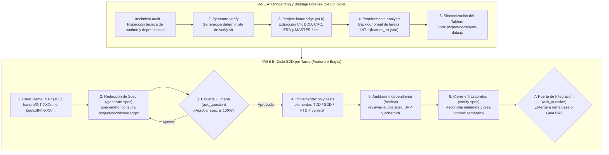

# Harness Engineering — Spec Driven Development con Agentes de IA

> **Esto no es un proyecto de software, es un arnés de control para desarrollo dirigido por especificaciones (SDD).**
>
> Un repositorio plantilla y sistema de ingeniería que cualquier proyecto puede adoptar para desarrollar
> features y bugfixes con agentes de IA (**Google Antigravity**, **opencode**, **GitHub Copilot**, **Claude Code**, **Cursor**) de forma
> **autónoma, verificable y con trazabilidad determinista**. Es 100% agnóstico al stack: funciona con
> Node, .NET, Python, Go, Java, Rust o cualquier tecnología.

---

## ¿Para qué sirve este repositorio?

Adopta este arnés cuando quieras que un agente de IA desarrolle requerimientos de software siguiendo estándares rigurosos de ingeniería:

- **Spec Driven Development (SDD)**: Primero se formaliza el qué (requerimientos EARS), el cómo (decisiones ADRs) y los pasos (tasks); luego se codifica. Todo aprobado previamente por un humano.
- **Base de Conocimiento de Ingeniería Soberana (v4.0)**: Extracción forense que genera documentación viva *Docs-as-Code* (IEEE 830, C4 Model, DDD táctico con tarjetas CRC, ERD, reglas `BR-*` y megadocumento `MASTER-PROJECT-KNOWLEDGE.md`) para erradicar alucinaciones de IA.
- **Tablero Visual de Seguimiento en 3 Niveles (`project-docs/`)**: Visor web modular (Tailwind CSS v4, Three.js, Editor Dual Markdown/Bloques ContextForge) con experiencia editorial y soporte de visualización offline (`file:///`) sin dependencias de backend.
- **Verificación Formal Multinivel (`verify.sh`)**: Script determinista que valida compilación, pruebas unitarias, caja blanca (branch coverage), caja negra (BVA), integración de sistema, pruebas de carga y aceptación E2E con Playwright.
- **Orquestación Multi-Agente Especializada**: Roles delimitados (`leader`, `spec-author`, `implementer`, `reviewer`) con puertas obligatorias de decisión humana (`ask_question`).
- **Agnóstico al Proyecto**: El stack, puertos, base de datos y servicios los defines tú; el arnés aporta el estándar y los guardrails de ingeniería.

---

## Estrategia Maestra: Orden de Ejecución de Skills

Cuando adoptes este arnés en cualquier software (nuevo o existente), sigue este flujo en **dos fases maestras**:



---

### FASE A: Onboarding del Software (Setup Inicial — Una sola vez)

Ejecuta estas skills en orden estricto la primera vez que incorpores el arnés al proyecto:

#### 1. Auditoría Técnica
* **Skill**: `/technical-audit`
* **Propósito**: Analiza el árbol del proyecto, detecta lenguajes, frameworks, librerías, base de datos, Docker y variables de entorno.
* **Resultado**: `project-spec.yaml` (Ficha técnica agnóstica).

#### 2. Generación del Script de Verificación
* **Skill**: `/generate-verify`
* **Propósito**: Lee `project-spec.yaml` y genera el script ejecutable de verificación multinivel con los comandos reales de build, lint y test.
* **Resultado**: `verify.sh` en la raíz del proyecto.

#### 3. Extracción Forense de Conocimiento (v4.0)
* **Skill**: `/project-knowledge`
* **Propósito**: Ejecuta el protocolo en 2 fases (escaneo topológico + extracción profunda por bounded context). Documenta visión de negocio (IEEE 830), arquitectura Screaming AS-IS, modelos C4, UML, ERD, invariantes `BR-*`, contratos externos, 5 módulos especializados y compila el dossier unificado `MASTER-PROJECT-KNOWLEDGE.md`.
* **Resultado**: Carpeta `project-docs/knowledge/` y `MASTER-PROJECT-KNOWLEDGE.md`.

#### 4. Elicitación de Requerimientos y Backlog
* **Skill**: `/requirements-analysis`
* **Propósito**: Transforma la documentación y el código en historias de usuario e items técnicos estructurados con identificadores formales `INT-001`, `INT-002`...
* **Resultado**: `project-docs/feature_list.json`.

#### 5. Sincronización del Tablero Visual
* **Comando**:
  ```bash
  node project-docs/sync-data.js
  ```
* **Propósito**: Indexa los documentos Markdown y metadatos hacia `data-fallback.js` y `knowledge-index.json` para habilitar el tablero web tanto en servidor como en modo local directo (`file:///`).

---

### FASE B: Ciclo de Vida SDD por Tarea (Feature o Bugfix)

Para cada nueva tarea del backlog, el flujo opera de forma determinista:

#### 1. Creación de Rama de Trabajo
* **Regla**: Toda tarea debe realizarse en su propia rama creada desde la rama base (`main`, `master` o `dev`).
* **Estructura estricta (≤ 80 caracteres)**:
  ```
  {feature o bugfix}/INT-{numero}/{nombre_descriptivo}
  ```
  * Ejemplos: `feature/INT-001/document_crud_api`, `bugfix/INT-002/fix_jwt_token_expiration`.

#### 2. Redacción de Especificaciones (`spec-author` / `/generate-spec`)
* **Rol**: Subagente `spec-author` (no toca código de producción ni tests).
* **Invariante**: Consulta obligatoriamente `project-docs/knowledge/` para respetar la arquitectura y las reglas `BR-*`.
* **Artefactos**:
  - `specs/{NNN}_{name}/requirements.md` (Requerimientos formales EARS / RF-*).
  - `specs/{NNN}_{name}/design.md` (Decisiones ADRs y diagramas de componentes).
  - `specs/{NNN}_{name}/tasks.md` (Tareas secuenciales y dependencias).
* **Recomendación Técnica**: Recomienda la estrategia de implementación:
  - **TDD** (`implement-tdd`): Tests primero $\to$ rojo $\to$ verde $\to$ refactor (lógica de negocio con bifurcaciones).
  - **SDD** (`implement-sdd`): Por fases siguiendo `design.md`, tests al final (multi-módulo, migraciones).
  - **FTD** (`implement-ftd`): Cambios menores sin lógica nueva (estilos, etiquetas, config).

#### 3. ⏸ Puerta de Aprobación Humana (`ask_question`)
* **Regla inviolable**: La IA detiene su ejecución y presenta un modal interactivo con enlaces clicables a los specs.
* **Opciones**:
  - `(Recommended) Aprobar spec al 100% e iniciar implementación (pasar a in_progress)`
  - `Solicitar correcciones o ajustes en el spec (mantener en edición)`
  - `Rechazar spec y devolver la tarea a estado pending`
* **Nunca se escribe código de producción sin aprobación humana explícita.**

#### 4. Implementación y Cobertura (`implementer`)
* **Rol**: Subagente `implementer`.
* **Acciones**:
  - Desarrolla el código productivo y las suites de pruebas asociadas (`write-unit-tests`, `acceptance-testing`, `api-test-plan`).
  - Ejecuta `./verify.sh` hasta pasar todos los niveles de prueba en verde.
  - Documenta la trazabilidad `Requerimiento ↔ Tests` en `progress/impl_{name}.md`.

#### 5. Auditoría de Calidad Independiente (`reviewer` / `/review`)
* **Rol**: Subagente `reviewer` (no edita código).
* **Auditoría**:
  - Valida el 100% de criterios de aceptación y tareas de `tasks.md`.
  - Verifica que no se hayan vulnerado invariantes `BR-*` de la base de conocimiento.
  - Verifica la ejecución exitosa de `verify.sh` y ausencia de regresiones.

#### 6. Cierre y Reconciliación de Metadatos (`verify-spec`)
* **Skill**: `/verify-spec`
* **Acciones**:
  - Actualiza a `completed` en `feature_list.json`, `current.json`, `history.json` y el `spec.md`.
  - Ejecuta `node project-docs/sync-data.js` para reflejar el progreso en el tablero.
  - Crea el commit semántico en la rama de trabajo: `feat(scope): descripción` o `fix(scope): descripción`.

#### 7. Puerta de Integración a la Rama Base (`ask_question`)
* Modal final para decidir la integración:
  - `(Recommended) Sí, proyecto local: fusionar (merge) directamente a la rama base`
  - `No integrar por ahora (mantener la tarea completada en su rama)`
  - `Sí, proyecto en repositorio remoto/nube: preparar guía para Pull Request (PR)`

> **Atajo Rápido**: Puedes invocar el flujo completo de una tarea escribiendo:
> ```text
> /start-feature INT-001
> ```
> o
> ```text
> /sdd-workflow ejecuta la siguiente tarea pendiente
> ```

---

## Base de Conocimiento Soberana y Tablero Visual (`project-docs/`)

El tablero interactivo vive en `project-docs/index.html` y cuenta con una experiencia de lectura editorial y gestión técnica de **3 Niveles de Perspectiva**:

```
project-docs/
├── index.html                   # Shell web (Tailwind CSS v4 + Vanilla JS + Three.js)
├── feature_list.json            # Backlog vivo de tareas (ramas INT-*, status, prioridad)
├── data-fallback.js             # Fallback autocontenido para soporte offline (file:///)
├── sync-data.js                 # Pipeline de sincronización y bundling
├── knowledge/                   # Docs-as-Code de Ingeniería Soberana
│   ├── MASTER-PROJECT-KNOWLEDGE.md  # Megadocumento Maestro Consolidado (~8,200 palabras)
│   ├── 01-project-overview-and-business.md  # Problema IEEE 830, visión y RACI
│   ├── 02-architecture-and-patterns.md      # Screaming Architecture AS-IS y patrones
│   ├── 04-domain-ddd-and-crc.md            # Dominio conceptual y tarjetas CRC
│   ├── c4-model.md                         # Diagramas C1, C2, C3 en Mermaid
│   ├── uml-diagrams.md                     # Secuencias, clases y estados
│   ├── business-rules.md                   # Catálogo de invariantes BR-*
│   ├── data-dictionary.md                  # Esquema de datos y diagrama ERD
│   ├── external-services.md                # Matriz de integraciones y failover
│   ├── coding-standards.md                 # Guardrails anti-sesgo y naming
│   └── modules/                            # 5 Bounded Contexts Granulares
│       ├── agent-orchestrator/             # 5 archivos: spec, rules, data, diagrams, tech-debt
│       ├── dashboard-visualizer/           # 5 archivos: spec, rules, data, diagrams, tech-debt
│       ├── knowledge-engine/               # 5 archivos: spec, rules, data, diagrams, tech-debt
│       ├── testing-qa-suite/               # 5 archivos: spec, rules, data, diagrams, tech-debt
│       └── triple-sync-engine/             # 5 archivos: spec, rules, data, diagrams, tech-debt
└── src/                         # Arquitectura Screaming en Vanilla JS
    ├── core/                    # store.js (reactivo), router.js, api.js, detector.js
    ├── shared/                  # Icons.js (100% SVG, 0 emojis), MarkdownViewer.js, Modal.js
    └── features/                # stats, current-spec, feature-list, knowledge-base, etc.
```

### Los 3 Niveles de la Base de Conocimiento
1. **Tier 1 (Visión Global & Arquitectura)**: Vista canónica de los documentos globales, modelo C4 destacado, resumen IEEE 830, buscador con debouncing y filtrado por estantes temáticos (`architecture`, `business_rules`, `requirements`, `adrs`, `standards`, `modules`).
2. **Tier 2 (Módulos & Bounded Contexts Granulares)**: Pestañas interactivas para explorar los 5 subdominios estratégicos DDD. Cada módulo expone sus 5 artefactos formales (`module-spec.md` con tarjetas CRC, `requirements-and-rules.md`, `data-and-transactions.md`, `diagrams.md` con 6 diagramas dedicados y `technical-debt-refactoring.md`).
3. **Tier 3 (Dossier Maestro Consolidado)**: Panel dedicado para `MASTER-PROJECT-KNOWLEDGE.md`, optimizado para lectura continua, navegación por 9 capítulos y botones para copiar o descargar el Markdown completo para alimentar prompts de IA sin truncamiento.

### Editor Dual ContextForge
Permite alternar entre **Modo Lector Editorial** (columna de lectura centrada de 780px con tabla de contenidos flotante on-this-page) y **Modo Editor Dual** (código fuente Markdown vs Bloques Visuales interactivos con scroll sincronizado bidireccional).

---

## Catálogo de Skills Disponibles (18 Skills Homologadas)

Las skills están homologadas en **tres plataformas**:
- **opencode**: `.opencode/skills/` (**Fuente de verdad**)
- **GitHub Copilot**: `.github/skills/` (Espejo)
- **Google Antigravity**: `.agents/skills/` (Espejo)

| Skill | Descripción | Fase de Uso |
|---|---|---|
| `technical-audit` | Auditoría técnica de runtime, dependencias y configuración | Onboarding (Fase A) |
| `generate-verify` | Generación del script de verificación determinista `verify.sh` | Onboarding (Fase A) |
| `project-knowledge` | Extracción forense de conocimiento (C4, UML, ERD, CRC, BR-*, ADRs, Master Doc) | Onboarding (Fase A) |
| `requirements-analysis` | Análisis de requerimientos y generación de `feature_list.json` | Onboarding (Fase A) |
| `sdd-workflow` | Orquestador integral del ciclo de vida SDD (spec $\to$ gate $\to$ code $\to$ review) | Ciclo SDD (Fase B) |
| `start-feature` | Inicia o retoma el flujo SDD para el siguiente ticket del backlog | Ciclo SDD (Fase B) |
| `generate-spec` / `spec` | Genera especificación formal (`requirements`, `design`, `tasks`) | Ciclo SDD (Fase B) |
| `implement-tdd` | Implementación con Test-Driven Development (rojo $\to$ verde $\to$ refactor) | Implementación (Fase B) |
| `implement-sdd` | Implementación dirigida por spec por fases de arquitectura | Implementación (Fase B) |
| `implement-ftd` | Implementación ágil para cambios menores sin lógica nueva | Implementación (Fase B) |
| `implement` | Ejecutor de tareas de implementación de código y trazabilidad R $\leftrightarrow$ Tests | Implementación (Fase B) |
| `write-unit-tests` | Generación de tests unitarios agnósticos al lenguaje | Testing (Fase B) |
| `acceptance-testing` | Pruebas de aceptación con Playwright, caja blanca/negra y carga | QA & Testing (Fase B) |
| `api-test-plan` | Plan de pruebas API REST con archivos `.http` | Pruebas API (Fase B) |
| `execute-api-test-plan` | Ejecución de pruebas API con `curl` y registro de hallazgos | Pruebas API (Fase B) |
| `review` | Auditoría de calidad independiente de spec, trazabilidad y `verify.sh` | Auditoría (Fase B) |
| `verify-spec` | Reconciliación de metadata y cierre formal de la feature | Cierre (Fase B) |
| `sync-skills` | Sincronización triple de skills (`.opencode/` $\to$ `.github/` y `.agents/`) | Mantenimiento |

---

## Cómo Instalar este Arnés en tu Proyecto

El harness **no debe clonarse como repositorio independiente** dentro de tu proyecto. Los archivos deben copiarse **sin el historial git** del harness para no interferir con el control de versiones de tu proyecto.

<details>
<summary>📦 Opción A — Descargar ZIP (recomendada, sin git)</summary>

```bash
# Desde la raíz de tu proyecto (el que ya tiene su propio .git):
# 1. Descarga el ZIP y extráelo en una carpeta temporal
curl -L https://github.com/AndresOsorio0710/harness_anginnering/archive/master.tar.gz \
  | tar xz --strip=1 -C /tmp/harness-temp

# 2. Copia los archivos del harness a tu proyecto (sin .git)
cp -r /tmp/harness-temp/* /tmp/harness-temp/.* .

# 3. Limpia
rm -rf /tmp/harness-temp
```
</details>

<details>
<summary>🔀 Opción B — Clone shallow + copia (si tienes git)</summary>

```bash
git clone --depth 1 https://github.com/AndresOsorio0710/harness_anginnering.git /tmp/harness-temp

# Copia a tu proyecto (sin .git — no se cruza con tu historial)
cp -r /tmp/harness-temp/* /tmp/harness-temp/.* /ruta/de/tu/proyecto/

rm -rf /tmp/harness-temp
```
</details>

<details>
<summary>🔄 Opción C — Nuevo proyecto desde cero</summary>

```bash
git clone --depth 1 https://github.com/AndresOsorio0710/harness_anginnering.git mi-proyecto
cd mi-proyecto
rm -rf .git   # ← importante: elimina el git del harness
git init      # ← inicia tu propio repositorio
git add -A && git commit -m "feat: initialize project with harness"
```
</details>

---

## Convenciones y Reglas Inquebrantables

1. **Ramas Git**: Formato `{feature|bugfix}/INT-{numero}/{nombre}` con límite estricto de **máximo 80 caracteres**.
2. **Commits Semánticos**: Formato Conventional Commits en inglés (`feat(scope): ...`, `fix(scope): ...`).
3. **Consulta Obligatoria de Conocimiento**: Antes de redactar specs o codificar, el agente DEBE consultar `project-docs/knowledge/` para respetar las invariantes de negocio `BR-*` y convenciones de arquitectura.
4. **Puertas de Decisión Humana (`ask_question`)**: Ninguna implementación inicia sin la aprobación del spec por parte del usuario. Ninguna integración a la rama base ocurre sin confirmación.
5. **Sincronización Triple de Skills**: Todo cambio en `.opencode/skills/` (fuente de verdad) debe propagarse a `.github/skills/` y `.agents/skills/`.
6. **Sin Push**: Queda estrictamente prohibido ejecutar `git push` sin autorización expresa del usuario en el chat.
