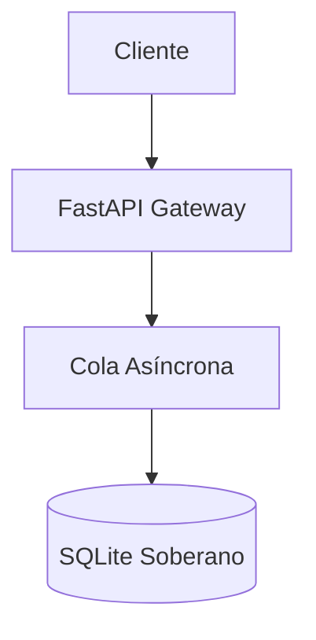
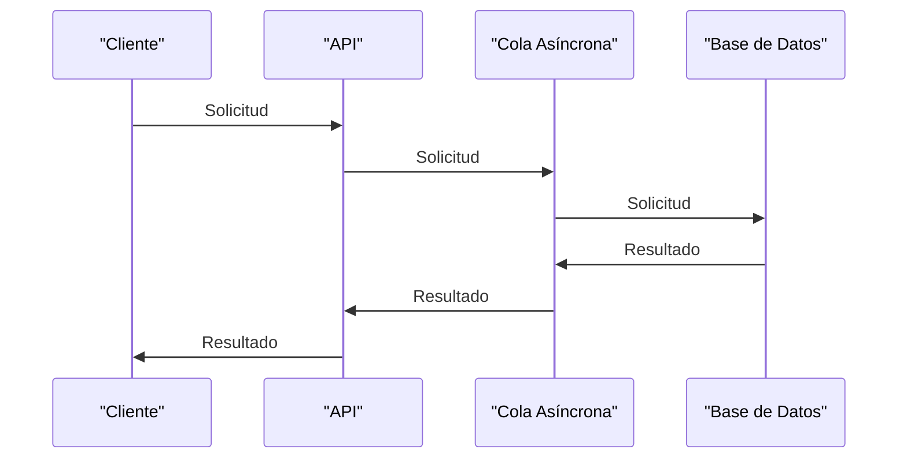

# Context Bundle: billing_architecture (d0a8a8bf)
> Generado por ContextForge el 2026-10-16 17:03:17 UTC
> Módulos incluidos: billing, architecture

## Directrices Operativas para el Asistente de IA (Cursor / Windsurf / Copilot)
1. Eres un asistente de desarrollo asistido consciente de las reglas de negocio de este repositorio.
2. NO inventes ni alteres reglas de negocio o contratos documentados en este paquete de contexto.
3. Respeta estrictamente los Architecture Decision Records (ADRs) aquí contenidos.

## Tabla de Contenidos
- [ADR 001: Adopción de Arquitectura Dirigida por Eventos en Pagos (001_event_driven_payments.md)](#architecture-adrs-001_event_driven_payments-md)
- [especificación-de-flujo-y-reglas-técnicas (especificación-de-flujo-y-reglas-técnicas.md)](#default-architecture-especificación-de-flujo-y-reglas-técnicas-md)
- [Políticas de Reintentos en Facturación Recurrente (retry_policy.md)](#modules-billing-retry_policy-md)

---
## Documento: ADR 001: Adopción de Arquitectura Dirigida por Eventos en Pagos <a id='architecture-adrs-001_event_driven_payments-md'></a>
**Ruta:** `architecture/adrs/001_event_driven_payments.md` | **Módulo:** `architecture` | **Autor:** Equipo Técnico

# ADR 001: Adopción de Arquitectura Dirigida por Eventos en Pagos

## Estado

Aceptado

## Contexto

El flujo original de cobros sincronizaba inventario, emisión de factura y notificaciones de correo en una sola llamada HTTP síncrona. Si el servicio de facturación demoraba más de 3 segundos, la pasarela de pagos abortaba la sesión por timeout del usuario.

## Decisión

Desacoplar la orquestación de pagos mediante eventos de dominio inmutables publicados en Kafka:
1. `OrderPlacedEvent` dispara el intento de cobro.
2. `PaymentCapturedEvent` dispara en paralelo:
- Reserva definitiva de inventario (`inventory_service`).
- Generación de factura electrónica PDF (`invoicing_service`).
- Envío de recibo al cliente (`notification_service`).

## Consecuencias

- **Positivas:** Reducción del tiempo de respuesta del checkout de 4.2s a 380ms.
- **Negativas:** Se requiere manejo de consistencia eventual y conciliación periódica mediante outbox pattern.

> 📎 **Anexo:** [Informe_Judicial_08001315301220180029200_2026-10-12.pdf](assets/adr_001_adopci_n_de_arquitectura_dirigida_por_eventos_en_pagos/Informe_Judicial_08001315301220180029200_2026-10-12.pdf)

---
## Documento: especificación-de-flujo-y-reglas-técnicas <a id='default-architecture-especificación-de-flujo-y-reglas-técnicas-md'></a>
**Ruta:** `default/architecture/especificación-de-flujo-y-reglas-técnicas.md` | **Módulo:** `architecture` | **Autor:** Equipo Técnico

# Especificación de Flujo y Reglas Técnicas

Este documento describe las políticas operativas y los contratos de integración.

## 1. Topología del Sistema


## 2. Reglas de Negocio
- Regla 1: Las transacciones deben ser idempotentes.
- Regla 2: Todo anexo PDF o Excel se indexa automáticamente para RAG.

```python
def process_event(event_id: str) -> bool:
    # Lógica de validación con cero fugas
    return True
```

**Especificación de Flujo y Reglas Técnicas**
=====================================

**Índice**
--------

1. [Topología del Sistema](#topología-del-sistema)
2. [Reglas de Negocio](#reglas-de-negocio)
3. [Flujo de Procesamiento](#flujo-de-procesamiento)
4. [Diagrama de Flujo](#diagrama-de-flujo)

**Topología del Sistema**
------------------------

La arquitectura del sistema se compone de los siguientes componentes:


**Reglas de Negocio**
-------------------

1. **Idempotencia de Transacciones**: Las transacciones deben ser idempotentes, es decir, si una transacción se ejecuta varias veces, el resultado final debe ser el mismo que si se hubiera ejecutado una sola vez.
2. **Índice de Anexos**: Todo anexo PDF o Excel se indexa automáticamente para RAG (Reconocimiento Automático de Gatos).

```python
def process_event(event_id: str) -> bool:
    # Lógica de validación con cero fugas
    return True
```

**Flujo de Procesamiento**
-------------------------

El flujo de procesamiento se describe a continuación:

1. El cliente envía una solicitud al API.
2. El API envía la solicitud a la cola asincrónica.
3. La cola asincrónica procesa la solicitud y la envía a la base de datos.
4. La base de datos procesa la solicitud y devuelve el resultado al API.
5. El API devuelve el resultado al cliente.

**Diagrama de Flujo**
---------------------



**Conclusión**
----------

En este documento se ha descrito la topología del sistema, las reglas de negocio y el flujo de procesamiento. Se ha incluido un diagrama de flujo para ilustrar el proceso. Este documento es una guía para los desarrolladores que trabajen en el proyecto y debe ser revisado y actualizado regularmente.

**Frontmatter YAML**
-------------------

```yml
title: Especificación de Flujo y Reglas Técnicas
module: default
tags: [flujo, reglas, negocio]
author: [Nombre del autor]
date: [Fecha de creación]
version: [Versión del documento]
```

Espero que este documento sea de ayuda. ¡Si tienes alguna pregunta o necesitas más información, no dudes en preguntar!

---
## Documento: Políticas de Reintentos en Facturación Recurrente <a id='modules-billing-retry_policy-md'></a>
**Ruta:** `modules/billing/retry_policy.md` | **Módulo:** `billing` | **Autor:** Arquitectura Pagos

# Políticas de Reintentos en Facturación Recurrente

## 1. Resumen Ejecutivo
Este documento formaliza el comportamiento del subsistema de cobro recurrente cuando la pasarela de pagos (Stripe / Adyen) responde con errores de timeout o fallos transitorios de red.

## 2. Flujo de Reintentos y Backoff Exponencial
Cuando una solicitud de cobro contra el endpoint `/v1/charges` devuelve `HTTP 504 Gateway Timeout` o `ERR_SOCKET_TIMEOUT`, el worker aplica un ciclo de reintentos determinista:
- **Intento 1:** Inmediato tras 2 segundos.
- **Intento 2:** Tras 15 segundos con jitter aleatorio.
- **Intento 3:** Tras 60 segundos.

```python
def should_retry_transaction(error_code: str, current_attempt: int) -> bool:
    TRANSIENT_ERRORS = {"ERR_GATEWAY_TIMEOUT", "ERR_CONNECTION_RESET", "429_TOO_MANY_REQUESTS"}
    if error_code in TRANSIENT_ERRORS and current_attempt < 3:
        return True
    return False
```

## 3. Fallo Definitivo y Dead Letter Queue (DLQ)
Si tras el 3er intento la pasarela no confirma la transacción:
1. El estado del pedido se marca como `PAYMENT_PENDING_MANUAL_REVIEW`.
2. Se emite el evento de dominio `PaymentDeadLetterEvent` al bus de eventos Kafka/PubSub.
3. Se notifica al equipo de soporte mediante alerta PagerDuty si el monto supera los \$1,000 USD.
