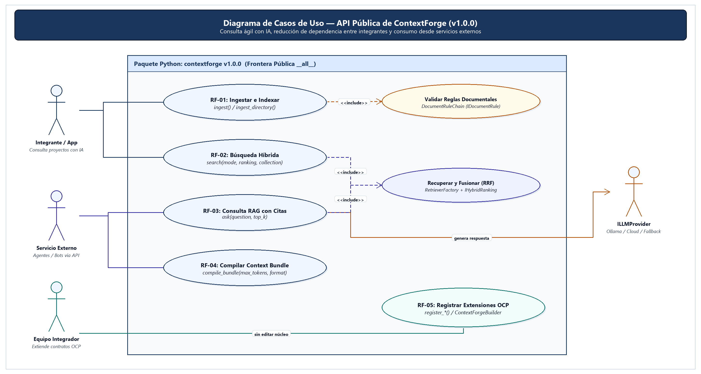

# Documentación Funcional — ContextForge (`v1.0.0`)

## 1. Problemática, Objetivos y Escenarios de Reutilización

### Problemática que resuelve
Los equipos de software que trabajan con proyectos complejos e integran agentes de IA enfrentan cinco problemas recurrentes:
1. **Dependencia del conocimiento entre integrantes (*silos / bus factor*)**: reglas de negocio, ADRs y decisiones técnicas quedan en la cabeza de pocos desarrolladores, generando interrupciones y frenando el *onboarding*.
2. **Búsqueda lenta e insuficiente de información de los proyectos**: buscar manualmente en documentos dispersos consume tiempo; además, la búsqueda solo por palabras clave pierde sinonimia y la búsqueda solo vectorial falla en identificadores exactos (códigos de error, clases o endpoints).
3. **Alucinaciones sin trazabilidad**: los modelos generativos producen respuestas plausibles pero sin citar exactamente de qué documento y sección proviene la información.
4. **Desbordamiento de ventana de contexto**: pasar toda la documentación al prompt de un agente excede presupuestos de tokens y degrada la precisión.
5. **Falta de interoperabilidad para servicios externos y acoplamiento a proveedores**: otros sistemas o bots no pueden consumir fácilmente la base de conocimiento ni integrar agentes vía API o paquete reutilizable, y quedar atado a un solo LLM impide probar sin red.

### Objetivos
- **Objetivo General**: Proveer un componente Python reutilizable (`contextforge`) y una capa API opcional que centralicen la documentación Markdown de los proyectos para agilizar consultas con IA verificable, reducir la dependencia de conocimiento entre integrantes y habilitar que servicios externos consuman bases de conocimiento e integren agentes sin modificar el componente.
- **Objetivos Específicos**:
  1. Reducir la dependencia del conocimiento tácito mediante consultas RAG con citas exactas (`ask()`).
  2. Agilizar la búsqueda sobre proyectos con recuperación híbrida BM25 + vectorial (`search()`) y compilación de *Context Bundles* (`compile_bundle()`).
  3. Permitir consumo desde servicios externos mediante API pública Python (`0` dependencias) y endpoints opcionales (REST `/api/v1`, OpenAI `/v1/*`, MCP `/mcp` y Widget).
  4. Garantizar extensibilidad (OCP/DIP), tipado estricto y cobertura de pruebas unitarias `>= 70%`.

### Escenarios de Reutilización
**ContextForge** se instala como paquete Python (`pip install -e .`) y puede reutilizarse sin modificar su código fuente en:
- **Equipos de desarrollo**: consultar reglas, arquitectura y decisiones de los proyectos con IA sin depender de otros compañeros.
- **Servicios externos y chats con agentes IA**: consumir la API (REST / OpenAI `/v1` / MCP) o importar `contextforge` para integrar agentes sobre las bases de conocimiento (`ask()`).
- **Pipelines CI/CD y asistentes de Code Review**: compilar *Context Bundles* acotados en tokens (`compile_bundle()`) con las reglas del módulo afectado.
- **Entornos de pruebas automatizadas y evaluación de RAG**: sustituir stores y LLM por dobles de prueba (`ILexicalStore`, `IVectorStore`, `ILLMProvider`) para verificar determinismo sin acceso a red.

---

## 2. Requerimientos Funcionales y Casos de Uso de la API



> Archivo editable Draw.io: [diagramas/componente/01_casos_de_uso_api.drawio](diagramas/componente/01_casos_de_uso_api.drawio)

| ID | Caso de Uso / Operación API | Descripción | Criterios de Aceptación |
| :--- | :--- | :--- | :--- |
| **RF-01** | `ingest(documents)` / `ingest_directory(path)` | Valida documentos mediante la cadena de reglas (`IDocumentRule`), los divide con `IChunkingStrategy` e indexa los fragmentos en los almacenes léxico y vectorial. | 1) Rechaza documentos sin `doc_id`, sin título, vacíos o sobre el límite con `DocumentValidationError`. 2) Retorna `IngestionReport` con conteo exacto de documentos y chunks. 3) Emite evento `knowledge.ingested`. |
| **RF-02** | `search(query, top_k, mode, ranking, collection)` | Ejecuta recuperación léxica (`lexical`), semántica (`vector`) o híbrida (`hybrid`) aplicando una estrategia de fusión (`rrf`, `weighted` o personalizada). | 1) Lanza `ValueError` si `query` está vacía o `top_k < 1`. 2) Lanza `UnknownStrategyError` ante modo o ranker inexistente. 3) Permite filtrar por `collection` y retorna `list[SearchHit]` ordenada descendentemente por `score`. |
| **RF-03** | `ask(question, top_k, mode, ranking, system_prompt)` | Recupera los fragmentos más relevantes, construye un prompt fundamentado, invoca `ILLMProvider` y retorna la respuesta junto con citas exactas (`SourceCitation`). | 1) Lanza `EmptyKnowledgeBaseError` si no hay documentos indexados. 2) Traduce cualquier fallo del proveedor externo a `ProviderUnavailableError`. 3) Funciona sin LLM externo gracias al proveedor local extractivo por defecto. |
| **RF-04** | `compile_bundle(name, query, document_ids, max_tokens, export_format)` | Selecciona documentos relevantes o explícitos respetando estrictamente `max_tokens` y serializa el paquete usando el `IBundleExporter` elegido (`markdown`, `json`, `xml` o custom). | 1) Lanza `TokenBudgetExceededError` si `max_tokens < 50`. 2) Lanza `UnknownExportFormatError` ante formato no registrado. 3) Reporta `included_doc_ids`, `omitted_doc_ids` y `estimated_tokens <= max_tokens`. |
| **RF-05** | Extensión sin modificación (`register_*` / `ContextForgeBuilder`) | Permite inyectar nuevas estrategias de chunking, ranking, exportación, reglas de validación, observadores, almacenes y proveedores LLM. | 1) Cualquier clase externa que implemente los contratos de `contextforge.contracts` puede registrarse y usarse sin modificar `src/contextforge/`. |

---

## 3. Guía de Uso (Entradas, Salidas y Errores por Funcionalidad)

### 3.1 Ingesta e Indexación (`ingest` e `ingest_directory`)
- **Entradas**: `documents: Sequence[KnowledgeDocument]`, `chunking_strategy: str | None = None` (`"heading_aware"` o `"sliding_window"`). Para carpetas: `directory: str | Path`, `pattern: str = "*.md"`.
- **Salida**: `IngestionReport(documents_indexed, chunks_created, chunking_strategy, doc_ids, latency_ms)`.
- **Errores posibles**: `DocumentValidationError`, `UnknownStrategyError`, `FileNotFoundError`.

```python
from contextforge import ContextForge, KnowledgeDocument

engine = ContextForge()
report = engine.ingest(
    [
        KnowledgeDocument(
            doc_id="arch/payments.md",
            title="Arquitectura de Pagos",
            collection="engineering",
            tags=("payments", "events"),
            content="# Eventos\nSe usa Event-Driven Architecture con idempotencia por clave.",
        )
    ],
    chunking_strategy="heading_aware",
)
print(report.documents_indexed, report.chunks_created)
```

### 3.2 Búsqueda Híbrida (`search`)
- **Entradas**: `query: str`, `top_k: int = 5`, `mode: str = "hybrid"` (`"lexical"`, `"vector"`, `"hybrid"`), `ranking: str = "rrf"` (`"rrf"`, `"weighted"`), `collection: str | None = None`.
- **Salida**: `list[SearchHit]` con `chunk_id`, `doc_id`, `title`, `text`, `score`, `source_type`, `collection`, `headers`.
- **Errores posibles**: `ValueError`, `UnknownStrategyError`.

```python
hits = engine.search(
    "idempotencia arquitectura pagos",
    top_k=3,
    mode="hybrid",
    ranking="weighted",
    collection="engineering",
)
for hit in hits:
    print(hit.doc_id, hit.score, hit.source_type)
```

### 3.3 Consulta RAG para Agentes IA (`ask`)
- **Entradas**: `question: str`, `top_k: int = 5`, `mode: str | None = None`, `ranking: str | None = None`, `system_prompt: str | None = None`.
- **Salida**: `RagResponse(question, answer, citations, provider_name, retrieval_mode, ranking_strategy, grounded, latency_ms)`.
- **Errores posibles**: `ValueError`, `EmptyKnowledgeBaseError`, `ProviderUnavailableError`, `UnknownStrategyError`.

```python
response = engine.ask("¿Cómo garantizamos idempotencia en pagos?", top_k=3)
print(response.answer)
for citation in response.citations:
    print(f"- {citation.doc_id} (score={citation.score})")
```

### 3.4 Compilación y Exportación de Context Bundles (`compile_bundle`)
- **Entradas**: `name: str`, `query: str | None = None`, `document_ids: Sequence[str] | None = None`, `max_tokens: int = 4000`, `export_format: str = "markdown"` (`"markdown"`, `"json"`, `"xml"`).
- **Salida**: `ContextBundle(bundle_id, name, export_format, content, included_doc_ids, omitted_doc_ids, estimated_tokens, max_tokens, created_at)`.
- **Errores posibles**: `ValueError`, `TokenBudgetExceededError`, `EmptyKnowledgeBaseError`, `UnknownExportFormatError`.

```python
bundle = engine.compile_bundle(
    "Contexto de Pagos para Agente",
    query="idempotencia pagos",
    max_tokens=1500,
    export_format="xml",
)
print(bundle.estimated_tokens, bundle.included_doc_ids)
print(bundle.content)
```

---

## 4. Guía de Extensión (Paso a Paso sin Modificar el Componente)

Todos los puntos de extensión están exportados directamente en `contextforge` (definidos en `src/contextforge/contracts.py`).

### Paso a paso general
1. Importe el contrato deseado desde `contextforge` (`IBundleExporter`, `IHybridRankingStrategy`, `IChunkingStrategy`, `IDocumentRule`, `ILLMProvider`, `IKnowledgeObserver`, `ILexicalStore`, `IVectorStore`).
2. Cree una subclase propia en **su proyecto** implementando los métodos abstractos.
3. Regístrela mediante `ContextForgeBuilder().with_*()` o `engine.register_*()`.

### Ejemplo 1: Nuevo Formato de Exportación (`IBundleExporter`)

```python
from typing import Sequence
from contextforge import ContextForgeBuilder, IBundleExporter, KnowledgeDocument

class YamlBundleExporter(IBundleExporter):
    @property
    def format_name(self) -> str:
        return "yaml"

    def export(
        self,
        name: str,
        documents: Sequence[KnowledgeDocument],
        estimated_tokens: int,
        max_tokens: int,
    ) -> str:
        lines = [f"bundle: {name}", f"tokens: {estimated_tokens}/{max_tokens}", "docs:"]
        for d in documents:
            lines.append(f"  - id: {d.doc_id}\n    title: {d.title}")
        return "\n".join(lines) + "\n"

engine = ContextForgeBuilder().with_exporter(YamlBundleExporter()).build()
```

### Ejemplo 2: Nueva Política de Ranking Híbrido (`IHybridRankingStrategy`)

```python
from typing import Sequence
from contextforge import ContextForge, IHybridRankingStrategy, SearchHit

class CollectionBoostRanker(IHybridRankingStrategy):
    @property
    def name(self) -> str:
        return "engineering_first"

    def fuse(self, lexical_hits: Sequence[SearchHit], vector_hits: Sequence[SearchHit], top_k: int) -> list[SearchHit]:
        merged = list(lexical_hits) + list(vector_hits)
        merged.sort(key=lambda h: h.score * (1.3 if h.collection == "engineering" else 1.0), reverse=True)
        return merged[:top_k]

engine = ContextForge()
engine.register_ranking_strategy(CollectionBoostRanker())
```

### Ejemplo 3: Nueva Regla de Gobernanza Documental (`IDocumentRule`)

```python
from contextforge import ContextForge, DocumentValidationError, IDocumentRule, KnowledgeDocument

class RequireTagsRule(IDocumentRule):
    @property
    def rule_name(self) -> str:
        return "require_tags"

    def validate(self, document: KnowledgeDocument) -> None:
        if not document.tags:
            raise DocumentValidationError("Se requiere al menos un tag.", rule_name=self.rule_name)

engine = ContextForge()
engine.register_rule(RequireTagsRule())
```

### Ejemplo 4: Proveedor LLM Personalizado (`ILLMProvider`)

```python
from contextforge import ContextForge, ILLMProvider

class CustomAgentLLM(ILLMProvider):
    @property
    def provider_name(self) -> str:
        return "custom-corporate-llm"

    def generate(self, prompt: str, *, system_prompt: str | None = None) -> str:
        return f"[Respuesta generada con contexto verificado] {prompt[:120]}"

engine = ContextForge(llm_provider=CustomAgentLLM())
```

### Ejemplo 5: Estrategia de Segmentación Personalizada (`IChunkingStrategy`)

```python
from contextforge import ContextForge, DocumentChunk, IChunkingStrategy, KnowledgeDocument

class ParagraphChunkingStrategy(IChunkingStrategy):
    @property
    def name(self) -> str:
        return "by_paragraph"

    def chunk(self, document: KnowledgeDocument) -> list[DocumentChunk]:
        paragraphs = [p.strip() for p in document.content.split("\n\n") if p.strip()]
        return [
            DocumentChunk(
                chunk_id=f"{document.doc_id}#p{idx}",
                doc_id=document.doc_id,
                title=document.title,
                text=para,
                collection=document.collection,
                tags=document.tags,
            )
            for idx, para in enumerate(paragraphs)
        ]

engine = ContextForge()
engine.register_chunking_strategy(ParagraphChunkingStrategy())
engine.ingest([KnowledgeDocument(doc_id="a.md", title="Doc", content="P1\n\nP2")], chunking_strategy="by_paragraph")
```

### Ejemplo 6: Almacenes Reemplazables (`ILexicalStore` e `IVectorStore`)

```python
from typing import Sequence
from contextforge import ContextForgeBuilder, DocumentChunk, ILexicalStore, IVectorStore, SearchHit

class CustomKeywordStore(ILexicalStore):
    def __init__(self) -> None:
        self._chunks: list[DocumentChunk] = []

    def index(self, chunks: Sequence[DocumentChunk]) -> None:
        self._chunks.extend(chunks)

    def search(self, query: str, top_k: int) -> list[SearchHit]:
        q = query.lower()
        matches = [
            SearchHit(c.chunk_id, c.doc_id, c.title, c.text, 1.0, "lexical", c.collection, c.headers)
            for c in self._chunks if q in c.text.lower()
        ]
        return matches[:top_k]

    def clear(self) -> None:
        self._chunks.clear()

# De forma análoga puede implementarse IVectorStore para ChromaDB, Qdrant, FAISS o un Fake en pruebas.
engine = ContextForgeBuilder().with_stores(lexical_store=CustomKeywordStore()).build()
```

### Ejemplo 7: Observador de Eventos de Ciclo de Vida (`IKnowledgeObserver`)

```python
from contextforge import ContextForge, IKnowledgeObserver, KnowledgeEvent

class AuditPrintObserver(IKnowledgeObserver):
    def on_event(self, event: KnowledgeEvent) -> None:
        print(f"[{event.occurred_at}] {event.event_type} -> {event.payload}")

engine = ContextForge()
engine.subscribe(AuditPrintObserver())
```
