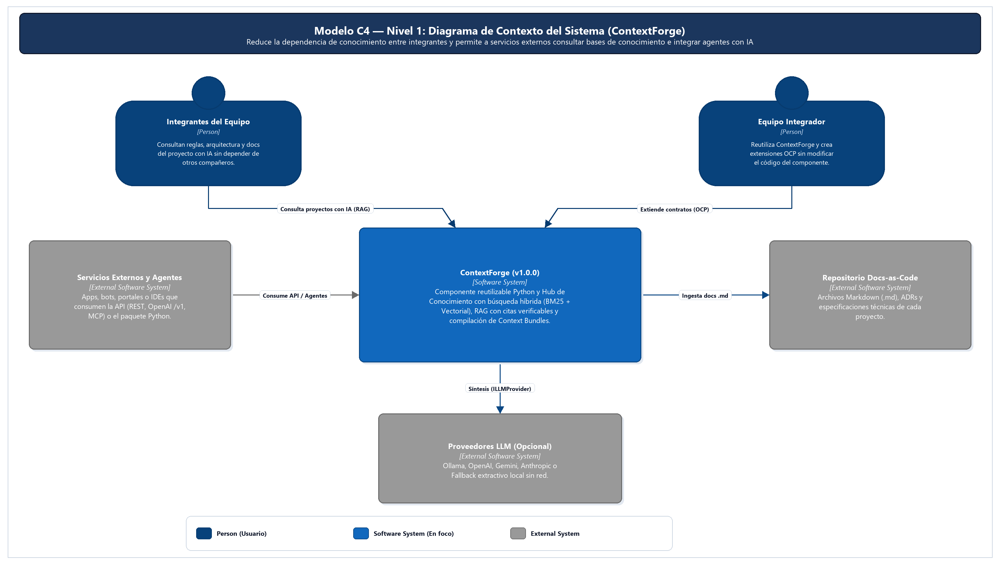
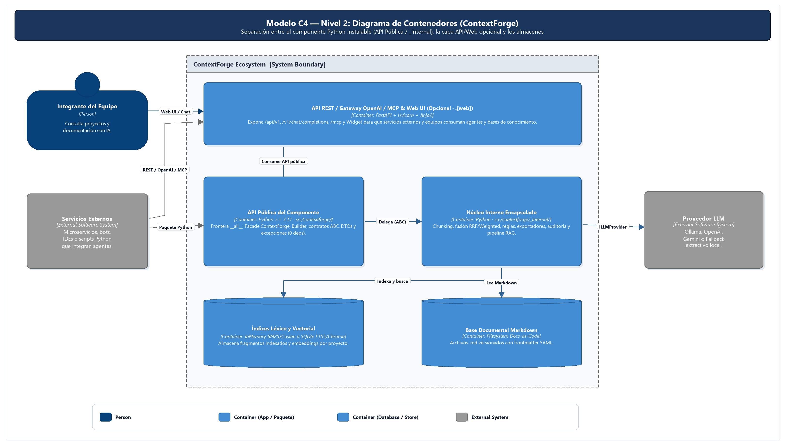
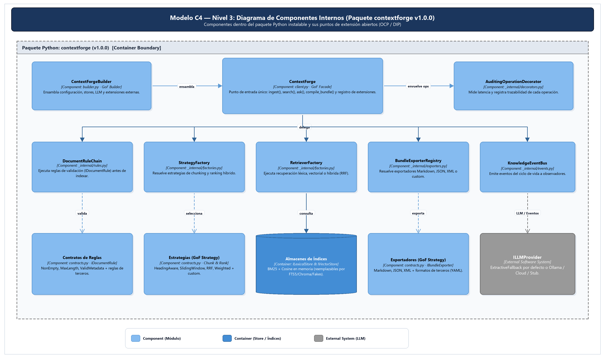
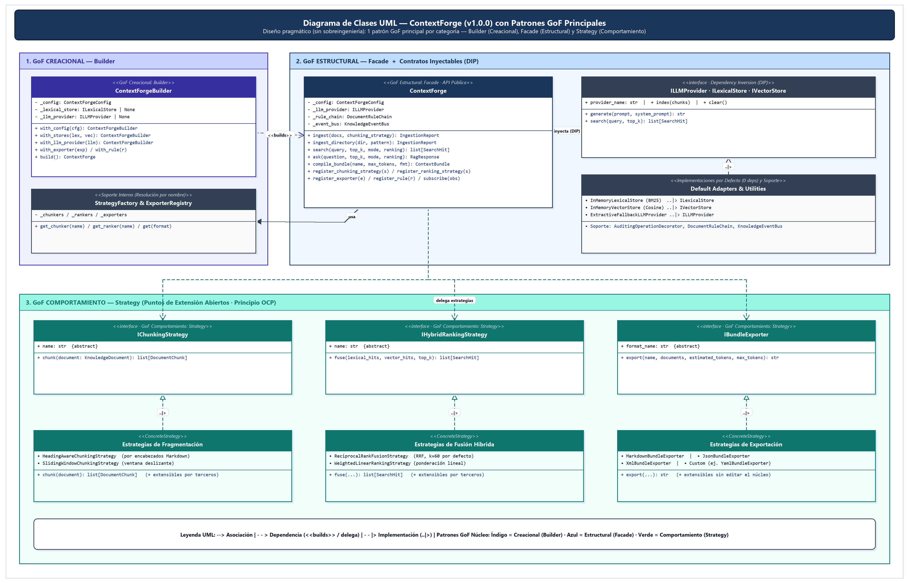
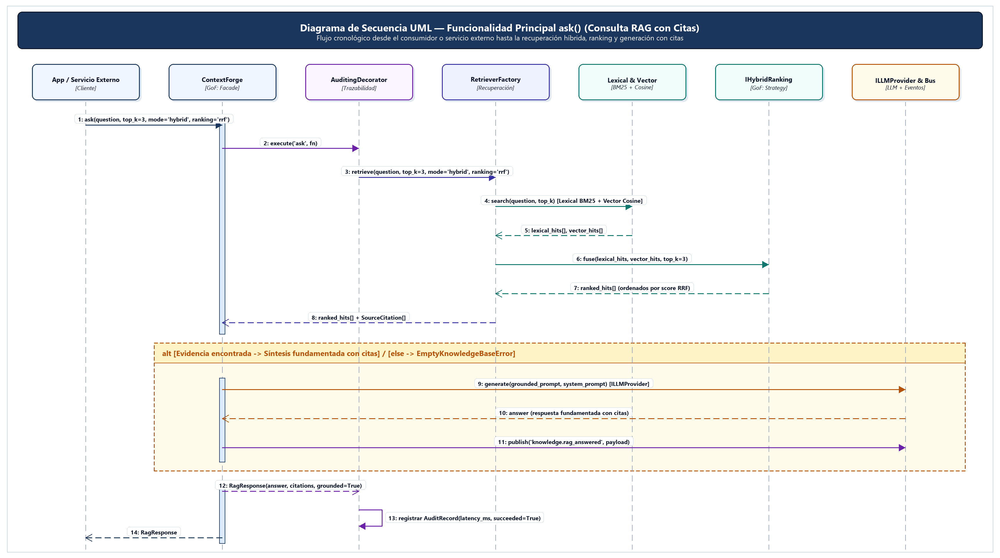

# Documentación Técnica, Arquitectura y Diseño — ContextForge (`v1.0.0`)

## 1. Requerimientos No Funcionales (ISO/IEC 25010)

| Característica ISO/IEC 25010 | Subcaracterística | Requisito Concreto en ContextForge | Mecanismo de Verificación |
| :--- | :--- | :--- | :--- |
| **Mantenibilidad** | **Reusabilidad** | El componente `contextforge` no depende de frameworks web, bases de datos ni APIs externas (`dependencies = []`) y funciona en cualquier proyecto Python `>= 3.11`. | Instalación aislada vía `pyproject.toml` y ejecución de `examples/agent_knowledge_cli.py`. |
| **Mantenibilidad** | **Modularidad** | Separación estricta entre API pública (`src/contextforge/{__init__,client,builder,contracts,models,exceptions}.py`) e implementación interna (`src/contextforge/_internal/`). Todo archivo fuente mantiene `<= 300` líneas. | Inspección de `__all__` en pruebas y auditoría automática de líneas por archivo. |
| **Mantenibilidad** | **Capacidad de prueba** | Toda dependencia colaboradora (`ILexicalStore`, `IVectorStore`, `ILLMProvider`, `IKnowledgeObserver`) es inyectable y reemplazable por dobles de prueba (fakes, stubs, spies). | Suite `pytest` con cobertura de líneas `>= 70%` sobre `src/contextforge/`. |
| **Mantenibilidad** | **Facilidad de modificación** | Agregar nuevos chunkers, rankers, exportadores o reglas de validación no exige editar código existente del núcleo (OCP). | Pruebas de extensión externa en `tests/unit/test_contextforge_component.py`. |
| **Adecuación Funcional** | **Corrección funcional** | Las operaciones `ingest`, `search`, `ask` y `compile_bundle` validan entradas y lanzan excepciones tipadas derivadas de `ContextForgeError`. | Tipado estricto `mypy --strict src` sin errores y pruebas de caminos de error. |
| **Eficiencia de Desempeño** | **Comportamiento temporal** | Las operaciones en memoria se ejecutan en milisegundos y registran `latency_ms` mediante `AuditingOperationDecorator`. | Inspección de `engine.audit_trail`. |

---

## 2. Arquitectura del Componente — Modelo C4

### Nivel 1: Diagrama de Contexto del Sistema

> Editable en Draw.io: [diagramas/componente/02_c4_contexto_n1.drawio](diagramas/componente/02_c4_contexto_n1.drawio)

**Justificación**: El sistema consumidor depende únicamente de la frontera pública de `ContextForge`, aislando su lógica de negocio de los detalles de indexación, fusión de puntajes y proveedores generativos.

### Nivel 2: Diagrama de Contenedores

> Editable en Draw.io: [diagramas/componente/03_c4_contenedores_n2.drawio](diagramas/componente/03_c4_contenedores_n2.drawio)

**Justificación**: La separación física en subpaquete `_internal/` impide acoplamientos accidentales a clases concretas y permite evolucionar estructuras internas (p. ej. cambiar el índice BM25 o el vectorizador) preservando compatibilidad semántica (`v1.x`).

### Nivel 3: Diagrama de Componentes Internos

> Editable en Draw.io: [diagramas/componente/04_c4_componentes_n3.drawio](diagramas/componente/04_c4_componentes_n3.drawio)

---

## 3. Diagramas UML

### 3.1 Diagrama de Clases UML (API Pública, Colaboradores y Patrones GoF)

> Editable en Draw.io: [diagramas/componente/05_uml_clases_gof.drawio](diagramas/componente/05_uml_clases_gof.drawio)

### 3.2 Diagrama de Secuencia UML — Funcionalidad Principal `ask()` (RAG Híbrido con Citas)

> Editable en Draw.io: [diagramas/componente/06_uml_secuencia_ask.drawio](diagramas/componente/06_uml_secuencia_ask.drawio)

---

## 4. Matriz de Principios SOLID, Patrones GRASP y Patrones GoF

### 4.1 Principios SOLID

| Principio | Evidencia en Código (Clase / Módulo) | Justificación Técnica |
| :--- | :--- | :--- |
| **S — Single Responsibility** | `stores.py` (almacenamiento), `strategies.py` (algoritmos de chunking/ranking), `exporters.py` (serialización), `rules.py` (reglas de validación), `decorators.py` (telemetría). | Cada módulo tiene una única razón de cambio; modificar el formato XML no toca ni el índice BM25 ni el motor RAG. |
| **O — Open/Closed** | `contracts.py` + `register_chunking_strategy`, `register_ranking_strategy`, `register_exporter`, `register_rule`, `subscribe` en `client.py`. | Un tercero agrega un exportador YAML o una política de ranking nueva sin editar el código fuente de `contextforge`. |
| **L — Liskov Substitution** | `HeadingAwareChunkingStrategy` / `SlidingWindowChunkingStrategy` (`IChunkingStrategy`); `ReciprocalRankFusionStrategy` / `WeightedLinearRankingStrategy` (`IHybridRankingStrategy`); `Markdown/Json/XmlBundleExporter` (`IBundleExporter`). | Cualquier implementación (incorporada o externa) respeta pre/postcondiciones y es intercambiable transparentemente en tiempo de ejecución. |
| **I — Interface Segregation** | Contratos pequeños y focalizados en `src/contextforge/contracts.py` (`ILexicalStore`, `IVectorStore`, `ILLMProvider`, `IBundleExporter`, `IDocumentRule`, `IKnowledgeObserver`). | Ningún implementador se ve obligado a implementar métodos que no usa (por ejemplo, un exportador solo implementa `format_name` y `export`). |
| **D — Dependency Inversion** | `ContextForge.__init__()` y `ContextForgeBuilder` dependen de abstracciones (`ILexicalStore`, `IVectorStore`, `ILLMProvider`, `IDocumentRule`), no de implementaciones concretas. | Permite inyectar ChromaDB/Ollama en producción y fakes/stubs en pruebas unitarias sin alterar el núcleo. |

### 4.2 Patrones GRASP

| Patrón GRASP | Evidencia en Código | Justificación |
| :--- | :--- | :--- |
| **Information Expert** | `KnowledgeDocument.word_count` (`models.py`), `InMemoryLexicalStore.search()` (`stores.py`), `DocumentRuleChain.validate_all()` (`rules.py`). | La responsabilidad vive en la clase que posee los datos necesarios para calcularla. |
| **Creator** | `StrategyFactory` y `BundleExporterRegistry` (`factories.py`, `exporters.py`), `ContextForgeBuilder` (`builder.py`). | Centralizan la creación y ensamblaje de colaboradores con sus parámetros consistentes. |
| **Controller / Facade** | `ContextForge` (`client.py`). | Coordina los casos de uso públicos (`ingest`, `search`, `ask`, `compile_bundle`) ocultando la complejidad interna. |
| **Polymorphism** | `IChunkingStrategy.chunk()`, `IHybridRankingStrategy.fuse()`, `IBundleExporter.export()`, `IDocumentRule.validate()`. | Elimina cadenas `if/elif` por tipo de formato, ranker o regla. |
| **Low Coupling & High Cohesion** | Paquete `src/contextforge/_internal/` dividido en 7 módulos enfocados conectados solo por DTOs e interfaces públicas. | Minimiza impacto de cambios y facilita la auditoría y reutilización. |
| **Protected Variations** | Contratos en `src/contextforge/contracts.py` y excepciones en `src/contextforge/exceptions.py`. | Protege a los consumidores frente a cambios en motores LLM, almacenes vectoriales o formatos de exportación. |

### 4.3 Patrones GoF Principales (1 por Categoría: Beneficios y Costos)

Para evitar sobreingeniería, la arquitectura del componente adopta **3 patrones GoF principales** (uno por categoría):

| Categoría | Patrón GoF | Implementación Exacta | Beneficio Técnico | Costo de Implementación |
| :--- | :--- | :--- | :--- | :--- |
| **Creacional** | **Builder** | `ContextForgeBuilder` (`src/contextforge/builder.py`) | Ensamblado legible y seguro de configuración, dobles de prueba y extensiones sin constructores telescópicos. | Una clase adicional de configuración y leve duplicación de parámetros respecto a `ContextForge.__init__`. |
| **Estructural** | **Facade** | `ContextForge` (`src/contextforge/client.py`) | API pública pequeña (4 operaciones principales) fácil de aprender y reutilizar en cualquier proyecto o servicio externo. | Puede crecer si se agregan responsabilidades no esenciales; se mitiga delegando en módulos internos. |
| **Comportamiento** | **Strategy** | `IChunkingStrategy`, `IHybridRankingStrategy`, `IBundleExporter` (`contracts.py`, `strategies.py`) | Permite intercambiar y extender algoritmos de chunking, fusión híbrida y exportación sin condicionales rígidos (OCP). | Incrementa el número de clases pequeñas para algoritmos simples. |

#### Patrones Complementarios de Soporte (Uso Acotado en `_internal/`)

| Patrón | Implementación | Beneficio Técnico | Costo de Implementación |
| :--- | :--- | :--- | :--- |
| **Factory / Registry** | `StrategyFactory`, `RetrieverFactory`, `BundleExporterRegistry` (`factories.py`, `exporters.py`) | Desacopla la selección dinámica de algoritmos/formatos por nombre y permite registrar extensiones en caliente. | Requiere gestionar claves de registro y validación explícita (`UnknownStrategyError`, `UnknownExportFormatError`). |
| **Chain of Responsibility** | `DocumentRuleChain` + `IDocumentRule` (`rules.py`) | Permite encadenar reglas de validación documental independientes y que terceros agreguen nuevas reglas con `register_rule()`. | El orden de registro importa y un fallo temprano detiene la evaluación de reglas posteriores. |
| **Decorator** | `AuditingOperationDecorator` (`decorators.py`) | Añade medición de latencia y trazabilidad de éxitos/fallos sin contaminar la lógica de negocio de cada operación. | Introduce una capa extra de indirección en la pila de llamadas durante la depuración. |
| **Observer** | `KnowledgeEventBus` + `IKnowledgeObserver` (`events.py`) | Desacopla la emisión de eventos del ciclo de vida (`knowledge.ingested`, `knowledge.searched`, etc.) de logging, métricas o WebSockets. | Si un observador lanza una excepción no controlada o realiza I/O lento, afecta la latencia síncrona de la operación. |
