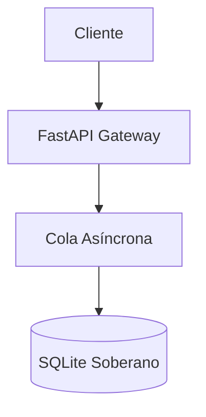
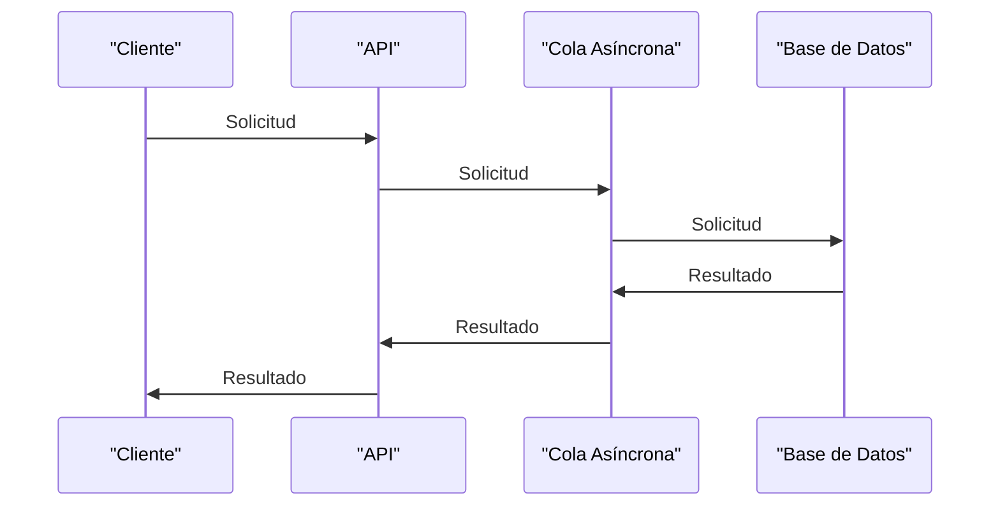

# Especificación de Flujo y Reglas Técnicas

Este documento describe las políticas operativas y los contratos de integración.

## 1. Topología del Sistema


## 2. Reglas de Negocio
- Regla 1: Las transacciones deben ser idempotentes.
- Regla 2: Todo anexo PDF o Excel se indexa automáticamente para RAG.

```python
def process_event(event_id: str) -> bool:
    # Lógica de validación con cero fugas
    return True
```

**Especificación de Flujo y Reglas Técnicas**
=====================================

**Índice**
--------

1. [Topología del Sistema](#topología-del-sistema)
2. [Reglas de Negocio](#reglas-de-negocio)
3. [Flujo de Procesamiento](#flujo-de-procesamiento)
4. [Diagrama de Flujo](#diagrama-de-flujo)

**Topología del Sistema**
------------------------

La arquitectura del sistema se compone de los siguientes componentes:


**Reglas de Negocio**
-------------------

1. **Idempotencia de Transacciones**: Las transacciones deben ser idempotentes, es decir, si una transacción se ejecuta varias veces, el resultado final debe ser el mismo que si se hubiera ejecutado una sola vez.
2. **Índice de Anexos**: Todo anexo PDF o Excel se indexa automáticamente para RAG (Reconocimiento Automático de Gatos).

```python
def process_event(event_id: str) -> bool:
    # Lógica de validación con cero fugas
    return True
```

**Flujo de Procesamiento**
-------------------------

El flujo de procesamiento se describe a continuación:

1. El cliente envía una solicitud al API.
2. El API envía la solicitud a la cola asincrónica.
3. La cola asincrónica procesa la solicitud y la envía a la base de datos.
4. La base de datos procesa la solicitud y devuelve el resultado al API.
5. El API devuelve el resultado al cliente.

**Diagrama de Flujo**
---------------------



**Conclusión**
----------

En este documento se ha descrito la topología del sistema, las reglas de negocio y el flujo de procesamiento. Se ha incluido un diagrama de flujo para ilustrar el proceso. Este documento es una guía para los desarrolladores que trabajen en el proyecto y debe ser revisado y actualizado regularmente.

**Frontmatter YAML**
-------------------

```yml
title: Especificación de Flujo y Reglas Técnicas
module: default
tags: [flujo, reglas, negocio]
author: [Nombre del autor]
date: [Fecha de creación]
version: [Versión del documento]
```

Espero que este documento sea de ayuda. ¡Si tienes alguna pregunta o necesitas más información, no dudes en preguntar!
