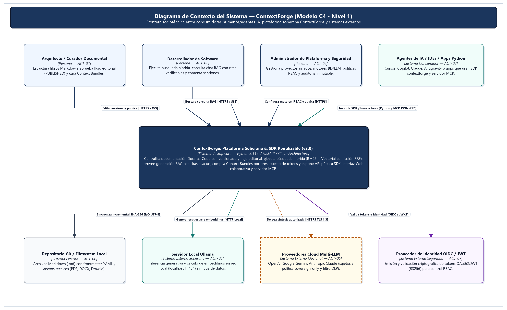
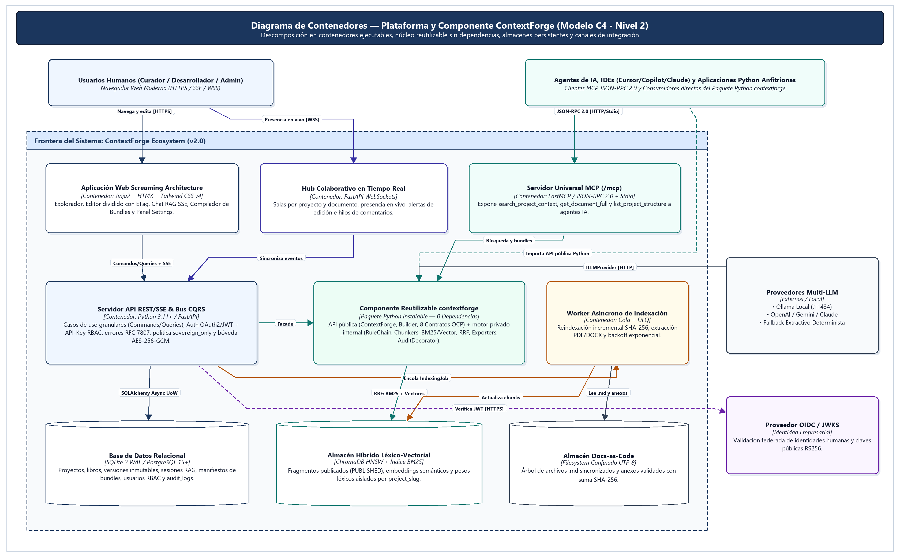
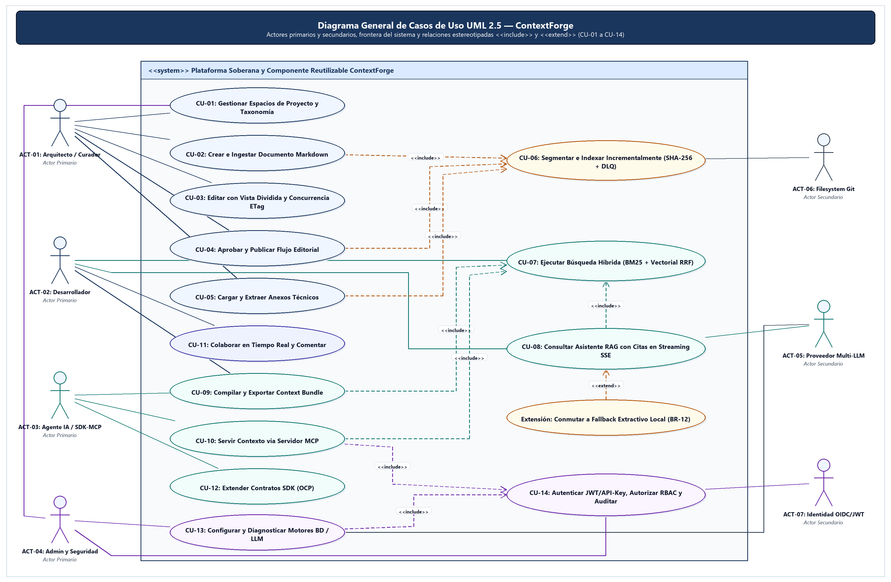
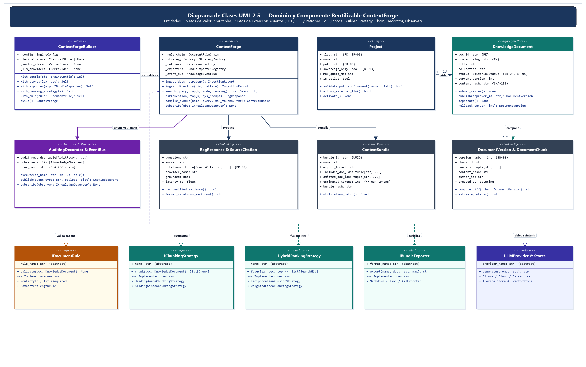
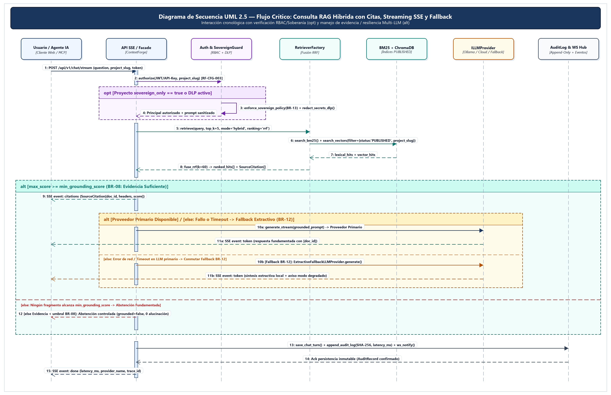
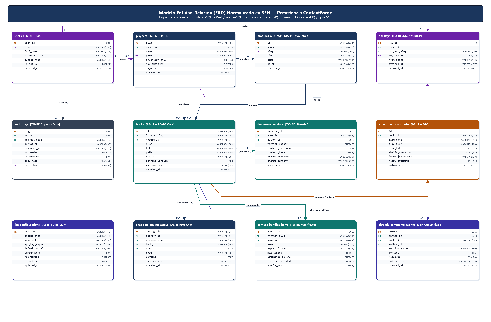

# 6. Modelado Arquitectónico, Diseño Detallado y Diagramas de Ingeniería

El modelo arquitectónico y de diseño de **ContextForge** se documenta mediante seis artefactos gráficos construidos nativamente en formato XML editable **Draw.io (`mxGraphModel`)** bajo `docs/diagramas/` y renderizados en alta resolución para su inspección visual directa. Los diagramas articulan de forma coherente el estado operativo actual (`AS-IS v1.0.0`) y las capacidades de reingeniería empresarial (`TO-BE v2.0.0`).

---

## 6.1 Diagrama de Contexto del Sistema — Modelo C4 Nivel 1

El primer nivel del Modelo C4 delimita a **ContextForge** como caja negra en el centro de su ecosistema sociotécnico, identificando los cuatro perfiles humanos/agentes consumidores y los sistemas externos con los cuales intercambia información bajo contratos gobernados.

*Figura 1. Diagrama de Contexto del Sistema ContextForge (Modelo C4 — Nivel 1). Fuente: Elaboración propia (2026).*

**Análisis Arquitectónico:** Como evidencia la Figura 1, ContextForge desacopla por completo a los consumidores (arquitectos, desarrolladores, administradores e IDEs/agentes IA) de los motores subyacentes de inferencia y almacenamiento. El sistema lee y sincroniza repositorios Markdown locales (*Docs-as-Code*), autentica identidades contra un proveedor OIDC/JWT institucional cuando opera en red compartida y delega opcionalmente la generación lingüística en Ollama local o proveedores Cloud bajo políticas estrictas de soberanía por proyecto (`BR-13`).

---

## 6.2 Diagrama de Contenedores — Modelo C4 Nivel 2

El segundo nivel del Modelo C4 descompone el límite interno del sistema en sus contenedores ejecutables, almacenes de persistencia y protocolos de comunicación en tiempo real.

*Figura 2. Diagrama de Contenedores de ContextForge (Modelo C4 — Nivel 2). Fuente: Elaboración propia (2026).*

**Análisis Arquitectónico:** Destaca la arquitectura concéntrica híbrida: el **Componente Reutilizable `contextforge` (Python SDK)** constituye un contenedor autónomo sin dependencias externas que puede ser embebido directamente por cualquier aplicación Python, mientras que la **Aplicación Web Screaming Architecture**, el **Servidor API FastAPI + Bus CQRS**, el **Servidor Universal MCP (`/mcp`)**, el **Hub WebSocket Colaborativo** y el **Worker Asíncrono de Indexación (`SHA-256` + DLQ)** actúan como contenedores coordinados sobre SQLite WAL / PostgreSQL y ChromaDB + BM25.

---

## 6.3 Diagrama General de Casos de Uso — UML 2.5

El diagrama general de casos de uso sintetiza la frontera funcional completa especificada en el Capítulo 3 (`CU-01` a `CU-14`), explicitando las asociaciones con actores primarios/secundarios y las dependencias estructurales `<<include>>` y `<<extend>>`.

*Figura 3. Diagrama General de Casos de Uso UML de ContextForge. Fuente: Elaboración propia (2026).*

---

## 6.4 Diagrama de Clases del Dominio y Patrones de Diseño — UML 2.5

El diagrama de clases modela las entidades ricas, objetos de valor inmutables, interfaces de extensión (contratos **DIP/OCP**) y colaboradores de patrones clásicos **GoF** (*Facade, Builder, Strategy, Factory, Chain of Responsibility, Decorator, Observer*) y **GRASP** (*Controller, Information Expert, Pure Fabrication, Indirection, Protected Variations*).

*Figura 4. Diagrama de Clases UML del Dominio y Componente Reutilizable ContextForge. Fuente: Elaboración propia (2026).*

### Síntesis de Patrones GoF, SOLID y GRASP Aplicados

| Patrón / Principio | Clases / Contratos Participantes | Problema de Diseño Resuelto en ContextForge |
| :--- | :--- | :--- |
| **Facade (GoF)** | `ContextForge` (`client.py`) | Ofrece una interfaz pública unificada y mínima (`ingest`, `search`, `ask`, `compile_bundle`) ocultando la complejidad de pipelines, fábricas y buses internos. |
| **Builder (GoF)** | `ContextForgeBuilder` (`builder.py`) | Permite ensamblar paso a paso configuraciones avanzadas del motor inyectando almacenes, estrategias, reglas y observadores sin constructores telescópicos. |
| **Strategy (GoF) + OCP** | `IChunkingStrategy`, `IHybridRankingStrategy`, `IBundleExporter`, `IDatabaseStrategy`, `ILLMProvider` | Habilita intercambiar algoritmos de segmentación, fusión matemática (`RRF` vs. `Weighted`), formatos de salida y motores de BD/LLM sin tocar clientes. |
| **Chain of Responsibility (GoF)** | `IDocumentRule` $\rightarrow$ `DocumentRuleChain` | Desacopla y encadena validaciones modulares sobre documentos antes de su ingesta, permitiendo a terceros añadir políticas de gobernanza propias. |
| **Decorator (GoF)** | `AuditingOperationDecorator` | Envuelve transparentemente la ejecución de comandos y consultas midiendo `latency_ms`, capturando fallos y registrando trazabilidad inmutable (`AuditRecord`). |
| **Observer (GoF)** | `IKnowledgeObserver` $\rightarrow$ `KnowledgeEventBus` | Publica eventos de dominio (`knowledge.ingested`, `knowledge.searched`, `knowledge.rag_answered`, `knowledge.bundle_compiled`) hacia suscriptores desacoplados (telemetría, WS). |
| **Factory / Registry (GoF)** | `StrategyFactory`, `RetrieverFactory`, `BundleExporterRegistry`, `DatabaseFactory` | Centraliza la resolución polimórfica de implementaciones concretas a partir de claves semánticas de configuración. |

---

## 6.5 Diagrama de Secuencia del Flujo Crítico Principal — UML 2.5

La Figura 5 detalla cronológicamente el flujo crítico de mayor valor del sistema: una **consulta conversacional RAG híbrida con transmisión SSE, verificación de compuerta editorial y soberanía, atribución de citas, notificación en tiempo real y conmutación resiliente (*fallback*)**, incorporando fragmentos combinados **`alt`** y **`opt`** de UML 2.5.

*Figura 5. Diagrama de Secuencia UML del Flujo Crítico Principal (Consulta RAG Híbrida con Citas, SSE y Fallback). Fuente: Elaboración propia (2026).*

---

## 6.6 Modelo Entidad-Relación Normalizado (ERD — 3FN)

El modelo relacional consolidado (Figura 6) normaliza en **Tercera Forma Normal (3FN)** las tablas existentes en `src/infrastructure/persistence/models/` junto con las entidades de reingeniería `TO-BE` (`users`, `api_keys`, `document_versions`, `context_bundles`, `bundle_items`, `indexing_jobs` y `audit_logs`), eliminando la duplicidad histórica de modelos de comentarios (`REI-12`) y definiendo explícitamente claves primarias (`PK`), claves foráneas (`FK`) y tipos de datos SQL compatibles con SQLite WAL y PostgreSQL.

*Figura 6. Modelo Entidad-Relación (ERD) Normalizado de ContextForge. Fuente: Elaboración propia (2026).*

---

# 7. Validación de Requisitos, Matriz de Trazabilidad (`RTM`) y Control de Cambios

## 7.1 Lista de Chequeo Formal de Validación de Requisitos

De conformidad con el marco de validación de Ingeniería de Requerimientos (IEEE Std 830 / ISO 29148 / Guía Metodológica UPC), cada conjunto de requisitos ha sido auditado contra los nueve criterios canónicos de calidad:
- **`ER`** = Especificado por escrito · **`N`** = Necesario · **`Na`** = No ambiguo · **`V`** = Verificable · **`Cpo`** = Completo · **`Cto`** = Correcto · **`Vb`** = Viable · **`Pb`** = Priorizado · **`Cte`** = Consistente.

| Bloque Auditado | `ER` | `N` | `Na` | `V` | `Cpo` | `Cto` | `Vb` | `Pb` | `Cte` | Dictamen Técnico de Validación |
| :--- | :---: | :---: | :---: | :---: | :---: | :---: | :---: | :---: | :---: | :--- |
| **`RF-PRJ-001` a `RF-PRJ-004`** (Gobernanza Multi-Proyecto) | Sí | Sí | Sí | Sí | Sí | Sí | Sí | Sí | Sí | **Aprobado (9/9):** Aislamiento `BR-10` y confinamiento de rutas `BR-03` verificables determinísticamente. |
| **`RF-DOC-001` a `RF-DOC-005`** (Documental, Editorial y Versiones) | Sí | Sí | Sí | Sí | Sí | Sí | Sí | Sí | Sí | **Aprobado (9/9):** Autómata editorial `BR-05`, concurrencia `ETag` (`409`) y `SHA-256` sin ambigüedades. |
| **`RF-RAG-001` a `RF-RAG-004`** (Indexación, Híbrido y RAG) | Sí | Sí | Sí | Sí | Sí | Sí | Sí | Sí | Sí | **Aprobado (9/9):** Fórmulas RRF, citas obligatorias `BR-08` y soberanía `BR-13` cerradas y testeables. |
| **`RF-BND-001` a `RF-BND-004`** (Bundles, MCP y Extensión SDK) | Sí | Sí | Sí | Sí | Sí | Sí | Sí | Sí | Sí | **Aprobado (9/9):** Presupuesto matemático `estimated_tokens <= max_tokens` y contratos ABC verificados. |
| **`RF-COL-001` a `RF-COL-004`** (Tiempo Real, Hilos y Auditoría) | Sí | Sí | Sí | Sí | Sí | Sí | Sí | Sí | Sí | **Aprobado (9/9):** Eventos WS tipados, idempotencia de votos y bitácora *append-only* (`BR-14`) consistentes. |
| **`RF-CFG-001` a `RF-CFG-004`** (Multi-LLM, BD, RBAC y Salud) | Sí | Sí | Sí | Sí | Sí | Sí | Sí | Sí | Sí | **Aprobado (9/9):** Cifrado `AES-256-GCM`, roles RBAC y métricas de salud alienados con `RNF-01..04`. |
| **`RNF-01` a `RNF-18` + `RIU/RIH/RIS/RIC` + `OR`** | Sí | Sí | Sí | Sí | Sí | Sí | Sí | Sí | Sí | **Aprobado (9/9):** 100 % cuantificados con umbrales exactos ($P95$, SUS, WCAG, cobertura, RPO/RTO). |

---

## 7.2 Matriz de Trazabilidad Bidireccional Completa (`RTM`)

La Tabla siguiente garantiza trazabilidad hacia adelante (*desde objetivos y stakeholders hacia diseño y pruebas*) y hacia atrás (*desde cada caso de prueba y código hacia la necesidad de negocio que lo justifica*) para los **24 Requerimientos Funcionales**:

| Objetivo | Stakeholder(s) | Req. Funcional | Reglas `BR-*` | Caso de Uso | Historia `HU-*` | `RNF` / Interfaces Relacionados | Caso de Prueba Verificador (`CP-*`) |
| :---: | :---: | :---: | :--- | :---: | :---: | :--- | :--- |
| `OE-01` | `SH-01`, `SH-05` | **`RF-PRJ-001`** | `BR-01`, `BR-03` | `CU-01` | `HU-01` | `RNF-02`, `RNF-04`, `RIS-07` | `CP-PRJ-01`: Alta de proyecto válido y rechazo de `slug` duplicado o `../`. |
| `OE-01` | `SH-02`, `SH-03` | **`RF-PRJ-002`** | `BR-10` | `CU-01` | `HU-01` | `RNF-02`, `RIU-01` | `CP-PRJ-02`: Verificación de aislamiento multi-tenant entre dos proyectos activos. |
| `OE-01` | `SH-02` | **`RF-PRJ-003`** | `BR-01` | `CU-01` | `HU-02` | `RNF-05`, `RIU-02` | `CP-PRJ-03`: Creación de módulo/tag y filtrado efectivo en catálogo y búsqueda. |
| `OE-01` | `SH-02`, `SH-05` | **`RF-PRJ-004`** | `BR-03`, `BR-06` | `CU-06` | `HU-03` | `RNF-11`, `RIS-07` | `CP-PRJ-04`: Sincronización diferencial *Docs-as-Code* por hash `SHA-256`. |
| `OE-01` | `SH-02`, `SH-04` | **`RF-DOC-001`** | `BR-02`, `BR-15` | `CU-02` | `HU-04` | `RNF-11`, `RNF-17` | `CP-DOC-01`: Ejecución de `DocumentRuleChain` y disparo de `DocumentValidationError`. |
| `OE-01` | `SH-02` | **`RF-DOC-002`** | `BR-02`, `BR-11` | `CU-03` | `HU-05` | `RNF-06`, `RNF-07`, `RIU-03` | `CP-DOC-02`: Guardado con `ETag` válido y rechazo `409 Conflict` ante edición concurrente. |
| `OE-01` | `SH-02`, `SH-04` | **`RF-DOC-003`** | `BR-04`, `BR-05` | `CU-04` | `HU-06` | `RNF-02`, `OR-04` | `CP-DOC-03`: Transición `DRAFT -> IN_REVIEW -> PUBLISHED` y exclusión de borradores en RAG. |
| `OE-01` | `SH-02` | **`RF-DOC-004`** | `BR-06` | `CU-03` | `HU-07` | `RNF-09`, `RNF-11` | `CP-DOC-04`: Generación de *unified diff* y *rollback* creando nueva versión secuencial. |
| `OE-01` | `SH-02`, `SH-06` | **`RF-DOC-005`** | `BR-03`, `BR-16` | `CU-05` | `HU-08` | `RNF-04`, `RIC-01` | `CP-DOC-05`: Subida y extracción PDF/DOCX válido y bloqueo `415` de ejecutables. |
| `OE-02` | `SH-02`, `SH-05` | **`RF-RAG-001`** | `BR-04`, `BR-07` | `CU-06` | `HU-09` | `RNF-11`, `RNF-12`, `RIS-03` | `CP-RAG-01`: Preservación de `headers` en *chunking* y envío a `DLQ` tras 3 fallos. |
| `OE-02` | `SH-03`, `SH-04` | **`RF-RAG-002`** | `BR-04`, `BR-07`, `BR-10` | `CU-07` | `HU-10` | `RNF-12`, `RNF-15` | `CP-RAG-02`: Fusión híbrida `RRF` y `Weighted` ordenando descendentemente en $\le 250\text{ ms}$. |
| `OE-03` | `SH-03`, `SH-04` | **`RF-RAG-003`** | `BR-04`, `BR-08`, `BR-12` | `CU-08` | `HU-11`, `HU-12` | `RNF-10`, `RNF-13`, `RIU-04`, `RIC-02` | `CP-RAG-03`: Streaming SSE con `SourceCitation[]` verificables y abstención sin evidencia. |
| `OE-03` | `SH-03`, `SH-06` | **`RF-RAG-004`** | `BR-10`, `BR-13` | `CU-08` | `HU-13` | `RNF-03`, `OR-01`, `OR-03` | `CP-RAG-04`: Bloqueo de salida externa en proyecto `sovereign_only` y redacción DLP. |
| `OE-04` | `SH-03`, `SH-04` | **`RF-BND-001`** | `BR-09`, `BR-10` | `CU-09` | `HU-14` | `RNF-08`, `RNF-12`, `RIU-05` | `CP-BND-01`: Cumplimiento `estimated_tokens <= max_tokens` y registro de `omitted_doc_ids`. |
| `OE-04` | `SH-04`, `SH-07` | **`RF-BND-002`** | `BR-09` | `CU-09` | `HU-15` | `RNF-11`, `OR-05` | `CP-BND-02`: Serialización válida Markdown/JSON/XML y verificación de `bundle_hash`. |
| `OE-04` | `SH-04` | **`RF-BND-003`** | `BR-03`, `BR-04`, `BR-10` | `CU-10` | `HU-16` | `RNF-12`, `RIS-06`, `RIC-04` | `CP-BND-03`: Invocación JSON-RPC de las 3 herramientas en `/mcp` con control de proyecto. |
| `OE-04` | `SH-04`, `SH-07` | **`RF-BND-004`** | `BR-15` | `CU-12` | `HU-17` | `RNF-08`, `RNF-16`, `RNF-17`, `RNF-18` | `CP-BND-04`: Registro externo de exportador YAML, ranker, regla y LLM sin tocar `src/contextforge/`. |
| `OE-05` | `SH-02`, `SH-03` | **`RF-COL-001`** | `BR-10`, `BR-11` | `CU-11` | `HU-18` | `RNF-14`, `RIC-03` | `CP-COL-01`: Difusión de presencia y alerta de edición vía WebSocket en $\le 150\text{ ms}$. |
| `OE-05` | `SH-02`, `SH-03` | **`RF-COL-002`** | `BR-10` | `CU-11` | `HU-18` | `RNF-04`, `RIU-02` | `CP-COL-02`: Creación, sanitización XSS y cierre (`resolved`) de hilo de comentarios. |
| `OE-05` | `SH-03` | **`RF-COL-003`** | `BR-10` | `CU-11` | `HU-18` | `RNF-11` | `CP-COL-03`: *Upsert* idempotente de calificación (1–5) y cálculo exacto de promedio. |
| `OE-06` | `SH-06`, `SH-08` | **`RF-COL-004`** | `BR-14` | `CU-14` | `HU-20` | `RNF-04`, `OR-02` | `CP-COL-04`: Persistencia inmutable de `audit_logs`, cadena de hash y rechazo de `DELETE`. |
| `OE-06` | `SH-05`, `SH-06` | **`RF-CFG-001`** | `BR-15` | `CU-13` | `HU-19` | `RNF-03`, `RIS-02`, `RIU-06` | `CP-CFG-01`: Diagnóstico `DatabaseFactory.test_connection` y ocultamiento de contraseñas. |
| `OE-03` | `SH-05`, `SH-09` | **`RF-CFG-002`** | `BR-12`, `BR-13` | `CU-13` | `HU-19` | `RNF-03`, `RNF-10`, `RIS-04`, `RIS-05` | `CP-CFG-02`: Cifrado `AES-256-GCM` de `api_key` y conmutación automática a *fallback* local. |
| `OE-06` | `SH-01`, `SH-06` | **`RF-CFG-003`** | `BR-10`, `BR-14` | `CU-14` | `HU-20` | `RNF-01`, `RNF-02`, `RIC-05` | `CP-CFG-03`: Autenticación JWT/API-Key y bloqueo `403` según matriz de 4 roles RBAC. |
| `OE-06` | `SH-05` | **`RF-CFG-004`** | — | `CU-13` | `HU-19` | `RNF-09`, `RNF-12` | `CP-CFG-04`: Sonda `/health/ready` y reporte de estado degradado + percentiles $P95$. |

---

## 7.3 Gestión de Línea Base y Procedimiento de Control de Cambios

Una vez aprobada la presente especificación (`ERS-CF-UPC-2026-V2.0`), el documento y sus seis diagramas asociados pasan a constituir la **Línea Base de Requisitos (*Requirements Baseline*)** bajo control de configuración en Git (`docs/ers/` y `docs/diagramas/`). Cualquier adición, modificación o retiro posterior de un requerimiento deberá seguir el flujo formal de cuatro pasos:

1. **Registro de Solicitud de Cambio (`RFC`):** Creación de una incidencia técnica especificando solicitante, requisito afectado (`RF-*` / `RNF-*` / `BR-*`), justificación de negocio y urgencia.
2. **Análisis de Impacto Técnico y de Trazabilidad:** Consulta obligatoria de la Matriz **RTM** (Sección 7.2) para determinar qué casos de uso, historias de usuario, esquemas de base de datos, contratos públicos del SDK (`SemVer`) y casos de prueba se ven impactados, estimando el esfuerzo en *Story Points*.
3. **Decisión del Comité de Control de Cambios (`CCB`):** Evaluación conjunta entre Patrocinador/Product Owner y Arquitecto Líder para aprobar, postergar al siguiente *Release* o rechazar el cambio; si altera de forma incompatible la API pública de `contextforge`, exige incremento de versión mayor (`v2.0.0` $\rightarrow$ `v3.0.0`).
4. **Actualización Sincronizada (*Docs-as-Code*):** Aplicación atómica del cambio en una rama `{feature|bugfix}/INT-{num}/{slug}`, actualizando simultáneamente los módulos Markdown en `docs/ers/`, `ERS-MAESTRA.md`, los diagramas `.drawio`/`.png` afectados y regenerando el entregable institucional `.docx` mediante `scripts/generate_ers_docx.py`.

---

# 8. Conclusiones

1. **Articulación Efectiva entre Componente Reutilizable y Plataforma Soberana:** La ingeniería de requisitos desarrollada demuestra que es plenamente viable desacoplar el problema medular de provisión de conocimiento para agentes de IA en un componente Python puro, libre de dependencias externas y abierto a la extensión (**`contextforge` SDK**, con 96 % de cobertura unitaria y `0` errores de tipado estricto), mientras sobre sus mismos contratos se erige una plataforma colaborativa completa con interfaz web minimalista, API REST/SSE, WebSockets y servidor **Model Context Protocol (MCP)**.
2. **Valor Crítico de la Reingeniería Funcional (`AS-IS` $\rightarrow$ `TO-BE`):** El análisis crítico no se limitó a inventariar el código existente; identificó y resolvió mediante especificaciones formales doce brechas determinantes para entornos reales —destacando la compuerta editorial `PUBLISHED` que evita contaminar el motor RAG con borradores incompletos, el versionado histórico con *rollback*, la indexación incremental asíncrona con `DLQ`, el control de concurrencia optimista `ETag`, el modo `sovereign_only` con filtro DLP y el esquema híbrido de seguridad **OAuth2/JWT + API Keys con RBAC y auditoría inmutable**—.
3. **Rigor Metodológico, Verificabilidad y Trazabilidad Total:** La aplicación combinada de la sintaxis normativa **ISO/IEC/IEEE 29148**, las métricas cuantitativas **FURPS+ / ISO/IEC 25010:2023**, la descomposición ágil **SPIDR / INVEST** y la Matriz de Trazabilidad Bidireccional (**RTM**) elimina ambigüedades interpretativas entre negocio, desarrollo y QA, dotando al proyecto de una base sólida, auditable y preparada para su evolución continua.

---

# 9. Referencias Bibliográficas

Anthropic. (2024). *Model Context Protocol (MCP) specification (Version 2024-11-05)*. https://modelcontextprotocol.io/

Beck, K., & Andres, C. (2004). *Extreme programming explained: Embrace change* (2nd ed.). Addison-Wesley Professional.

Brooke, J. (1996). SUS: A "quick and dirty" usability scale. En P. W. Jordan, B. Thomas, B. A. Weerdmeester, & A. L. McClelland (Eds.), *Usability evaluation in industry* (pp. 189–194). Taylor & Francis.

Brown, S. (2018). *The C4 model for visualising software architecture*. Leanpub. https://c4model.com/

Cohn, M. (2004). *User stories applied: For agile software development*. Addison-Wesley Professional.

Congreso de la República de Colombia. (2009). *Ley 1273 de 2009: Por medio de la cual se modifica el Código Penal, se crea un nuevo bien jurídico tutelado denominado "de la protección de la información y de los datos"*. Diario Oficial No. 47.223.

Congreso de la República de Colombia. (2012). *Ley Estatutaria 1581 de 2012: Por la cual se dictan disposiciones generales para la protección de datos personales*. Diario Oficial No. 48.587.

Congreso de la República de Colombia. (2014). *Ley 1712 de 2014: Ley de Transparencia y del Derecho de Acceso a la Información Pública Nacional*. Diario Oficial No. 49.084.

Cormack, G. V., Clarke, C. L. A., & Buettcher, S. (2009). Reciprocal rank fusion outperforms condorcet and individual rank learning methods. En *Proceedings of the 32nd International ACM SIGIR Conference on Research and Development in Information Retrieval* (pp. 758–759). ACM. https://doi.org/10.1145/1571941.1572114

Departamento Nacional de Planeación [DNP]. (2025). *Documento CONPES 4144: Política Nacional de Inteligencia Artificial*. Gobierno de Colombia.

Evans, E. (2003). *Domain-driven design: Tackling complexity in the heart of software*. Addison-Wesley Professional.

Gamma, E., Helm, R., Johnson, R., & Vlissides, J. (1994). *Design patterns: Elements of reusable object-oriented software*. Addison-Wesley Professional.

Grady, R. B. (1992). *Practical software metrics for project management and process improvement*. Prentice Hall.

IEEE Computer Society. (1998). *IEEE Std 830-1998: IEEE recommended practice for software requirements specifications*. Institute of Electrical and Electronics Engineers. https://doi.org/10.1109/IEEESTD.1998.88286

IEEE Computer Society. (2024). *Guide to the Software Engineering Body of Knowledge (SWEBOK Guide V4.0)* (H. Washizaki, Ed.). IEEE.

International Organization for Standardization [ISO], International Electrotechnical Commission [IEC], & Institute of Electrical and Electronics Engineers [IEEE]. (2018). *ISO/IEC/IEEE 29148:2018: Systems and software engineering — Life cycle processes — Requirements engineering*. ISO.

International Organization for Standardization [ISO] & International Electrotechnical Commission [IEC]. (2023). *ISO/IEC 25010:2023: Systems and software engineering — Systems and software Quality Requirements and Evaluation (SQuaRE) — Product quality model*. ISO.

Kotonya, G., & Sommerville, I. (1998). *Requirements engineering: Processes and techniques*. John Wiley & Sons.

Larman, C. (2004). *Applying UML and patterns: An introduction to object-oriented analysis and design and iterative development* (3rd ed.). Prentice Hall.

Lewis, P., Perez, E., Piktus, A., Petroni, F., Karpukhin, V., Goyal, N., Küttler, H., Lewis, M., Yih, W.-t., Rocktäschel, T., Riedel, S., & Kiela, D. (2020). Retrieval-augmented generation for knowledge-intensive NLP tasks. En *Advances in Neural Information Processing Systems (NeurIPS)* (Vol. 33, pp. 9459–9474).

Martin, R. C. (2017). *Clean architecture: A craftsman's guide to software structure and design*. Prentice Hall.

Ministerio de Tecnologías de la Información y las Comunicaciones [MinTIC]. (2020). *Resolución 1519 de 2020: Estándares de publicación y divulgación de información, accesibilidad web y seguridad digital*. Gobierno de Colombia.

Nielsen, J. (1994). *Usability engineering*. Morgan Kaufmann.

Nottingham, M., Wilde, E., & Dalal, S. (2023). *RFC 9457: Problem details for HTTP APIs* (Obsoletes RFC 7807). Internet Engineering Task Force (IETF). https://www.rfc-editor.org/rfc/rfc9457

Object Management Group [OMG]. (2017). *OMG Unified Modeling Language (OMG UML), Version 2.5.1*. https://www.omg.org/spec/UML/2.5.1/

Pressman, R. S., & Maxim, B. R. (2020). *Ingeniería de software: Un enfoque práctico* (9.ª ed.). McGraw-Hill Education.

Robertson, S., & Zaragoza, H. (2009). The probabilistic relevance framework: BM25 and beyond. *Foundations and Trends in Information Retrieval*, 3(4), 333–389. https://doi.org/10.1561/1500000019

Romero Mestre, M. (2026). *Guías metodológicas del módulo de Ingeniería de Requerimientos — Especialización en Ingeniería de Software*. Universidad Popular del Cesar (UPC).

Schwaber, K., & Sutherland, J. (2020). *The Scrum Guide: The definitive guide to Scrum*. Scrum.org.

Sommerville, I. (2016). *Software engineering* (10th ed.). Pearson.

World Wide Web Consortium [W3C]. (2018). *Web Content Accessibility Guidelines (WCAG) 2.1*. https://www.w3.org/TR/WCAG21/
