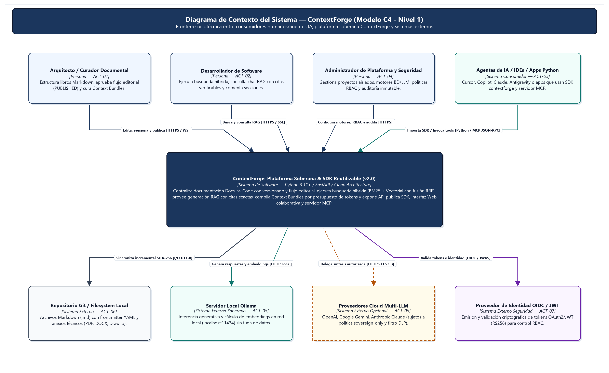
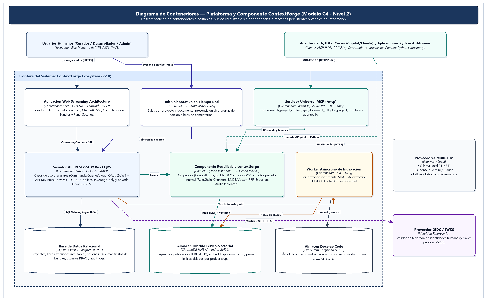
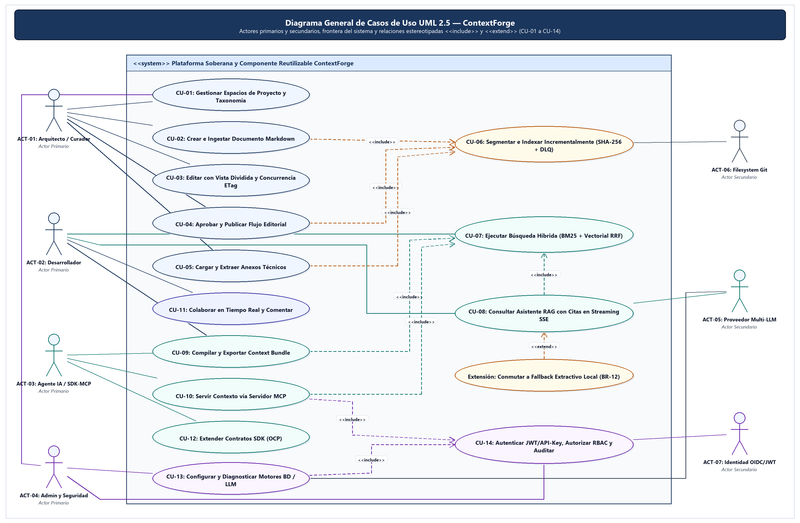
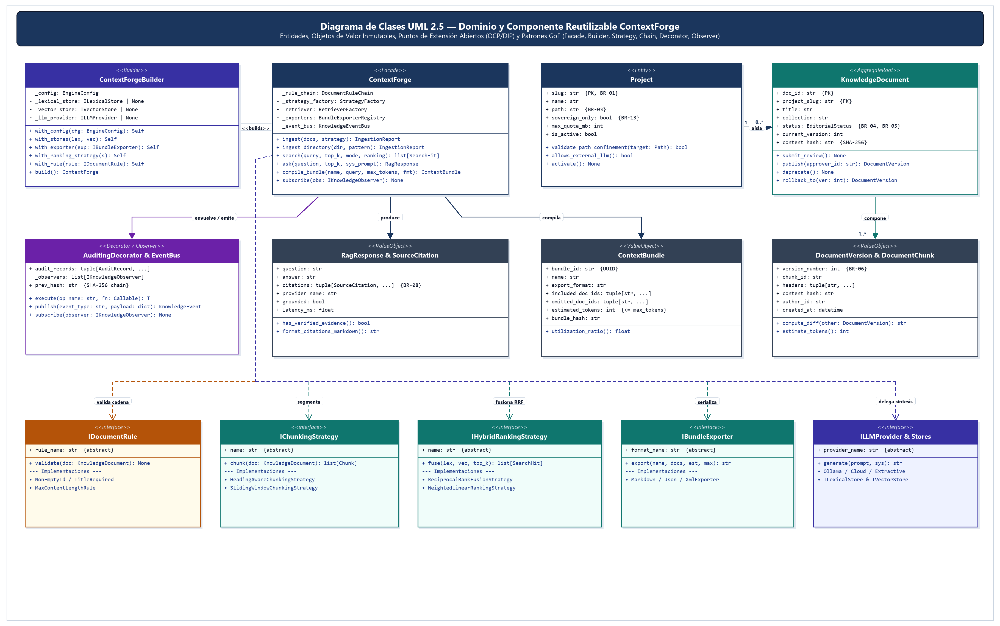
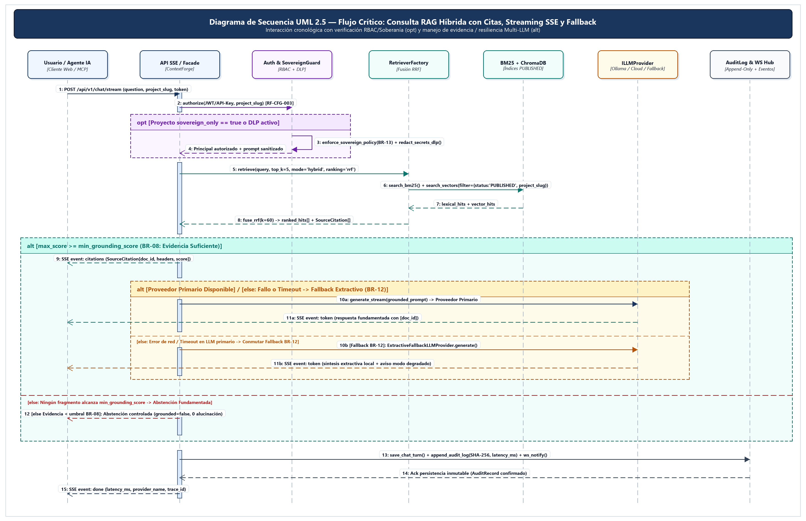
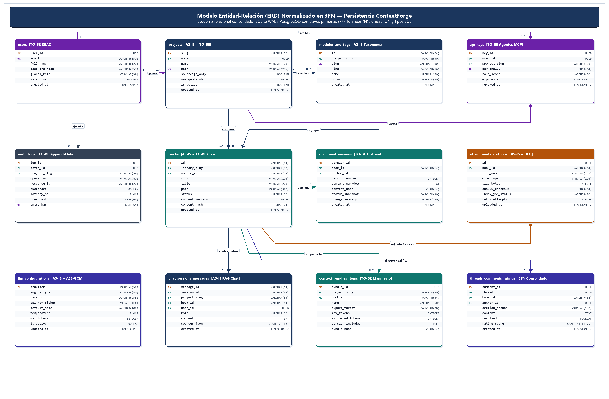

# ESPECIFICACIÓN DE REQUISITOS DE SOFTWARE (ERS) Y PROPUESTA DE REINGENIERÍA FUNCIONAL — CONTEXTFORGE (`v2.0.0`)

> **Universidad Popular del Cesar (UPC)** — Facultad de Ingenierías y Tecnológicas  
> **Especialización en Ingeniería de Software** — Módulo: **Ingeniería de Requerimientos**  
> **Docente:** Esp. / Msc. Maribel Romero Mestre  
> **Autores:** Kathy Carolina Sagbini Daza y Nayid Junior Castellar Agamez  
> **Ciudad y Año:** Valledupar, Cesar — 2026  
> **Estándares:** IEEE Std 830-1998 · ISO/IEC/IEEE 29148:2018 · ISO/IEC 25010:2023 · SWEBOK v4.0 · FURPS+ · INVEST · SPIDR · UML 2.5 · Modelo C4 · APA 7.ª Edición

---

## Tabla de Contenido Maestra

1. [1. Introducción y Marco Metodológico](#1-introducción-y-marco-metodológico)
   - 1.1 Propósito del Documento
   - 1.2 Alcance del Producto (SDK Reutilizable + Plataforma Soberana Web/API/MCP)
   - 1.3 Audiencias Objetivo y Uso del Documento
   - 1.4 Definiciones, Acrónimos y Abreviaturas
   - 1.5 Referencias Normativas y Metodológicas
   - 1.6 Visión General y Estructura de la Especificación
2. [2. Análisis del Problema, Elicitación, Stakeholders y Reingeniería Funcional](#2-análisis-del-problema-elicitación-stakeholders-y-reingeniería-funcional)
   - 2.1 Planteamiento del Problema y Pregunta Problema
   - 2.2 Visión del Producto
   - 2.3 Objetivos del Sistema (`OG-01` y `OE-01`..`OE-06`)
   - 2.4 Proceso de Ingeniería, Elicitación y Negociación de Conflictos
   - 2.5 Identificación y Gestión de Stakeholders (Poder/Interés y Matriz RACI)
   - 2.6 Diagnóstico Crítico y Reingeniería (`AS-IS v1.0.0` vs. `TO-BE v2.0.0`)
   - 2.7 Catálogo Maestro de Reglas e Invariantes de Negocio (`BR-01`..`BR-16`)
3. [3. Modelo de Casos de Uso y Requerimientos Funcionales (`RF-*`)](#3-modelo-de-casos-de-uso-y-requerimientos-funcionales-rf--bajo-ieee-830--iso-29148)
   - 3.1 Especificación de Actores del Sistema (`ACT-01`..`ACT-07`)
   - 3.2 Catálogo y Fichas Descriptivas de Casos de Uso (`CU-01`..`CU-14`)
   - 3.3 Especificación Formal por *Bounded Context* (`PRJ`, `DOC`, `RAG`, `BND`, `COL`, `CFG` — 25 Fichas `RF-*`)
4. [4. Requerimientos No Funcionales (`RNF-*`), Interfaces Externas y Otros Requisitos](#4-requerimientos-no-funcionales-rnf--interfaces-externas-y-otros-requisitos)
   - 4.1 Requerimientos No Funcionales bajo Modelo FURPS+ e ISO/IEC 25010:2023 (`RNF-01`..`RNF-18`)
   - 4.2 Matriz Consolidada de Calidad de Producto ISO/IEC 25010:2023
   - 4.3 Requisitos de Interfaces Externas (`RIU-*`, `RIH-*`, `RIS-*`, `RIC-*`)
   - 4.4 Otros Requisitos Legales, Regulatorios e IA Responsable (`OR-01`..`OR-06`)
5. [5. Modelado Ágil: Historias de Usuario (`HU-*`), Desglose `SPIDR` y Acuerdos `Scrum / XP`](#5-modelado-ágil-historias-de-usuario-hu--desglose-spidr-y-acuerdos-scrum--xp)
   - 5.1 Desglose de Épicas Complejas con Técnica `SPIDR` (`EP-01`..`EP-06`)
   - 5.2 Catálogo de 20 Historias de Usuario (`HU-01`..`HU-20`) bajo Criterios `INVEST` y Tareas `TI-*`
   - 5.3 *Product Backlog* Priorizado y Plan de Releases
   - 5.4 Acuerdos de Calidad Ágil: `DoR`, `DoD` y Prácticas `XP`
6. [6. Modelado Arquitectónico, Diseño Detallado y Diagramas de Ingeniería](#6-modelado-arquitectónico-diseño-detallado-y-diagramas-de-ingeniería)
   - 6.1 Diagrama de Contexto C4 Nivel 1 (`Figura 1`)
   - 6.2 Diagrama de Contenedores C4 Nivel 2 (`Figura 2`)
   - 6.3 Diagrama General de Casos de Uso UML 2.5 (`Figura 3`)
   - 6.4 Diagrama de Clases UML del Dominio y Patrones GoF (`Figura 4`)
   - 6.5 Diagrama de Secuencia del Flujo Crítico Principal (`Figura 5`)
   - 6.6 Modelo Entidad-Relación Normalizado en 3FN (`Figura 6`)
7. [7. Validación de Requisitos, Matriz de Trazabilidad (`RTM`) y Control de Cambios](#7-validación-de-requisitos-matriz-de-trazabilidad-rtm-y-control-de-cambios)
8. [8. Conclusiones](#8-conclusiones)
9. [9. Referencias Bibliográficas (APA 7.ª Edición)](#9-referencias-bibliográficas)

---

# 1. Introducción y Marco Metodológico

**Ficha de Control Documental**

| Atributo | Detalle Institucional y Técnico |
| :--- | :--- |
| **Proyecto / Producto** | **ContextForge**: Plataforma Soberana de Gestión Documental *Docs-as-Code*, Búsqueda Híbrida (BM25 + Vectorial), Generación Aumentada por Recuperación (RAG) con Citas, Compilación de *Context Bundles* y Componente de Software Reutilizable para Agentes de Inteligencia Artificial |
| **Tipo de Entregable** | Especificación de Requisitos de Software (ERS / SRS) y Propuesta de Reingeniería Funcional |
| **Código Documental** | `ERS-CF-UPC-2026-V2.0` |
| **Versión / Línea Base** | `2.0.0` (Integra Línea Base Operativa `AS-IS v1.0.0` y Reingeniería Objetivo `TO-BE v2.0.0`) |
| **Institución Académica** | Universidad Popular del Cesar (UPC) — Facultad de Ingenierías y Tecnológicas |
| **Posgrado** | Especialización en Ingeniería de Software |
| **Módulo Académico** | Ingeniería de Requerimientos |
| **Docente Titular** | Esp. / Msc. Maribel Romero Mestre |
| **Autores** | Kathy Carolina Sagbini Daza y Nayid Junior Castellar Agamez |
| **Estándares Aplicados** | IEEE Std 830-1998, ISO/IEC/IEEE 29148:2018, ISO/IEC 25010:2023 (SQuaRE), SWEBOK v4.0, FURPS+, UML 2.5, Modelo C4, Scrum/XP (INVEST, SPIDR), Normas APA 7.ª Edición |
| **Lugar y Fecha** | Valledupar, Cesar — 2026 |

---

## 1.1 Propósito del Documento

El presente documento constituye la **Especificación de Requisitos de Software (ERS)** formal, integral y verificable del sistema **ContextForge**, elaborada bajo los lineamientos metodológicos de los estándares internacionales **IEEE Std 830-1998** e **ISO/IEC/IEEE 29148:2018**, articulados con el modelo de calidad de producto **ISO/IEC 25010:2023 (SQuaRE)**, las áreas de conocimiento del **SWEBOK v4.0** y las prácticas ágiles de ingeniería de requisitos (**Scrum, Extreme Programming [XP], INVEST y SPIDR**).

Su propósito principal es establecer una **fuente única de verdad contractual, arquitectónica y de validación** entre los interesados del proyecto (*stakeholders*), el equipo de arquitectura y desarrollo, los ingenieros de aseguramiento de la calidad (QA) y los responsables de operación y mantenimiento. Adicionalmente, este documento trasciende la mera descripción pasiva de la versión implementada en el repositorio (**estado actual o `AS-IS v1.0.0`**) para incorporar un ejercicio riguroso de **reingeniería funcional y arquitectónica (`TO-BE v2.0.0`)**, identificando brechas estructurales de seguridad, gobernanza editorial, escalabilidad asíncrona, trazabilidad histórica e interoperabilidad multi-proveedor, y especificando formalmente los requerimientos que cierran dichas brechas.

## 1.2 Alcance del Producto

**ContextForge** es un ecosistema de software concebido bajo una arquitectura dual que resuelve la fragmentación de conocimiento técnico y la pérdida de contexto verificable al integrar agentes de Inteligencia Artificial (IA), copilotos de programación y asistentes conversacionales en proyectos de ingeniería de software:

1. **Núcleo Reutilizable Distribuible (`contextforge` Python SDK `v1.0.0+`):** Un componente de software autocontenido, instalable vía `pyproject.toml` (`pip install contextforge`) y libre de dependencias obligatorias de terceros en su núcleo, que expone una API pública pequeña, inmutable y extensible (`ContextForge`, `ContextForgeBuilder`, contratos abstractos en `contextforge.contracts`) separada estrictamente de su implementación interna (`contextforge._internal`). Provee validación documental por reglas encadenadas, segmentación semántica (*chunking*), indexación híbrida léxica (BM25) y vectorial, fusión de rankings (*Reciprocal Rank Fusion* [RRF] y combinación lineal ponderada), generación RAG con atribución exacta de citas y compilación determinista de paquetes de contexto (*Context Bundles*) sujetos a presupuestos estrictos de tokens.
2. **Plataforma Soberana Web, API REST/SSE, Tiempo Real y Servidor MCP (`ContextForge Hub`):** Una aplicación anfitriona construida bajo **Clean Architecture**, **CQRS granular** y **Screaming Web Architecture** (FastAPI, SQLAlchemy Async sobre SQLite WAL / PostgreSQL, ChromaDB, WebSockets y Tailwind CSS v4) que materializa sobre el motor central un entorno multi-proyecto de gestión documental *Docs-as-Code* (bibliotecas, libros, capítulos Markdown y anexos binarios), chat RAG en tiempo real con transmisión progresiva (*Server-Sent Events* [SSE]), compilador visual de *Context Bundles*, colaboración síncrona mediante WebSockets, administración dinámica de proveedores Multi-LLM (Ollama local, OpenAI, Google Gemini, Anthropic Claude o modo extractivo sin red) y un servidor nativo del **Model Context Protocol (MCP)** consumible por IDEs y agentes autónomos (Cursor, GitHub Copilot, Claude Code, Antigravity).

### Delimitación Explícita de Fronteras del Sistema

| Dimensión de Alcance | Capacidades Incluidas Dentro del Alcance (*In-Scope*) | Elementos Excluidos Fuera del Alcance (*Out-of-Scope*) |
| :--- | :--- | :--- |
| **Gobernanza y Espacios de Conocimiento (`PRJ`)** | Administración multi-proyecto (*workspaces* aislados por `project_slug`), taxonomía de colecciones/módulos y etiquetas, sincronización bidireccional con carpetas Markdown locales (*Docs-as-Code*) y control de cuotas por espacio (`TO-BE`). | Sistemas ERP financieros, facturación comercial por suscripción SaaS (pasarelas de pago Stripe/PSE) o gestión de nómina empresarial. |
| **Gestión Documental y Ciclo Editorial (`DOC`)** | Creación, edición enriquecida con vista previa dividida, carga y extracción de anexos técnicos (PDF, DOCX, TXT, código), flujo de estados editoriales (`DRAFT`, `IN_REVIEW`, `PUBLISHED`, `DEPRECATED`) e historial inmutable de versiones con *diff* y reversión (`TO-BE`). | Edición ofimática propietaria de hojas de cálculo complejas con macros VBA o diseño gráfico vectorial nativo dentro del navegador. |
| **Búsqueda Híbrida y Motor RAG (`RAG`)** | Segmentación sensible a encabezados Markdown, indexación dual BM25 + embeddings vectoriales, reindexación incremental por huella criptográfica `SHA-256` en cola asíncrona (`TO-BE`), consulta RAG con *streaming* SSE, citas verificables por fragmento y degradación extractiva local cuando no hay LLM disponible. | Entrenamiento desde cero (*pre-training*) o ajuste fino de pesos neuronales (*fine-tuning* con GPUs dedicadas) de modelos fundacionales de lenguaje. |
| **Empaquetado de Contexto e Integración IA (`BND`)** | Selección asistida o manual de documentos, cálculo en tiempo real de presupuesto de tokens (`max_tokens`), exportación extensible a Markdown, JSON, XML o formatos de terceros (`IBundleExporter`) y exposición de herramientas estandarizadas vía servidor **MCP** (`/mcp`). | Ejecución autónoma de despliegues en infraestructura productiva del cliente (CI/CD *runners* propios) sin supervisión de una herramienta externa. |
| **Colaboración en Tiempo Real y Auditoría (`COL`)** | Indicadores de presencia activa por documento vía WebSockets, hilos de comentarios y calificaciones técnicas por sección, notificaciones de cambios concurrentes y bitácora de auditoría transaccional de solo adición (*append-only*) (`TO-BE`). | Videoconferencia WebRTC integrada, llamadas de voz IP o mensajería instantánea corporativa generalista tipo Slack/Teams. |
| **Seguridad, Identidad y Multi-LLM (`CFG`)** | Configuración en caliente y diagnóstico de salud (*health-check*) de motores de base de datos y proveedores LLM, cifrado de secretos de API en reposo (`AES-256-GCM`, `TO-BE`), autenticación híbrida JWT/OIDC + API Keys para agentes y control de acceso basado en roles **RBAC** (`TO-BE`). | Aprovisionamiento físico de redes corporativas, gestión de directorios activos legados on-premise (LDAP v2 sin puente OIDC) o firewalls perimetrales de hardware. |

## 1.3 Audiencias Objetivo y Uso del Documento

Siguiendo la taxonomía clásica de lectores de una ERS formulada por Kotonya y Sommerville (1998) y estandarizada en ISO/IEC/IEEE 29148:2018, este documento ha sido estructurado para satisfacer las necesidades específicas de seis perfiles técnicos e institucionales:

1. **Patrocinadores Académicos, Directivos y Clientes (`Sponsors` / Evaluación Docente):** Utilizan las Secciones 1 y 2 para validar la pertinencia del problema abordado, la alineación con los objetivos estratégicos, el retorno técnico de las propuestas de reingeniería (`AS-IS` frente a `TO-BE`) y el alcance contractual del sistema.
2. **Líderes de Producto y Gestores de Proyecto (`Product Owners` / `Scrum Masters`):** Emplean las Secciones 2, 5 y 7 para gestionar las expectativas de los *stakeholders*, conducir la priorización del *Product Backlog*, planificar iteraciones basadas en puntos de historia Fibonacci, aplicar la descomposición **SPIDR** y auditar los criterios *Definition of Ready (DoR)* y *Definition of Done (DoD)*.
3. **Arquitectos de Software y Desarrolladores (`Backend`, `Frontend` e `Integradores SDK`):** Tienen en las Secciones 3, 4 y 6 su guía normativa de construcción; allí encuentran los contratos exactos de entradas, invariantes de negocio (`BR-*`), respuestas de error bajo **RFC 7807**, requisitos de interfaces externas (`RIU`, `RIH`, `RIS`, `RIC`) y los seis modelos arquitectónicos y de datos en **C4, UML 2.5 y ERD**.
4. **Ingenieros de Aseguramiento de Calidad (`QA` y Automatización de Pruebas):** Se apoyan en los criterios de aceptación **Gherkin (`Dado / Cuando / Entonces`)** de cada `RF-*` y `HU-*`, las métricas cuantitativas verificables de los `RNF-*` y la Matriz de Trazabilidad Bidireccional (**RTM**) de la Sección 7 para diseñar casos de prueba unitarios, de integración, de contrato MCP, de carga y de aceptación E2E.
5. **Ingenieros de Seguridad, Datos y Cumplimiento (`DevSecOps` / Oficial de Privacidad):** Consultan la Sección 4 para verificar los controles de autenticación OAuth2/JWT, autorización RBAC, prevención de fugas de información confidencial hacia LLMs externos, soberanía de datos y adherencia a la legislación colombiana de protección de datos personales.
6. **Equipos de Mantenimiento y Evolución de Plataforma:** Aprovechan la separación explícita de puntos de extensión bajo el Principio Abierto/Cerrado (**OCP**), el catálogo de reglas de negocio y el modelo relacional normalizado para incorporar nuevos proveedores generativos, almacenes vectoriales o exportadores sin introducir regresiones.

## 1.4 Definiciones, Acrónimos y Abreviaturas

Con el fin de eliminar cualquier ambigüedad léxica o semántica (criterio de *No Ambigüedad* de IEEE Std 830), la Tabla 1 establece las definiciones canónicas empleadas a lo largo de toda la especificación.

| Acrónimo / Término | Significado Técnico en el Dominio de ContextForge |
| :--- | :--- |
| **ADR** | *Architecture Decision Record*: Documento breve en Markdown que registra una decisión arquitectónica relevante, su contexto, alternativas evaluadas y consecuencias. |
| **API** | *Application Programming Interface*: Conjunto de contratos públicos (en Python SDK o endpoints HTTP REST) mediante los cuales consumidores externos interactúan con ContextForge. |
| **AS-IS** | Estado base actual del software auditado en el repositorio (`ContextForge v1.0.0`), funcional y verificado, sobre el cual se diagnostican oportunidades de mejora. |
| **BM25** | *Best Matching 25*: Función probabilística de recuperación de información léxica basada en frecuencia de términos (TF), frecuencia inversa de documento (IDF) y normalización por longitud. |
| **Bounded Context** | Contexto delimitado según *Domain-Driven Design* (DDD) dentro del cual un modelo de dominio, vocabulario ubicuo e invariantes mantienen significado unívoco (`PRJ`, `DOC`, `RAG`, `BND`, `COL`, `CFG`). |
| **C4 (Modelo)** | Notación jerárquica de arquitectura de software propuesta por Simon Brown compuesta por cuatro niveles de abstracción: Contexto (N1), Contenedores (N2), Componentes (N3) y Código (N4). |
| **Chunk / Chunking** | Fragmento cohesivo de texto extraído de un documento fuente mediante una estrategia de segmentación (`HeadingAware` o `SlidingWindow`) para maximizar la precisión de búsqueda e inyección RAG. |
| **Context Bundle** | Paquete determinista e inmutable de conocimiento compilado por ContextForge para un agente de IA, ajustado estrictamente a un presupuesto máximo de tokens (`max_tokens`) en formato Markdown, JSON o XML. |
| **CQRS** | *Command Query Responsibility Segregation*: Patrón arquitectónico que segrega las operaciones de mutación de estado (*Commands*) de las operaciones de lectura y proyección (*Queries*). |
| **DLQ** | *Dead-Letter Queue*: Cola de mensajes o tareas fallidas donde se aíslan documentos cuya extracción o indexación falló tras agotar la política de reintentos, permitiendo inspección y reprocesamiento. |
| **Docs-as-Code** | Filosofía de ingeniería documental donde la documentación técnica reside en texto plano (Markdown) junto al código fuente, sometida a control de versiones, validación automática y trazabilidad. |
| **DoD / DoR** | *Definition of Done* (Definición de Terminado) y *Definition of Ready* (Definición de Preparado): Acuerdos formales de calidad de entrada y salida de elementos del *Sprint Backlog* en Scrum. |
| **ERS / SRS** | Especificación de Requisitos de Software (*Software Requirements Specification*). |
| **FURPS+** | Modelo taxonómico de requisitos desarrollado por Robert Grady en Hewlett-Packard: *Functionality, Usability, Reliability, Performance, Supportability* más restricciones de diseño, interfaz, físicas y legales (`+`). |
| **GoF / GRASP / SOLID** | Catálogo de 23 patrones de diseño clásicos (*Gang of Four*), patrones de asignación de responsabilidades (*General Responsibility Assignment Software Patterns*) y los cinco principios de diseño orientado a objetos de Robert C. Martin. |
| **INVEST** | Criterio de calidad para Historias de Usuario formulado por Bill Wake: *Independent, Negotiable, Valuable, Estimable, Small, Testable*. |
| **MCP** | *Model Context Protocol*: Protocolo estándar abierto basado en JSON-RPC 2.0 que permite a agentes de IA e IDEs descubrir e invocar herramientas (`tools`), recursos y contextos expuestos por servidores locales o remotos. |
| **OCP** | *Open/Closed Principle* (Principio Abierto/Cerrado): Las entidades de software deben estar abiertas para su extensión mediante contratos polimórficos, pero cerradas para la modificación de su código fuente probado. |
| **P95 / P99** | Percentiles 95 y 99 de distribución de latencia; indican el tiempo máximo de respuesta garantizado para el 95 % y el 99 % de las peticiones bajo una carga concurrente dada. |
| **RAG** | *Retrieval-Augmented Generation*: Arquitectura híbrida que recupera fragmentos verificados de una base de conocimiento antes de invocar un modelo generativo (LLM), anclando la respuesta en evidencia trazable. |
| **RBAC** | *Role-Based Access Control*: Modelo de seguridad donde los permisos sobre operaciones se asignan a roles organizacionales (`Admin`, `Curator`, `Consumer`, `AgentClient`) y no a sujetos aislados. |
| **RFC 7807** | Estándar IETF (*Problem Details for HTTP APIs*, actualizado por RFC 9457) que define una estructura JSON uniforme (`type`, `title`, `status`, `detail`, `instance`) para reportar errores en APIs HTTP. |
| **RRF** | *Reciprocal Rank Fusion*: Algoritmo matemático de fusión de listas ordenadas heterogéneas definido por $\text{RRF}(d) = \sum_{r \in R} \frac{1}{k + \text{rank}_r(d)}$, capaz de combinar resultados BM25 y vectoriales sin requerir calibración de escalas. |
| **RPO / RTO** | *Recovery Point Objective* (pérdida máxima tolerable de datos medida en tiempo) y *Recovery Time Objective* (tiempo máximo tolerable para restaurar el servicio tras un incidente). |
| **RTM** | *Requirements Traceability Matrix*: Matriz de Trazabilidad Bidireccional que vincula objetivos de negocio, interesados, requisitos funcionales, reglas de negocio, casos de uso, historias de usuario, requisitos no funcionales y pruebas. |
| **SPIDR** | Técnica ágil propuesta por Mike Cohn para dividir épicas complejas en historias pequeñas mediante cinco vectores: *Spike, Paths, Interfaces, Data, Rules*. |
| **SSE** | *Server-Sent Events*: Estándar HTTP unidireccional (`text/event-stream`) utilizado por ContextForge para transmitir en tiempo real los tokens generados por el motor RAG y las citas asociadas. |
| **SUS** | *System Usability Scale*: Cuestionario psicométrico estandarizado de 10 ítems (escala 0 a 100) creado por John Brooke para medir objetivamente la usabilidad percibida de un sistema. |
| **TO-BE** | Estado objetivo propuesto mediante reingeniería funcional y arquitectónica en esta ERS (`ContextForge v2.0.0`) para elevar la seguridad, escalabilidad, gobernanza y auditabilidad del producto. |
| **WAL** | *Write-Ahead Logging*: Modo transaccional de motores relacionales como SQLite y PostgreSQL que permite lecturas concurrentes sin bloqueo mientras se ejecutan escrituras atómicas. |

## 1.5 Referencias Normativas y Metodológicas

La formulación, clasificación, análisis, validación y modelado de los requisitos contenidos en esta especificación se fundamentan en el siguiente marco normativo, técnico y legal:

- **Estándares Internacionales de Ingeniería de Software y Calidad:**
  - **IEEE Std 830-1998:** *IEEE Recommended Practice for Software Requirements Specifications*, adoptado para la organización estructural de secciones, criterios de completitud, consistencia, verificabilidad y especificación de interfaces externas.
  - **ISO/IEC/IEEE 29148:2018:** *Systems and software engineering — Life cycle processes — Requirements engineering*, empleado para la sintaxis formal libre de ambigüedades, atributos de requisitos, trazabilidad bidireccional y validación de necesidades de interesados.
  - **ISO/IEC 25010:2023 (SQuaRE):** *Systems and software engineering — Systems and software Quality Requirements and Evaluation — Product quality model*, utilizado para categorizar y cuantificar los atributos de calidad del producto (adecuación funcional, eficiencia de desempeño, compatibilidad, capacidad de interacción/usabilidad, fiabilidad, seguridad, mantenibilidad y flexibilidad).
  - **IEEE Computer Society — SWEBOK v4.0 (2024):** *Guide to the Software Engineering Body of Knowledge*, Capítulo 1 (*Software Requirements*), guía rectora del proceso de elicitación, análisis, negociación, especificación y validación.
  - **OMG UML 2.5.1 (2017) y Modelo C4 (Brown, 2018):** Estándares de notación visual para los diagramas de contexto, contenedores, casos de uso, clases de dominio y secuencia de interacciones.
  - **IETF RFC 7807 / RFC 9457, RFC 6749 (OAuth 2.0), RFC 7519 (JWT) y W3C WCAG 2.1 Nivel AA:** Estándares técnicos de interoperabilidad web, seguridad de APIs y accesibilidad de interfaces de usuario.
- **Marco Metodológico Ágil y de Diseño:**
  - **Guías Metodológicas Institucionales UPC (Romero Mestre, 2026):** Lineamientos de cátedra sobre gramática formal de requisitos, proceso de negociación en tres etapas, matriz de visión, especificación de interfaces externas y lista de chequeo de validación (`ER, N, Na, V, Cpo, Cto, Vb, Pb, Cte`).
  - **Scrum Guide (Schwaber & Sutherland, 2020), User Stories Applied / SPIDR (Cohn, 2004) y Extreme Programming Explained (Beck & Andres, 2004):** Marco para historias de usuario bajo criterios INVEST, estimación relativa Fibonacci, *Definition of Ready/Done*, TDD e integración continua.
- **Marco Normativo y Regulatorio Colombiano aplicable a Datos e IA:**
  - **Ley Estatutaria 1581 de 2012 y Decreto Reglamentario 1377 de 2013:** Régimen general de protección de datos personales (*Habeas Data*) en Colombia, aplicable al tratamiento de identidades de autores, registros de auditoría y prevención de exposición de datos sensibles en prompts generativos.
  - **Ley 1273 de 2009:** Protección de la información y de los datos frente a accesos abusivos, interceptación o daño informático.
  - **Ley 1712 de 2014 y Resolución MinTIC 1519 de 2020:** Lineamientos de transparencia, accesibilidad digital (conformidad WCAG 2.1 AA) y seguridad de la información cuando la plataforma se despliega en entornos institucionales o académicos.
  - **CONPES 4144 de 2025 / Marco Ético para la Inteligencia Artificial en Colombia:** Principios de transparencia algorítmica, explicabilidad (citas verificables obligatorias), supervisión humana y privacidad desde el diseño (*Privacy by Design*).

## 1.6 Visión General y Estructura de la Especificación

El resto de este documento se organiza en ocho capítulos cohesivos y mutuamente trazables:

- **Capítulo 2 (Análisis del Problema, Elicitación, Stakeholders y Reingeniería):** Examina la problemática raíz del manejo de contexto técnico para IA, formula la pregunta problema, la visión del producto y los objetivos medibles; documenta el proceso de elicitación y negociación de conflictos; caracteriza a los *stakeholders* mediante matrices Poder/Interés y RACI; expone el diagnóstico crítico comparativo `AS-IS` frente a `TO-BE` y consolida el catálogo maestro de reglas de negocio (`BR-01` a `BR-16`).
- **Capítulo 3 (Modelo de Casos de Uso y Requerimientos Funcionales):** Define los actores primarios y secundarios, las fichas descriptivas de 14 Casos de Uso (`CU-01` a `CU-14`) y especifica en tablas rigurosas 24 Requerimientos Funcionales (`RF-*`) distribuidos en seis *Bounded Contexts* (`PRJ`, `DOC`, `RAG`, `BND`, `COL`, `CFG`), siguiendo estrictamente la fórmula gramatical institucional, validaciones de entrada, procesamiento paso a paso, errores RFC 7807 y escenarios Gherkin.
- **Capítulo 4 (Requerimientos No Funcionales, Interfaces Externas y Otros Requisitos):** Cuantifica 18 Requerimientos No Funcionales (`RNF-01` a `RNF-18`) bajo el modelo **FURPS+** cruzado con **ISO/IEC 25010:2023**, detalla los requisitos de interfaces de usuario (`RIU-*`), hardware (`RIH-*`), software (`RIS-*`) y comunicaciones (`RIC-*`), e incorpora los requisitos legales, regulatorios y de gobernanza de IA (`OR-*`).
- **Capítulo 5 (Modelado Ágil: SPIDR, Historias de Usuario y Acuerdos Scrum/XP):** Presenta la partición de épicas complejas con la técnica **SPIDR**, el catálogo de 20 Historias de Usuario (`HU-01` a `HU-20`) verificadas con **INVEST** y desglosadas en tareas de ingeniería (`TI-*`), el *Product Backlog* priorizado y los acuerdos operativos *DoR*, *DoD* y prácticas *XP*.
- **Capítulo 6 (Modelado Arquitectónico y Diagramas de Ingeniería):** Integra y documenta los seis modelos gráficos nativos desarrollados en Draw.io (Contexto C4 N1, Contenedores C4 N2, Casos de Uso UML, Clases de Dominio UML, Secuencia Principal con fragmentos `alt`/`opt` y Modelo Entidad-Relación Normalizado ERD).
- **Capítulo 7 (Validación de Requisitos, Matriz de Trazabilidad RTM y Control de Cambios):** Aplica la lista de chequeo formal de validación de calidad sobre los requisitos, construye la Matriz de Trazabilidad Bidireccional completa y define el protocolo de gestión de línea base y control de cambios.
- **Capítulos 8 y 9 (Conclusiones y Referencias Bibliográficas):** Sintetizan los aportes ingenieriles de la especificación y la reingeniería propuesta, cerrando con las fuentes bibliográficas en formato **APA 7.ª edición**.

---

# 2. Análisis del Problema, Elicitación, Stakeholders y Reingeniería Funcional

## 2.1 Planteamiento del Problema

### Situación Actual y Contexto Tecnológico

En la ingeniería de software contemporánea, la adopción acelerada de Modelos Grandes de Lenguaje (*Large Language Models* — LLMs), asistentes conversacionales y agentes autónomos de codificación ha transformado radicalmente los flujos de diseño, implementación, revisión de código y soporte operativo. Sin embargo, las organizaciones de desarrollo, grupos de investigación universitarios y equipos de arquitectura enfrentan una paradoja estructural: aunque los modelos fundacionales poseen capacidades notables de síntesis y razonamiento general, **carecen de conocimiento fáctico, actualizado y gobernado sobre la arquitectura específica, las reglas de negocio invariables (`BR-*`), los contratos de API y las decisiones de diseño (ADRs) propias de cada proyecto**.

En la práctica cotidiana de los equipos técnicos, el conocimiento del proyecto suele encontrarse atomizado entre archivos Markdown sueltos en repositorios Git, documentos Word o PDF desactualizados, hilos efímeros de mensajería y conocimiento tácito no documentado. Cuando un ingeniero o un agente de IA necesita responder una consulta crítica o modificar un módulo sin violar las reglas arquitectónicas, se ve obligado a copiar manualmente fragmentos arbitrarios de texto en el prompt o a conectar servicios en la nube de terceros que indexan información confidencial fuera del perímetro soberano de la organización.

### Síntomas, Causas Raíz y Consecuencias

El diagnóstico de ingeniería efectuado sobre los flujos tradicionales de gestión de contexto técnico y sobre la primera versión base del sistema (**ContextForge `AS-IS v1.0.0`**) permitió identificar la cadena causal que se detalla a continuación:

1. **Síntomas Observables:**
   - Respuestas generativas verosímiles pero técnicamente erróneas (*alucinaciones*) al consultar sobre reglas internas, nombres exactos de clases, códigos de excepción o políticas operativas del proyecto.
   - Imposibilidad de verificar con rapidez de qué documento, versión y encabezado proviene una afirmación entregada por un asistente de IA.
   - Desbordamiento recurrente de la ventana de contexto (*context window overflow*) o degradación de atención (*lost-in-the-middle*) al inyectar documentación completa sin control presupuestario de tokens.
   - Acoplamiento rígido de los proyectos consumidores a librerías pesadas, motores vectoriales únicos o APIs comerciales de pago, impidiendo reutilizar la lógica de conocimiento como un componente limpio en otros sistemas.
   - En la versión base `AS-IS` del repositorio: ausencia de control de acceso por roles (RBAC) cuando se despliega en red compartida, inexistencia de separación estricta entre borradores no aprobados y documentos publicados que alimentan al motor RAG, bloqueo síncrono durante la reindexación de directorios extensos y pérdida de trazabilidad de auditoría al reiniciar el proceso en memoria.

2. **Causas Raíz:**
   - **Carencia de búsqueda híbrida calibrada:** Los buscadores exclusivamente léxicos fallan ante paráfrasis semánticas, mientras que los buscadores exclusivamente vectoriales diluyen identificadores exactos (`RF-RAG-002`, `BR-07`, nombres de endpoints o variables de entorno).
   - **Desconexión entre el ciclo de vida documental y el índice de IA:** Los documentos en edición o obsoletos son indexados con el mismo peso que las especificaciones aprobadas, contaminando las respuestas generativas (*context poisoning* involuntario).
   - **Falta de contratos estandarizados de empaquetamiento e integración:** No existe en la mayoría de los repositorios un mecanismo determinista que compile paquetes de contexto (*Context Bundles*) acotados por tokens ni que los exponga simultáneamente vía SDK programático, API HTTP/SSE y protocolo **MCP**.
   - **Diseño inicial orientado a entorno monousuario local (`AS-IS`):** La primera iteración priorizó la agilidad de arranque local sin autenticación ni colas asíncronas de indexación, lo cual limita su adopción en equipos colaborativos concurrentes de 10 a 100 ingenieros.

3. **Consecuencias Operativas, Técnicas y de Negocio:**
   - Incremento del retrabajo técnico y defectos arquitectónicos introducidos por asistentes de IA que desconocen las invariantes reales del sistema.
   - Pérdida de tiempo de ingeniería (estimada entre 25 % y 35 % durante sesiones de *onboarding* y diagnóstico) buscando y ensamblando manualmente contexto documental.
   - Riesgo legal y de seguridad de la información (incumplimiento de confidencialidad y de la Ley 1581 de 2012) al transmitir documentación interna sensible hacia servicios generativos externos sin controles de soberanía ni anonimización.

### Matriz Formal de Síntesis del Problema

| Elemento Metodológico | Descripción Estructurada en ContextForge |
| :--- | :--- |
| **El problema de** | Fragmentación documental, recuperación unimodal imprecisa, alucinaciones generativas sin atribución verificable de fuentes, desbordamiento de presupuestos de tokens y carencia de gobernanza editorial/seguridad multi-proyecto en la provisión de contexto técnico para humanos y agentes de IA. |
| **Afecta a** | Arquitectos de software, desarrolladores backend/frontend, líderes técnicos, curadores de documentación, ingenieros de QA y agentes autónomos de IA que construyen, auditan y mantienen sistemas de software intensivos en conocimiento. |
| **Cuyo impacto es** | Generación de código y respuestas inconsistentes con la arquitectura real, altos tiempos de búsqueda e integración manual de contexto, riesgo de filtración de propiedad intelectual hacia nubes externas, contaminación del motor RAG con borradores no validados y alto costo de acoplamiento al integrar capacidades de base de conocimiento en nuevas aplicaciones. |
| **Una solución exitosa sería** | Disponer de **ContextForge** como plataforma soberana y componente de software reutilizable que unifique la gestión documental *Docs-as-Code* con control editorial y versionado, ejecute búsqueda híbrida (BM25 + vectorial con fusión RRF), provea respuestas RAG fundamentadas con citas exactas bajo arquitectura Multi-LLM/local, compile *Context Bundles* ajustados por presupuesto de tokens y exponga sus capacidades de forma segura (JWT/RBAC) vía SDK Python sin dependencias, interfaz web colaborativa en tiempo real y protocolo **MCP**. |

### Formulación de la Pregunta Problema

> ¿Cómo diseñar, especificar y evolucionar mediante reingeniería funcional una plataforma soberana y un componente de software reutilizable que permita gestionar documentación técnica viva (*Docs-as-Code*) con gobernanza editorial, ejecutar recuperación híbrida léxico-vectorial y generación aumentada por recuperación (RAG) con citas verificables, compilar paquetes de contexto sujetos a presupuestos estrictos de tokens e integrarse de forma segura, desacoplada y en tiempo real con equipos humanos y agentes de Inteligencia Artificial?

---

## 2.2 Visión del Producto

### Declaración Formal de la Visión

En concordancia con la plantilla estratégica de ingeniería de requisitos de Moore / Leffingwell adoptada en la guía metodológica institucional, se establece la siguiente declaración de visión del producto:

> **Para** equipos de ingeniería de software, arquitectos de soluciones, curadores técnicos e integradores de agentes de Inteligencia Artificial, **quienes** necesitan centralizar, gobernar y suministrar conocimiento técnico verificado a personas y modelos generativos sin sufrir alucinaciones, desbordamiento de ventana de tokens, fugas de propiedad intelectual ni acoplamiento a proveedores propietarios, **ContextForge**, **que es** una plataforma soberana de base de conocimiento *Docs-as-Code*, motor de búsqueda híbrida / RAG con citas y componente de software reutilizable en Python con soporte nativo MCP, **ofrece** ingesta validada con control de ciclo editorial, recuperación híbrida léxico-semántica (BM25 + vectorial mediante *Reciprocal Rank Fusion*), respuestas generativas ancladas estrictamente en evidencia citada, compilación determinista de *Context Bundles* por presupuesto de tokens y colaboración síncrona multi-proyecto; **a diferencia de** las wikis estáticas tradicionales (Confluence, Notion) desconectadas del flujo de agentes y de los frameworks RAG monolíticos acoplados a APIs comerciales en la nube, **nuestro producto** combina un núcleo SDK 100 % estándar, extensible bajo principios SOLID/GoF y operable totalmente en modo soberano local (Ollama / modo extractivo sin red) o híbrido empresarial con seguridad RBAC y auditoría inmutable.

### Matriz Estructurada de Visión del Producto

| Cláusula de Visión | Especificación Aplicada al Dominio de ContextForge |
| :--- | :--- |
| **PARA** | Equipos de desarrollo de software, arquitectos de sistemas, curadores documentales, ingenieros de QA y desarrolladores de aplicaciones basadas en agentes de IA. |
| **QUIENES** | Enfrentan dispersión de especificaciones técnicas, respuestas generativas sin respaldo documental verificable, exceso de consumo de tokens y dificultades para reutilizar motores RAG de forma privada y desacoplada. |
| **EL** | **ContextForge** (`ContextForge SDK` + `ContextForge Knowledge Hub`). |
| **QUE ES** | Un componente de software reutilizable en Python y una plataforma web/API/MCP soberana de gestión documental *Docs-as-Code*, búsqueda híbrida y compilación de contexto para IA. |
| **QUE** | Valida, versiona e indexa documentos Markdown y anexos técnicos; fusiona búsqueda léxica BM25 y semántica vectorial; responde consultas RAG en *streaming* con citas exactas por fragmento; y empaqueta *Context Bundles* óptimos en tokens. |
| **A DIFERENCIA DE** | Repositorios documentales pasivos sin recuperación semántica y librerías RAG pesadas con fuerte dependencia de servicios cloud externos y sin gobernanza editorial ni servidor MCP integrado. |
| **NUESTRO PRODUCTO** | Garantiza soberanía total de los datos (operación local u orquestación Multi-LLM intercambiable), cero dependencias obligatorias en su paquete núcleo reutilizable, extensibilidad abierta sin modificación de código (**OCP**) y trazabilidad completa de extremo a extremo. |

---

## 2.3 Objetivos del Sistema

### 2.3.1 Objetivo General (`OG-01`)

- **`OG-01`:** Especificar, estructurar y evolucionar mediante reingeniería funcional la plataforma y componente reutilizable **ContextForge**, integrando gestión documental *Docs-as-Code* con gobernanza editorial, motor de búsqueda híbrida léxico-vectorial, generación aumentada por recuperación (RAG) con atribución verificable de fuentes, compilación determinista de *Context Bundles* y exposición segura vía SDK Python, API REST/SSE, WebSockets y protocolo MCP, con el fin de garantizar precisión contextual, soberanía de información, mantenibilidad y alta calidad de software conforme a los estándares IEEE 830, ISO/IEC/IEEE 29148 e ISO/IEC 25010.

### 2.3.2 Objetivos Específicos (`OE-01` a `OE-06`)

1. **`OE-01` (Gobernanza Multi-Proyecto y Ciclo Documental):** Establecer un mecanismo aislado de administración multi-proyecto, taxonomía modular, control de versiones inmutable y flujo de estados editoriales (`Borrador`, `En Revisión`, `Publicado`, `Retirado`) sobre documentos Markdown y anexos técnicos, evitando que información obsoleta o no aprobada contamine las respuestas del motor de IA.
2. **`OE-02` (Recuperación Híbrida e Indexación Resiliente):** Diseñar un subsistema de validación por cadena de reglas, segmentación sensible a encabezados y reindexación incremental asíncrona (`SHA-256` + cola con DLQ) que combine índices léxicos BM25 y vectoriales mediante estrategias intercambiables de fusión (**RRF** y ponderación lineal), maximizando la precisión tanto en términos exactos como en consultas conceptuales.
3. **`OE-03` (Generación RAG Fundamentada y Multi-LLM):** Proveer un pipeline conversacional RAG con transmisión progresiva (*SSE*), citas obligatorias enlazadas al documento y fragmento fuente, aislamiento de sesiones por proyecto y conmutación transparente entre proveedores LLM locales (Ollama), remotos (OpenAI, Gemini, Anthropic) y un modo extractivo determinista sin red.
4. **`OE-04` (Empaquetado de Contexto e Interoperabilidad MCP/SDK):** Suministrar un compilador de *Context Bundles* gobernado por presupuestos estrictos de tokens (`max_tokens`) con exportación polimórfica (Markdown, JSON, XML y extensiones de terceros) y exposición directa a través de la API pública del paquete `contextforge` y del servidor universal **Model Context Protocol (MCP)**.
5. **`OE-05` (Colaboración en Tiempo Real y Usabilidad Centrada en el Humano):** Consolidar una experiencia de usuario minimalista, accesible (**WCAG 2.1 AA**) y alineada con las **10 Heurísticas de Jakob Nielsen**, dotada de sincronización en tiempo real mediante WebSockets para presencia activa, comentarios técnicos contextualizados y prevención de conflictos de edición concurrente.
6. **`OE-06` (Seguridad Empresarial, Auditoría y Calidad Verificable):** Incorporar controles de autenticación híbrida (OAuth2/JWT para usuarios humanos y API Keys con alcance restringido para agentes), autorización basada en roles (**RBAC**), cifrado de credenciales en reposo, bitácora de auditoría inmutable y trazabilidad completa verificada mediante pruebas automatizadas.

---

## 2.4 Proceso de Ingeniería y Elicitación de Requerimientos

### Técnicas de Elicitación Aplicadas

Para construir una especificación rigurosa que articule fielmente las capacidades ya construidas con las mejoras de reingeniería requeridas por un entorno de producción, se ejecutó un proceso de elicitación multimétodo estructurado en cinco técnicas complementarias:

1. **Arqueología de Software y Auditoría Arquitectónica del Sistema Existente (`AS-IS`):** Inspección exhaustiva del código fuente en `src/contextforge/` (componente reutilizable), `src/domain/`, `src/application/` (casos de uso CQRS), `src/infrastructure/` (SQLAlchemy Async, ChromaDB, BM25, estrategias de base de datos, adaptadores LLM y WebSockets) y `src/presentation/` (endpoints REST v1, servidor FastMCP y vistas Screaming Web). Esta técnica permitió levantar con exactitud los contratos reales, entidades ORM y reglas actualmente operativas.
2. **Análisis Documental y Normativo:** Revisión sistemática de la documentación técnica previa del repositorio (`README.md`, `docs/01-documentacion-funcional.md` a `docs/04-evaluacion-critica-de-calidad.md`), contrastada con las guías metodológicas de Ingeniería de Requerimientos de la Universidad Popular del Cesar y las normas IEEE 830, ISO/IEC/IEEE 29148 e ISO/IEC 25010.
3. **Observación Directa e Inspección Heurística de Flujos UX (Nielsen):** Recorrido empírico sobre las siete vistas reales de la interfaz web (`/docs/browser`, `/docs/view/...`, `/books/editor`, `/chat`, `/bundles`, `/projects`, `/settings`) evaluando visibilidad del estado del sistema, carga cognitiva, manejo de estados vacíos (*skeletons*), atajos de teclado, prevención de pérdida de cambios no guardados y claridad de citas en el chat RAG.
4. **Entrevistas Semiestructuradas y Talleres JAD (*Joint Application Design*) por Roles:** Sesiones estructuradas de análisis desde la perspectiva de cuatro arquetipos usuarios reales (Arquitecto Líder / Curador Documental, Desarrollador Consumidor del SDK/MCP, Administrador de Infraestructura IA y Auditor de Seguridad/QA) para descubrir necesidades tácitas no cubiertas por el MVP inicial.
5. **Prototipado Evolutivo y Validación mediante Escenarios Gherkin:** Construcción y verificación ejecutable de aplicaciones cliente de referencia (`examples/agent_knowledge_cli.py`) y flujos de extremo a extremo para comprobar la ergonomía de la API pública y refinar las precondiciones y postcondiciones de cada requisito.

### Dificultades Encontradas y Estrategias de Superación

- **Tensión entre simplicidad del paquete reutilizable y riqueza funcional de la plataforma web:** Inicialmente existía el riesgo de contaminar el paquete instalable `contextforge` con dependencias pesadas de servidor web y bases de datos. Se superó definiendo una arquitectura en capas concéntricas donde el núcleo `src/contextforge/` permanece 100 % libre de dependencias externas y la plataforma web/MCP actúa como consumidor y adaptador de infraestructura.
- **Rastros terminológicos heredados en carpetas antiguas:** El workspace conservaba referencias históricas a dominios previos; mediante auditoría semántica se depuró y consolidó el lenguaje ubicuo (*Ubiquitous Language*) exclusivamente en torno al dominio de **ContextForge**.
- **Cuantificación objetiva de criterios no funcionales:** Se sustituyeron expresiones subjetivas frecuentes en etapas tempranas ("búsqueda rápida", "interfaz intuitiva", "sistema seguro") por umbrales estadísticos medibles ($P95$, $P99$, puntaje **SUS**, ratio de contraste **WCAG**, cobertura de líneas y **RPO/RTO**).

### Negociación y Resolución de Conflictos de Requerimientos

Siguiendo el modelo metodológico de negociación en tres etapas (**1. Información $\rightarrow$ 2. Debate $\rightarrow$ 3. Resolución**), se resolvieron cuatro conflictos críticos entre necesidades contrapuestas de los *stakeholders*:

| ID Conflicto | Etapa 1: Información (Partes y Requerimientos en Tensión) | Etapa 2: Debate (Análisis de Compensaciones / *Trade-offs*) | Etapa 3: Resolución Arquitectónica Acordada |
| :--- | :--- | :--- | :--- |
| **`CNF-01`** | **Oficial de Seguridad (`SH-06`)** exige prohibir salida de datos a internet (solo inferencia local), mientras que **Líder de Desarrollo (`SH-03`)** solicita usar modelos cloud (OpenAI / Gemini) para consultas arquitectónicas complejas. | Bloquear todo proveedor cloud reduce capacidad analítica en equipos sin GPU dedicada; abrir APIs cloud indiscriminadamente vulnera la soberanía de proyectos confidenciales. | Se incorpora el patrón `ILLMProvider` con política configurable **por proyecto** (`allow_external_llm: bool` en `TO-BE`): los proyectos clasificados como confidenciales fuerzan ejecución exclusiva en Ollama local o proveedor extractivo determinista sin red (`RF-CFG-002`, `BR-13`). |
| **`CNF-02`** | **Integrador del SDK (`SH-04`)** requiere `pip install contextforge` con cero dependencias externas e inicio instantáneo, mientras que **Administrador de Plataforma (`SH-05`)** demanda persistencia SQLite/PostgreSQL y vectores ChromaDB a gran escala. | Incluir `fastapi`, `sqlalchemy` y `chromadb` como dependencias obligatorias haría pesado y frágil el componente reutilizable en microservicios o pipelines CI/CD ligeros. | Se adopta empaquetado modular en `pyproject.toml` con `dependencies = []` en el núcleo (almacenes en memoria por defecto) y extras opcionales `.[web]` + contratos inyectables `ILexicalStore` e `IVectorStore` (**DIP/OCP**). |
| **`CNF-03`** | **Redactor Técnico (`SH-02`)** desea guardar borradores frecuentes y verlos de inmediato en el explorador, mientras que **Consumidor de Agentes IA (`SH-04`)** exige que el motor RAG jamás responda basándose en especificaciones incompletas. | Si cada autoguardado reindexa inmediatamente el documento en la colección activa de RAG, los agentes de código consumirán reglas a medio redactar o contradictorias. | Se introduce la máquina de estados editoriales (`DRAFT -> IN_REVIEW -> PUBLISHED -> DEPRECATED`): los borradores se persisten y previsualizan en el editor, pero el índice productivo de RAG y MCP filtra exclusivamente versiones en estado `PUBLISHED` (`RF-DOC-003`, `BR-04`). |
| **`CNF-04`** | **Usuario Local Individual (`SH-03`)** valora ingresar sin pantallas de login en su estación personal (`localhost`), mientras que **Patrocinador Institucional (`SH-01`)** exige autenticación robusta y trazabilidad nominal por autor en despliegues de equipo. | Imponer un servidor OIDC externo obligatorio en desarrollo local degradaría drásticamente la adopción rápida; omitir autenticación en servidor compartido expone documentos a mutaciones anónimas. | Se especifica un modo de seguridad adaptable por perfil de entorno (`AUTH_MODE=local_dev | enterprise_rbac` en `TO-BE`), proveyendo identidad local preconfigurada en modo personal y exigiendo **OAuth2/JWT + API Keys con RBAC** en despliegues de red (`RF-CFG-003`, `RNF-01`). |

---

## 2.5 Identificación y Gestión de Stakeholders

### Catálogo Maestro de Stakeholders (`SH-01` a `SH-10`)

| ID | Stakeholder / Rol | Categoría | Responsabilidades en el Ecosistema | Intereses Principales y Necesidades de Información |
| :--- | :--- | :--- | :--- | :--- |
| **`SH-01`** | **Patrocinador Institucional / Director de Ingeniería** | Sponsor / Cliente | Aprobar alcance, presupuesto de infraestructura y políticas de gobernanza tecnológica y propiedad intelectual. | Soberanía del conocimiento organizacional, reducción de tiempos de *onboarding* y cumplimiento normativo auditable. |
| **`SH-02`** | **Arquitecto de Software / Curador Documental** | Usuario Directo | Estructurar libros y documentos Markdown, redactar ADRs y reglas de negocio, aprobar publicaciones editoriales y curar *Context Bundles*. | Editor ágil con soporte Markdown completo, control de versiones, taxonomía clara y garantía de que la IA respete las reglas publicadas. |
| **`SH-03`** | **Desarrollador de Software ( Consumidor Web / Chat RAG)** | Usuario Directo | Consultar dudas arquitectónicas en el chat RAG, explorar el catálogo documental, comentar secciones y descargar bundles de contexto. | Búsqueda híbrida inmediata (< 300 ms), respuestas con citas clicables exactas y navegación minimalista sin fricción cognitiva. |
| **`SH-04`** | **Ingeniero Integrador de Agentes IA / Consumidor SDK & MCP** | Usuario Directo | Integrar `from contextforge import ...` en aplicaciones Python propias o conectar clientes MCP (IDEs, copilotos, pipelines CI/CD). | API pública estable, tipado estricto (`mypy --strict`), puntos de extensión limpios (**OCP**) y herramientas MCP deterministas con control de tokens. |
| **`SH-05`** | **Administrador de Plataforma / Ingeniero DevOps** | Técnico / Operación | Desplegar contenedores, configurar motores SQLite WAL / PostgreSQL, ChromaDB y endpoints Ollama/Multi-LLM, y monitorear salud del servicio. | Diagnóstico de conectividad en tiempo real, configuración sin reinicios innecesarios, copias de seguridad consistentes y observabilidad. |
| **`SH-06`** | **Oficial de Seguridad de la Información y Privacidad** | Regulador / Técnico | Auditar controles de acceso, cifrado de credenciales API, aislamiento multi-proyecto y cumplimiento de Ley 1581 de 2012. | Autenticación JWT/API-Key, matriz RBAC estricta, bitácora inmutable de operaciones y bloqueo de fuga de datos a LLMs no autorizados. |
| **`SH-07`** | **Ingeniero de Aseguramiento de Calidad (QA)** | Técnico / Validación | Diseñar y ejecutar suites de prueba unitarias, de contrato API/MCP, de usabilidad/accesibilidad y de regresión E2E. | Criterios de aceptación Gherkin verificables, inyección de dobles de prueba (*fakes/stubs*) sin red y reportes reproducibles de cobertura. |
| **`SH-08`** | **Docente Evaluador / Comité Académico UPC** | Sponsor Académico / Auditor | Evaluar el rigor metodológico de la ingeniería de requisitos, coherencia arquitectónica y adherencia a estándares internacionales. | Trazabilidad completa, redacción formal sin ambigüedades, diagramación estándar UML/C4/ERD y calidad editorial APA. |
| **`SH-09`** | **Proveedores de Inferencia LLM y Motores Externos** | Indirecto / Sistema Externo | Procesar solicitudes de generación de texto o embeddings (Ollama local, OpenAI, Google Gemini, Anthropic) bajo contratos HTTP. | Peticiones bien formadas con *timeouts*, reintentos controlados (*backoff*) y manejo elegante de cuotas (*rate limits*). |
| **`SH-10`** | **Líder Técnico / Scrum Master** | Gestión / Proceso | Facilitar ceremonias ágiles, remover impedimentos, dar seguimiento a velocidad del equipo y gestionar cambios sobre la línea base. | Historias de usuario pequeñas (**INVEST**), desglose **SPIDR** claro y visibilidad de dependencias técnicas entre módulos. |

### Matriz de Poder vs. Interés

| Cuadrante Estratégico | Nivel de Poder | Nivel de Interés | Stakeholders Ubicados | Estrategia de Gestión en el Proyecto |
| :--- | :---: | :---: | :--- | :--- |
| **Gestionar de Cerca (*Jugadores Clave*)** | Alto | Alto | `SH-01` (Sponsor), `SH-02` (Arquitecto/Curador), `SH-06` (Seguridad), `SH-08` (Evaluador Académico) | Involucramiento directo en puertas de aprobación de línea base, revisión de reingeniería `TO-BE`, validación de reglas `BR-*` y auditoría de entregables. |
| **Mantener Satisfechos** | Alto | Moderado | `SH-05` (Admin Plataforma / DevOps) | Garantizar requisitos claros de desplegabilidad en contenedores, diagnósticos de salud automatizados y cero degradación operativa. |
| **Mantener Informados** | Moderado | Alto | `SH-03` (Desarrollador Web/RAG), `SH-04` (Integrador SDK/MCP), `SH-07` (QA), `SH-10` (Scrum Master) | Comunicación continua de contratos de API, *changelogs* semánticos, criterios Gherkin, guías de integración y sesiones de demostración por iteración. |
| **Monitorear (*Esfuerzo Mínimo*)** | Bajo | Bajo / Técnico | `SH-09` (Proveedores LLM Externos) | Aislar mediante adaptadores intercambiables (`ILLMProvider`) y políticas de *fallback* para eliminar dependencia crítica de cualquier proveedor externo. |

### Matriz de Asignación de Responsabilidades (RACI) por Módulo Funcional

Convención estándar: **R** = *Responsible* (Ejecuta), **A** = *Accountable* (Aprobador final, único por fila), **C** = *Consulted* (Consultado bidireccionalmente), **I** = *Informed* (Informado de resultados).

| Módulo / *Bounded Context* | `SH-01` Sponsor | `SH-02` Arquitecto / Curador | `SH-03` Dev Usuario | `SH-04` Integrador SDK/MCP | `SH-05` Admin / DevOps | `SH-06` Seguridad | `SH-07` Ing. QA |
| :--- | :---: | :---: | :---: | :---: | :---: | :---: | :---: |
| **`PRJ` — Gobernanza Multi-Proyecto y Taxonomía** | A | R | I | C | C | C | I |
| **`DOC` — Gestión Documental *Docs-as-Code* y Versionado** | I | A / R | C | I | I | C | C |
| **`RAG` — Indexación Híbrida, Búsqueda y Asistente IA** | I | A | C | R | C | C | R |
| **`BND` — Compilación de *Context Bundles* y Servidor MCP** | I | C | C | A / R | I | C | R |
| **`COL` — Colaboración en Tiempo Real, Comentarios y Auditoría** | I | A | R | I | C | C | R |
| **`CFG` — Orquestación Multi-LLM, Persistencia y Seguridad RBAC** | C | C | I | I | R | A | R |

---

## 2.6 Diagnóstico Crítico del Sistema Actual y Propuestas de Reingeniería (`AS-IS` vs. `TO-BE`)

En cumplimiento del principio de **ingeniería crítica y propositiva**, se auditó integralmente la línea base actual del repositorio (**`AS-IS v1.0.0`**) evaluando modelo de dominio, persistencia, concurrencia, experiencia de usuario, seguridad e integración. Si bien la base actual cuenta con fortalezas arquitectónicas notables —como el componente reutilizable `src/contextforge/` con 96 % de cobertura unitaria, tipado estricto y separación de capas—, se detectaron **doce brechas técnicas y funcionales** que deben resolverse en la arquitectura objetivo (**`TO-BE v2.0.0`**) para alcanzar madurez institucional y empresarial.

| ID | Dimensión Auditada | Estado Actual Auditado (`AS-IS v1.0.0`) | Brecha / Riesgo Técnico-Operativo Detectado | Propuesta de Reingeniería (`TO-BE v2.0.0`) | Impacto en Calidad (ISO/IEC 25010) | Requisitos Asociados |
| :--- | :--- | :--- | :--- | :--- | :--- | :--- |
| **`REI-01`** | **Autenticación y Control de Acceso** | Acceso abierto sin autenticación de usuarios ni diferenciación de permisos en API HTTP, WebSockets y rutas `/mcp`. | Cualquier cliente con acceso de red puede modificar o eliminar documentos, alterar proveedores LLM o leer proyectos restringidos. | Autenticación híbrida **OAuth2 / JWT (RS256)** con soporte OIDC para humanos y **API Keys con prefijo y hash `SHA-256`** para agentes MCP, gobernada por **RBAC** (`Admin`, `Curator`, `Consumer`, `AgentClient`) y modo local opcional. | **Seguridad** (Autenticidad, Confidencialidad, Responsabilidad). | `RF-CFG-003`, `RF-CFG-004`, `RNF-01`, `RNF-02` |
| **`REI-02`** | **Flujo Editorial y Gobernanza RAG** | Todo documento guardado en disco o base de datos es susceptible de ser recuperado inmediatamente por la búsqueda y el chat RAG. | Documentos en borrador incompleto o especificaciones obsoletas contaminan el contexto inyectado a los agentes de IA (*context drift*). | Máquina de estados editoriales formal (`DRAFT -> IN_REVIEW -> PUBLISHED -> DEPRECATED`) con compuerta de visibilidad: el motor RAG y MCP consulta por defecto únicamente versiones `PUBLISHED`. | **Adecuación Funcional** (Corrección) e **Integridad**. | `RF-DOC-003`, `BR-04`, `BR-05` |
| **`REI-03`** | **Historial de Versiones y Reversión** | La edición de un documento Markdown sobrescribe directamente `content_markdown` en `DocumentORM` y en el archivo físico sin conservar instantáneas previas en BD. | Errores humanos o ediciones concurrentes provocan pérdida irreversible de secciones previas si aún no se ha ejecutado un `git commit` externo. | Incorporación de la entidad `DocumentVersion` inmutable con número secuencial, huella `SHA-256`, autor, resumen de cambio, comparación visual (*diff*) y operación transaccional de *rollback*. | **Fiabilidad** (Recuperabilidad) y **Mantenibilidad**. | `RF-DOC-004`, `BR-06` |
| **`REI-04`** | **Pipeline de Indexación y Escalabilidad** | El observador de archivos (`fs_watcher`) y los comandos de guardado ejecutan segmentación y reindexación completa en el hilo de la petición o al inicio. | En repositorios con cientos de documentos o PDFs extensos, la reindexación total eleva la latencia de escritura y consume CPU/IO redundante sobre archivos no modificados. | Reindexación incremental guiada por comparación de hash `SHA-256` por documento, desacoplada mediante una **Cola Asíncrona de Trabajos (`IndexingJob`)** con reintentos exponenciales y **Dead-Letter Queue (DLQ)**. | **Eficiencia de Desempeño** (Comportamiento temporal, Utilización de recursos). | `RF-RAG-001`, `RNF-09`, `RNF-12` |
| **`REI-05`** | **Protección de Credenciales Multi-LLM y BD** | Las configuraciones de proveedores externos (`SettingsModel` / JSON de infraestructura) almacenan claves o cadenas de conexión en texto plano local. | Una lectura no autorizada del archivo SQLite o respaldo de configuración expone *API Keys* corporativas de OpenAI, Gemini o cadenas PostgreSQL. | Cifrado simétrico autenticado **AES-256-GCM** en reposo para todo secreto persistido, derivado de clave maestra en variable de entorno/gestor de secretos y enmascaramiento estricto en respuestas API (`****abcd`). | **Seguridad** (Confidencialidad). | `RF-CFG-001`, `RF-CFG-002`, `RNF-03` |
| **`REI-06`** | **Persistencia de *Context Bundles* y Reproducibilidad** | Los *Context Bundles* se compilan en memoria o en archivos sueltos en `src/bundles/` sin registro relacional de qué versión exacta de cada documento fue empaquetada. | No es posible auditar meses después qué contexto exacto recibió un agente de IA cuando tomó una decisión arquitectónica o generó código. | Persistencia relacional de `ContextBundle` y tabla asociativa `BundleDocumentItem` registrando `version_hash`, presupuesto `max_tokens`, `estimated_tokens`, formato y huella de integridad del paquete. | **Seguridad** (No repudio) y **Adecuación Funcional**. | `RF-BND-001`, `RF-BND-002`, `BR-09` |
| **`REI-07`** | **Bitácora de Auditoría Persistente** | El decorador `AuditingOperationDecorator` del SDK conserva los registros `AuditRecord` únicamente en una lista volátil en memoria (`_audit_records`). | Al reiniciar el servidor FastAPI se pierde el rastro histórico de quién modificó documentos, cambió modelos LLM o exportó paquetes sensibles. | Tabla transaccional inmutable `audit_logs` (*append-only*) con encadenamiento opcional de hashes (`prev_hash`), latencia, actor, IP/cliente, recurso afectado y resultado. | **Seguridad** (Responsabilidad, Trazabilidad). | `RF-COL-004`, `RNF-04`, `BR-14` |
| **`REI-08`** | **Estandarización de Errores HTTP** | Algunas rutas REST devuelven cadenas simples o estructuras heterogéneas (`{"detail": "..."}` frente a `{"error": "..."}`) ante fallos de validación o de proveedores externos. | Dificulta el tratamiento programático uniforme en el cliente web y en integradores externos ante errores de dominio, cuotas o caídas de LLM. | Adopción transversal del estándar **IETF RFC 7807 / RFC 9457 (`application/problem+json`)** mapeando determinísticamente la jerarquía `ContextForgeError` / `DomainException` a códigos HTTP semánticos con `trace_id`. | **Compatibilidad** (Interoperabilidad) y **Usabilidad** (Diagnóstico de errores). | `RF-PRJ-001`..`RF-CFG-004`, `RIS-01`, `RNF-10` |
| **`REI-09`** | **Control de Concurrencia Colaborativa** | Dos usuarios pueden abrir simultáneamente el mismo capítulo en `/books/editor` y el último en guardar sobrescribe silenciosamente los cambios del primero (*lost update*). | Pérdida inadvertida de trabajo intelectual en sesiones de documentación colaborativa. | Control de concurrencia optimista mediante cabecera `ETag` / `version_number` (`HTTP 409 Conflict` con asistente visual de resolución) complementado con bloqueo suave de presencia en vivo por WebSocket. | **Fiabilidad** (Tolerancia a defectos) y **Usabilidad** (Prevención de errores — Nielsen H5). | `RF-COL-001`, `RF-DOC-002`, `BR-11` |
| **`REI-10`** | **Gobernanza de Soberanía y Privacidad IA** | No existe un filtro previo a la invocación de LLMs remotos que detecte secretos accidentales (tokens AWS, claves privadas, PII) dentro de los fragmentos recuperados. | Riesgo de fuga accidental de credenciales o datos personales regulados hacia proveedores generativos externos. | Interceptor **DLP ligero (*Data Loss Prevention* / Redacción de Secretos y PII)** en el pipeline RAG + bandera `sovereign_only` por proyecto que restringe la inferencia exclusivamente a motores locales. | **Seguridad** y **Cumplimiento Legal** (Ley 1581/2012). | `RF-RAG-004`, `OR-01`, `OR-03`, `BR-13` |
| **`REI-11`** | **Calibración y Explicabilidad de Citas RAG** | Las citas actuales referencian el documento y puntaje general, pero cuando el corpus no contiene evidencia suficiente el LLM externo aún podría intentar responder por conocimiento paramétrico general. | Respuestas no ancladas en la base documental del proyecto que inducen a error al desarrollador. | Umbral configurable de relevancia mínima (`min_grounding_score`) y verificación de abstención controlada: si ningún fragmento supera el umbral, el sistema declara explícitamente ausencia de evidencia documental sin inventar respuesta. | **Adecuación Funcional** y **Transparencia de IA**. | `RF-RAG-003`, `BR-08`, `OR-04` |
| **`REI-12`** | **Consolidación del Esquema Relacional de Comentarios** | Coexisten en la capa ORM dos modelos superpuestos (`CommentORM`/`ThreadORM` y `DocumentCommentModel`) producto de iteraciones previas. | Duplicidad conceptual en persistencia, consultas ambiguas y riesgo de inconsistencia referencial al eliminar documentos o proyectos. | Normalización en tercera forma normal (**3FN**) unificando hilos y comentarios anclados a documento/sección con integridad referencial `ON DELETE CASCADE` y soporte de estado `resolved`. | **Mantenibilidad** (Analizabilidad, Modularidad). | `RF-COL-002`, Modelo ERD (`Figura 6`) |

---

## 2.7 Catálogo Maestro de Reglas e Invariantes de Negocio (`BR-01` a `BR-16`)

Las siguientes reglas de negocio constituyen invariantes obligatorias del dominio de **ContextForge**; son independientes de la interfaz gráfica y deben cumplirse idénticamente tanto si la operación ingresa por la web, la API REST, el servidor MCP o el SDK Python:

| ID Regla | Nombre de la Invariante | Especificación Formal de la Regla de Negocio | Origen |
| :--- | :--- | :--- | :---: |
| **`BR-01`** | **Unicidad y Formato Canónico de `project_slug`** | Todo proyecto debe identificarse mediante un `slug` único en minúsculas (`^[a-z0-9]+(?:-[a-z0-9]+)*$`, longitud entre 3 y 50 caracteres). No pueden coexistir dos proyectos con el mismo `slug` ni apuntando al mismo directorio raíz de documentos. | Base (`AS-IS`) |
| **`BR-02`** | **Integridad de Documentos en Ingesta** | Ningún documento puede ser persistido ni indexado si carece de identificador/ruta válida (`doc_id`), si su título está vacío tras eliminar espacios, si su cuerpo Markdown está vacío o si excede el tamaño máximo configurado (`max_document_chars`, por defecto 500 000 caracteres). | Base (`AS-IS`) |
| **`BR-03`** | **Prevención de *Path Traversal* en *Docs-as-Code*** | Toda ruta relativa de documento o anexo (`path`) resuelta sobre el sistema de archivos debe permanecer estrictamente contenida dentro del directorio raíz canónico del proyecto (`Path.resolve().is_relative_to(project_root)`), rechazando cualquier secuencia `..` o enlace simbólico externo. | Base (`AS-IS`) |
| **`BR-04`** | **Compuerta Editorial de Visibilidad en RAG y MCP** | Las consultas de búsqueda productiva (`search`), chat generativo (`ask`) y herramientas MCP para agentes de IA solo deben recuperar fragmentos pertenecientes a documentos cuyo estado editorial sea `PUBLISHED`, salvo que un usuario con rol `Curator` o `Admin` active explícitamente el filtro `include_drafts=true` en modo vista previa. | Mejora (`TO-BE`) |
| **`BR-05`** | **Transiciones Válidas del Ciclo de Vida Documental** | Un documento solo puede transitar siguiendo el grafo dirigido: `DRAFT -> IN_REVIEW`, `IN_REVIEW -> PUBLISHED`, `IN_REVIEW -> DRAFT` (rechazo con observación), `PUBLISHED -> DEPRECATED` y `PUBLISHED -> DRAFT` (apertura de nueva revisión sin retirar la última versión publicada hasta su aprobación). Un documento `DEPRECATED` es de solo lectura. | Mejora (`TO-BE`) |
| **`BR-06`** | **Inmutabilidad de Versiones Históricas** | Cada vez que un documento cambia su contenido o pasa a estado `PUBLISHED`, se genera un registro `DocumentVersion` inmutable identificado por número correlativo y hash `SHA-256`. Una reversión (*rollback*) no borra versiones intermedias: crea una nueva versión cuyo contenido restaura la instantánea seleccionada. | Mejora (`TO-BE`) |
| **`BR-07`** | **Determinismo y Normalización en Fusión Híbrida** | Cuando se ejecuta búsqueda en modo `hybrid`, el motor debe consultar simultáneamente el almacén léxico (BM25) y el almacén vectorial, fusionar duplicados por `chunk_id` mediante la estrategia activa (`rrf` con $k=60$ por defecto o `weighted` con pesos $\alpha + \beta = 1.0$) y ordenar descendentemente por `score` con desempate determinista por `chunk_id`. | Base (`AS-IS`) |
| **`BR-08`** | **Atribución Obligatoria de Citas y Abstención por Evidencia Insuficiente** | Toda respuesta emitida por el motor RAG (`RagResponse`) debe adjuntar al menos una cita verificable (`SourceCitation` con `doc_id`, `chunk_id`, `title`, extracto y `score`) cuando `grounded=true`. Si la base está vacía o ningún fragmento alcanza el umbral mínimo de relevancia (`min_score >= 0.15`), el sistema no debe inventar información paramétrica: debe informar abstención fundamentada o lanzar `EmptyKnowledgeBaseError`. | Mixto (`AS-IS` + `TO-BE`) |
| **`BR-09`** | **Cumplimiento Estricto del Presupuesto de Tokens en *Context Bundles*** | Ningún *Context Bundle* compilado puede superar el límite `max_tokens` solicitado por el consumidor (`estimated_tokens <= max_tokens`, con un mínimo absoluto de `max_tokens >= 50`). Los documentos candidatos que excedan el remanente disponible deben excluirse del contenido serializado y registrarse explícitamente en `omitted_doc_ids`. | Base (`AS-IS`) |
| **`BR-10`** | **Aislamiento Estricto Multi-Proyecto (*Tenant Isolation*)** | Ninguna consulta léxica, vectorial, sesión de chat RAG, compilación de bundle ni invocación MCP ejecutada bajo un `project_slug` determinado puede filtrar fragmentos, metadatos, comentarios o anexos pertenecientes a otro proyecto distinto. | Base (`AS-IS`) |
| **`BR-11`** | **Control de Concurrencia Optimista en Edición** | Toda solicitud de actualización de un documento existente debe incluir la versión o `ETag` leído previamente; si el documento fue modificado por otro actor en el ínterin, el sistema debe rechazar la sobrescritura silenciosa con error de conflicto (`409 Conflict`) y preservar ambas versiones para conciliación. | Mejora (`TO-BE`) |
| **`BR-12`** | **Degradación Elegante (*Graceful Fallback*) ante Fallo de LLM** | Si el proveedor LLM externo configurado presenta indisponibilidad de red, *timeout* o error de cuota y el proyecto tiene habilitada la continuidad operativa, el sistema debe conmutar de forma controlada al proveedor secundario o al motor extractivo local (`ExtractiveFallbackLLMProvider`), marcando en la respuesta el proveedor efectivamente empleado. | Base (`AS-IS`) |
| **`BR-13`** | **Soberanía de Datos y Bloqueo de Proveedores Externos en Proyectos Sensibles** | Si un proyecto tiene activa la política `sovereign_only = true`, el sistema tiene prohibido transmitir prompts, fragmentos o embeddings hacia endpoints fuera de `localhost` / red interna autorizada, aun cuando a nivel global exista configurada una API Key comercial. | Mejora (`TO-BE`) |
| **`BR-14`** | **Inmutabilidad de la Bitácora de Auditoría** | Los registros de auditoría (`AuditRecord` / `audit_logs`) son estrictamente de solo inserción (*append-only*). Ningún usuario —incluido el rol `Admin`— dispone de operaciones en la aplicación para editar o eliminar eventos de auditoría previamente asentados. | Mejora (`TO-BE`) |
| **`BR-15`** | **Extensibilidad sin Modificación del Núcleo (OCP)** | El registro de nuevas estrategias de *chunking*, fusión de ranking, reglas de validación documental, formatos de exportación de bundles o proveedores LLM debe realizarse exclusivamente mediante los contratos públicos de `contextforge.contracts` sin alterar archivos dentro de `src/contextforge/_internal/`. | Base (`AS-IS`) |
| **`BR-16`** | **Validación y Límites Seguros de Anexos Técnicos** | Solo se admiten archivos adjuntos cuyas extensiones y firmas MIME correspondan a formatos documentales o técnicos permitidos (`.pdf`, `.docx`, `.md`, `.txt`, `.json`, `.yaml`, `.png`, `.svg`, `.drawio`), con tamaño unitario inferior o igual a `25 MB` y cálculo obligatorio de suma de verificación `SHA-256`. | Mixto (`AS-IS` + `TO-BE`) |

---

# 3. Modelo de Casos de Uso y Requerimientos Funcionales (`RF-*`) bajo IEEE 830 / ISO 29148

## 3.1 Especificación de Actores del Sistema

La interacción con **ContextForge** se modela a través de cuatro actores primarios (que inician casos de uso para obtener valor directo) y tres actores secundarios o sistemas colaboradores externos:

| ID Actor | Nombre del Actor | Clasificación | Descripción Técnica y Canal de Interacción |
| :--- | :--- | :---: | :--- |
| **`ACT-01`** | **Arquitecto / Curador Documental** | Primario (Humano) | Responsable de estructurar bibliotecas, redactar y editar especificaciones Markdown, cargar anexos, revisar borradores y publicar conocimiento certificado mediante la interfaz web o Git (*Docs-as-Code*). |
| **`ACT-02`** | **Desarrollador / Consumidor de Conocimiento** | Primario (Humano) | Ingeniero que explora el catálogo, ejecuta búsquedas híbridas, conversa con el asistente RAG con citas, comenta documentos y descarga *Context Bundles* desde la aplicación web. |
| **`ACT-03`** | **Agente de IA / Integrador SDK & MCP** | Primario (Sistema / Humano Técnico) | Copiloto de código, agente autónomo o aplicación Python anfitriona que consume programáticamente la API pública `contextforge` o invoca herramientas JSON-RPC 2.0 en el servidor `/mcp`. |
| **`ACT-04`** | **Administrador de Plataforma y Seguridad** | Primario (Humano) | Especialista que gestiona proyectos multi-tenant, políticas de soberanía, motores de base de datos, proveedores Multi-LLM, roles RBAC, API Keys y auditoría inmutable. |
| **`ACT-05`** | **Proveedor de Inferencia Multi-LLM** | Secundario (Sistema Externo) | Motor generativo local (Ollama) o servicio remoto (OpenAI, Google Gemini, Anthropic Claude) invocado a través del puerto `ILLMProvider` para síntesis RAG. |
| **`ACT-06`** | **Sistema de Archivos *Docs-as-Code*** | Secundario (Infraestructura) | Almacenamiento jerárquico de archivos `.md` y anexos monitorizado bidireccionalmente para mantener sincronía entre disco y base de datos. |
| **`ACT-07`** | **Proveedor de Identidad OIDC / Servicio Criptográfico JWT** | Secundario (Sistema Externo) | Servicio emisor/validador de tokens OAuth2/JWT y gestión de claves de cifrado para despliegues colaborativos empresariales (`TO-BE`). |

---

## 3.2 Catálogo y Fichas Descriptivas de Casos de Uso (`CU-01` a `CU-14`)

El modelo general de casos de uso (representado gráficamente en la **Figura 3** del Capítulo 6) comprende catorce casos de uso esenciales articulados mediante relaciones estereotipadas `<<include>>` y `<<extend>>`:

| ID | Caso de Uso | Actor(es) Principal(es) | Relaciones UML | Precondición | Flujo Normal Resumido | Flujo Alternativo / Excepción | Postcondición |
| :--- | :--- | :--- | :--- | :--- | :--- | :--- | :--- |
| **`CU-01`** | **Gestionar Espacios de Proyecto y Taxonomía** | `ACT-04`, `ACT-01` | `<<include>>` `CU-14` (Autenticar y Autorizar) | Actor autenticado con rol `Admin` o `Curator`. | 1. El actor define nombre, `slug`, ruta documental, política `sovereign_only` y módulos/tags. 2. El sistema valida `BR-01` y `BR-03`. 3. Persiste el proyecto y estructura inicial. | **FA-1:** `slug` duplicado o ruta fuera de perímetro $\rightarrow$ retorna `409` / `422` RFC 7807 sin crear registros. | Espacio de proyecto aislado y activo para ingesta y consulta. |
| **`CU-02`** | **Crear e Ingestar Documento Markdown** | `ACT-01`, `ACT-03` | `<<include>>` Validar Reglas (`IDocumentRule`); `<<include>>` `CU-06` (Indexar) | Proyecto existente; actor con permiso de escritura. | 1. El actor envía metadatos y cuerpo Markdown (vía editor web, API o `engine.ingest()`). 2. El sistema ejecuta la cadena `DocumentRuleChain` (`BR-02`). 3. Guarda archivo `.md`, crea versión `v1` y encola indexación si es publicable. | **FA-1:** Documento vacío o excede tamaño máximo $\rightarrow$ lanza `DocumentValidationError` indicando la regla infringida. | Documento persistido en disco y BD con versión inicial e integridad verificada. |
| **`CU-03`** | **Editar Documento con Control de Concurrencia** | `ACT-01` | `<<include>>` `CU-11` (Notificar Presencia WS) | Documento existente no retirado (`status != DEPRECATED`). | 1. El actor abre el editor dividido con vista previa en vivo y `ETag` actual. 2. Modifica contenido y pulsa guardar (`Ctrl+S`). 3. El sistema verifica `BR-11`, incrementa versión y sincroniza disco/BD. | **FA-1:** `ETag` desactualizado por edición concurrente $\rightarrow$ responde `409 Conflict` y ofrece comparador de diferencias (*diff*). | Nueva instantánea `DocumentVersion` almacenada sin sobrescritura silenciosa. |
| **`CU-04`** | **Aprobar y Publicar Flujo Editorial** | `ACT-01` | `<<include>>` `CU-06` (Indexar al publicar) | Documento en estado `DRAFT` o `IN_REVIEW`. | 1. El autor solicita revisión (`IN_REVIEW`). 2. El curador audita el contenido y aprueba publicación (`PUBLISHED`). 3. El sistema habilita el documento para recuperación RAG/MCP (`BR-04`, `BR-05`). | **FA-1:** Curador rechaza con observaciones $\rightarrow$ retorna a `DRAFT` manteniendo activa en RAG la versión publicada previa si existía. | Estado actualizado, evento auditado y versión publicada disponible en el índice híbrido. |
| **`CU-05`** | **Cargar y Extraer Anexos Técnicos** | `ACT-01` | `<<include>>` `CU-06` | Libro/documento padre registrado. | 1. El actor adjunta archivo (`.pdf`, `.docx`, `.txt`, `.drawio`). 2. El sistema valida MIME, límite `<= 25 MB` y calcula `SHA-256` (`BR-16`). 3. Almacena binario, extrae texto plano e indexa fragmentos. | **FA-1:** Extensión prohibida, archivo corrupto o tamaño excesivo $\rightarrow$ rechaza con `415` / `413` y limpia temporal. | Anexo vinculado al libro y su contenido textual incorporado al buscador. |
| **`CU-06`** | **Segmentar e Indexar Incrementalmente** | `ACT-01`, `ACT-06` | Invocado por `CU-02`, `CU-04`, `CU-05` | Documento válido con cambio de contenido detectado. | 1. Calcula hash `SHA-256` y compara contra el último indexado. 2. Segmenta con `IChunkingStrategy` (`HeadingAware`). 3. Actualiza almacén léxico BM25 y vectorial ChromaDB/InMemory. | **FA-1:** Fallo transitorio del motor vectorial $\rightarrow$ reintenta con *backoff* exponencial (3 intentos) y si persiste envía a `DLQ`. | Índices léxico y vectorial consistentes con la última versión publicada. |
| **`CU-07`** | **Ejecutar Búsqueda Híbrida Léxico-Vectorial** | `ACT-02`, `ACT-03` | `<<extend>>` Filtrar por colección/tag | Proyecto con al menos un documento publicado. | 1. El actor ingresa consulta, `top_k`, modo (`hybrid`) y estrategia (`rrf` o `weighted`). 2. El sistema consulta BM25 y vectores aislados por proyecto (`BR-10`), fusiona (`BR-07`) y retorna `SearchHit[]`. | **FA-1:** Estrategia desconocida o `query` vacía $\rightarrow$ retorna `400` / `UnknownStrategyError`. | Lista determinista de fragmentos relevantes con puntaje normalizado y ruta de encabezados. |
| **`CU-08`** | **Consultar Asistente RAG con Citas en *Streaming*** | `ACT-02`, `ACT-03` | `<<include>>` `CU-07`; `<<extend>>` Degradación Extractiva (`BR-12`) | Sesión activa o consulta puntual sobre proyecto con corpus. | 1. Recupera fragmentos relevantes publicados (`BR-04`). 2. Verifica umbral de evidencia (`BR-08`) y política de soberanía (`BR-13`). 3. Invoca `ILLMProvider` transmitiendo tokens vía SSE junto a `SourceCitation[]`. | **FA-1:** Proveedor LLM caído $\rightarrow$ conmuta a `ExtractiveFallbackLLMProvider` notificando modo degradado. **FA-2:** Sin evidencia $\rightarrow$ declara abstención controlada. | Respuesta fundamentada, trazable a documentos exactos y persistida en el historial de sesión. |
| **`CU-09`** | **Compilar y Exportar *Context Bundle*** | `ACT-02`, `ACT-03` | `<<include>>` `CU-07` (si es por consulta) | `max_tokens >= 50` y documentos disponibles. | 1. El actor selecciona documentos o define consulta semántica, `max_tokens` y formato (`markdown`, `json`, `xml` o custom). 2. Empaqueta respetando `BR-09` y serializa vía `IBundleExporter`. | **FA-1:** `max_tokens < 50` $\rightarrow$ lanza `TokenBudgetExceededError`. **FA-2:** Documentos exceden cupo $\rightarrow$ los reporta en `omitted_doc_ids`. | Paquete inmutable generado con conteo exacto de tokens y manifiesto de versiones incluidas. |
| **`CU-10`** | **Servir Contexto a Agentes vía Protocolo MCP** | `ACT-03` | `<<include>>` `CU-07`; `<<include>>` `CU-14` | Cliente MCP conectado a `/mcp` con credenciales válidas. | 1. El agente descubre herramientas (`tools/list`). 2. Invoca `search_project_context`, `get_document_full` o `list_project_structure`. 3. El servidor valida alcance de `project_slug` y devuelve Markdown estructurado. | **FA-1:** Documento inexistente o proyecto no autorizado $\rightarrow$ devuelve respuesta de error JSON-RPC tipada sin filtrar rutas internas. | Agente de IA provisto de contexto arquitectónico certificado en milisegundos. |
| **`CU-11`** | **Colaborar en Tiempo Real y Anotar Documentos** | `ACT-01`, `ACT-02` | — | Conexión WebSocket activa sobre el proyecto/documento. | 1. Registra presencia en vivo de lectores/editores. 2. Permite publicar comentarios anclados a sección y calificar utilidad (1–5). 3. Difunde eventos en tiempo real a los suscriptores conectados. | **FA-1:** Caída temporal de red $\rightarrow$ cliente WebSocket aplica reconexión automática exponencial y resincroniza estado. | Comentarios, hilos y calificaciones persistidos y visibles instantáneamente sin recargar página. |
| **`CU-12`** | **Extender el Componente SDK sin Modificar el Núcleo** | `ACT-03` | — | Paquete `contextforge` instalado en proyecto consumidor. | 1. El integrador implementa una subclase de `IBundleExporter`, `IHybridRankingStrategy`, `IChunkingStrategy`, `IDocumentRule` o `ILLMProvider`. 2. La registra en `ContextForgeBuilder`. 3. Ejecuta operaciones usando su extensión. | **FA-1:** Subclase no implementa método abstracto requerido $\rightarrow$ Python ABC impide instanciación en tiempo temprano (`TypeError`). | Comportamiento extendido cumpliendo estrictamente el Principio Abierto/Cerrado (**OCP**, `BR-15`). |
| **`CU-13`** | **Configurar y Diagnosticar Motores Multi-LLM y BD** | `ACT-04` | `<<include>>` `CU-14` | Actor autenticado con rol `Admin`. | 1. Configura proveedor de BD (`DatabaseFactory`) o LLM (Ollama, OpenAI, Gemini, CLI local). 2. Cifra secretos con `AES-256-GCM`. 3. Ejecuta sonda `test_connection` midiendo `latency_ms`. | **FA-1:** Host inalcanzable o credencial inválida $\rightarrow$ retorna diagnóstico accionable sin activar el proveedor fallido. | Infraestructura verificada y conmutada en caliente sin pérdida de configuración previa. |
| **`CU-14`** | **Autenticar Identidad, Gestionar RBAC y Auditar** | `ACT-04`, `ACT-01`..`03` | Transversal (`<<include>>`) | Sistema en modo `enterprise_rbac` o bitácora activa. | 1. Valida JWT/OIDC o `X-API-Key` y verifica permiso RBAC sobre el recurso. 2. Envuelve la operación con `AuditingOperationDecorator` / persistencia `audit_logs` (`BR-14`). | **FA-1:** Token expirado (`401`) o rol insuficiente (`403`) $\rightarrow$ deniega operación y registra intento fallido en auditoría. | Acceso controlado bajo mínimo privilegio y trazabilidad completa no repudiable. |

---

## 3.3 Especificación Formal de Requerimientos Funcionales (`RF-[MOD]-[NNN]`)

Cada requerimiento funcional se redacta aplicando rigurosamente la gramática formal exigida por las guías de Ingeniería de Requerimientos e ISO/IEC/IEEE 29148:
> *[En el contexto/módulo X, cuando ocurre el evento o condición Y], el sistema [debe / deberá / no debe] [acción técnica precisa] [sobre el objeto/sujeto Z] [para lograr el resultado esperado W].*

---

### 3.3.1 Módulo `PRJ`: Gobernanza Multi-Proyecto y Taxonomía

#### Ficha `RF-PRJ-001` — Registro y Aprovisionamiento de Espacio de Proyecto

| Atributo | Especificación Técnica |
| :--- | :--- |
| **ID y Nombre** | **`RF-PRJ-001` — Registro y aprovisionamiento de espacio de proyecto aislado** |
| **Prioridad / Origen** | **Alta** · **Mixto** (`Base AS-IS` + políticas de cuota y soberanía `Mejora Propuesta TO-BE`) |
| **Enunciado Formal** | En el módulo de gobernanza multi-proyecto (`PRJ`), cuando un administrador solicita registrar un nuevo espacio de conocimiento, el sistema **debe** validar la unicidad del `slug` y la seguridad de la ruta documental, aprovisionando el registro del proyecto y su directorio base aislado para habilitar la gestión independiente de libros, índices y sesiones RAG. |
| **Precondiciones** | El actor posee rol `Admin` (o ejecuta en modo local autorizado) y el motor de persistencia relacional se encuentra disponible. |
| **Entradas** | `name: str` (3–100 car.), `slug: str` (3–50 car., regex `^[a-z0-9]+(?:-[a-z0-9]+)*$`), `description: str` (opcional, $\le 500$ car.), `path: str` (ruta relativa dentro del workspace permitido), `sovereign_only: bool = false`, `max_quota_mb: int = 1024`. |
| **Procesamiento Paso a Paso** | 1. Normalizar `slug` y verificar invariante `BR-01` consultando `projects.slug`. 2. Resolver canónicamente `path` y comprobar `BR-03` (ausencia de *path traversal* y no colisión con otro proyecto). 3. Crear directorio físico si no existe e inicializar subcarpetas de documentos y anexos. 4. Persistir entidad `ProjectORM` dentro de transacción `UnitOfWork` y emitir evento de auditoría `project.created`. |
| **Salidas** | **Éxito (`201 Created`):** DTO JSON del proyecto creado con `slug`, `path`, `sovereign_only` y `created_at` UTC. **Errores (`application/problem+json` RFC 7807):** `409 Conflict` (`type: "/errors/duplicate-project-slug"`), `422 Unprocessable Entity` (`type: "/errors/invalid-project-path"`). |
| **Postcondiciones** | El proyecto queda registrado, con directorio físico válido y colección lógica aislada lista para indexación. |
| **Criterios de Aceptación (Gherkin)** | **Dado** un administrador autenticado en la vista `/projects` o API `/api/v1/projects` **Cuando** envía `name="Pagos Core"`, `slug="pagos-core"` y `path="./docs/pagos-core"` sin colisiones previas **Entonces** el sistema responde `201 Created`, crea la carpeta física y lista el proyecto sin mezclar documentos de `default`. |

#### Ficha `RF-PRJ-002` — Conmutación de Proyecto Activo y Aislamiento de Contexto

| Atributo | Especificación Técnica |
| :--- | :--- |
| **ID y Nombre** | **`RF-PRJ-002` — Conmutación de contexto activo y aislamiento estricto multi-tenant** |
| **Prioridad / Origen** | **Alta** · **Base (`AS-IS`)** |
| **Enunciado Formal** | En el módulo de gobernanza multi-proyecto (`PRJ`), cuando un usuario o agente selecciona o parametriza un `project_slug` activo, el sistema **debe** acotar todas las consultas documentales, búsquedas híbridas, sesiones de chat y compilaciones de bundles exclusivamente a dicho proyecto para impedir fugas cruzadas de información entre espacios distintos. |
| **Precondiciones** | El `project_slug` solicitado existe en la tabla `projects` y el actor tiene permiso de lectura sobre él. |
| **Entradas** | `project_slug: str` (vía selector global de UI, query param, cuerpo JSON o parámetro de herramienta MCP). |
| **Procesamiento Paso a Paso** | 1. Verificar existencia de `project_slug` y membresía/permiso del solicitante. 2. Fijar el contexto activo en el estado de sesión del cliente o en el comando/query CQRS. 3. Aplicar obligatoriamente predicado `WHERE library_slug = :project_slug` en SQL y filtro de metadatos `{"project_slug": project_slug}` en BM25 y ChromaDB (`BR-10`). |
| **Salidas** | **Éxito (`200 OK`):** Confirmación del proyecto activo con contadores actualizados de documentos, módulos y estado del índice. **Errores (RFC 7807):** `404 Not Found` (`type: "/errors/project-not-found"`), `403 Forbidden` (`type: "/errors/project-access-denied"`). |
| **Postcondiciones** | Ninguna vista ni respuesta posterior expone registros pertenecientes a un `project_slug` diferente al seleccionado. |
| **Criterios de Aceptación (Gherkin)** | **Dado** que existen los proyectos `alfa` y `beta` con documentos propios **Cuando** el usuario conmuta el selector activo a `beta` y ejecuta una búsqueda en `/docs/browser` **Entonces** el sistema retorna únicamente documentos de `beta` y cero coincidencias provenientes de `alfa`. |

#### Ficha `RF-PRJ-003` — Gestión de Taxonomía de Módulos y Etiquetas

| Atributo | Especificación Técnica |
| :--- | :--- |
| **ID y Nombre** | **`RF-PRJ-003` — Administración de módulos funcionales y etiquetas de clasificación** |
| **Prioridad / Origen** | **Media** · **Base (`AS-IS`)** |
| **Enunciado Formal** | En el módulo de gobernanza multi-proyecto (`PRJ`), cuando un curador documental crea o actualiza un módulo funcional o una etiqueta dentro de un proyecto, el sistema **debe** normalizar su identificador `slug` y persistir sus atributos visuales y semánticos sobre el catálogo taxonómico para estructurar la navegación y el filtrado focalizado en búsquedas RAG. |
| **Precondiciones** | Proyecto válido seleccionado y usuario con rol `Curator` o `Admin`. |
| **Entradas** | `entity_type: "module" | "tag"`, `name: str` (2–100 car.), `slug: str | None`, `description: str` (para módulos), `color: str` (token cromático permitido), `project_slug: str`. |
| **Procesamiento Paso a Paso** | 1. Derivar `slug` canónico en `snake_case`/`kebab-case` si no fue suministrado. 2. Validar ausencia de colisión de `slug` dentro del mismo `project_slug`. 3. Persistir `ModuleORM` o `TagORM` y refrescar facetas de filtrado del explorador. |
| **Salidas** | **Éxito (`201 Created` / `200 OK`):** Objeto `ModuleEntity` o `TagEntity` serializado. **Errores (RFC 7807):** `409 Conflict` por `slug` repetido; `422 Unprocessable Entity` por nombre vacío. |
| **Postcondiciones** | El módulo o etiqueta queda disponible inmediatamente para clasificar libros/documentos y acotar búsquedas (`collection`). |
| **Criterios de Aceptación (Gherkin)** | **Dado** un curador ubicado en el proyecto `default` **Cuando** registra el módulo `Seguridad OAuth2` con color `emerald` **Entonces** el sistema genera el `slug` `seguridad_oauth2`, lo persiste y lo habilita como filtro en el navegador documental y en el chat RAG. |

#### Ficha `RF-PRJ-004` — Sincronización Bidireccional con Directorio *Docs-as-Code*

| Atributo | Especificación Técnica |
| :--- | :--- |
| **ID y Nombre** | **`RF-PRJ-004` — Descubrimiento y sincronización segura de archivos Markdown en disco** |
| **Prioridad / Origen** | **Alta** · **Mixto** (`Base AS-IS` + reconciliación por hash `TO-BE`) |
| **Enunciado Formal** | En el módulo de gobernanza multi-proyecto (`PRJ`), cuando se detectan cambios en el directorio físico del proyecto o se solicita una sincronización manual, el sistema **debe** escanear recursivamente los archivos `.md`, reconciliar sus metadatos *frontmatter* YAML con la base de datos y programar la reindexación únicamente de los archivos modificados para preservar coherencia entre Git y la plataforma. |
| **Precondiciones** | Directorio `project.path` existente y accesible con permisos de lectura/escritura por el proceso de aplicación. |
| **Entradas** | `project_slug: str`, `pattern: str = "*.md"`, `dry_run: bool = false`. |
| **Procesamiento Paso a Paso** | 1. Recorrer archivos coincidentes validando `BR-03` (ningún enlace simbólico fuera de raíz). 2. Extraer *frontmatter* YAML opcional (`title`, `module`, `tags`, `status`) y calcular `SHA-256` del contenido. 3. Insertar nuevos documentos, actualizar aquellos cuyo hash difiera y marcar como archivados/huérfanos los eliminados en disco. 4. Emitir resumen `SyncReport` y encolar trabajos incrementales de indexación (`RF-RAG-001`). |
| **Salidas** | **Éxito (`200 OK`):** `SyncReport` (`added_count`, `updated_count`, `unchanged_count`, `archived_count`, `duration_ms`). **Errores (RFC 7807):** `403 Forbidden` si se detecta intento de escape de directorio; `500` con detalle de E/S si el volumen no está montado. |
| **Postcondiciones** | El catálogo relacional refleja fielmente el árbol de archivos Markdown del repositorio sin reprocesar archivos intactos. |
| **Criterios de Aceptación (Gherkin)** | **Dado** un repositorio con 50 archivos `.md` previamente sincronizados donde solo 2 fueron editados vía `git pull` **Cuando** se ejecuta la sincronización del proyecto **Entonces** el sistema reporta `updated_count = 2`, `unchanged_count = 48` y reindexa únicamente los 2 documentos alterados. |

---

### 3.3.2 Módulo `DOC`: Gestión Documental *Docs-as-Code*, Ciclo Editorial y Versionado

#### Ficha `RF-DOC-001` — Creación e Ingesta Validada de Documento Técnico

| Atributo | Especificación Técnica |
| :--- | :--- |
| **ID y Nombre** | **`RF-DOC-001` — Creación e ingesta de documento Markdown con cadena de reglas `IDocumentRule`** |
| **Prioridad / Origen** | **Alta** · **Base (`AS-IS`)** |
| **Enunciado Formal** | En el módulo de gestión documental (`DOC`), cuando un actor envía un nuevo documento para su incorporación al repositorio o al motor `ContextForge`, el sistema **debe** evaluar secuencialmente todas las reglas registradas en `DocumentRuleChain` antes de persistir el contenido para garantizar que ningún documento inválido o malformado ingrese a la base de conocimiento. |
| **Precondiciones** | Proyecto válido; en el SDK `ContextForge` instanciado; en plataforma web actor con rol `Curator` o `Admin`. |
| **Entradas** | `doc_id / path: str`, `title: str` (1–200 car.), `collection / module_name: str`, `tags: Sequence[str]`, `content: str` (Markdown no vacío, $\le 500\,000$ car.), `status: str = "draft"`. |
| **Procesamiento Paso a Paso** | 1. Construir objeto de dominio `KnowledgeDocument` / comando `CreateDocumentCommand`. 2. Ejecutar `DocumentRuleChain.validate_all(document)` verificando `NonEmptyIdRule`, `TitleRequiredRule`, `NonEmptyContentRule`, `MaxContentLengthRule` y cualquier `IDocumentRule` personalizada (`BR-02`, `BR-15`). 3. Escribir archivo `.md` con *frontmatter* normalizado (en modo plataforma) y registrar `BookORM` + versión `v1`. 4. Publicar evento `knowledge.ingested` en `KnowledgeEventBus`. |
| **Salidas** | **Éxito (`201 Created` / `IngestionReport`):** Identificador del documento, `version = 1`, `chunks_created` y `latency_ms`. **Errores:** En SDK lanza `DocumentValidationError(message, rule_name)`; en HTTP retorna `422 Unprocessable Entity` RFC 7807 indicando `rule_name`. |
| **Postcondiciones** | El documento válido queda almacenado de forma atómica; si infringe alguna regla, no se escribe en disco ni en los almacenes de búsqueda. |
| **Criterios de Aceptación (Gherkin)** | **Dado** un motor ContextForge con las reglas estándar activas **Cuando** un cliente intenta ingestar un `KnowledgeDocument` con `title=""` o `content="   "` **Entonces** el sistema rechaza la operación con `DocumentValidationError` (`rule_name="non_empty_title"` o `"non_empty_content"`) y mantiene intacto el conteo de documentos. |

#### Ficha `RF-DOC-002` — Edición Enriquecida con Vista Dividida y Concurrencia Optimista

| Atributo | Especificación Técnica |
| :--- | :--- |
| **ID y Nombre** | **`RF-DOC-002` — Edición de documentos Markdown con prevención de sobrescritura concurrente** |
| **Prioridad / Origen** | **Alta** · **Mixto** (`Editor dividido Base AS-IS` + concurrencia optimista `ETag` `Mejora Propuesta TO-BE`) |
| **Enunciado Formal** | En el módulo de gestión documental (`DOC`), cuando un curador guarda modificaciones sobre un documento existente, el sistema **debe** verificar la coincidencia del número de versión o cabecera `If-Match (ETag)` antes de persistir el nuevo contenido para impedir la pérdida silenciosa de ediciones concurrentes realizadas por otros colaboradores. |
| **Precondiciones** | El documento existe, no se encuentra en estado `DEPRECATED` (`BR-05`) y el usuario posee permisos de edición. |
| **Entradas** | `doc_id: str`, `title: str`, `content_markdown: str`, `module_name: str`, `tags: list[str]`, `expected_version: int` (o header HTTP `If-Match`), `change_summary: str` (opcional, $\le 250$ car.). |
| **Procesamiento Paso a Paso** | 1. Consultar versión actual del documento dentro de transacción. 2. Comprobar `BR-05` (`status != DEPRECATED`) y `BR-11` (`current_version == expected_version`). Si difiere, abortar con conflicto. 3. Validar reglas `BR-02` sobre el nuevo contenido. 4. Incrementar `current_version`, insertar fila inmutable en `document_versions`, sincronizar archivo físico `.md` y emitir notificación WebSocket `document.updated`. |
| **Salidas** | **Éxito (`200 OK`):** Documento actualizado con nuevo `ETag` / `current_version` y marca temporal `updated_at`. **Errores (RFC 7807):** `409 Conflict` (`type: "/errors/concurrent-modification"`, incluye `server_version` y `server_content` para *merge*), `423 Locked` si está `DEPRECATED`. |
| **Postcondiciones** | El archivo Markdown y la base de datos quedan sincronizados en la versión $N+1$ conservando intacta la versión $N$. |
| **Criterios de Aceptación (Gherkin)** | **Dado** que dos arquitectos abrieron simultáneamente `arch/eventos.md` en la versión `3` **Cuando** el primero guarda pasando a versión `4` y segundos después el segundo intenta guardar enviando `expected_version = 3` **Entonces** el sistema responde `409 Conflict`, evita sobrescribir la versión `4` y presenta al segundo usuario las diferencias para conciliar sus cambios. |

#### Ficha `RF-DOC-003` — Gestión del Flujo de Estados Editoriales y Compuerta RAG

| Atributo | Especificación Técnica |
| :--- | :--- |
| **ID y Nombre** | **`RF-DOC-003` — Transición gobernada de estados editoriales y elegibilidad para RAG** |
| **Prioridad / Origen** | **Alta** · **Mejora Propuesta (`TO-BE`)** |
| **Enunciado Formal** | En el módulo de gestión documental (`DOC`), cuando un actor autorizado solicita cambiar el estado editorial de un documento, el sistema **debe** validar que la transición respete el autómata finito del ciclo documental y actualizar su visibilidad en los índices productivos de búsqueda y MCP para asegurar que los agentes de IA consuman exclusivamente conocimiento certificado (`PUBLISHED`). |
| **Precondiciones** | Documento registrado; rol `Author/Curator` para enviar a revisión y rol `Curator/Admin` para publicar o retirar. |
| **Entradas** | `doc_id: str`, `target_status: "DRAFT" | "IN_REVIEW" | "PUBLISHED" | "DEPRECATED"`, `review_comment: str | None`. |
| **Procesamiento Paso a Paso** | 1. Verificar que el par `(current_status, target_status)` sea válido conforme a `BR-05`. 2. Si `target_status == "PUBLISHED"`, promover la versión actual como versión publicada vigente y disparar indexación en el índice activo de RAG (`BR-04`). 3. Si `target_status == "DEPRECATED"`, remover sus fragmentos del índice activo de RAG para evitar respuestas obsoletas, preservando el documento para consulta histórica. 4. Asentar registro en `audit_logs` con actor, estado previo, estado nuevo y justificación. |
| **Salidas** | **Éxito (`200 OK`):** Estado actualizado, versión publicada vigente y estado de indexación. **Errores (RFC 7807):** `409 Conflict` (`type: "/errors/invalid-editorial-transition"`), `403 Forbidden` si carece de rol aprobador. |
| **Postcondiciones** | El índice productivo RAG/MCP contiene todos y solo los fragmentos correspondientes a versiones `PUBLISHED`. |
| **Criterios de Aceptación (Gherkin)** | **Dado** un documento `seguridad/jwt.md` recién creado en estado `DRAFT` **Cuando** un desarrollador pregunta al chat RAG por el contenido de dicho documento antes de su aprobación **Entonces** el motor RAG no incluye fragmentos de `seguridad/jwt.md`; y **Cuando** un curador lo transiciona a `IN_REVIEW` y luego a `PUBLISHED`, la consulta RAG subsiguiente sí recupera y cita dicho documento. |

#### Ficha `RF-DOC-004` — Historial Inmutable de Versiones, Comparación (*Diff*) y Reversión

| Atributo | Especificación Técnica |
| :--- | :--- |
| **ID y Nombre** | **`RF-DOC-004` — Consulta de historial de versiones, comparación de diferencias y *rollback*** |
| **Prioridad / Origen** | **Media** · **Mejora Propuesta (`TO-BE`)** |
| **Enunciado Formal** | En el módulo de gestión documental (`DOC`), cuando un curador inspecciona la evolución de un documento o solicita restaurar una versión anterior, el sistema **debe** presentar las diferencias línea por línea (*unified diff*) entre revisiones y ejecutar la restauración creando una nueva versión secuencial a partir de la instantánea elegida para preservar trazabilidad histórica inalterable. |
| **Precondiciones** | Documento existente con al menos una entrada en `document_versions`. |
| **Entradas** | Para comparación: `doc_id: str`, `from_version: int`, `to_version: int`. Para reversión: `doc_id: str`, `target_version: int`, `reason: str` (obligatorio, 5–250 car.). |
| **Procesamiento Paso a Paso** | 1. Recuperar instantáneas inmutables solicitadas desde `document_versions`. 2. En modo comparación, calcular `unified_diff` determinista con conteo de líneas añadidas/eliminadas. 3. En modo reversión (`BR-06`), copiar el contenido de `target_version` hacia una nueva versión $N+1$ (`change_summary = "Rollback a v{target}: {reason}"`), actualizar el archivo `.md` y reencolar indexación si aplica. |
| **Salidas** | **Éxito (`200 OK`):** Listado paginado de versiones, estructura `DiffResult` o confirmación de nueva versión restaurada. **Errores (RFC 7807):** `404 Not Found` si `target_version` no existe para ese documento. |
| **Postcondiciones** | El documento vuelve al contenido deseado sin haber destruido ninguna versión intermedia del historial. |
| **Criterios de Aceptación (Gherkin)** | **Dado** un documento en versión `5` donde se introdujo un error accidental respecto a la versión `3` **Cuando** el curador ejecuta *rollback* hacia la versión `3` indicando el motivo **Entonces** el sistema crea la versión `6` idéntica en contenido a la `3`, mantiene las versiones `1..5` auditables y actualiza el archivo en disco. |

#### Ficha `RF-DOC-005` — Carga, Validación y Extracción Textual de Anexos Técnicos

| Atributo | Especificación Técnica |
| :--- | :--- |
| **ID y Nombre** | **`RF-DOC-005` — Gestión segura y extracción de texto de archivos adjuntos técnicos** |
| **Prioridad / Origen** | **Media** · **Mixto** (`Carga y extracción Base AS-IS` + firma MIME y `SHA-256` `TO-BE`) |
| **Enunciado Formal** | En el módulo de gestión documental (`DOC`), cuando un usuario adjunta un archivo complementario a un libro o especificación, el sistema **debe** verificar su tipo MIME real, tamaño máximo y suma criptográfica `SHA-256`, almacenarlo de forma aislada y extraer su contenido textual indexable para enriquecer la búsqueda híbrida sobre artefactos PDF, Word y diagramas. |
| **Precondiciones** | Libro o documento contenedor existente; cuota disponible en el proyecto; actor con permiso de edición. |
| **Entradas** | Flujo multiparte `file: UploadFile`, `book_id: str`, `project_slug: str`. |
| **Procesamiento Paso a Paso** | 1. Validar tamaño `<= 25 MB` y extensión/cabecera mágica MIME permitida conforme a `BR-16` y ruta segura `BR-03`. 2. Calcular huella `SHA-256` durante la lectura por bloques (*chunks* de 64 KB). 3. Guardar binario en el almacén del proyecto y persistir `AttachmentORM`. 4. Invocar extractor documental correspondiente (PDF/DOCX/TXT/XML Draw.io) y enviar el texto extraído al pipeline de indexación vinculado a `book_id`. |
| **Salidas** | **Éxito (`201 Created`):** Metadatos del anexo (`id`, `file_name`, `mime_type`, `size_bytes`, `sha256_checksum`, `extracted_chars`). **Errores (RFC 7807):** `413 Payload Too Large` (> 25 MB), `415 Unsupported Media Type` (ejecutables `.exe`, `.bat`, `.sh` rechazados). |
| **Postcondiciones** | El anexo es descargable de forma segura y sus párrafos relevantes pueden ser recuperados y citados en consultas híbridas. |
| **Criterios de Aceptación (Gherkin)** | **Dado** un libro de arquitectura en el proyecto `default` **Cuando** el arquitecto sube un manual técnico en PDF de `4 MB` válido **Entonces** el sistema responde `201 Created` con su `sha256_checksum` e indexa su texto; pero si intenta subir un archivo `script.exe`, responde `415 Unsupported Media Type`. |

---

### 3.3.3 Módulo `RAG`: Indexación Incremental, Búsqueda Híbrida y Generación RAG con Citas

#### Ficha `RF-RAG-001` — Segmentación Semántica e Indexación Incremental Asíncrona con DLQ

| Atributo | Especificación Técnica |
| :--- | :--- |
| **ID y Nombre** | **`RF-RAG-001` — Segmentación sensible a encabezados y reindexación incremental con DLQ** |
| **Prioridad / Origen** | **Alta** · **Mixto** (`Chunking e indexación dual Base AS-IS` + cola incremental/DLQ `Mejora Propuesta TO-BE`) |
| **Enunciado Formal** | En el módulo de recuperación e inteligencia (`RAG`), cuando un documento publicado se crea o modifica su huella `SHA-256`, el sistema **deberá** dividirlo mediante la estrategia `IChunkingStrategy` configurada y actualizar asíncronamente los índices léxico y vectorial con política de reintentos y cola de fallos (`DLQ`) para mantener la frescura de búsqueda sin bloquear las operaciones del usuario. |
| **Precondiciones** | Documento válido en estado elegible para indexación; estrategia de *chunking* registrada (`heading_aware` o `sliding_window`). |
| **Entradas** | `document: KnowledgeDocument`, `chunking_strategy: str = "heading_aware"`, `content_hash: str`. |
| **Procesamiento Paso a Paso** | 1. Comparar `content_hash` contra el último hash indexado; si coincide, omitir trabajo por idempotencia. 2. Resolver estrategia en `StrategyFactory.get_chunker()` y generar `DocumentChunk[]` preservando jerarquía de encabezados Markdown (`headers: tuple[str, ...]`). 3. Reemplazar atómicamente los chunks previos del `doc_id` en `ILexicalStore` (BM25) y `IVectorStore` (ChromaDB / embeddings). 4. Ante error de infraestructura en modo servidor, aplicar hasta 3 reintentos con *backoff* exponencial (1 s, 3 s, 9 s); si persiste, mover `IndexingJob` a estado `DEAD_LETTER` con traza diagnóstica. |
| **Salidas** | **Éxito:** `IngestionReport` / `IndexingJobStatus` (`chunks_created`, `chunking_strategy`, `latency_ms`, `status="COMPLETED"`). **Errores:** `UnknownStrategyError` (`400`) ante estrategia inexistente; registro en `DLQ` consultable en `/settings` si falla el almacén externo. |
| **Postcondiciones** | Los fragmentos actualizados quedan indexados sin duplicados residuales de versiones anteriores del mismo documento. |
| **Criterios de Aceptación (Gherkin)** | **Dado** un documento Markdown con tres secciones `## Contexto`, `## Decisión` y `## Consecuencias` **Cuando** se indexa con la estrategia `heading_aware` **Entonces** cada `DocumentChunk` generado conserva en su tupla `headers` la ruta exacta de encabezados a la que pertenece. |

#### Ficha `RF-RAG-002` — Búsqueda Híbrida Léxico-Vectorial con Fusión RRF / Ponderada

| Atributo | Especificación Técnica |
| :--- | :--- |
| **ID y Nombre** | **`RF-RAG-002` — Recuperación híbrida configurable (BM25 + Vectorial) con fusión determinista** |
| **Prioridad / Origen** | **Alta** · **Base (`AS-IS`)** |
| **Enunciado Formal** | En el módulo de recuperación e inteligencia (`RAG`), cuando un consumidor ejecuta una consulta de búsqueda especificando modo y política de ranking, el sistema **debe** recuperar candidatos desde los almacenes léxico y vectorial filtrados por proyecto y fusionarlos mediante `IHybridRankingStrategy` para entregar fragmentos relevantes tanto por coincidencia exacta de identificadores como por similitud semántica. |
| **Precondiciones** | `query` no vacía tras recortar espacios y `top_k >= 1`. |
| **Entradas** | `query: str` (1–1 000 car.), `top_k: int = 5` (1–50), `mode: "lexical" | "vector" | "hybrid" = "hybrid"`, `ranking: str = "rrf"` (`"rrf"`, `"weighted"` o custom), `collection: str | None = None`, `project_slug: str = "default"`. |
| **Procesamiento Paso a Paso** | 1. Validar parámetros (`query.strip() != ""`, `1 <= top_k <= 50`) y existencia de modo/estrategia en `StrategyFactory`. 2. Aplicar filtro estricto de aislamiento `project_slug` (`BR-10`), estado `PUBLISHED` (`BR-04`) y colección opcional. 3. En modo `hybrid`, consultar candidatos ampliados ($\max(top\_k \times 2, 10)$) en `ILexicalStore` y `IVectorStore`, e invocar `ranker.fuse(lexical_hits, vector_hits, top_k)` conforme a `BR-07`. 4. Emitir evento `knowledge.searched` y registrar `latency_ms` mediante `AuditingOperationDecorator`. |
| **Salidas** | **Éxito (`200 OK` / `list[SearchHit]`):** Arreglo ordenado de `SearchHit(chunk_id, doc_id, title, text, score, source_type, collection, headers)`. **Errores:** `ValueError` / `400 Bad Request` si `query` vacía o `top_k < 1`; `UnknownStrategyError` / `422` si modo o ranker no registrado. |
| **Postcondiciones** | Operación de solo lectura libre de efectos colaterales sobre el corpus, registrada en métricas de latencia. |
| **Criterios de Aceptación (Gherkin)** | **Dado** un corpus que contiene el código exacto `ERR_WEBHOOK_504` y párrafos conceptuales sobre resiliencia de pasarelas **Cuando** se consulta `"ERR_WEBHOOK_504 reintentos pasarela"` con `mode="hybrid"` y `ranking="rrf"` **Entonces** el primer resultado fusionado recupera el fragmento exacto con `source_type="hybrid"` y puntaje estrictamente mayor a cero. |

#### Ficha `RF-RAG-003` — Generación RAG con *Streaming* SSE, Citas Verificables y Abstención

| Atributo | Especificación Técnica |
| :--- | :--- |
| **ID y Nombre** | **`RF-RAG-003` — Consulta conversacional RAG con atribución exacta de fuentes y abstención controlada** |
| **Prioridad / Origen** | **Alta** · **Mixto** (`Pipeline RAG + SSE + Citas Base AS-IS` + umbral de abstención `Mejora Propuesta TO-BE`) |
| **Enunciado Formal** | En el módulo de recuperación e inteligencia (`RAG`), cuando un usuario o agente formula una pregunta técnica al motor `ask()` o al endpoint conversacional, el sistema **debe** anclar la síntesis generativa exclusivamente en los fragmentos recuperados, transmitir progresivamente la respuesta junto con citas estructuradas (`SourceCitation`) y abstenerse de inventar afirmaciones cuando la evidencia supere por debajo el umbral mínimo de relevancia. |
| **Precondiciones** | Base de conocimiento no vacía; proveedor `ILLMProvider` activo (o proveedor extractivo local habilitado). |
| **Entradas** | `question: str` (2–4 000 car.), `top_k: int = 5`, `mode: str = "hybrid"`, `ranking: str = "rrf"`, `system_prompt: str | None`, `session_id: str | None`, `stream: bool = true`. |
| **Procesamiento Paso a Paso** | 1. Verificar que el proyecto posea documentos indexados; de lo contrario lanzar `EmptyKnowledgeBaseError`. 2. Recuperar los `top_k` fragmentos publicados mediante `RF-RAG-002` y evaluar umbral de evidencia `BR-08` (`max_score >= min_grounding_score`). Si ningún fragmento califica, retornar mensaje de abstención fundamentada con `grounded=false`. 3. Construir `SourceCitation[]` inmutables y ensamblar prompt acotado instruyendo citación explícita `[doc_id]`. 4. Invocar `ILLMProvider.generate()` (o flujo SSE token a token con soporte de cancelación por cliente); ante fallo externo aplicar `BR-12` (*fallback* controlado o `ProviderUnavailableError`). |
| **Salidas** | **Éxito (`200 OK` JSON / `text/event-stream` SSE / `RagResponse`):** `answer`, `citations: tuple[SourceCitation, ...]`, `provider_name`, `grounded: bool`, `latency_ms`. **Errores:** `EmptyKnowledgeBaseError` (`409`), `ProviderUnavailableError` (`503 Service Unavailable` RFC 7807 con sugerencia de activar modo local). |
| **Postcondiciones** | Si `session_id` fue provisto, tanto la pregunta del usuario como la respuesta y su JSON de citas quedan persistidos en `chat_messages`. |
| **Criterios de Aceptación (Gherkin)** | **Dado** que el documento publicado `engineering/retries.md` especifica `"máximo 5 intentos con backoff exponencial"` **Cuando** el usuario pregunta `"¿Cuántos reintentos aplica un webhook?"` **Entonces** el sistema responde mencionando los 5 intentos, establece `grounded=true` e incluye `engineering/retries.md` dentro de `citations`. |

#### Ficha `RF-RAG-004` — Sesiones Conversacionales Acotadas y Filtro de Soberanía / DLP

| Atributo | Especificación Técnica |
| :--- | :--- |
| **ID y Nombre** | **`RF-RAG-004` — Gestión de historial de sesiones RAG y protección soberana contra fuga de secretos** |
| **Prioridad / Origen** | **Alta** · **Mixto** (`Sesiones acotadas Base AS-IS` + redacción DLP y bloqueo `sovereign_only` `Mejora Propuesta TO-BE`) |
| **Enunciado Formal** | En el módulo de recuperación e inteligencia (`RAG`), cuando se inicia o continúa una sesión de chat sobre un proyecto o libro específico, el sistema **debe** conservar la memoria conversacional aislada y aplicar políticas de soberanía (`sovereign_only`) y enmascaramiento preventivo de secretos antes de contactar cualquier LLM externo para proteger información confidencial y datos personales. |
| **Precondiciones** | Proyecto válido existente; usuario autenticado o sesión local activa. |
| **Entradas** | `project_slug: str`, `book_id: str | None` (alcance opcional a un libro), `session_id: str | None`, `message: str`. |
| **Procesamiento Paso a Paso** | 1. Crear o recuperar `ChatSessionORM` verificando correspondencia con `project_slug` (`BR-10`). 2. Si `project.sovereign_only == true` y el proveedor activo apunta fuera de red local, bloquear envío externo conforme a `BR-13` y redirigir a Ollama local / modo extractivo. 3. Si el destino es un LLM remoto permitido, ejecutar escáner de patrones sensibles (claves privadas PEM, tokens `sk-*`, documentos de identidad/correos personales según configuración DLP) reemplazándolos por marcadores `[REDACTED]`. 4. Permitir reiniciar o eliminar sesiones obsoletas limpiando `chat_messages` asociados. |
| **Salidas** | **Éxito (`200 OK`):** Historial de turnos de la sesión con citas hidratadas e indicador de modo soberano. **Errores (RFC 7807):** `403 Forbidden` (`type: "/errors/sovereign-policy-violation"` si se fuerza proveedor externo prohibido). |
| **Postcondiciones** | Ningún fragmento confidencial de un proyecto `sovereign_only` abandona el perímetro local en peticiones HTTP salientes. |
| **Criterios de Aceptación (Gherkin)** | **Dado** un proyecto marcado con `sovereign_only = true` y un proveedor global OpenAI configurado **Cuando** un desarrollador realiza una consulta en `/chat` sobre dicho proyecto **Entonces** el sistema impide cualquier llamada hacia `api.openai.com`, procesa la consulta con el motor local autorizado y muestra la insignia de ejecución soberana. |

---

### 3.3.4 Módulo `BND`: Compilación de *Context Bundles*, SDK Reutilizable y Servidor MCP

#### Ficha `RF-BND-001` — Compilación Determinista de *Context Bundles* con Presupuesto de Tokens

| Atributo | Especificación Técnica |
| :--- | :--- |
| **ID y Nombre** | **`RF-BND-001` — Compilación de paquetes de contexto gobernados por presupuesto `max_tokens`** |
| **Prioridad / Origen** | **Alta** · **Base (`AS-IS`)** |
| **Enunciado Formal** | En el módulo de empaquetado e integración (`BND`), cuando un consumidor solicita compilar un *Context Bundle* mediante selección explícita de documentos o consulta semántica, el sistema **debe** calcular determinísticamente el costo en tokens de cada documento candidato e incluir únicamente aquellos que quepan dentro de `max_tokens` para prevenir el desbordamiento de la ventana de contexto del agente consumidor. |
| **Precondiciones** | `name` no vacío, `max_tokens >= 50` y al menos un documento publicado disponible en el alcance solicitado. |
| **Entradas** | `name: str` (1–150 car.), `query: str | None`, `document_ids: Sequence[str] | None`, `max_tokens: int = 4000`, `export_format: str = "markdown"`, `project_slug: str = "default"`. |
| **Procesamiento Paso a Paso** | 1. Validar nombre y verificar invariante `BR-09` (`max_tokens >= 50`; si es menor lanzar `TokenBudgetExceededError`). 2. Seleccionar documentos candidatos en orden de prioridad (explícitos en `document_ids` o ranqueados vía `RF-RAG-002` si se indicó `query`). 3. Acumular documentos mientras `running_tokens + doc_tokens + overhead <= max_tokens`; clasificar los restantes en `omitted_doc_ids`. 4. Invocar el exportador registrado y construir `ContextBundle` inmutable con `estimated_tokens <= max_tokens`. |
| **Salidas** | **Éxito (`201 Created` / `ContextBundle`):** `bundle_id`, `name`, `export_format`, `content`, `included_doc_ids`, `omitted_doc_ids`, `estimated_tokens`, `max_tokens`, `created_at`. **Errores:** `TokenBudgetExceededError` (`422`), `EmptyKnowledgeBaseError` (`409`). |
| **Postcondiciones** | El paquete resultante cumple matemáticamente `estimated_tokens <= max_tokens` y reporta con transparencia cualquier documento omitido por cupo. |
| **Criterios de Aceptación (Gherkin)** | **Dado** tres documentos cuyos tamaños equivalen a `600`, `600` y `600` tokens respectivamente **Cuando** se compila un bundle con `max_tokens = 1350` **Entonces** el sistema incluye los dos primeros en `included_doc_ids`, registra el tercero en `omitted_doc_ids` y garantiza `estimated_tokens <= 1350`. |

#### Ficha `RF-BND-002` — Exportación Polimórfica y Manifiesto Reproducible de Bundles

| Atributo | Especificación Técnica |
| :--- | :--- |
| **ID y Nombre** | **`RF-BND-002` — Serialización multi-formato (`Markdown`, `JSON`, `XML`) y persistencia de manifiesto** |
| **Prioridad / Origen** | **Media** · **Mixto** (`Exportadores polimórficos Base AS-IS` + manifiesto relacional de versiones `TO-BE`) |
| **Enunciado Formal** | En el módulo de empaquetado e integración (`BND`), cuando se genera o descarga un *Context Bundle*, el sistema **debe** delegar su serialización al `IBundleExporter` correspondiente al formato elegido y persistir un manifiesto con los hashes de versión exactos de los documentos incluidos para asegurar interoperabilidad y reproducibilidad forense del contexto entregado a la IA. |
| **Precondiciones** | Formato solicitado registrado en `BundleExporterRegistry` (`markdown`, `json`, `xml` o extensión custom). |
| **Entradas** | `bundle_id` o solicitud de compilación con `export_format: str`, `persist_manifest: bool = true`. |
| **Procesamiento Paso a Paso** | 1. Resolver exportador en `BundleExporterRegistry.get(export_format)`; si no existe lanzar `UnknownExportFormatError`. 2. Serializar estructura limpia con cabeceras de trazabilidad, delimitadores claros para LLMs y escape válido (JSON RFC 8259 / XML bien formado). 3. Calcular `bundle_hash` (`SHA-256`) y guardar registro maestro `context_bundles` junto con `bundle_items` (`book_id`, `version_number`, `content_hash`). |
| **Salidas** | **Éxito (`200 OK`):** Archivo descargable o payload con tipo MIME apropiado (`text/markdown`, `application/json`, `application/xml`) y cabecera `X-Bundle-SHA256`. **Errores:** `UnknownExportFormatError` / `422 Unprocessable Entity` ante formato no registrado. |
| **Postcondiciones** | El paquete exportado puede inyectarse directamente en prompts de agentes y su composición exacta queda registrada para auditoría futura. |
| **Criterios de Aceptación (Gherkin)** | **Dado** un conjunto de especificaciones técnicas seleccionadas en `/bundles` **Cuando** el usuario exporta el paquete en formato `xml` **Entonces** el sistema produce un documento XML sintácticamente válido con nodos `<bundle>` y `<document>`, persistiendo el manifiesto con el `bundle_hash` verificable. |

#### Ficha `RF-BND-003` — Exposición de Herramientas Contextuales vía Servidor Universal MCP

| Atributo | Especificación Técnica |
| :--- | :--- |
| **ID y Nombre** | **`RF-BND-003` — Provisión estandarizada de herramientas de conocimiento sobre Model Context Protocol (MCP)** |
| **Prioridad / Origen** | **Alta** · **Mixto** (`Servidor FastMCP Base AS-IS` + autenticación por API Key / alcance `TO-BE`) |
| **Enunciado Formal** | En el módulo de empaquetado e integración (`BND`), cuando un agente de IA externo o IDE invoca el servidor MCP de ContextForge, el sistema **debe** exponer y ejecutar las herramientas `search_project_context`, `get_document_full` y `list_project_structure` respetando el aislamiento del proyecto y el estado publicado de los documentos para dotar al agente de contexto fáctico en tiempo de codificación. |
| **Precondiciones** | Servidor MCP montado en `/mcp` (o transporte stdio); cliente autenticado si rige modo empresarial. |
| **Entradas** | Mensajes JSON-RPC 2.0 estándar MCP (`tools/list`, `tools/call` con argumentos tipados `query`, `doc_path`, `project_slug`, `top_k`). |
| **Procesamiento Paso a Paso** | 1. Validar esquema JSON-RPC y alcance autorizado de la `API Key` del agente sobre `project_slug`. 2. Para `search_project_context`, ejecutar búsqueda híbrida sobre documentos `PUBLISHED` (`BR-04`, `BR-10`) y formatear fragmentos Markdown con rutas y títulos. 3. Para `get_document_full` y `list_project_structure`, retornar el contenido íntegro o el árbol jerárquico validando ausencia de *path traversal* (`BR-03`). 4. Registrar invocación del agente en auditoría con latencia y herramienta utilizada. |
| **Salidas** | **Éxito (`200 OK` JSON-RPC):** Objeto `CallToolResult` con bloques `TextContent` en Markdown listos para consumo por el agente. **Errores:** Código de error JSON-RPC estándar (`-32602` parámetros inválidos, `-32001` acceso no autorizado al proyecto). |
| **Postcondiciones** | El agente externo recibe reglas y contratos vigentes del proyecto sin requerir copia manual de archivos por parte del programador. |
| **Criterios de Aceptación (Gherkin)** | **Dado** un IDE conectado al endpoint `/mcp` de ContextForge **Cuando** el agente invoca `tools/call` sobre `search_project_context` con `query="convención de ramas"` y `project_slug="default"` **Entonces** el servidor retorna en menos de `300 ms` los fragmentos relevantes en Markdown citando la ruta exacta del documento fuente. |

#### Ficha `RF-BND-004` — Registro Polimórfico de Extensiones en el Componente Reutilizable (OCP)

| Atributo | Especificación Técnica |
| :--- | :--- |
| **ID y Nombre** | **`RF-BND-004` — Inyección y registro de puntos de extensión de terceros en el SDK `contextforge`** |
| **Prioridad / Origen** | **Alta** · **Base (`AS-IS`)** |
| **Enunciado Formal** | En el componente reutilizable (`contextforge`), cuando una aplicación consumidora registra implementaciones propias de `IChunkingStrategy`, `IHybridRankingStrategy`, `IBundleExporter`, `IDocumentRule`, `IKnowledgeObserver`, `ILexicalStore`, `IVectorStore` o `ILLMProvider`, el sistema **debe** incorporarlas dinámicamente a través de `ContextForgeBuilder` o los métodos `register_*` sin requerir modificaciones al código interno del paquete para garantizar reutilización abierta y desacoplada. |
| **Precondiciones** | La clase externa hereda o satisface el contrato abstracto definido en `contextforge.contracts`. |
| **Entradas** | Instancia concreta de cualquiera de los ocho contratos públicos exportados en `contextforge.__all__`. |
| **Procesamiento Paso a Paso** | 1. Verificar conformidad estructural/nominal con el contrato abstracto correspondiente. 2. Registrar la instancia en `StrategyFactory`, `BundleExporterRegistry`, `DocumentRuleChain` o `KnowledgeEventBus` bajo su clave identificadora (`name`, `format_name`, `rule_name`). 3. Habilitar su invocación inmediata por nombre en `ingest()`, `search()`, `ask()` y `compile_bundle()` preservando la frontera privada `_internal/` (`BR-15`). |
| **Salidas** | **Éxito:** Instancia `ContextForge` configurada y operativa con las extensiones inyectadas. **Errores:** `TypeError` si el objeto incumple la interfaz abstracta; `ValueError` si declara identificador vacío. |
| **Postcondiciones** | El proyecto anfitrión extiende formatos, algoritmos de ranking o almacenes manteniendo compatibilidad binaria y semántica con `contextforge v1.x`. |
| **Criterios de Aceptación (Gherkin)** | **Dado** un proyecto externo que define `YamlBundleExporter(IBundleExporter)` importando únicamente desde `contextforge` **Cuando** construye el motor con `ContextForgeBuilder().with_exporter(YamlBundleExporter()).build()` y llama `compile_bundle(..., export_format="yaml")` **Entonces** el componente genera exitosamente la salida en YAML sin haberse tocado ningún archivo bajo `src/contextforge/`. |

---

### 3.3.5 Módulo `COL`: Colaboración en Tiempo Real, Anotaciones Técnicas y Auditoría

#### Ficha `RF-COL-001` — Difusión de Presencia Activa y Eventos Documentales vía WebSockets

| Atributo | Especificación Técnica |
| :--- | :--- |
| **ID y Nombre** | **`RF-COL-001` — Sincronización en tiempo real de presencia y cambios documentales por WebSockets** |
| **Prioridad / Origen** | **Media** · **Mixto** (`Infraestructura WS Base AS-IS` + indicadores de edición activa por documento `TO-BE`) |
| **Enunciado Formal** | En el módulo de colaboración (`COL`), cuando uno o varios usuarios visualizan o editan documentos dentro de un proyecto, el sistema **debe** mantener canales WebSocket suscritos por ámbito (`project_slug` y `doc_path`) y difundir en tiempo real los estados de presencia, comentarios nuevos y avisos de actualización para coordinar el trabajo simultáneo y evitar colisiones de edición. |
| **Precondiciones** | Cliente conectado al endpoint WebSocket `/ws/collaboration` con proyecto válido (y token válido si aplica RBAC). |
| **Entradas** | Mensajes JSON de control: `{"action": "subscribe" | "editing_start" | "editing_stop" | "ping", "project_slug": str, "doc_path": str}`. |
| **Procesamiento Paso a Paso** | 1. Registrar conexión en `ConnectionManager` agrupada por sala `(project_slug, doc_path)`. 2. Emitir lista actualizada de colaboradores activos (`viewers`, `active_editors`) al unirse o desconectarse un socket. 3. Cuando ocurre un guardado (`RF-DOC-002`) o nuevo comentario (`RF-COL-002`), publicar evento `document.updated` / `comment.added` en menos de `150 ms` a todos los clientes de la sala. 4. Limpiar suscripciones huérfanas ante cierre abrupto o *heartbeat timeout*. |
| **Salidas** | **Éxito (Tramas WS JSON):** Eventos tipados `presence.sync`, `editor.active`, `document.updated`, `comment.created`. **Errores:** Código de cierre WebSocket `1008 Policy Violation` ante falta de autorización o payload malformado. |
| **Postcondiciones** | Los clientes conectados reflejan en vivo quién está editando cada documento y reciben alertas inmediatas si la versión en servidor cambió. |
| **Criterios de Aceptación (Gherkin)** | **Dado** que Ana visualiza `arch/pagos.md` y Carlos entra al editor del mismo documento **Cuando** el navegador de Carlos emite `editing_start` sobre el canal WebSocket **Entonces** Ana observa en menos de `200 ms` el indicador de edición activa sin recargar la página. |

#### Ficha `RF-COL-002` — Gestión de Hilos de Discusión y Comentarios Técnicos Anclados

| Atributo | Especificación Técnica |
| :--- | :--- |
| **ID y Nombre** | **`RF-COL-002` — Creación, respuesta y resolución de hilos de comentarios por documento o sección** |
| **Prioridad / Origen** | **Media** · **Mixto** (`Comentarios e hilos Base AS-IS` + anclaje por encabezado y estado `resolved` `TO-BE`) |
| **Enunciado Formal** | En el módulo de colaboración (`COL`), cuando un integrante del equipo registra una observación técnica sobre un documento o encabezado específico, el sistema **debe** persistir el comentario asociado a su hilo de discusión normalizado, sanitizar el texto contra inyección XSS y permitir marcar el hilo como resuelto para facilitar revisiones pares trazables sobre la documentación. |
| **Precondiciones** | Documento existente dentro del proyecto activo; usuario identificado con permiso de lectura/colaboración. |
| **Entradas** | `book_id / doc_path: str`, `section_anchor: str | None`, `thread_title: str | None`, `content: str` (1–2 000 car.), `resolved: bool = false`. |
| **Procesamiento Paso a Paso** | 1. Validar longitud no vacía de `content` y sanitizar etiquetas HTML/scripts peligrosos. 2. Crear o vincular `ThreadORM` normalizado al documento (`REI-12`) e insertar `CommentORM` con autor y timestamp UTC. 3. Notificar por WebSocket a los observadores activos del documento (`RF-COL-001`). |
| **Salidas** | **Éxito (`201 Created` / `200 OK`):** DTO del hilo y comentario con estado `resolved` y datos del autor. **Errores (RFC 7807):** `404 Not Found` si el documento objetivo no existe; `422` si el comentario está vacío. |
| **Postcondiciones** | La discusión técnica queda vinculada permanentemente al documento y su estado resuelto/abierto es consultable por los revisores. |
| **Criterios de Aceptación (Gherkin)** | **Dado** un documento en estado `IN_REVIEW` **Cuando** un revisor publica un comentario anclado al encabezado `# Modelo de Datos` y posteriormente el autor corrige el texto y marca el hilo como `resolved=true` **Entonces** el hilo persiste como resuelto y conserva íntegro el historial del intercambio. |

#### Ficha `RF-COL-003` — Calificación de Calidad y Utilidad Documental

| Atributo | Especificación Técnica |
| :--- | :--- |
| **ID y Nombre** | **`RF-COL-003` — Registro idempotente de calificaciones de utilidad sobre documentos** |
| **Prioridad / Origen** | **Baja** · **Mixto** (`Ratings Base AS-IS` + unicidad por usuario/documento `TO-BE`) |
| **Enunciado Formal** | En el módulo de colaboración (`COL`), cuando un consumidor evalúa la claridad y vigencia de un documento técnico, el sistema **debe** registrar o actualizar de forma idempotente su calificación entera en escala de 1 a 5 y recalcular el promedio ponderado del documento para visibilizar qué especificaciones requieren curaduría prioritaria. |
| **Precondiciones** | Documento existente y usuario identificado. |
| **Entradas** | `target_id (book_id): str`, `score: int` (rango estricto $1 \le \text{score} \le 5$). |
| **Procesamiento Paso a Paso** | 1. Validar que `score` sea un entero entre 1 y 5. 2. Realizar *upsert* sobre `ratings` por clave compuesta `(target_id, user_id)` evitando inflación artificial de votos repetidos por el mismo usuario. 3. Calcular promedio redondeado a dos decimales y total de valoraciones. |
| **Salidas** | **Éxito (`200 OK`):** `RatingSummary(target_id, average_score, total_ratings, user_score)`. **Errores (RFC 7807):** `422 Unprocessable Entity` si `score < 1` o `score > 5`. |
| **Postcondiciones** | El indicador de calidad documental se actualiza sin duplicar votos del mismo actor. |
| **Criterios de Aceptación (Gherkin)** | **Dado** un usuario que calificó previamente `api/errores.md` con `3` **Cuando** vuelve a calificar el mismo documento con `5` **Entonces** el sistema actualiza su voto existente en lugar de sumar un segundo registro y recalcula el promedio exacto. |

#### Ficha `RF-COL-004` — Bitácora Transaccional e Inmutable de Auditoría (*Append-Only*)

| Atributo | Especificación Técnica |
| :--- | :--- |
| **ID y Nombre** | **`RF-COL-004` — Registro y consulta filtrada de auditoría operativa inmutable** |
| **Prioridad / Origen** | **Alta** · **Mixto** (`Decorador en memoria Base AS-IS` + persistencia inmutable en BD `Mejora Propuesta TO-BE`) |
| **Enunciado Formal** | En el módulo de colaboración y gobernanza (`COL`), cuando se ejecuta cualquier comando de mutación, cambio de seguridad, consulta RAG o exportación de bundle, el sistema **debe** asentar de manera automática e inmutable un registro de auditoría con actor, operación, recurso, latencia, resultado y huella encadenada, sin ofrecer endpoints de edición ni borrado sobre dicha bitácora para garantizar trazabilidad forense y no repudio. |
| **Precondiciones** | Operación interceptada por `AuditingOperationDecorator` (SDK) o middleware/comportamiento CQRS (Servidor). |
| **Entradas** | Capturadas automáticamente del contexto de ejecución: `actor_id`, `role`, `project_slug`, `operation`, `resource_id`, `succeeded: bool`, `latency_ms: float`, `error_type: str | None`, `client_ip: str | None`. Para consulta: filtros `project_slug`, `operation`, `date_from`, `date_to`, `page`, `page_size`. |
| **Procesamiento Paso a Paso** | 1. Medir duración exacta con `time.perf_counter()` alrededor del caso de uso. 2. Calcular `entry_hash = SHA256(prev_hash + timestamp + actor_id + operation + resource_id + str(succeeded))` e insertar en `audit_logs` (`BR-14`). 3. Permitir consulta paginada y exportación CSV/JSON exclusivamente a usuarios con rol `Admin` o auditor de seguridad. |
| **Salidas** | **Éxito (`200 OK`):** Página de registros `AuditLogEntry[]` con metadatos de paginación e indicador de integridad de cadena. **Errores (RFC 7807):** `403 Forbidden` si un rol sin privilegios intenta consultar la bitácora global; `405 Method Not Allowed` ante `PUT/PATCH/DELETE`. |
| **Postcondiciones** | Toda acción crítica deja evidencia persistente resistente a manipulación accidental o maliciosa. |
| **Criterios de Aceptación (Gherkin)** | **Dado** que un administrador modifica el proveedor LLM activo y un curador publica un documento **Cuando** el oficial de seguridad consulta `/api/v1/audit-logs` tras reiniciar el servidor **Entonces** ambos eventos permanecen íntegros en la base de datos con su `latency_ms` y cualquier petición `DELETE` sobre `/api/v1/audit-logs/{id}` es rechazada. |

---

### 3.3.6 Módulo `CFG`: Orquestación Multi-LLM, Conectividad Políglota y Seguridad RBAC

#### Ficha `RF-CFG-001` — Configuración y Diagnóstico Polimórfico de Motores de Base de Datos

| Atributo | Especificación Técnica |
| :--- | :--- |
| **ID y Nombre** | **`RF-CFG-001` — Gestión y verificación de conectividad de motores de persistencia (`DatabaseFactory`)** |
| **Prioridad / Origen** | **Media** · **Mixto** (`Factory + Strategies Base AS-IS` + cifrado de credenciales `TO-BE`) |
| **Enunciado Formal** | En el módulo de configuración e infraestructura (`CFG`), cuando un administrador registra o prueba los parámetros de un motor de datos (SQLite, PostgreSQL, Supabase, SQL Server, MongoDB o Firebase), el sistema **debe** resolver la estrategia concreta mediante `DatabaseFactory`, ejecutar una sonda segura con *timeout* acotado y cifrar las credenciales antes de guardarlas para validar disponibilidad real sin exponer secretos. |
| **Precondiciones** | Usuario autenticado con rol `Admin`. |
| **Entradas** | `provider: DatabaseProvider`, `name: str`, `host: str`, `port: int | None`, `database_name: str`, `username: str`, `password / api_key: str`, `timeout_seconds: float = 10.0`. |
| **Procesamiento Paso a Paso** | 1. Construir `DatabaseConnectionOptions` inmutable. 2. Invocar `DatabaseFactory.test_connection(config)` ejecutando la `IDatabaseStrategy` correspondiente (`SELECT 1` o sonda TCP/HTTPS controlada). 3. Al guardar configuración, cifrar `password` y `api_key` con `AES-256-GCM` y devolver en la respuesta únicamente máscara parcial (`****`). |
| **Salidas** | **Éxito (`200 OK`):** `ConnectionTestResult(reachable: bool, message: str, latency_ms: float)` o configuración guardada con secretos enmascarados. **Errores (RFC 7807):** `422` por parámetros incompletos; `504 Gateway Timeout` controlado si supera `timeout_seconds`. |
| **Postcondiciones** | El administrador obtiene diagnóstico accionable de red/driver y ninguna contraseña viaja de regreso en texto claro hacia el navegador. |
| **Criterios de Aceptación (Gherkin)** | **Dado** un administrador en `/settings` configurando una instancia PostgreSQL **Cuando** pulsa `"Probar conexión"` contra un motor accesible **Entonces** el sistema ejecuta `PostgresDatabaseStrategy`, reporta `reachable=true` junto con la latencia en milisegundos y oculta la contraseña al persistir. |

#### Ficha `RF-CFG-002` — Orquestación Dinámica de Proveedores Multi-LLM y Degradación Resiliente

| Atributo | Especificación Técnica |
| :--- | :--- |
| **ID y Nombre** | **`RF-CFG-002` — Administración en caliente de proveedores Multi-LLM con cifrado y *fallback*** |
| **Prioridad / Origen** | **Alta** · **Mixto** (`Multi-LLM + Ollama + CLI Base AS-IS` + cifrado `AES-256-GCM` y orden de *fallback* `TO-BE`) |
| **Enunciado Formal** | En el módulo de configuración e infraestructura (`CFG`), cuando un administrador configura o activa un proveedor generativo o de embeddings (Ollama local, OpenAI, Google Gemini, Anthropic o CLI local), el sistema **debe** cifrar su `api_key` en reposo, verificar conectividad del modelo objetivo y conmutar el adaptador `ILLMProvider` en caliente con cadena de respaldo para garantizar continuidad del servicio RAG. |
| **Precondiciones** | Usuario con rol `Admin`. |
| **Entradas** | `provider: str`, `engine_type: "local_http" | "cloud_api" | "local_cli" | "extractive_fallback"`, `base_url: str`, `api_key: str`, `default_model: str`, `temperature: float` ($0.0 \le T \le 2.0$), `max_tokens: int` ($64 \le M \le 32768$), `is_active: bool`. |
| **Procesamiento Paso a Paso** | 1. Validar rangos numéricos de `temperature` y `max_tokens` y formato de `base_url`. 2. Cifrar `api_key` mediante `AES-256-GCM` antes de escribir en `llm_configurations`. 3. Si `is_active = true`, desmarcar el proveedor activo anterior dentro de la misma transacción e instanciar el nuevo `ILLMProvider` manteniendo registrado `ExtractiveFallbackLLMProvider` como respaldo de última instancia (`BR-12`). |
| **Salidas** | **Éxito (`200 OK`):** Configuración activa con `api_key_masked` y estado de salud del modelo. **Errores (RFC 7807):** `422` por parámetros fuera de rango; `502 Bad Gateway` en prueba de salud si el endpoint LLM rechaza autenticación. |
| **Postcondiciones** | Las consultas RAG subsiguientes utilizan el nuevo modelo sin necesidad de reiniciar el proceso del servidor. |
| **Criterios de Aceptación (Gherkin)** | **Dado** que el proveedor activo es Ollama (`llama3.1:8b`) en `http://localhost:11434` **Cuando** el servicio Ollama se detiene inesperadamente y un usuario realiza una consulta con *fallback* habilitado **Entonces** el sistema conmuta al proveedor secundario/extractivo sin arrojar error HTTP `500` no controlado e informa el `provider_name` utilizado. |

#### Ficha `RF-CFG-003` — Autenticación Híbrida (OAuth2/JWT + API Keys) y Control de Acceso RBAC

| Atributo | Especificación Técnica |
| :--- | :--- |
| **ID y Nombre** | **`RF-CFG-003` — Autenticación de usuarios y agentes con autorización basada en roles (RBAC)** |
| **Prioridad / Origen** | **Alta** · **Mejora Propuesta (`TO-BE`)** |
| **Enunciado Formal** | En el módulo de configuración y seguridad (`CFG`), cuando el sistema opera en perfil colaborativo empresarial (`AUTH_MODE=enterprise_rbac`), el sistema **deberá** autenticar usuarios humanos mediante tokens OAuth2/JWT (o proveedor OIDC institucional) y agentes autónomos mediante `API Keys` con alcance por proyecto, haciendo cumplir la matriz de permisos RBAC antes de ejecutar cualquier caso de uso. |
| **Precondiciones** | Claves criptográficas JWT configuradas; roles base inicializados (`Admin`, `Curator`, `Consumer`, `AgentClient`). |
| **Entradas** | Cabecera `Authorization: Bearer <jwt>` o `X-API-Key: cf_live_<token>`; para emisión de API Key: `name: str`, `role: "AgentClient" | "Consumer"`, `allowed_projects: list[str]`, `expires_at: datetime`. |
| **Procesamiento Paso a Paso** | 1. En peticiones entrantes (REST, SSE, WS, MCP), extraer credencial; validar firma RS256/HS256, expiración (`exp`) y estado no revocado, o comparar `SHA-256(api_key)` contra la tabla `api_keys`. 2. Evaluar política RBAC: `Admin` (control total), `Curator` (CRUD documental, publicación y taxonomía en proyectos asignados), `Consumer` (lectura, búsqueda, chat RAG, bundles y comentarios), `AgentClient` (solo lectura/búsqueda MCP y compilación de bundles en `allowed_projects`). 3. Rechazar cualquier violación de permiso o alcance de proyecto asentando evento de seguridad en `audit_logs`. |
| **Salidas** | **Éxito (`200` / `201`):** Contexto `AuthenticatedPrincipal` inyectado o `API Key` mostrada por única vez en su creación. **Errores (RFC 7807):** `401 Unauthorized` (`WWW-Authenticate: Bearer`), `403 Forbidden` (`type: "/errors/insufficient-role-permissions"`). |
| **Postcondiciones** | Toda operación ejecutada en red compartida queda asociada de manera unívoca a una identidad humana o de agente autorizada. |
| **Criterios de Aceptación (Gherkin)** | **Dado** un agente IA autenticado con una `API Key` de rol `AgentClient` autorizada únicamente para el proyecto `pagos-core` **Cuando** intenta invocar un endpoint de eliminación de documentos (`DELETE /api/v1/books/{id}`) o consultar el proyecto `rrhh-privado` **Entonces** el sistema bloquea ambas solicitudes con `403 Forbidden` y registra el intento en `audit_logs`. |

#### Ficha `RF-CFG-004` — Observabilidad Operativa y Tablero de Salud del Ecosistema

| Atributo | Especificación Técnica |
| :--- | :--- |
| **ID y Nombre** | **`RF-CFG-004` — Exposición de métricas de salud, latencias P95 y estado de índices por proyecto** |
| **Prioridad / Origen** | **Media** · **Mixto** (`Analítica de settings Base AS-IS` + métricas de cola/DLQ y percentiles `TO-BE`) |
| **Enunciado Formal** | En el módulo de configuración e infraestructura (`CFG`), cuando un administrador o sistema de monitoreo consulta el estado de la plataforma, el sistema **debe** reportar en tiempo real la disponibilidad de sus subsistemas (BD relacional, almacén vectorial, motor BM25, proveedor LLM y cola de indexación), el volumen documental y los percentiles de latencia ($P50, P95$) para facilitar el diagnóstico preventivo. |
| **Precondiciones** | Servicio en ejecución; endpoint `/health/ready` público ligero y `/api/v1/analytics/system` protegido por rol `Admin`/`Curator`. |
| **Entradas** | `project_slug: str | None`, `window_minutes: int = 60`. |
| **Procesamiento Paso a Paso** | 1. Ejecutar sondas no intrusivas sobre almacén SQL, índice vectorial y estado del último *heartbeat* del proveedor LLM. 2. Agregar contadores de documentos por estado (`PUBLISHED`, `DRAFT`, `IN_REVIEW`, `DEPRECATED`), trabajos pendientes/fallidos en `DLQ` y latencias de operaciones `search`, `ask` y `compile_bundle`. |
| **Salidas** | **Éxito (`200 OK`):** Payload `SystemHealthReport` con estado global (`healthy | degraded | unhealthy`) y desglose por componente. **Errores (`503 Service Unavailable`):** Si la base de datos primaria no responde en `/health/ready`. |
| **Postcondiciones** | Los orquestadores de contenedores (Docker / Kubernetes) y administradores cuentan con telemetría verificable del estado real del sistema. |
| **Criterios de Aceptación (Gherkin)** | **Dado** el sistema operando con SQLite WAL saludable pero con Ollama apagado y *fallback* extractivo activo **Cuando** se consulta `/api/v1/analytics/system` **Entonces** el reporte indica estado global `degraded`, marca `database="up"`, `primary_llm="down"`, `fallback_llm="ready"` y expone la latencia $P95$ de búsqueda. |

---

# 4. Requerimientos No Funcionales (`RNF-*`), Interfaces Externas y Otros Requisitos

## 4.1 Especificación de Requerimientos No Funcionales bajo Modelo FURPS+ e ISO/IEC 25010:2023

Con el fin de satisfacer el criterio de **Verificabilidad** de IEEE Std 830 e ISO/IEC/IEEE 29148, se prohíbe el uso de calificativos subjetivos no medibles. Cada requerimiento no funcional (`RNF-01` a `RNF-18`) establece métricas cuantitativas objetivas, condiciones de medición y mecanismos explícitos de verificación, clasificados según las cinco dimensiones **FURPS+** cruzadas con las características del estándar **ISO/IEC 25010:2023 (SQuaRE)**.

### 4.1.1 Funcionalidad Transversal y Seguridad (*Functionality & Security* — ISO 25010: Seguridad)

| ID | Nombre del Requisito | Subcaracterística ISO 25010 | Especificación Cuantitativa y Criterio de Verificación | Origen |
| :--- | :--- | :--- | :--- | :---: |
| **`RNF-01`** | **Autenticación Criptográfica Estándar y Sesiones** | Autenticidad | En modo colaborativo (`enterprise_rbac`), el 100 % de las rutas de mutación y lectura protegida deberá exigir tokens **JWT firmados con RS256/HS256** (tiempo de vida de *access token* $\le 15\text{ min}$ y *refresh token* rotativo $\le 7\text{ días}$) o cabeceras `X-API-Key` de al menos `256 bits` de entropía almacenadas únicamente como hash `SHA-256`. Verificable con suite de pruebas de seguridad sobre endpoints sin token, expirados y alterados (`100 %` respuestas `401`). | `TO-BE` |
| **`RNF-02`** | **Autorización de Mínimo Privilegio (RBAC) y Aislamiento** | Confidencialidad / Integridad | El middleware de autorización deberá evaluar permisos RBAC y pertenencia a `project_slug` en $\le 5\text{ ms}$ por petición, garantizando `0 %` de acceso cruzado no autorizado entre proyectos y `0 %` de ejecución de mutaciones por roles `Consumer` o `AgentClient`. Verificable mediante matriz automatizada de pruebas de penetración funcional por rol. | `TO-BE` |
| **`RNF-03`** | **Cifrado en Tránsito y en Reposo de Secretos** | Confidencialidad | En despliegues de red, toda comunicación HTTP/SSE/WS/MCP deberá operar bajo **TLS 1.3** (o TLS 1.2 con suites AEAD). En reposo, el `100 %` de las claves API de proveedores LLM y contraseñas de bases de datos externas deberá cifrarse mediante **AES-256-GCM** con IV aleatorio único de 96 bits por registro; ninguna respuesta JSON expondrá el secreto en claro. | `TO-BE` |
| **`RNF-04`** | **Mitigación OWASP Top 10 / OWASP LLM Top 10 y Auditoría** | Integridad / No repudio | El sistema deberá mantener `0` vulnerabilidades críticas o altas en análisis estático (`bandit` / `pip-audit`), aplicar consultas SQL parametrizadas al `100 %`, sanitizar renderizado Markdown contra XSS (`DOMPurify` / lista blanca de etiquetas), confinar rutas contra *Path Traversal* (`BR-03`), delimitar fragmentos RAG en bloques etiquetados para mitigar *Prompt Injection* indirecto y registrar el `100 %` de mutaciones en `audit_logs` inmutable. | Mixto |

### 4.1.2 Usabilidad, Interacción y Accesibilidad (*Usability* — ISO 25010: Capacidad de Interacción)

| ID | Nombre del Requisito | Subcaracterística ISO 25010 | Especificación Cuantitativa y Criterio de Verificación | Origen |
| :--- | :--- | :--- | :--- | :---: |
| **`RNF-05`** | **Conformidad con las 10 Heurísticas de Nielsen y SUS** | Operabilidad / Aprendizabilidad | Las siete vistas web de ContextForge deberán proporcionar visibilidad inmediata del estado del sistema (barra global de progreso HTMX, indicador de conexión WS y barra en vivo de presupuesto de tokens), divulgación progresiva por pestañas y vocabulario de dominio claro, alcanzando un puntaje promedio en la escala **System Usability Scale (SUS) $\ge 75 / 100$** y una tasa de éxito en tareas primarias $\ge 90 \%$ sin capacitación previa. | `AS-IS` |
| **`RNF-06`** | **Accesibilidad Web Estándar WCAG 2.1 Nivel AA** | Inclusividad / Accesibilidad | Todas las pantallas deberán cumplir **W3C WCAG 2.1 Nivel AA**: relación de contraste cromático $\ge 4.5:1$ en texto normal y $\ge 3.0:1$ en texto grande/componentes UI, navegación completa por teclado (`Tab`, `Shift+Tab`, `Enter`, `Esc` para cerrar modales, `Ctrl+S` en editor), atributos `aria-label` / `role="dialog"` y **cero uso de emojis Unicode** (empleando exclusivamente iconografía vectorial SVG semántica). | `AS-IS` |
| **`RNF-07`** | **Estados de Carga (*Skeletons*) y Prevención de Errores** | Protección contra errores de usuario | Toda transición asíncrona que supere `150 ms` deberá mostrar *skeletons* estructurales o indicadores progresivos evitando saltos bruscos de diseño (*CLS* $< 0.1$). El editor documental deberá activar guardia de cambios sin guardar (*dirty state guard* `beforeunload`) y previsualización en vivo de `slug` antes de enviar formularios; toda acción destructiva exigirá confirmación explícita. | `AS-IS` |
| **`RNF-08`** | **Ergonomía de la API Pública del SDK (`Developer Experience`)** | Aprendizabilidad técnica | Un desarrollador Python deberá poder instalar `contextforge` e implementar su primera ingesta, búsqueda híbrida y consulta RAG en **$\le 15$ líneas de código cliente** y en menos de `5 minutos` siguiendo el `README.md`, contando con `100 %` de símbolos públicos documentados mediante *docstrings* y anotaciones de tipos compatibles con autocompletado estático de IDEs. | `AS-IS` |

### 4.1.3 Fiabilidad, Disponibilidad y Resiliencia (*Reliability* — ISO 25010: Fiabilidad)

| ID | Nombre del Requisito | Subcaracterística ISO 25010 | Especificación Cuantitativa y Criterio de Verificación | Origen |
| :--- | :--- | :--- | :--- | :---: |
| **`RNF-09`** | **Disponibilidad Operativa y Recuperación (RPO / RTO)** | Disponibilidad / Recuperabilidad | En despliegue servidor contenedorizado, la plataforma deberá mantener una disponibilidad mensual **$\ge 99.5 \%$** (máximo `3.6 horas/mes` de ventana no planificada). Gracias a la persistencia dual *Docs-as-Code* en archivos Markdown versionables y SQLite WAL / PostgreSQL con respaldos programados, el **RPO será $= 0\text{ min}$** para documentos confirmados en disco y **$\le 15\text{ min}$** para metadatos relacionales, con **RTO $\le 10\text{ min}$** (incluyendo reconstrucción automática de índices). | Mixto |
| **`RNF-10`** | **Tolerancia a Fallos de Proveedores IA y Errores RFC 7807** | Tolerancia a defectos | La caída total o *timeout* (`> 15 s`) de un proveedor LLM externo o servidor de embeddings **no deberá tumbar el proceso principal ni afectar el explorador documental, el editor ni el compilador léxico de bundles**. El `100 %` de las excepciones no controladas o de dominio en la API HTTP deberá capturarse en un manejador centralizado que retorne estructura **RFC 7807** con `trace_id` sin filtrar trazas internas de pila (*stack traces*) en producción. | Mixto |
| **`RNF-11`** | **Atomicidad Transaccional e Idempotencia** | Madurez / Consistencia | Toda operación de escritura relacional deberá ejecutarse dentro del patrón `IUnitOfWork` con *rollback* automático ante cualquier fallo intermedio. La ingesta repetida del mismo `doc_id` con idéntico contenido y la indexación por cola deberán comportarse de forma **idempotente**, produciendo `0` fragmentos duplicados en los almacenes léxico y vectorial. | `AS-IS` |

### 4.1.4 Rendimiento y Eficiencia de Recursos (*Performance* — ISO 25010: Eficiencia de Desempeño)

| ID | Nombre del Requisito | Subcaracterística ISO 25010 | Especificación Cuantitativa y Criterio de Verificación | Origen |
| :--- | :--- | :--- | :--- | :---: |
| **`RNF-12`** | **Latencias Percentiles ($P95 / P99$) en Búsqueda y SDK** | Comportamiento temporal | Sobre un corpus de hasta `1 000 documentos` (`~10 000 chunks`), la búsqueda híbrida (`search` API / MCP) deberá responder con **$P95 \le 250\text{ ms}$** y **$P99 \le 450\text{ ms}$**; en el componente en memoria (`contextforge` SDK sobre `500 chunks`), `search()` y `compile_bundle()` deberán responder con **$P95 \le 50\text{ ms}$**. | `AS-IS` |
| **`RNF-13`** | **Tiempo al Primer Token (TTFT) en Streaming RAG SSE** | Comportamiento temporal | Durante consultas conversacionales en `/chat`, el servidor deberá entregar las citas recuperadas y abrir el flujo SSE con un **Time-To-First-Token (TTFT) $P95 \le 1\,200\text{ ms}$** (descontando tiempo frío de carga de modelo en Ollama) y soportar cancelación inmediata por parte del cliente en $\le 200\text{ ms}$ liberando la conexión subyacente. | `AS-IS` |
| **`RNF-14`** | **Concurrencia, Paginación Eficiente y Latencia WebSocket** | Capacidad / Utilización de recursos | El servidor asíncrono FastAPI sobre SQLite WAL / PostgreSQL deberá soportar al menos **`50 usuarios concurrentes`** navegando, buscando y colaborando sin degradación superior al `20 %` en $P95$ ni errores `SQLITE_BUSY` (`busy_timeout >= 5000 ms`). Todo listado de documentos, versiones y auditoría deberá paginarse en base de datos (`LIMIT/OFFSET` o cursor, máximo `100` registros por página), y la difusión de eventos WebSocket deberá completar entrega local en **$P95 \le 150\text{ ms}$**. | Mixto |
| **`RNF-15`** | **Huella Ligera de Memoria y Arranque del Componente** | Utilización de recursos | El paquete reutilizable `contextforge` deberá importarse en frío en **$\le 100\text{ ms}$** consumiendo **$\le 35\text{ MB}$ de RAM base** al no cargar frameworks web ni librerías nativas pesadas. | `AS-IS` |

### 4.1.5 Soportabilidad, Mantenibilidad y Restricciones de Diseño (*Supportability & `+`* — ISO 25010: Mantenibilidad y Flexibilidad)

| ID | Nombre del Requisito | Subcaracterística ISO 25010 | Especificación Cuantitativa y Criterio de Verificación | Origen |
| :--- | :--- | :--- | :--- | :---: |
| **`RNF-16`** | **Arquitectura Limpia, Modularidad y Principios SOLID/GRASP** | Modularidad / Facilidad de modificación | El código fuente deberá mantener separación estricta de capas (`domain`, `application` CQRS, `infrastructure`, `presentation` Screaming Web) y encapsulamiento total de `src/contextforge/_internal/` respecto de `src/contextforge/__all__`. Ningún módulo refactorizado del componente o de la capa web deberá exceder **`300 líneas efectivas`** por archivo para preservar alta cohesión y baja complejidad ciclomática ($\le 12$ por función). | `AS-IS` |
| **`RNF-17`** | **Tipado Estricto y Cobertura Automatizada de Pruebas** | Capacidad de prueba / Analizabilidad | El paquete `src/contextforge/` deberá aprobar análisis estático de tipos **`mypy --strict` con `0 errores`** y mantener una cobertura automatizada de líneas con `pytest-cov` **$\ge 85 \%$** (superando ampliamente el umbral mínimo institucional del `70 %`, actualmente en **`96 %`**), empleando dobles de prueba deterministas sin requerir acceso a internet. | `AS-IS` |
| **`RNF-18`** | **Portabilidad Multiplataforma, Empaquetado Estándar y Contenedores** | Adaptabilidad / Instalabilidad | El componente núcleo deberá poseer **`0` dependencias externas obligatorias** en `[project.dependencies]` de `pyproject.toml` (PEP 621 / `hatchling`) y ejecutarse sin modificaciones sobre **Windows 10/11, Linux (Ubuntu/Debian/Alpine) y macOS** con Python `3.11`, `3.12` y `3.13`. La plataforma completa deberá poder desplegarse de forma reproducible mediante imagen Docker multi-etapa no privilegiada (`non-root user`). | Mixto |

---

## 4.2 Matriz Consolidada de Calidad de Producto (ISO/IEC 25010:2023)

| Característica ISO/IEC 25010:2023 | Subcaracterísticas Cubiertas | Requisitos Trazados | Evidencia / Mecanismo Objetivo de Validación |
| :--- | :--- | :--- | :--- |
| **1. Adecuación Funcional** | Completitud, Corrección, Pertinencia funcional | `RF-PRJ-*`, `RF-DOC-*`, `RF-RAG-*`, `RF-BND-*`, `RF-COL-*`, `RF-CFG-*` | Pruebas funcionales basadas en escenarios Gherkin y aplicación demostradora `examples/agent_knowledge_cli.py`. |
| **2. Eficiencia de Desempeño** | Comportamiento temporal, Utilización de recursos, Capacidad | `RNF-12`, `RNF-13`, `RNF-14`, `RNF-15` | Medición automática `latency_ms` en `AuditingOperationDecorator` y pruebas de carga concurrente. |
| **3. Compatibilidad** | Coexistencia, Interoperabilidad | `RF-BND-002`, `RF-BND-003`, `RIC-01`..`07`, `RIS-01`..`08` | Conformidad JSON-RPC 2.0 en servidor MCP, exportadores Markdown/JSON/XML y respuestas HTTP RFC 7807. |
| **4. Capacidad de Interacción (Usabilidad)** | Reconocibilidad, Aprendizabilidad, Operabilidad, Protección contra errores, Inclusividad | `RNF-05`, `RNF-06`, `RNF-07`, `RNF-08`, `RIU-01`..`10` | Evaluación heurística de Nielsen, contraste WCAG 2.1 AA, cuestionario SUS $\ge 75$ y auditoría cero emojis. |
| **5. Fiabilidad** | Madurez, Disponibilidad, Tolerancia a defectos, Recuperabilidad | `RNF-09`, `RNF-10`, `RNF-11`, `RF-DOC-004`, `RF-CFG-002` | Transacciones `SqlAlchemyUnitOfWork`, *fallback* extractivo ante caída de LLM y reversión de versiones. |
| **6. Seguridad** | Confidencialidad, Integridad, No repudio, Responsabilidad, Autenticidad | `RNF-01`, `RNF-02`, `RNF-03`, `RNF-04`, `RF-COL-004`, `RF-CFG-003` | Pruebas RBAC/JWT, cifrado AES-256-GCM, validación *path traversal* y bitácora *append-only*. |
| **7. Mantenibilidad** | Modularidad, Reusabilidad, Analizabilidad, Modificabilidad, Capacidad de prueba | `RNF-16`, `RNF-17`, `RF-BND-004` | `mypy --strict` (0 errores), cobertura unitaria 96 % y 8 contratos públicos extensibles bajo OCP. |
| **8. Flexibilidad (Portabilidad)** | Adaptabilidad, Escalabilidad, Instalabilidad, Reemplazabilidad | `RNF-18`, `RF-CFG-001`, `RF-CFG-002` | Instalación `pip install -e .` sin dependencias, soporte multi-OS y adaptadores intercambiables de BD/LLM. |

---

## 4.3 Especificación de Requisitos de Interfaces Externas (IEEE Std 830 §3.1)

Atendiendo estrictamente las directrices metodológicas sobre **Requisitos de Interfaz Externa**, se especifican a continuación los cuatro tipos de fronteras de interacción del sistema:

### 4.3.1 Interfaces de Usuario (`RIU-01` a `RIU-08`)

- **`RIU-01` (Arquitectura Visual y Navegación Principal):** La aplicación web deberá presentar una barra lateral colapsable y cabecera contextual fija con selector global de proyecto activo (`project_slug`), acceso directo a los siete espacios de trabajo (`Explorador Documental`, `Editor de Libros`, `Chat RAG`, `Compilador de Bundles`, `Proyectos`, `Guía de Integración MCP/SDK` y `Configuración`) e indicador visual de estado de red/LLM.
- **`RIU-02` (Explorador y Visor Documental Progresivo):** La vista `/docs/browser` y `/docs/view/{path}` deberá ofrecer búsqueda instantánea, filtros combinables por módulo y etiqueta, tabla de contenido dinámica (*TOC*) autogenerada a partir de encabezados `H1..H3`, insignias de estado editorial (`Publicado`, `Borrador`, `En Revisión`, `Retirado`) y pestañas de divulgación progresiva para lectura, anexos, versiones y comentarios.
- **`RIU-03` (Editor Dividido *Docs-as-Code*):** La vista `/books/editor` deberá disponer de panel de edición Markdown con barra de acciones rápidas, previsualización renderizada sincronizada, previsualización automática del `slug` resultante, atajo `Ctrl+S` / `Cmd+S` y alerta modal accesible ante intento de abandono con cambios pendientes.
- **`RIU-04` (Consola Conversacional RAG con Citas Clicables):** La vista `/chat` deberá renderizar respuestas en *streaming* progresivo con bloques de código resaltados, botón visible para detener generación en curso (`AbortController`), acción de reinicio limpio de conversación y tarjetas de citas expandibles que enlacen directamente al documento y sección fuente junto a su puntaje de relevancia.
- **`RIU-05` (Compilador Visual de *Context Bundles*):** La vista `/bundles` deberá incluir una barra dinámica de presupuesto de tokens (`estimated_tokens / max_tokens`) con cambio cromático preventivo (verde $< 75 \%$, ámbar $75\text{–}95 \%$, rojo $> 95 \%$), selector de formato (`Markdown`, `JSON`, `XML`), vista previa del paquete compilado, copiado en un clic al portapapeles y descarga directa.
- **`RIU-06` (Panel de Configuración con Diagnóstico Accionable):** La vista `/settings` deberá organizar en pestañas desacopladas la configuración de motores de persistencia, proveedores Multi-LLM y parámetros del motor RAG, incorporando botones de prueba de conexión con retroalimentación inmediata de latencia y mensajes correctivos claros en español.
- **`RIU-07` (Diseño Adaptativo y Tokens Tipográficos):** La interfaz deberá construirse con **Tailwind CSS v4**, ser plenamente funcional en resoluciones de escritorio (`1280x720` a `3840x2160`) y tabletas/portátiles compactos (`>= 768 px`), empleando tipografía sans-serif de alta legibilidad para lectura extensa y fuente monoespaciada para código, rutas y hashes.
- **`RIU-08` (Política Estricta de Iconografía Vectorial):** Queda prohibida la presencia de emojis Unicode en botones, etiquetas, alertas o estados vacíos; el `100 %` de los iconos deberá renderizarse mediante vectores SVG consistentes en trazo y dimensión, acompañados de texto visible o etiqueta accesible.

### 4.3.2 Interfaces de Hardware (`RIH-01` a `RIH-04`)

- **`RIH-01` (Perfil Mínimo para Uso del Componente SDK o Modo Cliente Ligero):** Procesador x86_64 o ARM64 de 2 núcleos lógicos ($\ge 2.0\text{ GHz}$), `4 GB` de memoria RAM disponible y `500 MB` de espacio libre en unidad de almacenamiento estado sólido (SSD), sin requerimiento de tarjeta gráfica dedicada (GPU).
- **`RIH-02` (Perfil Recomendado para Servidor Web Colaborativo + Inferencia Local Ollama):** Procesador de 8 núcleos lógicos o superior, `16 GB` de memoria RAM (`32 GB` recomendados para modelos locales de `7B`–`14B` parámetros cuantizados `Q4_K_M`), unidad SSD NVMe con al menos `20 GB` libres para modelos, base SQLite WAL / PostgreSQL e índices vectoriales ChromaDB.
- **`RIH-03` (Aceleración Opcional por Hardware IA):** Cuando el nodo anfitrión disponga de GPU compatible (NVIDIA CUDA, AMD ROCm o Apple Silicon Metal/Unified Memory), la comunicación con el demonio local Ollama aprovechará transparentemente dicha aceleración a través de su interfaz de bucle local sin requerir controladores propietarios dentro del código de ContextForge.
- **`RIH-04` (Sensores / Periféricos):** No requiere hardware especializado ni periféricos industriales; interactúa exclusivamente con dispositivos estándar de entrada/salida (teclado, puntero, pantalla y tarjeta de interfaz de red Ethernet/Wi-Fi).

### 4.3.3 Interfaces de Software (`RIS-01` a `RIS-07`)

| ID | Sistema / Componente Software Externo | Propósito de la Interfaz | Contrato Técnico, Versión y Formato de Datos |
| :--- | :--- | :--- | :--- |
| **`RIS-01`** | **Runtime Python y Biblioteca Estándar** | Ejecución del SDK `contextforge` y del backend anfitrión. | CPython `>= 3.11` (`3.11`, `3.12`, `3.13`), utilizando `abc`, `dataclasses`, `typing`, `pathlib`, `hashlib`, `json`, `xml.etree.ElementTree`. |
| **`RIS-02`** | **SQLite 3 (WAL) / PostgreSQL 15+** | Persistencia transaccional asíncrona de proyectos, libros, versiones, sesiones, usuarios y auditoría. | SQLAlchemy `2.0+` (`AsyncEngine` / `AsyncSession`) sobre drivers `aiosqlite` (despliegue soberano local) o `asyncpg` (despliegue empresarial concurrente). |
| **`RIS-03`** | **ChromaDB / Almacén Vectorial** | Almacenamiento e indexación ANN (*Approximate Nearest Neighbors* HNSW) de embeddings semánticos. | API Python embebida `chromadb.PersistentClient` o servidor HTTP Chroma, intercambiando vectores `float[]`, texto y diccionario plano de metadatos filtrables. |
| **`RIS-04`** | **Servidor Local Ollama** | Generación de respuestas RAG soberanas y cálculo local de embeddings (`nomic-embed-text`, `llama3.1`, `qwen2.5-coder`). | API HTTP REST JSON local (`POST /api/generate`, `POST /api/chat`, `POST /api/embeddings`, `GET /api/tags`) por defecto en `http://127.0.0.1:11434`. |
| **`RIS-05`** | **Proveedores Cloud Multi-LLM (Opcional)** | Inferencia remota cuando la política del proyecto lo autoriza (`allow_external_llm = true`). | Adaptadores HTTP asíncronos (`httpx`) compatibles con OpenAI Chat Completions API (`/v1/chat/completions`), Google Gemini API y Anthropic Messages API. |
| **`RIS-06`** | ** Clientes e IDEs compatibles con MCP** | Consumo directo de documentación y búsqueda híbrida por agentes de codificación (Cursor, Claude Desktop, VS Code, Antigravity). | Especificación abierta **Model Context Protocol (`2024-11-05+`)** exponiendo herramientas tipadas con JSON Schema Draft 2020-12. |
| **`RIS-07`** | **Sistema de Archivos del Sistema Operativo** | Lectura, escritura atómica y monitoreo de archivos `.md` y anexos bajo paradigma *Docs-as-Code*. | Rutas codificadas en `UTF-8` sobre NTFS (Windows), ext4/XFS (Linux) o APFS (macOS) abstraídas mediante `pathlib.Path` y `watchdog`. |

### 4.3.4 Interfaces de Comunicaciones (`RIC-01` a `RIC-06`)

- **`RIC-01` (API HTTP RESTful):** Comunicación cliente-servidor sobre **HTTP/1.1 y HTTP/2** (puerto configurable, por defecto `8000` en desarrollo y `443` bajo *reverse proxy* TLS en producción), con payloads codificados en `application/json; charset=utf-8`, subida de anexos en `multipart/form-data` y errores normalizados en `application/problem+json` (**RFC 7807**).
- **`RIC-02` (Canal Unidireccional *Server-Sent Events* — SSE):** El endpoint de generación conversacional transmitirá eventos bajo tipo MIME `text/event-stream` (`Cache-Control: no-cache`, `Connection: keep-alive`), emitiendo eventos diferenciados `event: citations`, `event: token`, `event: done` y `event: error`.
- **`RIC-03` (Canal Bidireccional WebSockets):** La colaboración síncrona operará sobre `ws://` (desarrollo local) o `wss://` (producción TLS) en la ruta `/ws/collaboration`, utilizando tramas JSON UTF-8 con latidos (*ping/pong*) cada `30 segundos` y reconexión automática con *backoff* exponencial en el cliente (`1 s` hasta `30 s`).
- **`RIC-04` (Transporte Model Context Protocol — MCP):** El servidor MCP soportará transporte **Streamable HTTP / SSE** en `/mcp` para clientes en red y transporte estándar **stdio** para invocación local por subprocesos de IDEs, encapsulando llamadas en **JSON-RPC 2.0**.
- **`RIC-05` (Políticas CORS, Rate Limiting y Timeouts):** El servidor aplicará lista blanca explícita de orígenes permitidos (**CORS**), límite preventivo de tasa (*rate limiting* en `TO-BE`: `120 req/min` en lecturas y `30 req/min` en invocaciones generativas por identidad) y *timeouts* configurables en llamadas salientes hacia proveedores externos (`10 s` conexión, `60 s` lectura de streaming).
- **`RIC-06` (Operación `Air-Gapped` / Cero Red):** Tanto el componente `contextforge` como el servidor local configurado con SQLite WAL + Ollama/modo extractivo y activos estáticos locales deberán poder operar al `100 %` en redes aisladas sin salida a internet (*air-gapped environments*).

---

## 4.4 Otros Requisitos: Legales, Regulatorios, Gobernanza de Datos e IA Responsable (`OR-01` a `OR-06`)

1. **`OR-01` — Cumplimiento de Protección de Datos Personales (Ley Estatutaria 1581 de 2012 y Decreto 1377 de 2013):** El sistema minimizará la recolección de datos personales de los colaboradores estrictamente a nombre, correo corporativo/institucional y rol operativo, registrando la finalidad técnica de autoría y auditoría, y permitiendo ejercer los derechos de consulta, actualización y desactivación de perfil sin romper la integridad referencial histórica (seudonimización de cuentas retiradas).
2. **`OR-02` — Seguridad Jurídica de la Información (Ley 1273 de 2009):** Los mecanismos de autenticación, confinamiento de rutas, validación de anexos y bitácora inmutable deberán preservar evidencia técnica íntegra ante eventuales incidentes de acceso abusivo o sabotaje documental.
3. **`OR-03` — Garantía de Cero Entrenamiento No Autorizado y Soberanía Intelectual:** Por diseño arquitectónico, ContextForge **no enviará telemetría oculta ni corpus documentales a servicios externos**; cualquier conexión hacia APIs generativas de terceros estará deshabilitada por defecto en proyectos `sovereign_only` y requerirá configuración explícita del administrador institucional.
4. **`OR-04` — Transparencia Algorítmica y Explicabilidad de IA (CONPES 4144 / Ética en IA):** Toda salida generada o asistida por un modelo de lenguaje dentro de la plataforma deberá distinguirse visualmente del contenido redactado por humanos, exponer el nombre del modelo/proveedor empleado (`provider_name`) y enlazar las citas exactas de respaldo (`SourceCitation`), evitando presentar inferencias probabilísticas como hechos no verificados.
5. **`OR-05` — Accesibilidad y Transparencia Institucional (Ley 1712 de 2014 y Resolución MinTIC 1519 de 2020):** El diseño de interfaz, estructura semántica HTML5 y exportadores abiertos (`Markdown`, `JSON`, `XML`) asegurarán que el conocimiento técnico institucional sea accesible y libre de bloqueo tecnológico (*zero vendor lock-in*).
6. **`OR-06` — Licenciamiento de Software y Dependencias Abiertas:** El componente `contextforge` se distribuye bajo licencia permisiva **MIT** (`LICENSE`), y el `100 %` de las bibliotecas empleadas en la capa opcional web/persistencia deberá contar con licencias de código abierto compatibles (MIT, BSD, Apache 2.0), excluyendo dependencias con licencias *copyleft* restrictivas incompatibles (AGPL propietaria no declarada).

---

# 5. Modelado Ágil: Historias de Usuario (`HU-*`), Desglose `SPIDR` y Acuerdos `Scrum / XP`

## 5.1 Desglose de Épicas Complejas con la Técnica `SPIDR`

Para evitar historias monolíticas difíciles de estimar o probar en un solo Sprint, las seis épicas estructurales de **ContextForge** se descompusieron sistemáticamente empleando los cinco patrones de partición **SPIDR** formulados por Mike Cohn (*Spike, Paths, Interfaces, Data, Rules*):

| ID Épica | Nombre de la Épica | Vector(es) `SPIDR` Aplicados | Justificación Ingenieril de la División | Historias Resultantes |
| :--- | :--- | :--- | :--- | :--- |
| **`EP-01`** | **Gobernanza Multi-Proyecto y *Docs-as-Code*** | **Data** + **Rules** | Se separó la creación básica del espacio de datos (`Project` y taxonomía `Module/Tag`) de las reglas de sincronización incremental con el sistema de archivos y confinamiento de rutas (`BR-01`, `BR-03`, `BR-10`). | `HU-01`, `HU-02`, `HU-03` |
| **`EP-02`** | **Gestión Editorial, Versionado y Anexos** | **Paths** + **Data** + **Rules** | Se dividieron los caminos de autoría Markdown (`HU-04`), control de concurrencia y flujo de aprobación editorial (`HU-05`, `HU-06`), historial de diferencias/*rollback* (`HU-07`) y tipos de datos adjuntos PDF/DOCX (`HU-08`). | `HU-04`, `HU-05`, `HU-06`, `HU-07`, `HU-08` |
| **`EP-03`** | **Motor de Indexación y Búsqueda Híbrida** | **Spike** + **Paths** | Se ejecutó un *Spike* técnico de calibración de constantes BM25 ($k_1=1.5, b=0.75$) frente a RRF ($k=60$), dividiendo luego la cola de indexación incremental/DLQ (`HU-09`) de los caminos de consulta léxica, vectorial e híbrida (`HU-10`). | `HU-09`, `HU-10` |
| **`EP-04`** | **Asistente Conversacional RAG y Soberanía IA** | **Interfaces** + **Rules** | Se independizó el flujo principal de chat en *streaming* SSE con citas (`HU-11`) de las reglas avanzadas de abstención por umbral, sesiones acotadas y prevención de fuga de datos `sovereign_only` / DLP (`HU-12`, `HU-13`). | `HU-11`, `HU-12`, `HU-13` |
| **`EP-05`** | **Empaquetado de *Context Bundles*, SDK y MCP** | **Interfaces** + **Data** | Se particionó por interfaz de consumo y formato de salida: compilador con presupuesto de tokens (`HU-14`), exportadores multi-formato con manifiesto (`HU-15`), servidor JSON-RPC **MCP** (`HU-16`) y puntos de extensión públicos del SDK (`HU-17`). | `HU-14`, `HU-15`, `HU-16`, `HU-17` |
| **`EP-06`** | **Colaboración en Tiempo Real, Infraestructura y RBAC** | **Paths** + **Rules** | Se separó la colaboración síncrona por WebSockets/comentarios (`HU-18`) de la orquestación de proveedores Multi-LLM/BD cifrados (`HU-19`) y de las reglas de seguridad OAuth2/JWT, API Keys, RBAC y auditoría inmutable (`HU-20`). | `HU-18`, `HU-19`, `HU-20` |

---

## 5.2 Catálogo de Historias de Usuario (`HU-01` a `HU-20`) bajo Criterios `INVEST`

Todas las historias del catálogo cumplen los seis atributos **INVEST**:
- **I (*Independent*):** Pueden desarrollarse y demostrarse en incrementos verticales sin bloqueos circulares.
- **N (*Negotiable*):** Definen el valor y las invariantes sin rigidizar detalles internos accesorios de implementación.
- **V (*Valuable*):** Cada historia entrega valor verificable a un actor real (`Curador`, `Desarrollador`, `Integrador SDK/MCP` o `Administrador`).
- **E (*Estimable*):** Poseen alcance acotado, contratos conocidos y puntuación consensuada en escala Fibonacci (`2, 3, 5, 8`).
- **S (*Small*):** Ninguna historia supera `8 Story Points` (completable dentro de una iteración de 1 a 2 semanas).
- **T (*Testable*):** Cuentan con criterios de aceptación deterministas en formato Gherkin y tareas explícitas de QA.

---

### Épica `EP-01`: Gobernanza Multi-Proyecto y Taxonomía

#### `HU-01` — Creación y Aislamiento de Espacios de Proyecto
- **Enunciado:** *Como* Administrador de Plataforma, *quiero* registrar espacios de proyecto independientes con su propio `slug`, ruta documental y política de soberanía, *para* aislar el conocimiento de múltiples sistemas sin mezclar índices ni permisos.
- **Puntos de Historia:** `3 SP` · **Prioridad:** `Alta (Must Have)` · **Estado:** `Mixto (AS-IS + TO-BE)` · **Trazabilidad:** `RF-PRJ-001`, `RF-PRJ-002`, `CU-01`, `BR-01`, `BR-03`, `BR-10`.
- **Criterios de Aceptación:**
  - **Dado** un `slug` válido y no registrado, **cuando** creo el proyecto, **entonces** se aprovisiona su carpeta base y al seleccionarlo en la barra superior solo se listan sus recursos.
  - **Dado** un `slug` duplicado o una ruta con `../`, **cuando** envío el formulario, **entonces** se rechaza con error RFC 7807 sin crear archivos.
- **Tareas de Ingeniería (`TI`):**
  - `TI-01.1 [UI]:` Formulario modal accesible en `/projects` con previsualización en vivo de `slug` y selector global activo.
  - `TI-01.2 [Dominio]:` Comando `CreateProjectCommand`, validador de `slug`/ruta (`BR-01`, `BR-03`) y política `sovereign_only`.
  - `TI-01.3 [Persistencia]:` Repositorio asíncrono sobre `ProjectORM` y filtros de aislamiento por `project_slug`.
  - `TI-01.4 [Pruebas]:` Pruebas unitarias de validación de rutas y prueba de integración verificando cero fugas entre dos proyectos.

#### `HU-02` — Clasificación Taxonómica por Módulos y Etiquetas
- **Enunciado:** *Como* Arquitecto Documental, *quiero* definir módulos funcionales y etiquetas cromáticas por proyecto, *para* organizar la biblioteca técnica y acotar búsquedas por dominio arquitectónico.
- **Puntos de Historia:** `2 SP` · **Prioridad:** `Media (Should Have)` · **Estado:** `Implementada (AS-IS)` · **Trazabilidad:** `RF-PRJ-003`, `CU-01`.
- **Criterios de Aceptación:**
  - **Dado** el proyecto activo, **cuando** creo un módulo o etiqueta, **entonces** queda disponible como faceta de filtrado en `/docs/browser` y en el parámetro `collection` de búsqueda.
- **Tareas de Ingeniería (`TI`):**
  - `TI-02.1 [UI]:` Selectores y chips vectoriales de módulos y tags en explorador y editor.
  - `TI-02.2 [Dominio]:` Entidades inmutables `ModuleEntity` y `TagEntity` con normalización automática de `slug`.
  - `TI-02.3 [Persistencia]:` Mapeo `ModuleORM` y `TagORM` en SQLAlchemy.
  - `TI-02.4 [Pruebas]:` Pruebas unitarias de creación idempotente y filtrado taxonómico.

#### `HU-03` — Sincronización Incremental *Docs-as-Code* con Sistema de Archivos
- **Enunciado:** *Como* Curador Técnico, *quiero* sincronizar automáticamente los cambios realizados sobre archivos `.md` en el repositorio local mediante huella `SHA-256`, *para* mantener coherencia bidireccional entre Git y ContextForge sin reprocesar archivos intactos.
- **Puntos de Historia:** `5 SP` · **Prioridad:** `Alta (Must Have)` · **Estado:** `Mixto (AS-IS + TO-BE)` · **Trazabilidad:** `RF-PRJ-004`, `CU-06`, `BR-03`.
- **Criterios de Aceptación:**
  - **Dado** un directorio con archivos Markdown modificados externamente, **cuando** se ejecuta la sincronización, **entonces** solo se actualizan e indexan los documentos cuyo `SHA-256` cambió y se reporta `SyncReport`.
- **Tareas de Ingeniería (`TI`):**
  - `TI-03.1 [UI]:` Botón de sincronización con indicador de progreso e informe resumido en `/projects`.
  - `TI-03.2 [Dominio]:` Analizador de *frontmatter* YAML y reconciliador diferencial por hash.
  - `TI-03.3 [Persistencia]:` Servicio `fs_watcher` confinado a raíz canónica y actualización en lote `UnitOfWork`.
  - `TI-03.4 [Pruebas]:` Pruebas con directorios temporales simulando altas, ediciones, borrados e intentos de *symlink* externo.

---

### Épica `EP-02`: Gestión Documental, Flujo Editorial, Versionado y Anexos

#### `HU-04` — Ingesta Validada de Documentos mediante Cadena de Reglas
- **Enunciado:** *Como* Integrador o Autor Técnico, *quiero* que todo documento sea validado por una cadena extensible de reglas antes de almacenarse, *para* impedir la entrada de especificaciones vacías, sin título o sobredimensionadas.
- **Puntos de Historia:** `3 SP` · **Prioridad:** `Alta (Must Have)` · **Estado:** `Implementada (AS-IS)` · **Trazabilidad:** `RF-DOC-001`, `CU-02`, `BR-02`, `BR-15`.
- **Criterios de Aceptación:**
  - **Dado** un documento que incumple una regla activa, **cuando** se invoca `ingest()` o `POST /api/v1/books`, **entonces** se rechaza informando `rule_name` y no deja residuos parciales.
- **Tareas de Ingeniería (`TI`):**
  - `TI-04.1 [UI]:` Validación preventiva en cliente y despliegue claro de mensajes por campo en `/books/editor`.
  - `TI-04.2 [Dominio]:` Contrato `IDocumentRule` y `DocumentRuleChain` (*Chain of Responsibility*).
  - `TI-04.3 [Persistencia]:` Escritura atómica coordinada entre archivo `.md` y tabla `books`.
  - `TI-04.4 [Pruebas]:` Suite parametrizada de casos válidos, bordes y fallos por cada regla estándar y custom.

#### `HU-05` — Editor Dividido con Atajos y Control de Concurrencia Optimista
- **Enunciado:** *Como* Arquitecto Documental, *quiero* redactar en un editor Markdown con vista previa instantánea, guardado con `Ctrl+S` y verificación de versión `ETag`, *para* escribir con fluidez sin sobrescribir accidentalmente los cambios de otro colega.
- **Puntos de Historia:** `5 SP` · **Prioridad:** `Alta (Must Have)` · **Estado:** `Mixto (AS-IS + TO-BE)` · **Trazabilidad:** `RF-DOC-002`, `CU-03`, `BR-11`, `RIU-03`.
- **Criterios de Aceptación:**
  - **Dado** un documento modificado pero no guardado, **cuando** intento abandonar la vista, **entonces** se activa el aviso preventivo; y si otro usuario guardó antes una versión superior, recibo `409 Conflict` con asistente de conciliación.
- **Tareas de Ingeniería (`TI`):**
  - `TI-05.1 [UI]:` Editor dividido responsivo, TOC lateral, atajo `Ctrl+S`, guardia `dirty-state` y modal de conflicto.
  - `TI-05.2 [Dominio]:` Comando `UpdateDocumentCommand` con validación `expected_version`.
  - `TI-05.3 [Persistencia]:` Columna `current_version` en `BookORM` y verificación atómica en `UPDATE`.
  - `TI-05.4 [Pruebas]:` Pruebas de carrera concurrente verificando rechazo determinista del segundo escritor con `ETag` obsoleto.

#### `HU-06` — Flujo de Aprobación Editorial y Compuerta de Visibilidad RAG
- **Enunciado:** *Como* Curador Líder, *quiero* controlar las transiciones entre `Borrador`, `En Revisión`, `Publicado` y `Retirado`, *para* garantizar que los agentes de IA y desarrolladores solo reciban respuestas basadas en documentación oficialmente aprobada.
- **Puntos de Historia:** `5 SP` · **Prioridad:** `Alta (Must Have)` · **Estado:** `Propuesta (TO-BE)` · **Trazabilidad:** `RF-DOC-003`, `CU-04`, `BR-04`, `BR-05`.
- **Criterios de Aceptación:**
  - **Dado** un documento en `DRAFT` o `DEPRECATED`, **cuando** se ejecuta búsqueda o chat RAG estándar, **entonces** sus fragmentos son excluidos; al pasar a `PUBLISHED`, quedan inmediatamente disponibles.
- **Tareas de Ingeniería (`TI`):**
  - `TI-06.1 [UI]:` Barra de estado editorial, botones contextuales de envío/aprobación/retiro y badges en catálogo.
  - `TI-06.2 [Dominio]:` Máquina de estados documental (`BR-05`) y política de filtrado `PUBLISHED` (`BR-04`).
  - `TI-06.3 [Persistencia]:` Sincronización de metadato `status` en BD y en filtros de índice léxico/vectorial.
  - `TI-06.4 [Pruebas]:` Pruebas de todas las transiciones válidas/inválidas y verificación de no contaminación en RAG.

#### `HU-07` — Historial de Versiones Inmutable, Comparador *Diff* y *Rollback*
- **Enunciado:** *Como* Curador Documental, *quiero* visualizar las diferencias línea a línea entre dos revisiones de un documento y restaurar una versión previa si es necesario, *para* auditar cambios y recuperarme rápidamente de ediciones erróneas.
- **Puntos de Historia:** `5 SP` · **Prioridad:** `Media (Should Have)` · **Estado:** `Propuesta (TO-BE)` · **Trazabilidad:** `RF-DOC-004`, `BR-06`.
- **Criterios de Aceptación:**
  - **Dado** un documento con múltiples revisiones, **cuando** comparo `v2` y `v4` o ejecuto *rollback* a `v2`, **entonces** visualizo el *diff* exacto y la reversión crea `v5` preservando intactas `v1..v4`.
- **Tareas de Ingeniería (`TI`):**
  - `TI-07.1 [UI]:` Pestaña de historial con visor *diff* resaltado (adiciones/supresiones) y diálogo de confirmación de *rollback*.
  - `TI-07.2 [Dominio]:` Servicio `DocumentDiffService` (`difflib`) y comando `RollbackDocumentVersionCommand`.
  - `TI-07.3 [Persistencia]:` Tabla inmutable `document_versions` con clave compuesta `(book_id, version_number)`.
  - `TI-07.4 [Pruebas]:` Pruebas unitarias de generación de *diff* e invariante de no destrucción histórica (`BR-06`).

#### `HU-08` — Carga Segura y Extracción Textual de Anexos Técnicos
- **Enunciado:** *Como* Arquitecto de Soluciones, *quiero* adjuntar documentos complementarios (PDF, Word, diagramas `.drawio`) a un libro técnico e indexar su texto, *para* centralizar toda la evidencia documental y hacerla consultable en el buscador.
- **Puntos de Historia:** `3 SP` · **Prioridad:** `Media (Should Have)` · **Estado:** `Mixto (AS-IS + TO-BE)` · **Trazabilidad:** `RF-DOC-005`, `CU-05`, `BR-16`.
- **Criterios de Aceptación:**
  - **Dado** un archivo permitido $\le 25\text{ MB}$, **cuando** lo subo, **entonces** se valida su firma MIME, se registra su `SHA-256` y su texto se indexa; archivos ejecutables son rechazados con `415`.
- **Tareas de Ingeniería (`TI`):**
  - `TI-08.1 [UI]:` Zona de carga con validación previa de tamaño/tipo y lista de anexos descargables en el visor.
  - `TI-08.2 [Dominio]:` Validador MIME/extensión (`BR-16`) y adaptadores extractores de texto.
  - `TI-08.3 [Persistencia]:` Almacenamiento confinado en disco y registro `AttachmentORM` con `sha256_checksum`.
  - `TI-08.4 [Pruebas]:` Pruebas con PDF/DOCX válidos, archivos sobre límite y ejecutables renombrados.

---

### Épica `EP-03`: Indexación Incremental y Búsqueda Híbrida

#### `HU-09` — Segmentación Sensible a Encabezados y Cola Asíncrona con DLQ
- **Enunciado:** *Como* Administrador de Plataforma, *quiero* que los documentos se dividan respetando sus encabezados Markdown y se indexen en segundo plano con reintentos y cola de fallos (`DLQ`), *para* mantener alta precisión semántica sin degradar los tiempos de respuesta del editor.
- **Puntos de Historia:** `8 SP` · **Prioridad:** `Alta (Must Have)` · **Estado:** `Mixto (AS-IS + TO-BE)` · **Trazabilidad:** `RF-RAG-001`, `CU-06`, `RNF-11`.
- **Criterios de Aceptación:**
  - **Dado** un documento publicado, **cuando** cambia su contenido, **entonces** `HeadingAwareChunkingStrategy` preserva la jerarquía `headers` y, ante un fallo del motor vectorial, el trabajo reintenta 3 veces antes de registrarse en `DLQ`.
- **Tareas de Ingeniería (`TI`):**
  - `TI-09.1 [UI]:` Indicador de estado de indexación y visor de trabajos en `DLQ` con botón de reproceso en `/settings`.
  - `TI-09.2 [Dominio]:` Estrategias `HeadingAwareChunkingStrategy` y `SlidingWindowChunkingStrategy` + trabajador asíncrono con *backoff*.
  - `TI-09.3 [Persistencia]:` Tabla `indexing_jobs` e indexación idempotente en BM25 y ChromaDB.
  - `TI-09.4 [Pruebas]:` Pruebas unitarias de preservación de encabezados y prueba con *stub* fallido verificando paso a `DLQ`.

#### `HU-10` — Búsqueda Híbrida Léxico-Vectorial con Fusión RRF y Ponderada
- **Enunciado:** *Como* Desarrollador de Software, *quiero* buscar simultáneamente por palabras clave exactas (BM25) y por significado conceptual (vectores) fusionando puntajes con RRF, *para* localizar al instante tanto códigos de error literales como decisiones arquitectónicas relacionadas.
- **Puntos de Historia:** `5 SP` · **Prioridad:** `Alta (Must Have)` · **Estado:** `Implementada (AS-IS)` · **Trazabilidad:** `RF-RAG-002`, `CU-07`, `BR-07`, `RNF-12`.
- **Criterios de Aceptación:**
  - **Dado** un corpus indexado, **cuando** busco en modo `hybrid` con `ranking="rrf"` o `"weighted"`, **entonces** obtengo `SearchHit[]` deduplicados y ordenados en $P95 \le 250\text{ ms}$.
- **Tareas de Ingeniería (`TI`):**
  - `TI-10.1 [UI]:` Barra de búsqueda unificada con selector de modo, filtro de módulo y resaltado de coincidencias.
  - `TI-10.2 [Dominio]:` `RetrieverFactory`, `ReciprocalRankFusionStrategy` y `WeightedLinearRankingStrategy`.
  - `TI-10.3 [Persistencia]:` Implementaciones `InMemoryLexicalStore`/BM25 y adaptador vectorial ChromaDB/`InMemoryVectorStore`.
  - `TI-10.4 [Pruebas]:` Pruebas comparativas de precisión léxica vs. vectorial vs. híbrida y validación de latencia.

---

### Épica `EP-04`: Asistente Conversacional RAG y Soberanía de Datos

#### `HU-11` — Chat Conversacional RAG en *Streaming* SSE con Citas Exactas
- **Enunciado:** *Como* Desarrollador Consumidor, *quiero* formular preguntas en lenguaje natural y recibir respuestas en tiempo real acompañadas de tarjetas clicables hacia los documentos y secciones citadas, *para* resolver dudas arquitectónicas verificando inmediatamente la fuente original.
- **Puntos de Historia:** `8 SP` · **Prioridad:** `Alta (Must Have)` · **Estado:** `Implementada (AS-IS)` · **Trazabilidad:** `RF-RAG-003`, `CU-08`, `BR-08`, `RIU-04`, `RNF-13`.
- **Criterios de Aceptación:**
  - **Dado** un proyecto con especificaciones publicadas, **cuando** envío una pregunta en `/chat`, **entonces** visualizo los tokens vía SSE, puedo cancelar en curso y recibo las citas `SourceCitation` con enlace directo al visor documental.
- **Tareas de Ingeniería (`TI`):**
  - `TI-11.1 [UI]:` Vista `/chat` con *streaming* fluido, botón detener, reinicio de sesión y panel de citas verificables.
  - `TI-11.2 [Dominio]:` `execute_rag_pipeline`, ensamblador de prompts fundamentados y generador SSE.
  - `TI-11.3 [Persistencia]:` Persistencia de turnos y `sources_json` en `ChatSessionORM` / `ChatMessageORM`.
  - `TI-11.4 [Pruebas]:` Pruebas de pipeline RAG con proveedor simulado garantizando presencia obligatoria de citas.

#### `HU-12` — Abstención Fundamentada ante Ausencia de Evidencia Documental
- **Enunciado:** *Como* Líder Técnico, *quiero* que el asistente RAG declare explícitamente cuando la base documental no contiene evidencia suficiente en lugar de inventar respuestas genéricas, *para* eliminar alucinaciones que induzcan errores de diseño.
- **Puntos de Historia:** `3 SP` · **Prioridad:** `Alta (Must Have)` · **Estado:** `Propuesta (TO-BE)` · **Trazabilidad:** `RF-RAG-003`, `BR-08`, `OR-04`.
- **Criterios de Aceptación:**
  - **Dado** una pregunta ajena al corpus o cuyos fragmentos no alcancen `min_grounding_score`, **cuando** el sistema evalúa la recuperación, **entonces** retorna `grounded=false` informando ausencia de soporte documental sin fabricar datos.
- **Tareas de Ingeniería (`TI`):**
  - `TI-12.1 [UI]:` Aviso visual diferenciado de respuesta en abstención sugiriendo términos relacionados o creación de ADR.
  - `TI-12.2 [Dominio]:` Evaluador de umbral de relevancia previa a la invocación generativa (`BR-08`).
  - `TI-12.3 [Persistencia]:` Parámetro `min_grounding_score` configurable en `SettingsModel`.
  - `TI-12.4 [Pruebas]:` Pruebas negativas con consultas fuera de dominio verificando `grounded == False`.

#### `HU-13` — Modo Soberano por Proyecto y Redacción Preventiva DLP
- **Enunciado:** *Como* Oficial de Seguridad, *quiero* marcar proyectos sensibles como `sovereign_only` y redactar automáticamente patrones de credenciales antes de cualquier llamada externa, *para* impedir filtraciones de propiedad intelectual o datos regulados hacia nubes públicas.
- **Puntos de Historia:** `5 SP` · **Prioridad:** `Alta (Must Have)` · **Estado:** `Propuesta (TO-BE)` · **Trazabilidad:** `RF-RAG-004`, `BR-13`, `OR-01`, `OR-03`.
- **Criterios de Aceptación:**
  - **Dado** un proyecto con `sovereign_only=true`, **cuando** se ejecuta `ask()`, **entonces** queda bloqueada toda salida a APIs remotas y se utiliza exclusivamente inferencia local.
- **Tareas de Ingeniería (`TI`):**
  - `TI-13.1 [UI]:` Interruptor e insignia de *"Modo Soberano Estricto"* en configuración de proyecto y cabecera de chat.
  - `TI-13.2 [Dominio]:` Guardia `SovereignPolicyGuard` e interceptor regex DLP de secretos/PII en el pipeline RAG.
  - `TI-13.3 [Persistencia]:` Atributo `sovereign_only` en tabla `projects` y trazabilidad de bloqueos en auditoría.
  - `TI-13.4 [Pruebas]:` Pruebas con espía HTTP confirmando `0` solicitudes externas y enmascaramiento `[REDACTED]`.

---

### Épica `EP-05`: Compilación de *Context Bundles*, SDK Reutilizable y Servidor MCP

#### `HU-14` — Compilador de *Context Bundles* con Barra en Vivo de Presupuesto de Tokens
- **Enunciado:** *Como* Ingeniero de IA, *quiero* compilar paquetes de contexto seleccionando documentos o consultas con un techo estricto `max_tokens`, *para* alimentar agentes de código aprovechando al máximo su ventana de atención sin truncamientos arbitrarios.
- **Puntos de Historia:** `5 SP` · **Prioridad:** `Alta (Must Have)` · **Estado:** `Implementada (AS-IS)` · **Trazabilidad:** `RF-BND-001`, `CU-09`, `BR-09`, `RIU-05`.
- **Criterios de Aceptación:**
  - **Dado** un presupuesto `max_tokens = 2000`, **cuando** compilo el paquete, **entonces** `estimated_tokens <= 2000`, la barra UI refleja el porcentaje exacto y cualquier exceso queda listado en `omitted_doc_ids`.
- **Tareas de Ingeniería (`TI`):**
  - `TI-14.1 [UI]:` Vista `/bundles` con barra progresiva de tokens en tiempo real y selección asistida de documentos.
  - `TI-14.2 [Dominio]:` Pipeline `compile_context_bundle` con estimador determinista y validación `TokenBudgetExceededError`.
  - `TI-14.3 [Persistencia]:` Consultas optimizadas de lectura de documentos seleccionados por proyecto.
  - `TI-14.4 [Pruebas]:` Pruebas de valores límite (`max_tokens = 49`, `50`, presupuesto exacto y omisión parcial).

#### `HU-15` — Exportación Multi-Formato y Manifiesto Forense de Bundles
- **Enunciado:** *Como* Integrador de Pipelines CI/CD, *quiero* exportar *Context Bundles* en Markdown, JSON o XML conservando el manifiesto criptográfico de las versiones empaquetadas, *para* integrarlos en distintos agentes y auditar qué reglas recibió cada ejecución.
- **Puntos de Historia:** `3 SP` · **Prioridad:** `Media (Should Have)` · **Estado:** `Mixto (AS-IS + TO-BE)` · **Trazabilidad:** `RF-BND-002`, `CU-09`.
- **Criterios de Aceptación:**
  - **Dado** un bundle compilado, **cuando** elijo formato `markdown`, `json` o `xml`, **entonces** descargo un artefacto válido con su `bundle_hash` y registro relacional de versiones incluidas.
- **Tareas de Ingeniería (`TI`):**
  - `TI-15.1 [UI]:` Selector de formato, previsualización con botón copiar y historial de bundles generados.
  - `TI-15.2 [Dominio]:` `BundleExporterRegistry` + `MarkdownBundleExporter`, `JsonBundleExporter`, `XmlBundleExporter`.
  - `TI-15.3 [Persistencia]:` Tablas `context_bundles` y `bundle_items` con huella `SHA-256`.
  - `TI-15.4 [Pruebas]:` Validación de parseo estricto JSON/XML y verificación de hash reproducible.

#### `HU-16` — Servidor Universal Model Context Protocol (MCP) para IDEs y Agentes
- **Enunciado:** *Como* Desarrollador que usa agentes de codificación en su IDE, *quiero* conectar mi agente al servidor `/mcp` de ContextForge, *para* que consulte automáticamente la estructura, documentos y búsqueda híbrida del proyecto antes de escribir código.
- **Puntos de Historia:** `5 SP` · **Prioridad:** `Alta (Must Have)` · **Estado:** `Mixto (AS-IS + TO-BE)` · **Trazabilidad:** `RF-BND-003`, `CU-10`, `RIS-06`, `RIC-04`.
- **Criterios de Aceptación:**
  - **Dado** un cliente MCP conectado, **cuando** invoca `search_project_context`, `get_document_full` o `list_project_structure`, **entonces** recibe respuestas JSON-RPC conformes acotadas a documentos publicados del proyecto autorizado.
- **Tareas de Ingeniería (`TI`):**
  - `TI-16.1 [UI]:` Vista `/docs/integration-guide` con fragmentos listos para copiar de configuración MCP y SDK.
  - `TI-16.2 [Dominio]:` Caso de uso `MCPQueryContextQueryHandler` reutilizando el buscador híbrido.
  - `TI-16.3 [Persistencia]:` Motor `FastMCP` en `src/presentation/mcp/server.py` con validación de `API Key`.
  - `TI-16.4 [Pruebas]:` Pruebas de contrato JSON-RPC 2.0 para descubrimiento e invocación de las 3 herramientas.

#### `HU-17` — Extensibilidad Abierta del Paquete Reutilizable `contextforge` (OCP)
- **Enunciado:** *Como* Desarrollador de una aplicación Python externa, *quiero* instalar `contextforge` sin dependencias pesadas e inyectar mis propios exportadores, rankers, reglas o proveedores LLM mediante `ContextForgeBuilder`, *para* reutilizar el motor adaptándolo a mi dominio sin tocar su código fuente.
- **Puntos de Historia:** `5 SP` · **Prioridad:** `Alta (Must Have)` · **Estado:** `Implementada (AS-IS)` · **Trazabilidad:** `RF-BND-004`, `CU-12`, `BR-15`, `RNF-16`..`18`.
- **Criterios de Aceptación:**
  - **Dado** un entorno limpio con `pip install -e .`, **cuando** registro extensiones heredando de `contextforge.contracts` y ejecuto `examples/agent_knowledge_cli.py`, **entonces** todas operan con `0` errores en `mypy --strict` y cobertura $\ge 85 \%$.
- **Tareas de Ingeniería (`TI`):**
  - `TI-17.1 [UI / CLI]:` Aplicación de consola demostradora `examples/agent_knowledge_cli.py` usando solo `__all__`.
  - `TI-17.2 [Dominio]:` Fachada `ContextForge`, `ContextForgeBuilder` y 8 contratos abstractos en `contracts.py`.
  - `TI-17.3 [Persistencia]:` Subpaquete encapsulado `_internal/` con almacenes en memoria libre de dependencias.
  - `TI-17.4 [Pruebas]:` Suite `tests/unit/test_contextforge_component.py` con `MagicMock`, *Stubs*, *Fakes* y *Spies*.

---

### Épica `EP-06`: Colaboración en Tiempo Real, Infraestructura Multi-LLM y Seguridad RBAC

#### `HU-18` — Presencia Colaborativa por WebSockets, Comentarios y Calificaciones
- **Enunciado:** *Como* Integrante del Equipo Técnico, *quiero* ver en tiempo real quién está revisando o editando un documento, dejar comentarios por sección y calificar su utilidad, *para* coordinar mejoras documentales de forma ágil y colaborativa.
- **Puntos de Historia:** `5 SP` · **Prioridad:** `Media (Should Have)` · **Estado:** `Mixto (AS-IS + TO-BE)` · **Trazabilidad:** `RF-COL-001`, `RF-COL-002`, `RF-COL-003`, `CU-11`.
- **Criterios de Aceptación:**
  - **Dado** dos usuarios conectados al mismo documento, **cuando** uno comenta o inicia edición, **entonces** el otro recibe la actualización vía WebSocket en $\le 150\text{ ms}$ y las calificaciones se consolidan de forma idempotente por usuario.
- **Tareas de Ingeniería (`TI`):**
  - `TI-18.1 [UI]:` Indicadores de presencia en cabecera documental, panel de hilos con botón resolver y widget de rating.
  - `TI-18.2 [Dominio]:` Gestor de salas WebSocket y casos de uso de comentarios sanitizados y *upsert* de calificaciones.
  - `TI-18.3 [Persistencia]:` Esquema normalizado `discussion_threads`, `document_comments` y `ratings`.
  - `TI-18.4 [Pruebas]:` Pruebas asíncronas WebSocket multi-cliente y pruebas de sanitización XSS.

#### `HU-19` — Administración y Diagnóstico en Caliente de Motores BD y Multi-LLM
- **Enunciado:** *Como* Administrador de Infraestructura, *quiero* configurar proveedores de base de datos y modelos LLM (Ollama, OpenAI, Gemini, CLI) probando su latencia y cifrando sus claves con `AES-256-GCM`, *para* operar y conmutar motores con seguridad y cero tiempo de inactividad.
- **Puntos de Historia:** `5 SP` · **Prioridad:** `Alta (Must Have)` · **Estado:** `Mixto (AS-IS + TO-BE)` · **Trazabilidad:** `RF-CFG-001`, `RF-CFG-002`, `RF-CFG-004`, `CU-13`, `RNF-03`.
- **Criterios de Aceptación:**
  - **Dado** el panel `/settings`, **cuando** pruebo una conexión y guardo una `API Key`, **entonces** obtengo estado y `latency_ms` reales, la clave se almacena cifrada en reposo y las respuestas posteriores solo muestran máscara `****`.
- **Tareas de Ingeniería (`TI`):**
  - `TI-19.1 [UI]:` Pestañas de infraestructura en `/settings` con sondas interactivas y tablero de salud por componente.
  - `TI-19.2 [Dominio]:` `DatabaseFactory`, estrategias `IDatabaseStrategy`, servicio `SecretVaultAESGCM` y conmutador LLM.
  - `TI-19.3 [Persistencia]:` Tablas `llm_configurations` y `settings` con columnas de texto cifrado autenticado.
  - `TI-19.4 [Pruebas]:` Pruebas criptográficas de cifrado/descifrado y pruebas de *fallback* automático ante caída de LLM.

#### `HU-20` — Seguridad Empresarial OAuth2/JWT, API Keys para Agentes, RBAC y Auditoría Inmutable
- **Enunciado:** *Como* Oficial de Seguridad y Cumplimiento, *quiero* autenticar usuarios con JWT/OIDC y agentes con `API Keys` acotadas por rol y proyecto, registrando toda operación en una bitácora inmutable, *para* proteger activos críticos de software y contar con trazabilidad forense completa.
- **Puntos de Historia:** `8 SP` · **Prioridad:** `Alta (Must Have en Producción)` · **Estado:** `Propuesta (TO-BE)` · **Trazabilidad:** `RF-CFG-003`, `RF-COL-004`, `CU-14`, `BR-14`, `RNF-01`, `RNF-02`, `RNF-04`.
- **Criterios de Aceptación:**
  - **Dado** el modo `enterprise_rbac`, **cuando** un rol `Consumer` o `AgentClient` intenta ejecutar operaciones administrativas o borrar auditoría, **entonces** recibe `403`/`405` y el evento queda encadenado permanentemente en `audit_logs`.
- **Tareas de Ingeniería (`TI`):**
  - `TI-20.1 [UI]:` Flujo de sesión, vista de emisión/revocación de `API Keys` y explorador filtrable de auditoría para `Admin`.
  - `TI-20.2 [Dominio]:` Servicio JWT/API-Key, matriz declarativa de políticas RBAC y `AuditingOperationDecorator` persistente.
  - `TI-20.3 [Persistencia]:` Tablas `users`, `project_memberships`, `api_keys` y `audit_logs` (*append-only* con cadena `SHA-256`).
  - `TI-20.4 [Pruebas]:` Matriz de pruebas de autorización por cada uno de los 4 roles y verificación de integridad de hash en bitácora.

---

## 5.3 *Product Backlog* Priorizado y Plan de Entregas Incrementales

La planificación ágil organiza los **`96 Story Points`** totales del catálogo en dos grandes incrementos evolutivos (6 Sprints de 2 semanas):

| Orden | ID Historia | Título Resumido | Épica | Prioridad | Story Points | Horizonte / Release |
| :---: | :--- | :--- | :---: | :---: | :---: | :--- |
| 1 | `HU-17` | Núcleo SDK `contextforge` y contratos extensibles OCP | `EP-05` | Alta | 5 | **R1.0 — Línea Base Operativa (`AS-IS`)** |
| 2 | `HU-04` | Ingesta validada con cadena de reglas `IDocumentRule` | `EP-02` | Alta | 3 | **R1.0 — Línea Base Operativa (`AS-IS`)** |
| 3 | `HU-10` | Búsqueda híbrida BM25 + vectorial con fusión RRF/Weighted | `EP-03` | Alta | 5 | **R1.0 — Línea Base Operativa (`AS-IS`)** |
| 4 | `HU-11` | Chat conversacional RAG en *streaming* SSE con citas | `EP-04` | Alta | 8 | **R1.0 — Línea Base Operativa (`AS-IS`)** |
| 5 | `HU-14` | Compilador de *Context Bundles* con presupuesto de tokens | `EP-05` | Alta | 5 | **R1.0 — Línea Base Operativa (`AS-IS`)** |
| 6 | `HU-01` | Creación y aislamiento de espacios multi-proyecto | `EP-01` | Alta | 3 | **R1.0 / R2.0 (Ampliación cuotas)** |
| 7 | `HU-02` | Taxonomía de módulos funcionales y etiquetas | `EP-01` | Media | 2 | **R1.0 — Línea Base Operativa (`AS-IS`)** |
| 8 | `HU-16` | Servidor universal MCP para IDEs y agentes autónomos | `EP-05` | Alta | 5 | **R1.0 / R2.0 (Seguridad API Key)** |
| 9 | `HU-20` | Autenticación JWT/OIDC, API Keys, RBAC y auditoría inmutable | `EP-06` | Alta | 8 | **R2.0 — Reingeniería Empresarial (`TO-BE`)** |
| 10 | `HU-06` | Flujo de estados editoriales y compuerta de visibilidad RAG | `EP-02` | Alta | 5 | **R2.0 — Reingeniería Empresarial (`TO-BE`)** |
| 11 | `HU-05` | Editor dividido con concurrencia optimista `ETag` (`409`) | `EP-02` | Alta | 5 | **R2.0 — Reingeniería Empresarial (`TO-BE`)** |
| 12 | `HU-09` | Cola asíncrona de indexación incremental (`SHA-256`) + DLQ | `EP-03` | Alta | 8 | **R2.0 — Reingeniería Empresarial (`TO-BE`)** |
| 13 | `HU-19` | Orquestación Multi-LLM/BD con cifrado `AES-256-GCM` | `EP-06` | Alta | 5 | **R2.0 — Reingeniería Empresarial (`TO-BE`)** |
| 14 | `HU-13` | Modo soberano estricto por proyecto y filtro DLP | `EP-04` | Alta | 5 | **R2.0 — Reingeniería Empresarial (`TO-BE`)** |
| 15 | `HU-12` | Umbral de evidencia y abstención controlada en RAG | `EP-04` | Alta | 3 | **R2.0 — Reingeniería Empresarial (`TO-BE`)** |
| 16 | `HU-03` | Sincronización incremental bidireccional *Docs-as-Code* | `EP-01` | Alta | 5 | **R2.0 — Reingeniería Empresarial (`TO-BE`)** |
| 17 | `HU-07` | Historial de versiones inmutable, *diff* y *rollback* | `EP-02` | Media | 5 | **R2.0 — Reingeniería Empresarial (`TO-BE`)** |
| 18 | `HU-15` | Exportadores multi-formato y manifiesto forense de bundles | `EP-05` | Media | 3 | **R2.0 — Reingeniería Empresarial (`TO-BE`)** |
| 19 | `HU-18` | Colaboración WebSocket en vivo, hilos resueltos y ratings | `EP-06` | Media | 5 | **R2.0 — Reingeniería Empresarial (`TO-BE`)** |
| 20 | `HU-08` | Validación MIME/SHA-256 y extracción textual de anexos | `EP-02` | Media | 3 | **R2.0 — Reingeniería Empresarial (`TO-BE`)** |

---

## 5.4 Acuerdos de Calidad Ágil: `DoR`, `DoD` y Prácticas de Ingeniería `XP`

### 5.4.1 *Definition of Ready (DoR)* — Condiciones de Entrada al Sprint
Ninguna Historia de Usuario puede comprometerse en un *Sprint Planning* si no verifica el 100 % de la siguiente lista:
1. Redactada bajo plantilla estándar de rol, acción y beneficio cuantificable, cumpliendo los seis criterios **INVEST**.
2. Trazada explícitamente hacia al menos un `RF-*`, las invariantes `BR-*` aplicables y los requisitos de interfaz/calidad (`RIU`/`RNF`).
3. Provista de escenarios de aceptación **Gherkin (`Dado / Cuando / Entonces`)** que cubran tanto el camino feliz como las excepciones de negocio (RFC 7807).
4. Sin dependencias externas bloqueantes no resueltas (si existía incertidumbre algorítmica, el *Spike* previo de **SPIDR** ya fue cerrado).
5. Estimada colegiadamente por el equipo mediante *Planning Poker* con puntaje $\le 8\text{ SP}$ y desglosada en tareas técnicas `TI-*`.

### 5.4.2 *Definition of Done (DoD)* — Condiciones de Salida e Incremento Terminado
Una Historia de Usuario se declara formalmente **Terminada (*Done*)** únicamente cuando cumple sin excepción:
1. Código implementado respetando **Clean Architecture**, principios **SOLID/GRASP**, límite modular $\le 300$ líneas por archivo y cero emojis Unicode en interfaz.
2. Análisis estático de tipos (`mypy --strict`) ejecutado con **`0` errores** y revisión de seguridad sin vulnerabilidades críticas/altas.
3. Pruebas unitarias y de integración automatizadas en verde (`pytest`), sosteniendo cobertura de líneas $\ge 85 \%$ sobre el núcleo reutilizable y verificando dobles sin acceso a red externa.
4. Todos los escenarios Gherkin validados positivamente, incluyendo conformidad **RFC 7807** en respuestas de error y cumplimiento de accesibilidad **WCAG 2.1 AA** en vistas web.
5. Documentación *Docs-as-Code*, docstrings de API pública y Matriz de Trazabilidad (**RTM**) actualizadas en la rama de trabajo conforme a la convención semántica del repositorio.

### 5.4.3 Prácticas de *Extreme Programming (XP)* Adoptadas
- **Desarrollo Guiado por Pruebas (*Test-Driven Development* — TDD):** Ciclo corto *Rojo $\rightarrow$ Verde $\rightarrow$ Refactor* obligatorio para reglas de dominio (`IDocumentRule`), algoritmos de fusión (`RRF`/`Weighted`), control de presupuesto de tokens y políticas RBAC.
- **Diseño Simple y Refactorización Continua:** Eliminación sistemática de código muerto, duplicidad de modelos ORM (`REI-12`) y archivos monolíticos, manteniendo contratos pequeños y expresivos.
- **Integración Continua (CI) y Construcción Reproducible:** Ejecución automática en cada cambio de empaquetado editable, verificación de tipos estrictos, suite de pruebas con cobertura y ejemplo de consumidor externo aislado.
- **Estándares de Codificación Unificados y Revisión Cruzada:** Uso homogéneo de tipado moderno de Python 3.11+, DTOs inmutables (`@dataclass(frozen=True)`), nomenclatura ubicua en torno a ContextForge e inspección cruzada de arquitectura antes de fusionar.

---

# 6. Modelado Arquitectónico, Diseño Detallado y Diagramas de Ingeniería

El modelo arquitectónico y de diseño de **ContextForge** se documenta mediante seis artefactos gráficos construidos nativamente en formato XML editable **Draw.io (`mxGraphModel`)** bajo `docs/diagramas/` y renderizados en alta resolución para su inspección visual directa. Los diagramas articulan de forma coherente el estado operativo actual (`AS-IS v1.0.0`) y las capacidades de reingeniería empresarial (`TO-BE v2.0.0`).

---

## 6.1 Diagrama de Contexto del Sistema — Modelo C4 Nivel 1

El primer nivel del Modelo C4 delimita a **ContextForge** como caja negra en el centro de su ecosistema sociotécnico, identificando los cuatro perfiles humanos/agentes consumidores y los sistemas externos con los cuales intercambia información bajo contratos gobernados.

*Figura 1. Diagrama de Contexto del Sistema ContextForge (Modelo C4 — Nivel 1). Fuente: Elaboración propia (2026).*

**Análisis Arquitectónico:** Como evidencia la Figura 1, ContextForge desacopla por completo a los consumidores (arquitectos, desarrolladores, administradores e IDEs/agentes IA) de los motores subyacentes de inferencia y almacenamiento. El sistema lee y sincroniza repositorios Markdown locales (*Docs-as-Code*), autentica identidades contra un proveedor OIDC/JWT institucional cuando opera en red compartida y delega opcionalmente la generación lingüística en Ollama local o proveedores Cloud bajo políticas estrictas de soberanía por proyecto (`BR-13`).

---

## 6.2 Diagrama de Contenedores — Modelo C4 Nivel 2

El segundo nivel del Modelo C4 descompone el límite interno del sistema en sus contenedores ejecutables, almacenes de persistencia y protocolos de comunicación en tiempo real.

*Figura 2. Diagrama de Contenedores de ContextForge (Modelo C4 — Nivel 2). Fuente: Elaboración propia (2026).*

**Análisis Arquitectónico:** Destaca la arquitectura concéntrica híbrida: el **Componente Reutilizable `contextforge` (Python SDK)** constituye un contenedor autónomo sin dependencias externas que puede ser embebido directamente por cualquier aplicación Python, mientras que la **Aplicación Web Screaming Architecture**, el **Servidor API FastAPI + Bus CQRS**, el **Servidor Universal MCP (`/mcp`)**, el **Hub WebSocket Colaborativo** y el **Worker Asíncrono de Indexación (`SHA-256` + DLQ)** actúan como contenedores coordinados sobre SQLite WAL / PostgreSQL y ChromaDB + BM25.

---

## 6.3 Diagrama General de Casos de Uso — UML 2.5

El diagrama general de casos de uso sintetiza la frontera funcional completa especificada en el Capítulo 3 (`CU-01` a `CU-14`), explicitando las asociaciones con actores primarios/secundarios y las dependencias estructurales `<<include>>` y `<<extend>>`.

*Figura 3. Diagrama General de Casos de Uso UML de ContextForge. Fuente: Elaboración propia (2026).*

---

## 6.4 Diagrama de Clases del Dominio y Patrones de Diseño — UML 2.5

El diagrama de clases modela las entidades ricas, objetos de valor inmutables, interfaces de extensión (contratos **DIP/OCP**) y colaboradores de patrones clásicos **GoF** (*Facade, Builder, Strategy, Factory, Chain of Responsibility, Decorator, Observer*) y **GRASP** (*Controller, Information Expert, Pure Fabrication, Indirection, Protected Variations*).

*Figura 4. Diagrama de Clases UML del Dominio y Componente Reutilizable ContextForge. Fuente: Elaboración propia (2026).*

### Síntesis de Patrones GoF, SOLID y GRASP Aplicados

| Patrón / Principio | Clases / Contratos Participantes | Problema de Diseño Resuelto en ContextForge |
| :--- | :--- | :--- |
| **Facade (GoF)** | `ContextForge` (`client.py`) | Ofrece una interfaz pública unificada y mínima (`ingest`, `search`, `ask`, `compile_bundle`) ocultando la complejidad de pipelines, fábricas y buses internos. |
| **Builder (GoF)** | `ContextForgeBuilder` (`builder.py`) | Permite ensamblar paso a paso configuraciones avanzadas del motor inyectando almacenes, estrategias, reglas y observadores sin constructores telescópicos. |
| **Strategy (GoF) + OCP** | `IChunkingStrategy`, `IHybridRankingStrategy`, `IBundleExporter`, `IDatabaseStrategy`, `ILLMProvider` | Habilita intercambiar algoritmos de segmentación, fusión matemática (`RRF` vs. `Weighted`), formatos de salida y motores de BD/LLM sin tocar clientes. |
| **Chain of Responsibility (GoF)** | `IDocumentRule` $\rightarrow$ `DocumentRuleChain` | Desacopla y encadena validaciones modulares sobre documentos antes de su ingesta, permitiendo a terceros añadir políticas de gobernanza propias. |
| **Decorator (GoF)** | `AuditingOperationDecorator` | Envuelve transparentemente la ejecución de comandos y consultas midiendo `latency_ms`, capturando fallos y registrando trazabilidad inmutable (`AuditRecord`). |
| **Observer (GoF)** | `IKnowledgeObserver` $\rightarrow$ `KnowledgeEventBus` | Publica eventos de dominio (`knowledge.ingested`, `knowledge.searched`, `knowledge.rag_answered`, `knowledge.bundle_compiled`) hacia suscriptores desacoplados (telemetría, WS). |
| **Factory / Registry (GoF)** | `StrategyFactory`, `RetrieverFactory`, `BundleExporterRegistry`, `DatabaseFactory` | Centraliza la resolución polimórfica de implementaciones concretas a partir de claves semánticas de configuración. |

---

## 6.5 Diagrama de Secuencia del Flujo Crítico Principal — UML 2.5

La Figura 5 detalla cronológicamente el flujo crítico de mayor valor del sistema: una **consulta conversacional RAG híbrida con transmisión SSE, verificación de compuerta editorial y soberanía, atribución de citas, notificación en tiempo real y conmutación resiliente (*fallback*)**, incorporando fragmentos combinados **`alt`** y **`opt`** de UML 2.5.

*Figura 5. Diagrama de Secuencia UML del Flujo Crítico Principal (Consulta RAG Híbrida con Citas, SSE y Fallback). Fuente: Elaboración propia (2026).*

---

## 6.6 Modelo Entidad-Relación Normalizado (ERD — 3FN)

El modelo relacional consolidado (Figura 6) normaliza en **Tercera Forma Normal (3FN)** las tablas existentes en `src/infrastructure/persistence/models/` junto con las entidades de reingeniería `TO-BE` (`users`, `api_keys`, `document_versions`, `context_bundles`, `bundle_items`, `indexing_jobs` y `audit_logs`), eliminando la duplicidad histórica de modelos de comentarios (`REI-12`) y definiendo explícitamente claves primarias (`PK`), claves foráneas (`FK`) y tipos de datos SQL compatibles con SQLite WAL y PostgreSQL.

*Figura 6. Modelo Entidad-Relación (ERD) Normalizado de ContextForge. Fuente: Elaboración propia (2026).*

---

# 7. Validación de Requisitos, Matriz de Trazabilidad (`RTM`) y Control de Cambios

## 7.1 Lista de Chequeo Formal de Validación de Requisitos

De conformidad con el marco de validación de Ingeniería de Requerimientos (IEEE Std 830 / ISO 29148 / Guía Metodológica UPC), cada conjunto de requisitos ha sido auditado contra los nueve criterios canónicos de calidad:
- **`ER`** = Especificado por escrito · **`N`** = Necesario · **`Na`** = No ambiguo · **`V`** = Verificable · **`Cpo`** = Completo · **`Cto`** = Correcto · **`Vb`** = Viable · **`Pb`** = Priorizado · **`Cte`** = Consistente.

| Bloque Auditado | `ER` | `N` | `Na` | `V` | `Cpo` | `Cto` | `Vb` | `Pb` | `Cte` | Dictamen Técnico de Validación |
| :--- | :---: | :---: | :---: | :---: | :---: | :---: | :---: | :---: | :---: | :--- |
| **`RF-PRJ-001` a `RF-PRJ-004`** (Gobernanza Multi-Proyecto) | Sí | Sí | Sí | Sí | Sí | Sí | Sí | Sí | Sí | **Aprobado (9/9):** Aislamiento `BR-10` y confinamiento de rutas `BR-03` verificables determinísticamente. |
| **`RF-DOC-001` a `RF-DOC-005`** (Documental, Editorial y Versiones) | Sí | Sí | Sí | Sí | Sí | Sí | Sí | Sí | Sí | **Aprobado (9/9):** Autómata editorial `BR-05`, concurrencia `ETag` (`409`) y `SHA-256` sin ambigüedades. |
| **`RF-RAG-001` a `RF-RAG-004`** (Indexación, Híbrido y RAG) | Sí | Sí | Sí | Sí | Sí | Sí | Sí | Sí | Sí | **Aprobado (9/9):** Fórmulas RRF, citas obligatorias `BR-08` y soberanía `BR-13` cerradas y testeables. |
| **`RF-BND-001` a `RF-BND-004`** (Bundles, MCP y Extensión SDK) | Sí | Sí | Sí | Sí | Sí | Sí | Sí | Sí | Sí | **Aprobado (9/9):** Presupuesto matemático `estimated_tokens <= max_tokens` y contratos ABC verificados. |
| **`RF-COL-001` a `RF-COL-004`** (Tiempo Real, Hilos y Auditoría) | Sí | Sí | Sí | Sí | Sí | Sí | Sí | Sí | Sí | **Aprobado (9/9):** Eventos WS tipados, idempotencia de votos y bitácora *append-only* (`BR-14`) consistentes. |
| **`RF-CFG-001` a `RF-CFG-004`** (Multi-LLM, BD, RBAC y Salud) | Sí | Sí | Sí | Sí | Sí | Sí | Sí | Sí | Sí | **Aprobado (9/9):** Cifrado `AES-256-GCM`, roles RBAC y métricas de salud alienados con `RNF-01..04`. |
| **`RNF-01` a `RNF-18` + `RIU/RIH/RIS/RIC` + `OR`** | Sí | Sí | Sí | Sí | Sí | Sí | Sí | Sí | Sí | **Aprobado (9/9):** 100 % cuantificados con umbrales exactos ($P95$, SUS, WCAG, cobertura, RPO/RTO). |

---

## 7.2 Matriz de Trazabilidad Bidireccional Completa (`RTM`)

La Tabla siguiente garantiza trazabilidad hacia adelante (*desde objetivos y stakeholders hacia diseño y pruebas*) y hacia atrás (*desde cada caso de prueba y código hacia la necesidad de negocio que lo justifica*) para los **24 Requerimientos Funcionales**:

| Objetivo | Stakeholder(s) | Req. Funcional | Reglas `BR-*` | Caso de Uso | Historia `HU-*` | `RNF` / Interfaces Relacionados | Caso de Prueba Verificador (`CP-*`) |
| :---: | :---: | :---: | :--- | :---: | :---: | :--- | :--- |
| `OE-01` | `SH-01`, `SH-05` | **`RF-PRJ-001`** | `BR-01`, `BR-03` | `CU-01` | `HU-01` | `RNF-02`, `RNF-04`, `RIS-07` | `CP-PRJ-01`: Alta de proyecto válido y rechazo de `slug` duplicado o `../`. |
| `OE-01` | `SH-02`, `SH-03` | **`RF-PRJ-002`** | `BR-10` | `CU-01` | `HU-01` | `RNF-02`, `RIU-01` | `CP-PRJ-02`: Verificación de aislamiento multi-tenant entre dos proyectos activos. |
| `OE-01` | `SH-02` | **`RF-PRJ-003`** | `BR-01` | `CU-01` | `HU-02` | `RNF-05`, `RIU-02` | `CP-PRJ-03`: Creación de módulo/tag y filtrado efectivo en catálogo y búsqueda. |
| `OE-01` | `SH-02`, `SH-05` | **`RF-PRJ-004`** | `BR-03`, `BR-06` | `CU-06` | `HU-03` | `RNF-11`, `RIS-07` | `CP-PRJ-04`: Sincronización diferencial *Docs-as-Code* por hash `SHA-256`. |
| `OE-01` | `SH-02`, `SH-04` | **`RF-DOC-001`** | `BR-02`, `BR-15` | `CU-02` | `HU-04` | `RNF-11`, `RNF-17` | `CP-DOC-01`: Ejecución de `DocumentRuleChain` y disparo de `DocumentValidationError`. |
| `OE-01` | `SH-02` | **`RF-DOC-002`** | `BR-02`, `BR-11` | `CU-03` | `HU-05` | `RNF-06`, `RNF-07`, `RIU-03` | `CP-DOC-02`: Guardado con `ETag` válido y rechazo `409 Conflict` ante edición concurrente. |
| `OE-01` | `SH-02`, `SH-04` | **`RF-DOC-003`** | `BR-04`, `BR-05` | `CU-04` | `HU-06` | `RNF-02`, `OR-04` | `CP-DOC-03`: Transición `DRAFT -> IN_REVIEW -> PUBLISHED` y exclusión de borradores en RAG. |
| `OE-01` | `SH-02` | **`RF-DOC-004`** | `BR-06` | `CU-03` | `HU-07` | `RNF-09`, `RNF-11` | `CP-DOC-04`: Generación de *unified diff* y *rollback* creando nueva versión secuencial. |
| `OE-01` | `SH-02`, `SH-06` | **`RF-DOC-005`** | `BR-03`, `BR-16` | `CU-05` | `HU-08` | `RNF-04`, `RIC-01` | `CP-DOC-05`: Subida y extracción PDF/DOCX válido y bloqueo `415` de ejecutables. |
| `OE-02` | `SH-02`, `SH-05` | **`RF-RAG-001`** | `BR-04`, `BR-07` | `CU-06` | `HU-09` | `RNF-11`, `RNF-12`, `RIS-03` | `CP-RAG-01`: Preservación de `headers` en *chunking* y envío a `DLQ` tras 3 fallos. |
| `OE-02` | `SH-03`, `SH-04` | **`RF-RAG-002`** | `BR-04`, `BR-07`, `BR-10` | `CU-07` | `HU-10` | `RNF-12`, `RNF-15` | `CP-RAG-02`: Fusión híbrida `RRF` y `Weighted` ordenando descendentemente en $\le 250\text{ ms}$. |
| `OE-03` | `SH-03`, `SH-04` | **`RF-RAG-003`** | `BR-04`, `BR-08`, `BR-12` | `CU-08` | `HU-11`, `HU-12` | `RNF-10`, `RNF-13`, `RIU-04`, `RIC-02` | `CP-RAG-03`: Streaming SSE con `SourceCitation[]` verificables y abstención sin evidencia. |
| `OE-03` | `SH-03`, `SH-06` | **`RF-RAG-004`** | `BR-10`, `BR-13` | `CU-08` | `HU-13` | `RNF-03`, `OR-01`, `OR-03` | `CP-RAG-04`: Bloqueo de salida externa en proyecto `sovereign_only` y redacción DLP. |
| `OE-04` | `SH-03`, `SH-04` | **`RF-BND-001`** | `BR-09`, `BR-10` | `CU-09` | `HU-14` | `RNF-08`, `RNF-12`, `RIU-05` | `CP-BND-01`: Cumplimiento `estimated_tokens <= max_tokens` y registro de `omitted_doc_ids`. |
| `OE-04` | `SH-04`, `SH-07` | **`RF-BND-002`** | `BR-09` | `CU-09` | `HU-15` | `RNF-11`, `OR-05` | `CP-BND-02`: Serialización válida Markdown/JSON/XML y verificación de `bundle_hash`. |
| `OE-04` | `SH-04` | **`RF-BND-003`** | `BR-03`, `BR-04`, `BR-10` | `CU-10` | `HU-16` | `RNF-12`, `RIS-06`, `RIC-04` | `CP-BND-03`: Invocación JSON-RPC de las 3 herramientas en `/mcp` con control de proyecto. |
| `OE-04` | `SH-04`, `SH-07` | **`RF-BND-004`** | `BR-15` | `CU-12` | `HU-17` | `RNF-08`, `RNF-16`, `RNF-17`, `RNF-18` | `CP-BND-04`: Registro externo de exportador YAML, ranker, regla y LLM sin tocar `src/contextforge/`. |
| `OE-05` | `SH-02`, `SH-03` | **`RF-COL-001`** | `BR-10`, `BR-11` | `CU-11` | `HU-18` | `RNF-14`, `RIC-03` | `CP-COL-01`: Difusión de presencia y alerta de edición vía WebSocket en $\le 150\text{ ms}$. |
| `OE-05` | `SH-02`, `SH-03` | **`RF-COL-002`** | `BR-10` | `CU-11` | `HU-18` | `RNF-04`, `RIU-02` | `CP-COL-02`: Creación, sanitización XSS y cierre (`resolved`) de hilo de comentarios. |
| `OE-05` | `SH-03` | **`RF-COL-003`** | `BR-10` | `CU-11` | `HU-18` | `RNF-11` | `CP-COL-03`: *Upsert* idempotente de calificación (1–5) y cálculo exacto de promedio. |
| `OE-06` | `SH-06`, `SH-08` | **`RF-COL-004`** | `BR-14` | `CU-14` | `HU-20` | `RNF-04`, `OR-02` | `CP-COL-04`: Persistencia inmutable de `audit_logs`, cadena de hash y rechazo de `DELETE`. |
| `OE-06` | `SH-05`, `SH-06` | **`RF-CFG-001`** | `BR-15` | `CU-13` | `HU-19` | `RNF-03`, `RIS-02`, `RIU-06` | `CP-CFG-01`: Diagnóstico `DatabaseFactory.test_connection` y ocultamiento de contraseñas. |
| `OE-03` | `SH-05`, `SH-09` | **`RF-CFG-002`** | `BR-12`, `BR-13` | `CU-13` | `HU-19` | `RNF-03`, `RNF-10`, `RIS-04`, `RIS-05` | `CP-CFG-02`: Cifrado `AES-256-GCM` de `api_key` y conmutación automática a *fallback* local. |
| `OE-06` | `SH-01`, `SH-06` | **`RF-CFG-003`** | `BR-10`, `BR-14` | `CU-14` | `HU-20` | `RNF-01`, `RNF-02`, `RIC-05` | `CP-CFG-03`: Autenticación JWT/API-Key y bloqueo `403` según matriz de 4 roles RBAC. |
| `OE-06` | `SH-05` | **`RF-CFG-004`** | — | `CU-13` | `HU-19` | `RNF-09`, `RNF-12` | `CP-CFG-04`: Sonda `/health/ready` y reporte de estado degradado + percentiles $P95$. |

---

## 7.3 Gestión de Línea Base y Procedimiento de Control de Cambios

Una vez aprobada la presente especificación (`ERS-CF-UPC-2026-V2.0`), el documento y sus seis diagramas asociados pasan a constituir la **Línea Base de Requisitos (*Requirements Baseline*)** bajo control de configuración en Git (`docs/ers/` y `docs/diagramas/`). Cualquier adición, modificación o retiro posterior de un requerimiento deberá seguir el flujo formal de cuatro pasos:

1. **Registro de Solicitud de Cambio (`RFC`):** Creación de una incidencia técnica especificando solicitante, requisito afectado (`RF-*` / `RNF-*` / `BR-*`), justificación de negocio y urgencia.
2. **Análisis de Impacto Técnico y de Trazabilidad:** Consulta obligatoria de la Matriz **RTM** (Sección 7.2) para determinar qué casos de uso, historias de usuario, esquemas de base de datos, contratos públicos del SDK (`SemVer`) y casos de prueba se ven impactados, estimando el esfuerzo en *Story Points*.
3. **Decisión del Comité de Control de Cambios (`CCB`):** Evaluación conjunta entre Patrocinador/Product Owner y Arquitecto Líder para aprobar, postergar al siguiente *Release* o rechazar el cambio; si altera de forma incompatible la API pública de `contextforge`, exige incremento de versión mayor (`v2.0.0` $\rightarrow$ `v3.0.0`).
4. **Actualización Sincronizada (*Docs-as-Code*):** Aplicación atómica del cambio en una rama `{feature|bugfix}/INT-{num}/{slug}`, actualizando simultáneamente los módulos Markdown en `docs/ers/`, `ERS-MAESTRA.md`, los diagramas `.drawio`/`.png` afectados y regenerando el entregable institucional `.docx` mediante `scripts/generate_ers_docx.py`.

---

# 8. Conclusiones

1. **Articulación Efectiva entre Componente Reutilizable y Plataforma Soberana:** La ingeniería de requisitos desarrollada demuestra que es plenamente viable desacoplar el problema medular de provisión de conocimiento para agentes de IA en un componente Python puro, libre de dependencias externas y abierto a la extensión (**`contextforge` SDK**, con 96 % de cobertura unitaria y `0` errores de tipado estricto), mientras sobre sus mismos contratos se erige una plataforma colaborativa completa con interfaz web minimalista, API REST/SSE, WebSockets y servidor **Model Context Protocol (MCP)**.
2. **Valor Crítico de la Reingeniería Funcional (`AS-IS` $\rightarrow$ `TO-BE`):** El análisis crítico no se limitó a inventariar el código existente; identificó y resolvió mediante especificaciones formales doce brechas determinantes para entornos reales —destacando la compuerta editorial `PUBLISHED` que evita contaminar el motor RAG con borradores incompletos, el versionado histórico con *rollback*, la indexación incremental asíncrona con `DLQ`, el control de concurrencia optimista `ETag`, el modo `sovereign_only` con filtro DLP y el esquema híbrido de seguridad **OAuth2/JWT + API Keys con RBAC y auditoría inmutable**—.
3. **Rigor Metodológico, Verificabilidad y Trazabilidad Total:** La aplicación combinada de la sintaxis normativa **ISO/IEC/IEEE 29148**, las métricas cuantitativas **FURPS+ / ISO/IEC 25010:2023**, la descomposición ágil **SPIDR / INVEST** y la Matriz de Trazabilidad Bidireccional (**RTM**) elimina ambigüedades interpretativas entre negocio, desarrollo y QA, dotando al proyecto de una base sólida, auditable y preparada para su evolución continua.

---

# 9. Referencias Bibliográficas

Anthropic. (2024). *Model Context Protocol (MCP) specification (Version 2024-11-05)*. https://modelcontextprotocol.io/

Beck, K., & Andres, C. (2004). *Extreme programming explained: Embrace change* (2nd ed.). Addison-Wesley Professional.

Brooke, J. (1996). SUS: A "quick and dirty" usability scale. En P. W. Jordan, B. Thomas, B. A. Weerdmeester, & A. L. McClelland (Eds.), *Usability evaluation in industry* (pp. 189–194). Taylor & Francis.

Brown, S. (2018). *The C4 model for visualising software architecture*. Leanpub. https://c4model.com/

Cohn, M. (2004). *User stories applied: For agile software development*. Addison-Wesley Professional.

Congreso de la República de Colombia. (2009). *Ley 1273 de 2009: Por medio de la cual se modifica el Código Penal, se crea un nuevo bien jurídico tutelado denominado "de la protección de la información y de los datos"*. Diario Oficial No. 47.223.

Congreso de la República de Colombia. (2012). *Ley Estatutaria 1581 de 2012: Por la cual se dictan disposiciones generales para la protección de datos personales*. Diario Oficial No. 48.587.

Congreso de la República de Colombia. (2014). *Ley 1712 de 2014: Ley de Transparencia y del Derecho de Acceso a la Información Pública Nacional*. Diario Oficial No. 49.084.

Cormack, G. V., Clarke, C. L. A., & Buettcher, S. (2009). Reciprocal rank fusion outperforms condorcet and individual rank learning methods. En *Proceedings of the 32nd International ACM SIGIR Conference on Research and Development in Information Retrieval* (pp. 758–759). ACM. https://doi.org/10.1145/1571941.1572114

Departamento Nacional de Planeación [DNP]. (2025). *Documento CONPES 4144: Política Nacional de Inteligencia Artificial*. Gobierno de Colombia.

Evans, E. (2003). *Domain-driven design: Tackling complexity in the heart of software*. Addison-Wesley Professional.

Gamma, E., Helm, R., Johnson, R., & Vlissides, J. (1994). *Design patterns: Elements of reusable object-oriented software*. Addison-Wesley Professional.

Grady, R. B. (1992). *Practical software metrics for project management and process improvement*. Prentice Hall.

IEEE Computer Society. (1998). *IEEE Std 830-1998: IEEE recommended practice for software requirements specifications*. Institute of Electrical and Electronics Engineers. https://doi.org/10.1109/IEEESTD.1998.88286

IEEE Computer Society. (2024). *Guide to the Software Engineering Body of Knowledge (SWEBOK Guide V4.0)* (H. Washizaki, Ed.). IEEE.

International Organization for Standardization [ISO], International Electrotechnical Commission [IEC], & Institute of Electrical and Electronics Engineers [IEEE]. (2018). *ISO/IEC/IEEE 29148:2018: Systems and software engineering — Life cycle processes — Requirements engineering*. ISO.

International Organization for Standardization [ISO] & International Electrotechnical Commission [IEC]. (2023). *ISO/IEC 25010:2023: Systems and software engineering — Systems and software Quality Requirements and Evaluation (SQuaRE) — Product quality model*. ISO.

Kotonya, G., & Sommerville, I. (1998). *Requirements engineering: Processes and techniques*. John Wiley & Sons.

Larman, C. (2004). *Applying UML and patterns: An introduction to object-oriented analysis and design and iterative development* (3rd ed.). Prentice Hall.

Lewis, P., Perez, E., Piktus, A., Petroni, F., Karpukhin, V., Goyal, N., Küttler, H., Lewis, M., Yih, W.-t., Rocktäschel, T., Riedel, S., & Kiela, D. (2020). Retrieval-augmented generation for knowledge-intensive NLP tasks. En *Advances in Neural Information Processing Systems (NeurIPS)* (Vol. 33, pp. 9459–9474).

Martin, R. C. (2017). *Clean architecture: A craftsman's guide to software structure and design*. Prentice Hall.

Ministerio de Tecnologías de la Información y las Comunicaciones [MinTIC]. (2020). *Resolución 1519 de 2020: Estándares de publicación y divulgación de información, accesibilidad web y seguridad digital*. Gobierno de Colombia.

Nielsen, J. (1994). *Usability engineering*. Morgan Kaufmann.

Nottingham, M., Wilde, E., & Dalal, S. (2023). *RFC 9457: Problem details for HTTP APIs* (Obsoletes RFC 7807). Internet Engineering Task Force (IETF). https://www.rfc-editor.org/rfc/rfc9457

Object Management Group [OMG]. (2017). *OMG Unified Modeling Language (OMG UML), Version 2.5.1*. https://www.omg.org/spec/UML/2.5.1/

Pressman, R. S., & Maxim, B. R. (2020). *Ingeniería de software: Un enfoque práctico* (9.ª ed.). McGraw-Hill Education.

Robertson, S., & Zaragoza, H. (2009). The probabilistic relevance framework: BM25 and beyond. *Foundations and Trends in Information Retrieval*, 3(4), 333–389. https://doi.org/10.1561/1500000019

Romero Mestre, M. (2026). *Guías metodológicas del módulo de Ingeniería de Requerimientos — Especialización en Ingeniería de Software*. Universidad Popular del Cesar (UPC).

Schwaber, K., & Sutherland, J. (2020). *The Scrum Guide: The definitive guide to Scrum*. Scrum.org.

Sommerville, I. (2016). *Software engineering* (10th ed.). Pearson.

World Wide Web Consortium [W3C]. (2018). *Web Content Accessibility Guidelines (WCAG) 2.1*. https://www.w3.org/TR/WCAG21/

---
