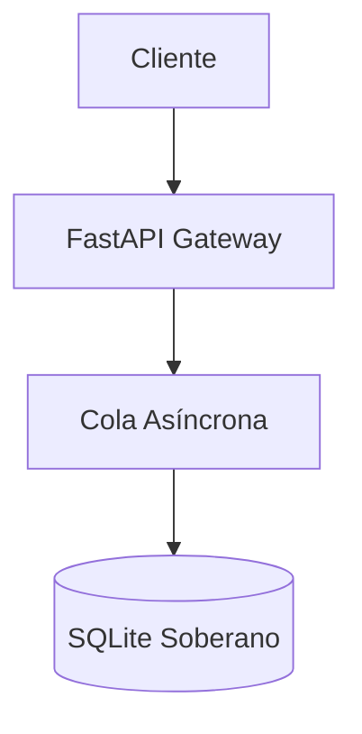

# Especificación de Flujo y Reglas Técnicas

Este documento describe las políticas operativas y los contratos de integración.

## 1. Topología del Sistema


## 2. Reglas de Negocio
- Regla 1: Las transacciones deben ser idempotentes.
- Regla 2: Todo anexo PDF o Excel se indexa automáticamente para RAG.

```python
def process_event(event_id: str) -> bool:
    # Lógica de validación con cero fugas
    return True
```

```markdown
---
title: "Cultura DevOps y Excelencia Operativa en la Arquitectura del Sistema"
module: "especificaci_n_de_flujo_y_reglas_t_cnicas"
project: "inactive-proj"
tags: ["devops", "cultura", "ci-cd", "arquitectura", "idempotencia", "observabilidad"]
author: "Copiloto Técnico ContextForge"
date: "2026-10-16"
version: "1.0.0"
---

# Cultura DevOps: De la Filosofía a la Ejecución Técnica

## 1. Introducción: ¿Qué es realmente la Cultura DevOps?
Más allá de las herramientas de automatización o los pipelines de despliegue, **DevOps es un marco cultural y organizacional** que elimina los silos históricos entre el equipo de Desarrollo (*Dev*) y el de Operaciones (*Ops*). Su objetivo fundamental es acortar el ciclo de vida del desarrollo de sistemas y proporcionar una entrega continua de software de alta calidad.

En el contexto de nuestra arquitectura (**FastAPI Gateway → Cola Asíncrona → SQLite Soberano**), adoptar una cultura DevOps garantiza que las reglas de negocio críticas —como la **idempotencia transaccional** y la **indexación automática para RAG**— evolucionen de forma segura, auditable y sin fricción operativa.

---

## 2. Los Pilares Culturales (Marco CALMS)

Para que la ingeniería sea sostenible, la cultura DevOps se apoya en cinco pilares fundamentales conocidos como **CALMS**:

1. **Culture (Cultura):** Responsabilidad compartida (*"You build it, you run it"*). El desarrollador que escribe `process_event(event_id: str)` también comprende cómo se comporta ese código bajo carga en el *Worker* y cómo impacta el bloqueo de escritura en *SQLite*.
2. **Automation (Automatización):** Eliminación del trabajo manual repetitivo (*toil*). Desde la ejecución de pruebas unitarias hasta la validación de esquemas y despliegues.
3. **Lean (Enfoque Lean):** Entregas pequeñas, incrementales y de rápido retorno de valor. Minimizar el trabajo en progreso (WIP) para detectar fallos de manera temprana.
4. **Measurement (Medición):** Toma de decisiones basada en datos reales y telemetría (latencia del Gateway, profundidad de la cola asíncrona, tiempos de indexación de anexos PDF/Excel).
5. **Sharing (Colaboración):** Transparencia total en el conocimiento, post-mortems sin culpa (*blameless post-mortems*) y documentación viva (como esta especificación en *ContextForge*).

---

## 3. El Flujo Continuo: Integración con Nuestra Topología

A continuación, se ilustra cómo el ciclo DevOps envuelve y protege la topología técnica definida en nuestro documento base:

```mermaid
graph TD
    subgraph Ciclo DevOps [Cultura y Automatización CI/CD]
        Plan[1. Planificación y Diseño] --> Code[2. Código y Pruebas Locales]
        Code --> CI[3. Integración Continua: Linting + Tests de Idempotencia]
        CI --> CD[4. Entrega Continua: Despliegue Automatizado]
    end

    subgraph Topología en Producción [Sistema Activo - inactive-proj]
        Cliente([Cliente]) --> API[FastAPI Gateway]
        API --> Worker[Cola Asíncrona]
        Worker --> RAG[Indexador RAG: PDF / Excel]
        Worker --> BD[(SQLite Soberano)]
    end

    subgraph Observabilidad y Feedback
        Mon[5. Monitoreo y Telemetría]
    end

    CD ==>|Actualización sin caída| API
    CD ==>|Actualización de Workers| Worker
    API -.->|Métricas HTTP / Latencia| Mon
    Worker -.->|Tasa de fallos / Dead Letter| Mon
    BD -.->|Estado de bloqueos / IOPS| Mon
    Mon ==>|Retroalimentación Continua| Plan
```



---

## 4. Aplicación Práctica a Nuestras Reglas Técnicas

Una cultura DevOps madura traduce principios abstractos en controles de ingeniería concretos dentro del proyecto:

### A. Garantía de la Regla 1 (Idempotencia en CI/CD)
* **Práctica DevOps:** *Shift-Left Testing* (mover las pruebas al inicio del flujo).
* **Implementación:** Ningún cambio en `process_event(event_id: str)` llega a producción sin superar pruebas automatizadas de inyección de duplicados en el pipeline de Integración Continua, asegurando **cero fugas** antes del despliegue.

### B. Resiliencia en la Regla 2 (Indexación RAG Asíncrona)
* **Práctica DevOps:** Observabilidad y Gestión de Incidentes.
* **Implementación:** El procesamiento de archivos pesados (PDF o Excel) en la cola asíncrona debe exponer métricas claras:
  * Tiempo medio de extracción e indexación.
  * Alertas automáticas si un documento malformado bloquea un *Worker*.
  * Estrategias de *Retry* con *Exponential Backoff* y colas de mensajes fallidos (*Dead-Letter Queues*).

### C. Gestión del Dato en SQLite Soberano
* **Práctica DevOps:** Infraestructura y Esquemas como Código (*Database Reliability Engineering*).
* **Implementación:** Versionado estricto de migraciones de base de datos, copias de seguridad automatizadas previas a cada despliegue y monitoreo del modo `WAL` (*Write-Ahead Logging*) para evitar contención entre lecturas del Gateway y escrituras del Worker.

---

## 5. Beneficios Clave para el Equipo de Ingeniería

* **Velocidad con Estabilidad:** Despliegues más frecuentes con una tasa mínima de fallos en producción.
* **Tiempo Medio de Recuperación (MTTR) Reducido:** Si una actualización en el indexador RAG falla, el *rollback* es inmediato y automatizado.
* **Documentación Viva:** La arquitectura, el código y las reglas operativas evolucionan juntos en un mismo repositorio de conocimiento.
```

---
*¿Te gustaría que incorporemos alguna sección de este artículo (como el pipeline de CI/CD o las métricas de observabilidad) directamente como una nueva sección dentro de tu documento **`Especificación de Flujo y Reglas Técnicas`**?*
