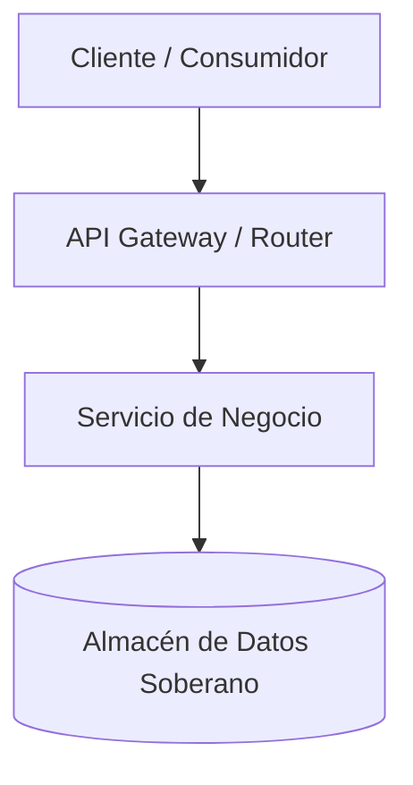

# ADR: Adopción de Arquitectura Hexagonal

## 1. Contexto y Definición del Problema
Describe el problema arquitectónico o técnico que motiva esta decisión.
Incluye requisitos no funcionales (rendimiento, escalabilidad, seguridad, costos) y restricciones del entorno.

## 2. Decisión Arquitectónica Adoptada
Detalla la solución elegida de forma clara e inequívoca.
Explica cómo se implementará y los patrones de diseño involucrados.

## 3. Diagrama de Arquitectura de la Solución

## 4. Consecuencias y Compensaciones
### Consecuencias Positivas
- Beneficio 1: Mejora en rendimiento o mantenibilidad.
- Beneficio 2: Reducción de acoplamiento.

### Consecuencias Negativas o Riesgos
- Trade-off 1: Complejidad operativa adicional.
- Medidas de mitigación previstas.

## 5. Alternativas Evaluadas y Descartadas
1. **Alternativa A**: Motivo por el cual fue descartada.
2. **Alternativa B**: Motivo por el cual fue descartada.
