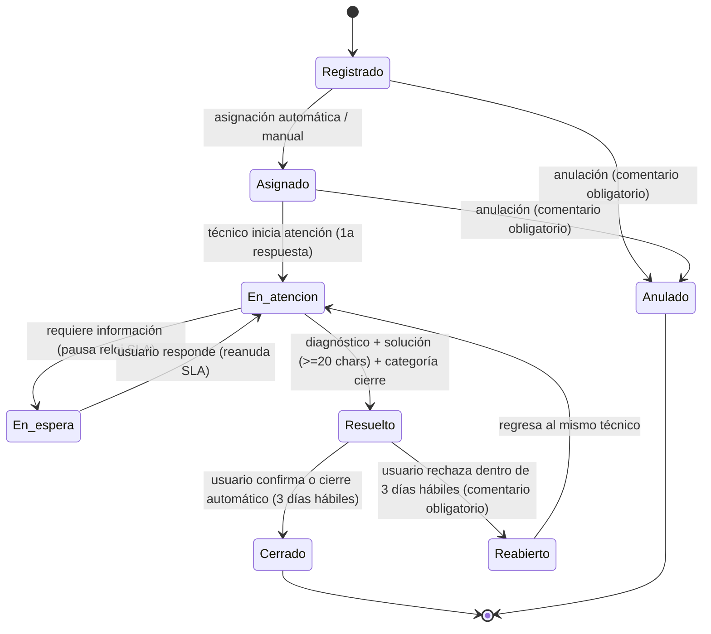

# Ciclo de Vida de Tickets, Matriz OR-03, SLA OR-04 y Reglas de Negocio

## 1. Ciclo de Vida de un Ticket (8 Estados — RF-10)
Todo ticket recibe un consecutivo único con formato **`MS-AAAA-NNNNNN`** (ej. `MS-2026-000142`) y recorre únicamente transiciones autorizadas:

### Reglas Operativas del Flujo de Tickets
- **Sin borrado físico (`OR-01`):** Ningún ticket ni mensaje del chat se elimina físicamente; se marcan como `Anulado` o quedan archivados (retención mínima de **5 años**, `OR-02`).
- **Chat inmutable (`RF-12`):** Los mensajes del chat no se pueden editar ni eliminar; en estados `Cerrado` o `Anulado` el chat pasa a modo de **solo lectura**.
- **Documentación obligatoria al resolver (`RF-15`):** El técnico debe diligenciar **diagnóstico**, **solución aplicada** (mínimo **20 caracteres**) y **categoría de cierre**; además puede marcar *Proponer como artículo* para crear un borrador en la base de conocimiento.
- **Confirmación, reapertura y cierre automático (`RF-16`, `CU-09`):**
  - Si el usuario confirma la solución -> pasa a `Cerrado` y se habilita la encuesta de satisfacción (`1` a `5`, opcional, disponible 5 días hábiles; si califica `1` o `2` pide comentario y alerta al coordinador).
  - Si el problema continúa -> pasa a `Reabierto` con **comentario obligatorio** y vuelve al mismo técnico (solo permitido dentro de los **3 días hábiles** siguientes a la resolución).
  - Si pasan **3 días hábiles sin respuesta** del usuario -> el temporizador cierra automáticamente el ticket y notifica por correo.

## 2. Matriz de Prioridad Automática — Regla `OR-03` (`RF-05`)
El **impacto** se hereda del servicio del catálogo y la **urgencia** se obtiene al preguntar al usuario si puede continuar trabajando:

- **Impacto:**
  - **Alto:** Afecta a una sede, una facultad o un servicio crítico (red, correo, plataforma virtual, matrícula).
  - **Medio:** Afecta a un grupo o dependencia.
  - **Bajo:** Afecta a una sola persona.
- **Urgencia:**
  - **Alta:** Impide trabajar y no existe alternativa.
  - **Media:** Existe una alternativa temporal.
  - **Baja:** No impide la actividad.

| Impacto \ Urgencia | Urgencia Alta | Urgencia Media | Urgencia Baja |
| :--- | :---: | :---: | :---: |
| **Impacto Alto** | **P1 Crítica** | **P2 Alta** | **P3 Media** |
| **Impacto Medio** | **P2 Alta** | **P3 Media** | **P4 Baja** |
| **Impacto Bajo** | **P3 Media** | **P4 Baja** | **P4 Baja** |

> El coordinador puede ajustar manualmente la prioridad únicamente registrando una **justificación obligatoria** en el historial.

## 3. Tiempos Objetivo de SLA y Horario Hábil — Regla `OR-04` (`RF-07`, `RF-08`)
- **Horario hábil oficial UPC (`America/Bogota`, UTC-5):**
  - **Lunes a viernes:** `7:00 a. m.` a `7:00 p. m.`
  - **Sábados:** `8:00 a. m.` a `12:00 m.`
  - **Excluidos:** Noches, domingos y festivos nacionales cargados en el calendario hábil.

| Prioridad | Tiempo de Primera Respuesta | Tiempo de Resolución | Ejemplo Típico en la UPC |
| :--- | :---: | :---: | :--- |
| **P1 Crítica** | **30 minutos hábiles** | **4 horas hábiles** | Caída de la red en un bloque académico |
| **P2 Alta** | **1 hora hábil** | **8 horas hábiles** | Videoproyector dañado en un aula con clase en curso |
| **P3 Media** | **4 horas hábiles** | **24 horas hábiles** | Impresora de una dependencia fuera de servicio |
| **P4 Baja** | **8 horas hábiles** | **40 horas hábiles** | Solicitud de instalación de un programa |

### Control, Semáforo, Alertas y Escalamiento (`CU-11`)
- El temporizador evalúa los tickets abiertos **cada minuto** (evitando ejecuciones duplicadas).
- **Pausa de reloj:** Mientras el ticket esté en estado `En espera` (esperando información del usuario), el contador de SLA se detiene y se reanuda automáticamente cuando el usuario responde.
- **Semáforo SLA:**
  - **Verde:** Menos del 75% del tiempo consumido.
  - **Amarillo (Alerta preventiva al 75%):** Notifica una sola vez al técnico asignado.
  - **Rojo (Vencido 100%):** Marca el ticket como `Vencido` y lo escala automáticamente al **coordinador del área** (y al director de TIC si no tiene técnico asignado).
- **Reasignación (`RF-11`):** Exige motivo obligatorio y **NO reinicia** el reloj de SLA.
- **Cambios de SLA (`RF-24`):** Solo aplican a tickets registrados después de la modificación.

## 4. Algoritmo de Asignación Automática (`RF-06`, `CU-06`)
1. Identifica el **área técnica** asociada al servicio del catálogo.
2. Calcula la prioridad (`OR-03`) y las fechas límite de respuesta y resolución (`OR-04`) en **menos de 10 segundos**.
3. Consulta los técnicos activos del área y asigna el ticket al técnico con **menor número de tickets abiertos**.
4. **Regla de desempate:** Si hay empate en carga, se elige al técnico cuya **última asignación sea más antigua**.
5. **Sin técnicos activos:** El ticket pasa a la cola del **coordinador del área**, quien recibe notificación inmediata.

## 5. Otros Requisitos Legales, de IA y Reutilización (`OR-05` a `OR-10`)
- **`OR-05` (Protección de Datos):** Cumplimiento de la **Ley Estatutaria 1581 de 2012** y **Decreto 1377 de 2013**; aviso de privacidad y aceptación registrada en el primer ingreso.
- **`OR-06` (Gobierno Digital):** Cumplimiento de la **Resolución 1519 de 2020** del MinTIC (accesibilidad WCAG 2.1 AA y seguridad digital).
- **`OR-07` (Transparencia):** Reportes y bitácora exportables para entes de control bajo la **Ley 1712 de 2014**, protegiendo datos personales.
- **`OR-08` (Uso Responsable de IA):** El asistente virtual siempre declara ser automatizado, **no decide prioridades ni cierres de tickets**, y el proveedor de IA no puede usar las conversaciones para entrenar modelos. Además (`RIS-03`), **nunca se envían nombres, documentos de identidad, correos ni adjuntos** al proveedor de IA.
- **`OR-09` (Idioma y Zona Horaria):** Español de Colombia (`dd/mm/aaaa`, formato 12 horas `a. m. / p. m.`, separador decimal coma `,`), almacenamiento interno en `UTC` y visualización en `America/Bogota`.
- **`OR-10` (Reutilización):** Módulos de notificaciones, autenticación y control de SLA reutilizables en otras mesas de servicio universitarias (ej. infraestructura física).
