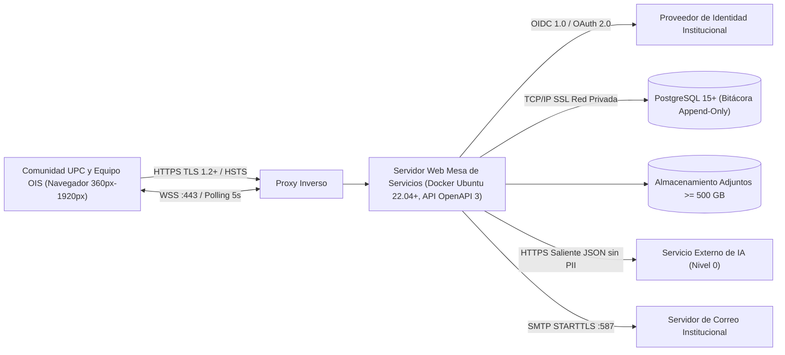

# Requisitos No Funcionales (ISO/IEC 25010) e Interfaces Externas

## 1. Arquitectura de Integración Externa

## 2. Requisitos No Funcionales Cuantitativos (`RNF-01` a `RNF-17`)
| ID | Nombre | Característica ISO/IEC 25010 | Umbral Verificable |
| :--- | :--- | :--- | :--- |
| **RNF-01** | Tiempo de respuesta | Eficiencia: comportamiento temporal | p95 <= **2s** con **300 usuarios concurrentes**; carga página <= **3s** en 10 Mbps (prueba JMeter/k6 de 30 min) |
| **RNF-02** | Latencia chat y notificaciones | Eficiencia: comportamiento temporal | 95% mensajes < **1s**; notificaciones < **5s** con **200 conexiones** de chat simultáneas |
| **RNF-03** | Capacidad y volumen | Eficiencia: capacidad | **500 sesiones concurrentes** con CPU < 80%; **300.000 tickets** históricos; **>= 500 GB** adjuntos |
| **RNF-04** | Disponibilidad | Fiabilidad: disponibilidad | **>= 99,5% mensual**; mantenimientos anunciados 48h antes entre 22:00 y 05:00 |
| **RNF-05** | Respaldo y recuperación | Fiabilidad: recuperación | Backup completo diario + incremental cada 4h fuera del servidor; **RPO = 4h**, **RTO = 8h**; prueba semestral |
| **RNF-06** | Tolerancia a fallos del asistente | Fiabilidad: tolerancia a fallos | Timeout **15s** -> ofrece formulario de ticket; caída de IA no afecta el resto del sistema |
| **RNF-07** | Autenticación y RBAC | Seguridad: autenticidad | **OpenID Connect** (sin almacenar contraseñas), expiración sesión **30 min** inactividad, token max **1 hora** |
| **RNF-08** | Protección en tránsito y reposo | Seguridad: confidencialidad | **HTTPS TLS 1.2+** (HSTS), adjuntos fuera de raíz pública con **enlaces firmados de 10 min**, 0 hallazgos altos/críticos OWASP Top 10 |
| **RNF-09** | Trazabilidad y no repudio | Seguridad: no repudio | 100% eventos sensibles auditados; tabla bitácora solo `INSERT`; retención mínima **5 años** |
| **RNF-10** | Facilidad de aprendizaje y uso | Usabilidad: operabilidad | >= 90% de 15 usuarios sin capacitación crea ticket en **< 3 min**; puntaje **SUS >= 70** |
| **RNF-11** | Accesibilidad web | Usabilidad: accesibilidad | **WCAG 2.1 nivel AA**, navegación 100% teclado, textos alternativos, contraste **>= 4,5:1** |
| **RNF-12** | Diseño adaptable y navegadores | Portabilidad: adaptabilidad | Sin scroll horizontal de **360px a 1920px**; 2 últimas versiones de Chrome, Edge, Firefox y Safari |
| **RNF-13** | Pertinencia de respuestas IA | Adecuación funcional | >= **85%** correctas y citadas sobre 100 FAQ validadas; **100%** abstención fuera de alcance TIC |
| **RNF-14** | Mantenibilidad del código | Mantenibilidad: modularidad | Módulos independientes, cobertura unitaria lógica de negocio **>= 70%**, OpenAPI 3, análisis estático limpio |
| **RNF-15** | Exactitud de tiempos SLA | Adecuación funcional | Error <= **1 min** en 50 casos de prueba con festivos/pausas; 100% coincidencia matriz `OR-03`; UTC -> `America/Bogota` |
| **RNF-16** | Interoperabilidad | Compatibilidad: interoperabilidad | Estándares abiertos: OIDC/OAuth 2.0, SMTP STARTTLS, REST JSON; cambio de proveedor solo por adaptador |
| **RNF-17** | Instalación y despliegue | Portabilidad: instalabilidad | Contenedores Docker con archivo único de orquestación; despliegue completo en **< 2 horas**; secretos en env |

## 3. Requisitos de Interfaz Externa (`RIU`, `RIH`, `RIS`, `RIC`)
- **Interfaces de Usuario (`RIU-01`..`RIU-10`):**
  - Inicio sin formulario propio de usuario/contraseña: único botón **Ingresar con cuenta institucional** (`RIU-01`).
  - Paleta institucional UPC, tipografía sin serifa >= **16px** (`RIU-02`).
  - Menú lateral filtrado por rol (`RIU-03`); formulario nuevo ticket en una sola columna (`RIU-04`); alertas con color + ícono + texto (`RIU-05`); tablas con semáforo SLA + tiempo restante en texto (`RIU-06`).
  - Detalle del ticket dividido en 2 zonas (datos/línea de tiempo a la izquierda, chat a la derecha; pestañas en móvil, `RIU-07`).
  - Botón flotante del asistente virtual en esquina inferior derecha con **"Hablar con una persona"** siempre visible (`RIU-08`).
  - Gráficos del tablero con tabla de datos equivalente para lectores de pantalla (`RIU-09`).
- **Interfaces de Hardware (`RIH-01`..`RIH-05`):**
  - Acceso desde escritorio, tableta y móvil (>= 360px) con captura directa desde **cámara móvil** para evidencias (`RIH-02`).
  - Infraestructura mínima producción: App Server **8 vCPU / 16 GB RAM / 100 GB SSD**; BD Server **4 vCPU / 16 GB RAM / 500 GB SSD**; almacenamiento independiente de adjuntos **500 GB** (`RIH-03`, `RIH-04`).
- **Interfaces de Software (`RIS-01`..`RIS-07`):**
  - OIDC 1.0 sobre OAuth 2.0 (`RIS-01`), **PostgreSQL 15+** con privilegios mínimos (`RIS-02`), API REST JSON para IA **sin PII ni adjuntos** (`RIS-03`), SMTP HTML+texto (`RIS-04`), Docker sobre **Ubuntu Server 22.04 LTS+** (`RIS-05`), API REST UTF-8 **OpenAPI 3** (`RIS-06`), reportes PDF y XLSX (`RIS-07`).
- **Interfaces de Comunicación (`RIC-01`..`RIC-07`):**
  - HTTPS TLS 1.2/1.3 + HSTS (`RIC-01`), **WSS puerto 443** con degradación automática a polling cada **5 segundos** (`RIC-02`), códigos HTTP estándar 200/201/400/401/403/404/500 (`RIC-03`), credenciales OIDC/IA nunca expuestas al navegador (`RIC-04`), SMTP STARTTLS puerto **587** (`RIC-05`), PostgreSQL en red privada cifrada no expuesta a internet (`RIC-06`), accesible desde campus e internet **sin VPN** (`RIC-07`).
