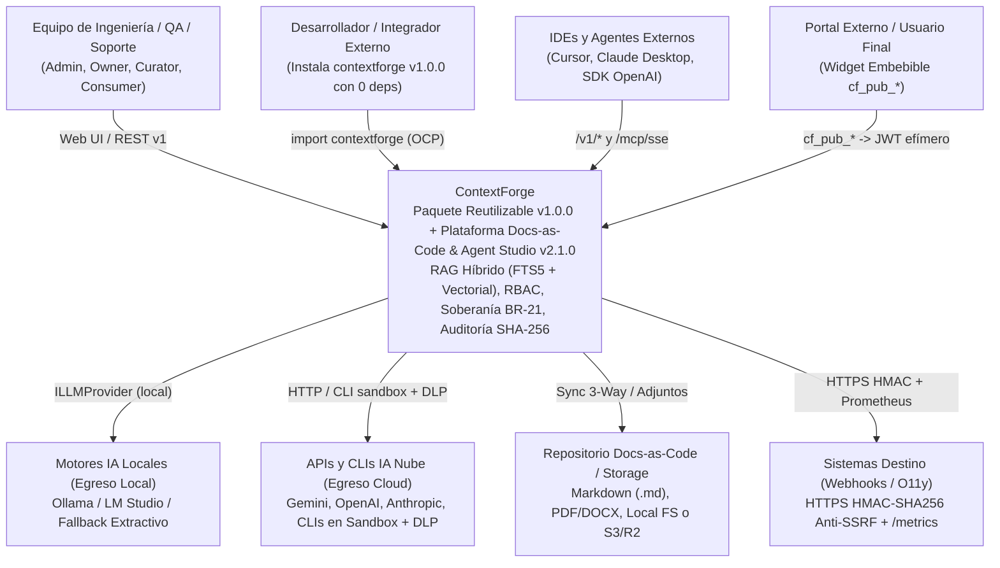
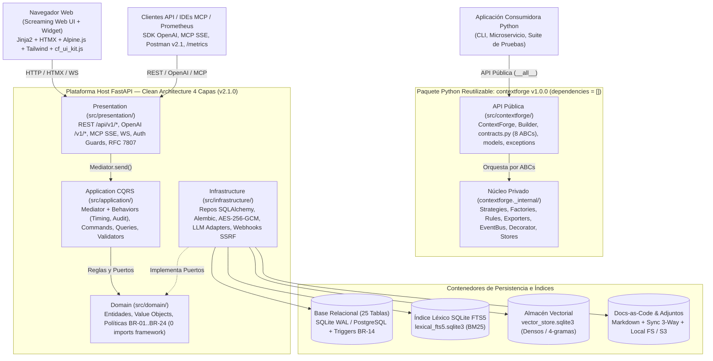
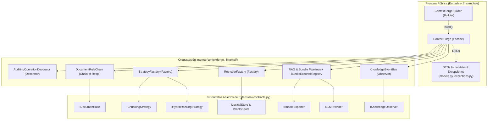
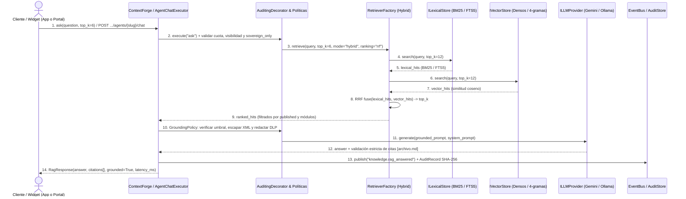

# Documentación Técnica, Arquitectura, ADRs y Evidencias de Verificación — ContextForge (`v1.0.0` / Plataforma `v2.1.0`)

> **Audiencia:** Ingenieros mantenedores, arquitectos e integradores del componente reutilizable **`contextforge` (`v1.0.0`)** y de su plataforma anfitriona **ContextForge (`v2.1.0`)**.  
> **Fuente de verdad arquitectónica:** [`Context.md`](../../Context.md) (verificada automáticamente con `scripts/verify_context_drift.py`).  
> **Diagramas consistentes versionados:** Mermaid embebido en este documento + archivos editables **draw.io** (`.drawio`) y renders PNG en [`docs/technical/diagrams/`](diagrams/), validados geométricamente con **0 solapamientos**.

---

## 1. Requerimientos No Funcionales (ISO/IEC 25010)

Los requerimientos no funcionales se especifican bajo el modelo de calidad de producto **ISO/IEC 25010**, priorizando las cuatro subcaracterísticas críticas de mantenimiento (**Reusabilidad**, **Modularidad**, **Capacidad de prueba** y **Facilidad de modificación**), complementadas con seguridad, fiabilidad, eficiencia, compatibilidad y usabilidad.

| ID | Característica ISO/IEC 25010 | Subcaracterística | Requisito Medible en ContextForge | Mecanismo de Verificación Actual |
| :--- | :--- | :--- | :--- | :--- |
| **RNF-01** | **Mantenibilidad** | **Reusabilidad** *(Énfasis)* | El paquete `src/contextforge/` debe instalarse y operar con **cero dependencias externas obligatorias** (`dependencies = []` en `pyproject.toml`), en Python `>= 3.11`, sin acoplamiento a FastAPI, SQLAlchemy ni motores de BD/LLM. | `pip install -e .`, ejecución de `examples/agent_knowledge_cli.py`, prueba `test_public_api_boundary_hides_internals`. |
| **RNF-02** | **Mantenibilidad** | **Modularidad** *(Énfasis)* | Separación estricta entre API pública (`src/contextforge/{__init__,client,builder,contracts,models,exceptions}.py`) e internos privados (`src/contextforge/_internal/`). En la plataforma host: Clean Architecture de **4 capas** (`domain`, `application`, `infrastructure`, `presentation`), **1 clase por archivo**, `0` clases en `__init__.py` y `0` imports de framework en `domain`/`application`. | Auditoría AST automatizada (`PY_FILES=503`, `LAYER_MULTI_CLASS=0`, `INIT_CLASSES=0`, `PURITY=0`) y verificación de `__all__`. |
| **RNF-03** | **Mantenibilidad** | **Capacidad de prueba** *(Énfasis)* | El 100% de colaboradores (`ILexicalStore`, `IVectorStore`, `ILLMProvider`, `IDocumentRule`, `IKnowledgeObserver`, `IChunkingStrategy`, `IHybridRankingStrategy`, `IBundleExporter`) debe ser inyectable y sustituible por dobles de prueba (fakes, stubs, spies) sin red ni discos externos. Cobertura de líneas `>= 70%` (meta interna `>= 95%`). | `pytest --cov=contextforge` (**96%** cobertura sobre 858 sentencias en 15 módulos; **66 pruebas** totales en verde). |
| **RNF-04** | **Mantenibilidad** | **Facilidad de modificación** *(Énfasis)* | Incorporar nuevas estrategias de fragmentación, algoritmos de fusión híbrida, exportadores de Context Bundles, reglas de validación o proveedores LLM no debe requerir modificar clases existentes del núcleo (OCP). Todo cambio de esquema en la plataforma se versiona mediante migraciones Alembic. | Pruebas de extensión de terceros en `tests/unit/test_contextforge_component.py`, migraciones `migrations/versions/20261128_0001..0004`. |
| **RNF-05** | **Adecuación Funcional** | **Corrección funcional** | Tipado estricto sin errores (`mypy --strict`), validación explícita de entradas con jerarquía `ContextForgeError`, abstención obligatoria ante falta de evidencia (`BR-08`) y validación de citas en streaming (`BR-22`). | `mypy --strict src/contextforge` (`Success: no issues found in 15 source files`) y `scripts/verify_context_drift.py`. |
| **RNF-06** | **Seguridad** | **Confidencialidad, integridad y no repudio** | Cifrado AES-256-GCM en reposo para secretos LLM y webhooks (`webhooks.secret_encrypted`), clasificación de egreso `local`/`cloud` (`BR-21`), allowlist positiva + sandbox CLI (`BR-17`), SSRF estricto HTTPS+DNS en webhooks, `cf_pub_* -> JWT` efímero en widget (`BR-18`), y auditoría append-only con cadena SHA-256 + triggers SQL (`BR-14`). | Pruebas unitarias de seguridad (`test_phase1_*`, `test_ya2_*`, `test_f1_*`, `test_f2_*`) y endpoint `GET /api/v1/audit-logs/verify`. |
| **RNF-07** | **Fiabilidad** | **Tolerancia a fallos y recuperabilidad** | SQLite en modo WAL, reintentos con cola de trabajos fallidos (`dead_letter` + retry manual), degradación automática a búsqueda 4-gramas offline y respaldo extractivo con aviso explícito (`fallback_reason`), más timeout configurable (`>= 180s` CLI / `>= 90s` HTTP). | Pruebas de integración WAL/DLQ (`test_persistence_wal_dlq_and_audit_chain.py`) y pruebas de resiliencia. |
| **RNF-08** | **Eficiencia de Desempeño** | **Comportamiento temporal** | Operaciones del componente en memoria en `< 50 ms` con medición automática (`latency_ms` en `AuditingOperationDecorator`); índice léxico persistente SQLite FTS5 (`unicode61`) + caché vectorial persistente (`vector_store.sqlite3`). | Inspección de `engine.audit_trail` y métricas Prometheus en `GET /metrics`. |
| **RNF-09** | **Compatibilidad** | **Interoperabilidad** | Exposición de contratos abiertos: API REST con errores **RFC 7807** (`/api/v1/*`), Gateway compatible con **OpenAI SDK** (`/v1/models`, `/v1/chat/completions`), servidor **MCP** (`/mcp/sse`, STDIO), colección **Postman v2.1** y Widget JS embebible. | Pruebas E2E de interoperabilidad y contrato OpenAI en `tests/unit/test_f4_ux_audit_remediation_and_postman.py`. |
| **RNF-10** | **Usabilidad** | **Accesibilidad y coherencia UI** | Cero emojis Unicode en `src/` (solo iconos vectoriales FontAwesome/SVG), kit UI unificado (`cf_ui_kit.js`) con renderizador `problem+json` y `request_id` copiable, `:focus-visible` y `@media (prefers-reduced-motion: reduce)` (WCAG 2.2 AA). | Auditoría automatizada `EMOJIS=0`, verificación de atributos Alpine y cierre 21/21 de `docs/ux-audit-settings-integration.md`. |

---

## 2. Arquitectura del Componente — Modelo C4

Todos los diagramas C4 están sincronizados entre **Mermaid** y **draw.io** (`.drawio` + `.png` con verificación matemática AABB de 0 solapamientos).

### 2.1 Nivel 1: Diagrama de Contexto del Sistema

- **Editable draw.io:** [`diagrams/01_c4_l1_contexto.drawio`](diagrams/01_c4_l1_contexto.drawio)
- **Render PNG:** [`diagrams/01_c4_l1_contexto.png`](diagrams/01_c4_l1_contexto.png)



**Justificación técnica (Nivel 1):**  
El diseño desacopla el conocimiento organizacional de personas concretas y de proveedores de IA específicos. Tanto las aplicaciones Python que consumen el paquete `contextforge` como los portales web, IDEs MCP o clientes OpenAI interactúan exclusivamente a través de contratos estables, mientras la plataforma aplica políticas transversales de soberanía por destino de egreso (`BR-21`), prevención de fuga de datos DLP (`BR-13`) y trazabilidad inmutable (`BR-14`).

---

### 2.2 Nivel 2: Diagrama de Contenedores

- **Editable draw.io:** [`diagrams/02_c4_l2_contenedores.drawio`](diagrams/02_c4_l2_contenedores.drawio)
- **Render PNG:** [`diagrams/02_c4_l2_contenedores.png`](diagrams/02_c4_l2_contenedores.png)



**Justificación técnica (Nivel 2):**
- **Doble empaquetado sin contaminación:** El núcleo reutilizable (`src/contextforge/`) permanece libre de FastAPI/SQLAlchemy/Pydantic, logrando instalación instantánea y pruebas deterministas; la plataforma host (`src/domain`, `src/application`, `src/infrastructure`, `src/presentation`) extiende la arquitectura con persistencia relacional, RBAC, Agent Studio y servidores HTTP/MCP/WS.
- **Persistencia especializada por carga de trabajo:** SQLite WAL / PostgreSQL garantiza atomicidad transaccional e integridad referencial (25 tablas), SQLite FTS5 provee ranking léxico BM25 persistente, `vector_store.sqlite3` aísla espacios vectoriales por `embedding_model` y `embedding_dim`, y el sistema de archivos conserva el flujo Docs-as-Code con resolución de conflictos 3-way (`BR-20`).

---

### 2.3 Nivel 3: Diagrama de Componentes Internos (`contextforge v1.0.0`)

- **Editable draw.io:** [`diagrams/03_c4_l3_componentes.drawio`](diagrams/03_c4_l3_componentes.drawio)
- **Render PNG:** [`diagrams/03_c4_l3_componentes.png`](diagrams/03_c4_l3_componentes.png)



**Justificación técnica (Nivel 3):**  
La fachada `ContextForge` reduce la superficie pública a 4 operaciones cohesivas (`ingest`, `search`, `ask`, `compile_bundle`) y 6 hooks de extensión (`register_*`, `subscribe`, `set_llm_provider`). Cada preocupación ortogonal (auditoría de latencia, validación en cadena, creación de estrategias, recuperación híbrida, exportación y eventos) reside en un colaborador pequeño, altamente cohesivo y aislado por una interfaz ABC.

---

## 3. Diagramas UML del Componente

### 3.1 Diagrama de Clases UML (`src/contextforge/`)

- **Editable draw.io:** [`diagrams/04_uml_clases_componente.drawio`](diagrams/04_uml_clases_componente.drawio)
- **Render PNG:** [`diagrams/04_uml_clases_componente.png`](diagrams/04_uml_clases_componente.png)

```mermaid
classDiagram
    class ContextForgeBuilder {
        +with_config(config) ContextForgeBuilder
        +with_stores(lexical_store, vector_store) ContextForgeBuilder
        +with_llm_provider(provider) ContextForgeBuilder
        +with_chunking_strategy(strategy, alias) ContextForgeBuilder
        +with_ranking_strategy(strategy, alias) ContextForgeBuilder
        +with_exporter(exporter, alias) ContextForgeBuilder
        +with_rule(rule) ContextForgeBuilder
        +with_observer(observer) ContextForgeBuilder
        +build() ContextForge
    }

    class ContextForge {
        <<Facade>>
        +ingest(documents, chunking_strategy) IngestionReport
        +ingest_directory(directory, pattern) IngestionReport
        +search(query, top_k, mode, ranking, collection) list~SearchHit~
        +ask(question, top_k, mode, ranking, system_prompt) RagResponse
        +compile_bundle(name, query, document_ids, max_tokens, export_format) ContextBundle
        +register_chunking_strategy(strategy) None
        +register_ranking_strategy(strategy) None
        +register_exporter(exporter) None
        +register_rule(rule) None
        +subscribe(observer) None
        +set_llm_provider(provider) None
    }

    class AuditingOperationDecorator {
        -_executor OperationExecutor
        -_records list~AuditRecord~
        +execute() TRes
    }

    class DocumentRuleChain {
        +add_rule(rule) None
        +validate_all(doc) None
    }
    class StrategyFactory {
        +get_chunker(name) IChunkingStrategy
        +get_ranker(name) IHybridRankingStrategy
    }
    class RetrieverFactory {
        +retrieve(query, top_k, mode, ranking_strategy) list~SearchHit~
    }
    class BundleExporterRegistry {
        +register(exporter) None
        +get(format_name) IBundleExporter
    }
    class KnowledgeEventBus {
        +subscribe(observer) None
        +publish(event_type, payload) KnowledgeEvent
    }

    class IDocumentRule {
        <<interface>>
        +rule_name str
        +validate(document) None
    }
    class IChunkingStrategy {
        <<interface>>
        +name str
        +chunk(document) list~DocumentChunk~
    }
    class IHybridRankingStrategy {
        <<interface>>
        +name str
        +fuse(lexical_hits, vector_hits, top_k) list~SearchHit~
    }
    class ILexicalStore {
        <<interface>>
        +index(chunks) None
        +search(query, top_k) list~SearchHit~
        +clear() None
    }
    class IVectorStore {
        <<interface>>
        +index(chunks) None
        +search(query, top_k) list~SearchHit~
        +clear() None
    }
    class IBundleExporter {
        <<interface>>
        +format_name str
        +export(name, documents, estimated_tokens, max_tokens) str
    }
    class ILLMProvider {
        <<interface>>
        +provider_name str
        +generate(prompt, system_prompt) str
    }
    class IKnowledgeObserver {
        <<interface>>
        +on_event(event) None
    }

    class TitleRequiredRule
    class NonEmptyContentRule
    class MaxDocumentSizeRule
    class HeadingAwareChunkingStrategy
    class SlidingWindowChunkingStrategy
    class ReciprocalRankFusionStrategy
    class WeightedLinearRankingStrategy
    class InMemoryLexicalStore
    class InMemoryVectorStore
    class MarkdownBundleExporter
    class JsonBundleExporter
    class XmlBundleExporter
    class ExtractiveFallbackLLMProvider

    ContextForgeBuilder ..> ContextForge : builds
    ContextForge --> AuditingOperationDecorator : wraps ops
    ContextForge --> DocumentRuleChain
    ContextForge --> StrategyFactory
    ContextForge --> RetrieverFactory
    ContextForge --> BundleExporterRegistry
    ContextForge --> KnowledgeEventBus
    ContextForge --> ILLMProvider

    DocumentRuleChain --> IDocumentRule
    StrategyFactory --> IChunkingStrategy
    StrategyFactory --> IHybridRankingStrategy
    RetrieverFactory --> ILexicalStore
    RetrieverFactory --> IVectorStore
    BundleExporterRegistry --> IBundleExporter
    KnowledgeEventBus --> IKnowledgeObserver

    TitleRequiredRule ..|> IDocumentRule
    NonEmptyContentRule ..|> IDocumentRule
    MaxDocumentSizeRule ..|> IDocumentRule
    HeadingAwareChunkingStrategy ..|> IChunkingStrategy
    SlidingWindowChunkingStrategy ..|> IChunkingStrategy
    ReciprocalRankFusionStrategy ..|> IHybridRankingStrategy
    WeightedLinearRankingStrategy ..|> IHybridRankingStrategy
    InMemoryLexicalStore ..|> ILexicalStore
    InMemoryVectorStore ..|> IVectorStore
    MarkdownBundleExporter ..|> IBundleExporter
    JsonBundleExporter ..|> IBundleExporter
    XmlBundleExporter ..|> IBundleExporter
    ExtractiveFallbackLLMProvider ..|> ILLMProvider
```



---

### 3.2 Diagrama de Secuencia UML — Funcionalidad Principal (Consulta RAG Híbrida / Agente Público)

- **Editable draw.io:** [`diagrams/05_uml_secuencia_principal.drawio`](diagrams/05_uml_secuencia_principal.drawio)
- **Render PNG:** [`diagrams/05_uml_secuencia_principal.png`](diagrams/05_uml_secuencia_principal.png)



---

## 4. Matriz Completa de Principios SOLID, Patrones GRASP y Patrones GoF

### 4.1 Principios SOLID (5 / 5)

| Principio | Clase / Módulo / Función de Evidencia | Justificación Técnica |
| :--- | :--- | :--- |
| **S — Single Responsibility Principle (SRP)** | `src/contextforge/_internal/stores.py` (almacenamiento), `strategies.py` (chunking/ranking), `exporters.py` (serialización), `rules.py` (reglas), `decorators.py` (auditoría). En la plataforma host: **1 clase por archivo** en `src/{domain,application,infrastructure,presentation}/` (ej. `GroundingPolicy`, `SovereignRoutingPolicy`, `CliSecurityPolicy`, `WebhookDispatcher`). | Cada clase/módulo posee una única razón de cambio. Modificar el serializador XML o las reglas SSRF de webhooks no altera la indexación léxica ni el cálculo RRF. |
| **O — Open/Closed Principle (OCP)** | `src/contextforge/contracts.py` + métodos `register_chunking_strategy`, `register_ranking_strategy`, `register_exporter`, `register_rule`, `subscribe` en `src/contextforge/client.py` y `ContextForgeBuilder` (`builder.py`). | Terceros extienden el componente (ej. nuevo `IBundleExporter` YAML o nueva `IDocumentRule`) sin editar el código fuente del núcleo, verificado en `test_builder_with_test_doubles_and_third_party_extensions`. |
| **L — Liskov Substitution Principle (LSP)** | `HeadingAwareChunkingStrategy` / `SlidingWindowChunkingStrategy` (`IChunkingStrategy`); `ReciprocalRankFusionStrategy` / `WeightedLinearRankingStrategy` (`IHybridRankingStrategy`); `Markdown/Json/XmlBundleExporter` (`IBundleExporter`); `InMemoryLexicalStore` / `SqliteFts5LexicalIndex`; `HttpMultiLlmAdapter` / `CliLlmAdapter` / `ExtractiveFallbackAdapter`. | Toda implementación concreta respeta las pre/postcondiciones y tipos de retorno definidos por su contrato ABC y puede sustituirse en tiempo de ejecución o en pruebas sin romper invariantes. |
| **I — Interface Segregation Principle (ISP)** | 8 contratos granulares en `src/contextforge/contracts.py` (`ILexicalStore`, `IVectorStore`, `ILLMProvider`, `IBundleExporter`, `IChunkingStrategy`, `IHybridRankingStrategy`, `IDocumentRule`, `IKnowledgeObserver`). En la plataforma host: repositorios segregados (`IProjectRepository`, `IDocumentRepository`, `IAgentRepository`, `IUserRepository`, `IApiKeyRepository`, `ILlmConfigRepository`). | Ningún cliente ni adaptador se ve forzado a implementar métodos innecesarios; un exportador solo define `format_name` y `export()`. |
| **D — Dependency Inversion Principle (DIP)** | `ContextForge.__init__()` (`src/contextforge/client.py`), `ContextForgeBuilder` (`src/contextforge/builder.py`), `AskScopedDocumentQueryHandler` (`src/application/rag/queries/AskScopedDocument/AskScopedDocumentQueryHandler.py`) y `register_all_cqrs_handlers()` (`src/infrastructure/di/register_handlers.py`). | Los módulos de alto nivel (`domain`, `application`, fachada `ContextForge`) dependen únicamente de abstracciones (`ABC` / puertos), nunca de SQLAlchemy, httpx, Ollama ni subprocess CLI. |

### 4.2 Patrones GRASP (9 / 9)

| Patrón GRASP | Clase / Módulo / Función de Evidencia | Justificación Técnica |
| :--- | :--- | :--- |
| **Information Expert** | `KnowledgeDocument.word_count` (`src/contextforge/models.py`), `InMemoryLexicalStore.search()` (`stores.py`), `DocumentAggregate.freshness_status` (`src/domain/documents/document_aggregate.py`), `SovereignRoutingPolicy.classify_egress()` (`src/domain/users/`). | Cada cálculo reside exactamente en la clase que posee la información necesaria para ejecutarlo sin violar encapsulamiento. |
| **Creator** | `ContextForgeBuilder.build()` (`src/contextforge/builder.py`), `StrategyFactory` y `RetrieverFactory` (`src/contextforge/_internal/factories.py`), `AIStrategyFactory.create()` (`src/infrastructure/integrations/llm/ai_strategy_factory.py`). | Centralizan la instanciación de colaboradores complejos asegurando parámetros y políticas consistentes (ej. piso de timeout CLI y descifrado de claves vía `ISecretVault`). |
| **Controller** | `ContextForge` (`src/contextforge/client.py`) como fachada de casos de uso del paquete; `Mediator` (`src/application/common/mediator.py`) y routers de `src/presentation/api/v1/` como controladores de entrada en la plataforma. | Reciben peticiones externas y delegan la ejecución al dominio/pipelines sin mezclar lógica de negocio con transporte HTTP o CLI. |
| **Low Coupling** | Frontera `src/contextforge/__init__.py` (`__all__`) + `0` imports de FastAPI/SQLAlchemy/Pydantic en `src/domain/` y `src/application/` (`PURITY=0`). | Reduce el radio de impacto de los cambios: migrar de SQLite a PostgreSQL o cambiar el proveedor LLM no afecta las capas internas. |
| **High Cohesion** | Separación de `src/contextforge/_internal/` en 7 módulos temáticos (`decorators`, `events`, `exporters`, `factories`, `pipelines`, `rules`, `stores`, `strategies`) y vertical slicing CQRS (`Command`, `Handler`, `Validation`) en `src/application/`. | Cada archivo y clase agrupa responsabilidades estrechamente relacionadas, manteniendo archivos pequeños y legibles. |
| **Polymorphism** | `IChunkingStrategy.chunk()`, `IHybridRankingStrategy.fuse()`, `IBundleExporter.export()`, `IDocumentRule.validate()`, `ILLMProviderPort.generate()` / `stream_generate()`. | Elimina cascadas `if/elif` por tipo de formato, motor LLM o estrategia de ranking; el comportamiento varía polimórficamente por objeto. |
| **Pure Fabrication** | `AuditingOperationDecorator` (`src/contextforge/_internal/decorators.py`), `KnowledgeEventBus` (`events.py`), `PostmanCollectionBuilder` (`src/infrastructure/integrations/exporters/postman_collection_builder.py`), `DynamicPrimaryLlmProxy` (`src/infrastructure/di/dynamic_primary_llm_proxy.py`). | Clases artificiales que no representan entidades del negocio, creadas para preservar alta cohesión y bajo acoplamiento (telemetría, mensajería interna, exportación, proxy dinámico). |
| **Indirection** | `Mediator` + `AuditEventStoreBehavior` (`src/application/common/`), `DynamicPrimaryLlmProxy` (`src/infrastructure/di/dynamic_primary_llm_proxy.py`), `RetrieverFactory` (`factories.py`). | Introducen un intermediario desacoplador entre invocador e implementación concreta, permitiendo cambiar el motor LLM activo en caliente sin reinstanciar handlers CQRS. |
| **Protected Variations** | Contratos en `src/contextforge/contracts.py`, jerarquía de errores `src/contextforge/exceptions.py`, `CliSecurityPolicy.ALLOWED_FLAGS_BY_BINARY` (`BR-17`) y `WebhookDispatcher` anti-SSRF (`BR-22`). | Aíslan los puntos de alta variabilidad (proveedores IA, motores de almacenamiento, formatos de bundle, endpoints externos) detrás de interfaces estables y políticas defensivas. |

### 4.3 Patrones GoF Aplicados

| Categoría | Patrón GoF | Evidencia Exacta | Beneficio y Costo |
| :--- | :--- | :--- | :--- |
| **Creacional** | **Builder** | `ContextForgeBuilder` (`src/contextforge/builder.py`) | Ensamblaje fluido y legible sin constructores telescópicos; costo mínimo de una clase configuradora adicional. |
| **Creacional** | **Factory / Registry** | `StrategyFactory`, `RetrieverFactory`, `BundleExporterRegistry`, `AIStrategyFactory` | Selección dinámica por nombre y extensibilidad OCP; exige gestión explícita de claves (`UnknownStrategyError`). |
| **Estructural** | **Facade** | `ContextForge` (`src/contextforge/client.py`) | Punto de entrada simple de 4 operaciones principales; se mantiene delgado delegando en pipelines y fábricas. |
| **Estructural** | **Decorator** | `AuditingOperationDecorator` (`src/contextforge/_internal/decorators.py`) | Telemetría y auditoría transversal sin contaminar lógica de negocio; añade un marco extra en stacktraces. |
| **Estructural** | **Proxy** | `DynamicPrimaryLlmProxy` (`src/infrastructure/di/dynamic_primary_llm_proxy.py`) | Resuelve el motor LLM activo en cada petición sin reiniciar la app ni acoplar handlers a un proveedor fijo. |
| **Comportamiento** | **Strategy** | `IChunkingStrategy`, `IHybridRankingStrategy`, `IBundleExporter` | Intercambio limpio de algoritmos de chunking, fusión y exportación; incrementa el número de clases pequeñas. |
| **Comportamiento** | **Chain of Responsibility** | `DocumentRuleChain` + `IDocumentRule` (`rules.py`) | Composición ordenada de reglas de gobernanza documental; el fallo temprano detiene reglas posteriores. |
| **Comportamiento** | **Observer** | `KnowledgeEventBus` + `IKnowledgeObserver` (`events.py`) | Publicación desacoplada de eventos de ciclo de vida hacia logs, telemetría o WebSockets. |

---

## 5. Registro de Decisiones de Diseño (ADRs)

### ADR-001: Separación Estricta entre API Pública (`contextforge`) e Implementación Privada (`_internal`)
- **Contexto:** Equipos externos y suites de integración deben reutilizar y extender el componente sin acoplarse a detalles internos ni al stack web de la plataforma.
- **Decisión:** Exponer únicamente `ContextForge`, `ContextForgeBuilder`, DTOs inmutables (`models.py`), 8 contratos (`contracts.py`) y excepciones (`exceptions.py`) mediante `__all__` en `src/contextforge/__init__.py`. Toda implementación concreta reside en `src/contextforge/_internal/`.
- **Alternativas consideradas:** Exponer directamente módulos de `src/infrastructure/` o del servidor FastAPI; descartado por alto acoplamiento y fuga de dependencias ORM/HTTP.
- **Consecuencias:** Superficie pública mínima, semver estable y 0 dependencias externas obligatorias; requiere mantener sincronizado `__all__` ante nuevos contratos.

### ADR-002: Clean Architecture en 4 Capas + CQRS + Regla "1 Clase por Archivo" en la Plataforma Host
- **Contexto:** La plataforma combina gestión documental, RBAC, Agent Studio, Gateway OpenAI, MCP y ciclo de conocimiento (`BR-01`..`BR-24`), con alto riesgo de degradación estructural si las capas se mezclan.
- **Decisión:** Estructurar `src/` en 4 capas estrictas (`domain`, `application`, `infrastructure`, `presentation`), comandos/consultas CQRS con `Mediator` y `Behaviors` (timing + auditoría), imponiendo 1 clase por archivo y `0` imports de FastAPI/SQLAlchemy/Pydantic en `domain` y `application`.
- **Alternativas consideradas:** Monolito MVC acoplado a SQLAlchemy en endpoints; descartado por baja testabilidad y dificultad para sustituir proveedores.
- **Consecuencias:** Alta testabilidad unitaria y aislamiento total de invariantes de dominio; incrementa el número de archivos pequeños (503 archivos Python), mitigado con organización por feature y verificación AST automática.

### ADR-003: Búsqueda Híbrida Persistente (SQLite FTS5 + Embeddings Densos con Degradación Offline)
- **Contexto:** Las consultas técnicas mezclan identificadores exactos (`OR-03`, `RF-18`, `cf_pub_*`) con lenguaje natural semántico, y los entornos locales no siempre tienen un servidor de embeddings activo.
- **Decisión:** Combinar `SqliteFts5LexicalIndex` (`unicode61`, BM25 persistente) con `SovereignVectorStoreAdapter` (embeddings densos Ollama/OpenAI etiquetados con `embedding_model` y `embedding_dim`, con degradación determinista a hashing de 4-gramas offline) fusionados vía **Reciprocal Rank Fusion (RRF)** o ponderación lineal.
- **Alternativas consideradas:** Solo búsqueda vectorial o exigir Postgres+pgvector desde el primer despliegue; descartado porque degrada coincidencias léxicas exactas y eleva la barrera de instalación local.
- **Consecuencias:** Excelente recuperación híbrida sin infraestructura pesada y prevención de mezcla de espacios vectoriales (con endpoint `/api/v1/settings/embeddings/reindex`); `pgvector` queda planificado para escalado multi-nodo en `Context.md` §15.2.

### ADR-004: Soberanía por Destino de Egreso (`egress_class`) y Sandbox CLI con Allowlist Positiva (`BR-17`, `BR-21`)
- **Contexto:** CLIs agénticos (`agy`, `claude`, `gemini`, `codex`, `opencode`, `aider`) se ejecutan localmente pero envían prompts a la nube y poseen herramientas que podrían ser explotadas vía prompt injection indirecta en documentos no confiables.
- **Decisión:** Persistir `egress_class` (`local` | `cloud`) por motor en `llm_configurations`, bloquear motores `cloud` en proyectos `sovereign_only`, aplicar redacción DLP (`BR-13`) antes de salir a nube, prohibir motores CLI en agentes `visibility="public"`, y ejecutar CLIs únicamente con allowlist positiva de flags (`CliSecurityPolicy.ALLOWED_FLAGS_BY_BINARY`) en un directorio temporal vacío con secretos del servidor eliminados del entorno y timeout mínimo de `180s`.
- **Alternativas consideradas:** Clasificar por `engine_type` o usar denylist de flags peligrosos; descartado porque filtraría datos a la nube vía CLIs y las denylists son frágiles.
- **Consecuencias:** Seguridad verificable por diseño; requiere que los agentes públicos utilicen proveedores HTTP (`ollama`, `gemini`, `openai`, etc.).

### ADR-005: Seguridad de Agentes Públicos, Widget JWT Efímero y SSRF Estricto en Webhooks (`BR-18`, `BR-22`)
- **Contexto:** Integrar agentes en portales externos requiere credenciales utilizables en navegador sin exponer secretos maestros ni permitir acceso a agentes internos o redes privadas del servidor.
- **Decisión:** Exigir `visibility="public"` para el widget, restringir claves `cf_pub_*` por `allowed_origins`, `allowed_agents` y `daily_quota_requests`, intercambiarlas vía `POST /api/v1/widget/session` por un JWT efímero (`scope="widget:chat"`), y endurecer `WebhookDispatcher` con `https://` estricto, resolución DNS contra todos los rangos CIDR privados/reservados (incluyendo IPv4-mapped IPv6), `follow_redirects=False`, firma HMAC-SHA256 con `X-ContextForge-Timestamp` y secreto cifrado en `webhooks.secret_encrypted`.
- **Alternativas consideradas:** Usar `cf_live_*` directamente en frontend o aceptar HTTP plano en webhooks; descartado por exposición de credenciales y riesgo SSRF.
- **Consecuencias:** Aislamiento fuerte para integraciones web externas y anti-replay en webhooks; requiere configurar `allowed_origins` y `allowed_agents` al emitir la clave `cf_pub_*`.

### ADR-006: Auditoría Append-Only con Cadena SHA-256, Rol `Owner` (`BR-23`) y Ciclo de Conocimiento (`BR-24`)
- **Contexto:** Una base de conocimiento institucional pierde valor si los documentos caducan, si las preguntas sin respuesta se olvidan o si los registros de auditoría pueden alterarse.
- **Decisión:** Encadenar cada registro de `audit_logs` con SHA-256 protegido por triggers `BEFORE UPDATE/DELETE` (SQLite y PostgreSQL) y verificación activa (`GET /api/v1/audit-logs/verify`); incorporar el rol `Owner` con protección del último propietario (`BR-23`) y el ciclo completo de responsables (`steward_user_id`), frescura documental y resolución automática de `knowledge_gaps` al publicar documentación (`BR-24`).
- **Alternativas consideradas:** Logs planos en archivo o gestión manual de vacíos fuera del sistema; descartado por falta de integridad criptográfica y desconexión entre chat y documentación.
- **Consecuencias:** Cierre automático del ciclo "pregunta fallida -> borrador prellenado -> publicación -> vacío resuelto" y trazabilidad auditable; añade 3 migraciones Alembic (`0002`, `0003`, `0004`).

---

## 6. Instrucciones para Compilar, Ejecutar y Probar

### 6.1 Preparación del Entorno e Instalación
```powershell
# 1. Crear y activar entorno virtual (Python >= 3.11; verificado en Python 3.13.3)
python -m venv .venv
.\.venv\Scripts\Activate.ps1

# 2. Instalar el paquete reutilizable 'contextforge' + extras web y desarrollo
pip install -e ".[web,dev]"
```

### 6.2 Migraciones de Base de Datos (Alembic) y Arranque Local
```powershell
# Aplicar migraciones de esquema (0001..0004)
.\.venv\Scripts\alembic.exe upgrade head

# Iniciar servidor FastAPI (puerto 8000, solo loopback por defecto)
.\.venv\Scripts\uvicorn.exe main:app --app-dir src --host 127.0.0.1 --port 8000
```

O mediante Docker Compose (modo equipo `enterprise_rbac` por defecto en `127.0.0.1:8000`):
```bash
docker compose up --build
```

### 6.3 Ejecución de la Suite de Pruebas, Cobertura, Tipado y Anti-Drift
```powershell
# 1. Suite completa de pruebas (unitarias, integración, E2E y seguridad) + cobertura del componente
.\.venv\Scripts\pytest.exe -v --cov=contextforge --cov-report=term-missing

# 2. Solo pruebas del componente reutilizable contextforge (0 dependencias externas)
.\.venv\Scripts\pytest.exe tests/unit/test_contextforge_component.py --cov=contextforge --cov-report=term-missing

# 3. Verificación de tipado estricto sobre el paquete reutilizable
.\.venv\Scripts\mypy.exe --strict src/contextforge

# 4. Verificación automatizada de cero drift contra Context.md (25 tablas ORM, rutas, BR-01..BR-24, RBAC)
.\.venv\Scripts\python.exe scripts/verify_context_drift.py

# 5. Ejecutar aplicación CLI de demostración del componente standalone
.\.venv\Scripts\python.exe examples/agent_knowledge_cli.py
```

### 6.4 Compilación y Empaquetado Distribuible (`wheel` y `sdist`)
```powershell
pip install build
python -m build
# Genera dist/contextforge-1.0.0-py3-none-any.whl y dist/contextforge-1.0.0.tar.gz
```

---

## 7. Recorrido Funcional en Chrome y Evidencias de Verificación (`mesa-servicios-upc`)

Se ejecutó un recorrido funcional en vivo en **Google Chrome (1440×900)** sobre `http://127.0.0.1:8000` utilizando el proyecto de prueba **`mesa-servicios-upc` (Mesa de Servicios TIC — UPC ITIL v4)** con 6 documentos ERS publicados e indexados y **3 agentes públicos** (`asistente-soporte-upc`, `analista-ers-itil`, `coordinador-sla-operacion`).

### 7.1 Matriz de Resultados del Recorrido en Vivo

| # | Flujo / Ruta Probada | Estado | Resultado Verificado en Chrome | Evidencia PNG |
| :---: | :--- | :---: | :--- | :--- |
| **1** | `/projects` | **OK** | Proyecto `mesa-servicios-upc` activo con 6 docs, 6 módulos y selector de miembros (`BR-23`). | [`01_proyectos_mesa_servicios.png`](evidencias/01_proyectos_mesa_servicios.png) |
| **2** | `/docs/browser?project=mesa-servicios-upc` | **OK** | Listado completo de los 6 documentos ERS/ITIL publicados en estado `v1`. | [`02_explorador_documentos_upc.png`](evidencias/02_explorador_documentos_upc.png) |
| **3** | `/docs/view/02-ciclo-vida-tickets-sla-y-reglas.md` | **OK** | Renderizado SVG de diagrama Mermaid `stateDiagram-v2` (8 estados del ticket) y tablas `OR-03` / `OR-04`. | [`03_documento_ciclo_vida_mermaid.png`](evidencias/03_documento_ciclo_vida_mermaid.png) |
| **4** | `/agents?project=mesa-servicios-upc` + **Widget en vivo** | **OK** | 3 agentes públicos listados; al lanzar **Probar Widget aquí en vivo** sobre `asistente-soporte-upc`, respondió cumpliendo `OR-08` (se presenta como IA), detalló verificaciones rápidas de videoproyector, prioridad **P2 Alta** (1h/8h), botones Útil/No útil y citas exactas (`05-base-conocimiento-soporte-nivel-0.md`, `02-ciclo-vida-tickets-sla-y-reglas.md`). | [`04_agent_studio_agentes_publicos.png`](evidencias/04_agent_studio_agentes_publicos.png) |
| **5** | `/knowledge-health?project=mesa-servicios-upc` | **OK** | Carga limpia sin texto JS roto; 6 tarjetas KPI operativas (`Vacíos abiertos`, `Docs vencidos`, `Ratio Útil/No útil`, `Tasa abstención`, `Conflictos sync`, `Borradores pendientes`). | [`05_salud_y_vacios_br24.png`](evidencias/05_salud_y_vacios_br24.png) |
| **6** | `/settings` + **Verificar cadena SHA-256** | **OK** | Separación Workspace vs Proyecto, chips `Egreso Local` / `Egreso Nube`, claves `cf_pub_*` y verificación criptográfica exitosa (**5,339 registros encadenados sin alteraciones**). | [`06_configuracion_workspace_egreso.png`](evidencias/06_configuracion_workspace_egreso.png) |
| **7** | `/docs/integration-guide?project=mesa-servicios-upc` | **OK** | Selectores de proyecto/agente, Gateway OpenAI `/v1/*` y botón **"Probar conexión en vivo"** exitoso en **38 ms** (4 agentes accesibles en `/v1/models`). | [`07_guia_integracion_openai_widget.png`](evidencias/07_guia_integracion_openai_widget.png) |
| **8** | `/chat?project=mesa-servicios-upc` | **OK** | Consulta sobre matriz `OR-03` y SLA `OR-04` respondida con tablas completas, horario hábil `America/Bogota` y 5 citas verificables enlazadas a `02-ciclo-vida-tickets-sla-y-reglas.md`. | [`08_chat_rag_mesa_servicios.png`](evidencias/08_chat_rag_mesa_servicios.png) |

### 7.2 Hallazgos Detectados en Chrome y Remediados de Inmediato
1. **DLQ vectorial (`NOT NULL constraint failed: vector_chunks.token_count`):** Detectado en `/settings` (24 trabajos fallidos por columnas heredadas `token_count` y `chunk_index` en `vector_store.sqlite3`). **Corregido** en `SovereignVectorStoreAdapter` (`src/infrastructure/integrations/rag/vector_store_adapter.py`) poblando `token_count` y `chunk_index` y reindexando `mesa-servicios-upc` (`vector_chunks_upc=37`, **`dlq_total=0`**).
2. **`SyntaxError: Unexpected end of input` en `/agents`:** Causado por comillas `\"` dentro del atributo `x-text="..."` del snippet cURL en `src/presentation/web/features/agents/views/agents_studio.html`. **Corregido** usando `JSON.stringify({...})` con comillas simples internas.

### 7.3 Entregable Ejecutivo en Word (`.docx`)
El informe integral con portada, tablas ISO/IEC 25010, los 5 diagramas C4/UML incrustados, matrices SOLID/GRASP/GoF, ADRs, guía de compilación/pruebas y las 8 capturas de Chrome está disponible en:
- [`docs/entregables/Informe_Tecnico_y_Evidencias_ContextForge.docx`](../entregables/Informe_Tecnico_y_Evidencias_ContextForge.docx)
