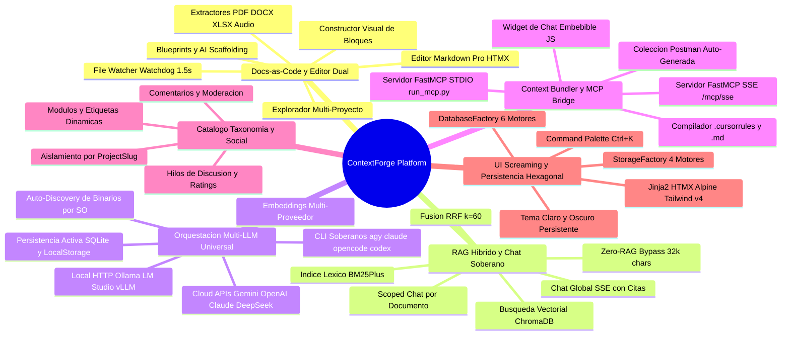
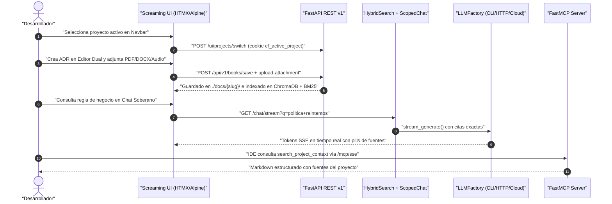

# Catálogo Exhaustivo de Capacidades, Features y Desglose Funcional (DeepWiki)

> [!NOTE]
> Descomposición funcional jerárquica de **ContextForge (IntegrationLibrary)** conectando capacidades de negocio, features granulares, recorridos de usuario (*User Journeys*), archivos fuente (*Deep Source Linking*) y cobertura de pruebas automatizadas (`158/158` tests pasando).

---

## 1. Mapa Mental de Capacidades del Sistema (Mermaid Mindmap)

---

## 2. Matriz de Capacidades y Features Granulares

### Capacidad 1 (`CAP-DOC`): Gestión Docs-as-Code, Editor Dual y Anexos Multiformato

| ID | Feature | Disparador / Endpoint | Invariantes (`BR-*`) | Código Fuente | Cobertura de Tests |
|---|---|---|---|---|---|
| `CAP-DOC-001` | Explorador y Visor Editorial con Lightbox/Audio/PDF/DOCX/XLSX | `GET /docs/browser`, `GET /docs/view/{path}` | `BR-DOC-001`, `BR-DOC-003` | [`docs_api.py`](file:///c:/Users/nayid/Documents/Proyectos/Proyecto%20-%20IntegrationLibrary/IntegrationLibrary/src/presentation/api/v1/docs_api.py), [`doc_detail.html`](file:///c:/Users/nayid/Documents/Proyectos/Proyecto%20-%20IntegrationLibrary/IntegrationLibrary/src/presentation/frontend/modules/knowledge_docs/views/doc_detail.html) | `tests/e2e/test_contextforge_e2e.py` |
| `CAP-DOC-002` | Editor Dual (Markdown Pro $\leftrightarrow$ Bloques Visuales) | `POST /api/v1/books/save`, `POST /api/v1/books/compile-blocks` | `BR-DOC-001`, `BR-DOC-002` | [`registry_api.py`](file:///c:/Users/nayid/Documents/Proyectos/Proyecto%20-%20IntegrationLibrary/IntegrationLibrary/src/presentation/api/v1/registry_api.py), [`doc_editor.html`](file:///c:/Users/nayid/Documents/Proyectos/Proyecto%20-%20IntegrationLibrary/IntegrationLibrary/src/presentation/frontend/modules/knowledge_docs/views/doc_editor.html) | `tests/e2e/test_dual_editor_and_scoped_rag.py` |
| `CAP-DOC-003` | Carga y Extracción Multiformato (PDF, DOCX, XLSX, Audio) | `POST /api/v1/books/upload-attachment`, `GET /api/v1/assets/{path}` | `BR-DOC-003` | [`src/infrastructure/external/extractors/`](file:///c:/Users/nayid/Documents/Proyectos/Proyecto%20-%20IntegrationLibrary/IntegrationLibrary/src/infrastructure/external/extractors) | `tests/unit/test_multiformat_extractors.py` |
| `CAP-DOC-004` | Scaffolding de Documentación con IA y Blueprints | `GET /api/v1/docs/templates`, `POST /api/v1/docs/scaffold-ai` | `BR-DOC-001` | [`scaffold_api.py`](file:///c:/Users/nayid/Documents/Proyectos/Proyecto%20-%20IntegrationLibrary/IntegrationLibrary/src/presentation/api/v1/scaffold_api.py), [`blueprints.py`](file:///c:/Users/nayid/Documents/Proyectos/Proyecto%20-%20IntegrationLibrary/IntegrationLibrary/src/core/templates/blueprints.py) | `tests/unit/test_blueprints_and_scaffold.py`, `tests/e2e/test_scaffold_api.py` |
| `CAP-DOC-005` | Sincronización Automática con File Watcher (`watchdog`) | Evento FS en `./docs/` (debounce `1.5s`) | `BR-RAG-001` | [`fs_watcher.py`](file:///c:/Users/nayid/Documents/Proyectos/Proyecto%20-%20IntegrationLibrary/IntegrationLibrary/src/infrastructure/services/fs_watcher.py) | `tests/integration/test_fs_watcher.py` |

### Capacidad 2 (`CAP-RAG`): Motor RAG Híbrido y Chat Conversacional

| ID | Feature | Disparador / Endpoint | Invariantes (`BR-*`) | Código Fuente | Cobertura de Tests |
|---|---|---|---|---|---|
| `CAP-RAG-001` | Búsqueda Híbrida BM25Plus + ChromaDB (RRF $k=60$) | `GET /api/v1/search/hybrid` | `BR-RAG-001`, `BR-RAG-002` | [`hybrid_searcher.py`](file:///c:/Users/nayid/Documents/Proyectos/Proyecto%20-%20IntegrationLibrary/IntegrationLibrary/src/application/rag_engine/services/hybrid_searcher.py) | `tests/integration/test_multi_project_rag.py` |
| `CAP-RAG-002` | Chat RAG Global con Streaming SSE y Citas | `GET /chat/stream`, `POST /api/v1/rag/ask` | `BR-RAG-002`, `BR-RAG-003` | [`rag_api.py`](file:///c:/Users/nayid/Documents/Proyectos/Proyecto%20-%20IntegrationLibrary/IntegrationLibrary/src/presentation/api/v1/rag_api.py), [`chat.html`](file:///c:/Users/nayid/Documents/Proyectos/Proyecto%20-%20IntegrationLibrary/IntegrationLibrary/src/presentation/frontend/modules/rag_chat/views/chat.html) | `tests/unit/test_contextforge_domain_and_app.py` |
| `CAP-RAG-003` | Chat Focalizado por Documento con Zero-RAG Bypass ($\le 32\text{k}$) | `POST /api/v1/chat/scoped`, `POST /api/v1/chat/messages` | `BR-RAG-004` | [`scoped_chat_service.py`](file:///c:/Users/nayid/Documents/Proyectos/Proyecto%20-%20IntegrationLibrary/IntegrationLibrary/src/application/chat/services/scoped_chat_service.py) | `tests/unit/test_scoped_chat_service.py`, `tests/e2e/test_dual_editor_and_scoped_rag.py` |

### Capacidad 3 (`CAP-LLM`): Orquestación Multi-LLM Universal y Agentes CLI

| ID | Feature | Disparador / Endpoint | Invariantes (`BR-*`) | Código Fuente | Cobertura de Tests |
|---|---|---|---|---|---|
| `CAP-LLM-001` | Gestión y Activación Persistente de 15 Proveedores LLM | `GET/POST /api/v1/settings/llm`, `POST /api/v1/settings/llm/activate` | `BR-LLM-001`, `BR-LLM-002` | [`llm_settings_api.py`](file:///c:/Users/nayid/Documents/Proyectos/Proyecto%20-%20IntegrationLibrary/IntegrationLibrary/src/presentation/api/v1/llm_settings_api.py), [`llm_factory.py`](file:///c:/Users/nayid/Documents/Proyectos/Proyecto%20-%20IntegrationLibrary/IntegrationLibrary/src/infrastructure/external/llm/llm_factory.py) | `tests/unit/test_multi_llm_subsystem.py` |
| `CAP-LLM-002` | Ejecución Segura y Streaming de Agentes CLI (`agy`, `claude`, `opencode`) | `CLIProcessClient.generate()`, `stream_generate()` | `BR-LLM-003`, `BR-LLM-004` | [`cli_process_client.py`](file:///c:/Users/nayid/Documents/Proyectos/Proyecto%20-%20IntegrationLibrary/IntegrationLibrary/src/infrastructure/external/llm/cli_process_client.py) | `tests/unit/test_multi_llm_subsystem.py` |
| `CAP-LLM-003` | Auto-Discovery de Binarios CLI y Test de Embeddings | `GET /api/v1/settings/llm/discover-cli`, `POST /api/v1/settings/llm/test-embedding` | `BR-LLM-002` | [`discover_cli_engines`](file:///c:/Users/nayid/Documents/Proyectos/Proyecto%20-%20IntegrationLibrary/IntegrationLibrary/src/application/settings/queries/discover_cli_engines) | `tests/test_universal_engines_and_mcp.py` |

### Capacidad 4 (`CAP-MCP`): Context Bundler, Servidor MCP e Integraciones

| ID | Feature | Disparador / Endpoint | Invariantes (`BR-*`) | Código Fuente | Cobertura de Tests |
|---|---|---|---|---|---|
| `CAP-MCP-001` | Compilación y Descarga de Context Bundles (`.cursorrules`/`.md`) | `POST /api/v1/bundles/export`, `GET /api/v1/bundles/{id}/download` | `BR-BND-001` | [`bundles_api.py`](file:///c:/Users/nayid/Documents/Proyectos/Proyecto%20-%20IntegrationLibrary/IntegrationLibrary/src/presentation/api/v1/bundles_api.py) | `tests/unit/test_projects_and_ui_bundler.py` |
| `CAP-MCP-002` | Servidor Universal FastMCP (SSE + STDIO JSON-RPC 2.0) | `GET /mcp/sse`, `POST /mcp/messages`, `python run_mcp.py` | `BR-MCP-001` | [`server.py`](file:///c:/Users/nayid/Documents/Proyectos/Proyecto%20-%20IntegrationLibrary/IntegrationLibrary/src/presentation/mcp/server.py), [`run_mcp.py`](file:///c:/Users/nayid/Documents/Proyectos/Proyecto%20-%20IntegrationLibrary/IntegrationLibrary/run_mcp.py) | `tests/test_universal_engines_and_mcp.py` |
| `CAP-MCP-003` | Widget Embebible JS y Colección Postman | `GET /api/v1/integrations/widget.js`, `GET /api/v1/integrations/postman-collection` | `BR-INT-001` | [`integrations_api.py`](file:///c:/Users/nayid/Documents/Proyectos/Proyecto%20-%20IntegrationLibrary/IntegrationLibrary/src/presentation/api/v1/integrations_api.py) | `tests/unit/test_integrations_and_widget.py` |

---

## 3. Flujo de Usuario de Extremo a Extremo (User Journey)

