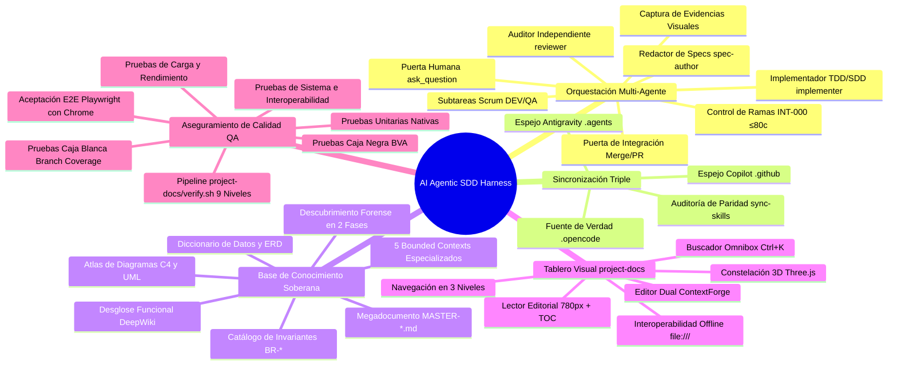
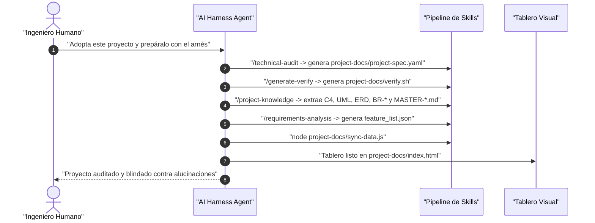
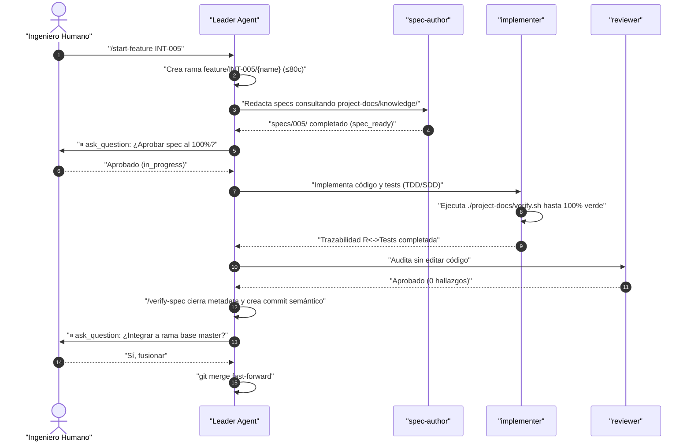
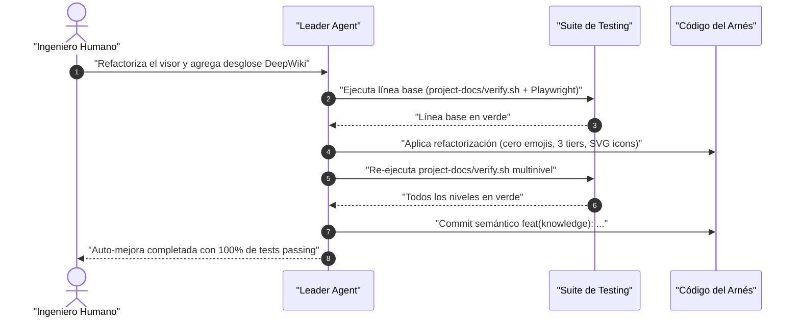

# Catálogo Exhaustivo de Capacidades, Features y Desglose Funcional

> [!NOTE]
> Este documento implementa el patrón de ingeniería inversa funcional de **DeepWiki / OpenDeepWiki**. Descompone el sistema en capacidades de alto nivel, features granulares, mapa mental de dependencias, flujos de usuario de extremo a extremo (*User Journeys*) y vínculos directos al código fuente (*Deep Source Linking*) para eliminar puntos ciegos y alucinaciones en agentes de IA.

---

## 1. Mapa Mental de Funcionalidades del Sistema (Mermaid Mindmap)

---

## 2. Catálogo Jerárquico de Capacidades y Features Granulares

### Capacidad 1: Orquestación Multi-Agente SDD (`agent-orchestrator`)

#### Feature 1.1: Control y Aislamiento Estricto de Ramas Git
- **Propósito**: Garantizar que ninguna tarea contamine las ramas base (`main`, `master`, `dev`), aislando el trabajo en ramas efímeras rastreables.
- **Entrada / Disparador**: Solicitud de nueva feature o inicio de ciclo `/sdd-workflow`.
- **Precondiciones**: Estado de working tree limpio en la rama base.
- **Invariante**: Longitud total del nombre de la rama $\le 80$ caracteres. Prefijo obligatorio `{feature|bugfix}/INT-{numero}/{nombre_descriptivo}`.
- **Ciclo de Ejecución**:
  1. Valida que la rama base sea válida.
  2. Calcula la longitud del nombre propuesto.
  3. Ejecuta `git checkout -b {feature|bugfix}/INT-{numero}/{nombre}`.
- **Salida / Artefacto**: Rama local activa en Git.
- **Código Fuente**: [`.agents/rules/antigravity-harness.md`](file:///c:/Users/nayid/Documents/Proyectos/Proyecto%20-%20Harness/harness_anginnering/.agents/rules/antigravity-harness.md), [`.opencode/rules/branches.md`](file:///c:/Users/nayid/Documents/Proyectos/Proyecto%20-%20Harness/harness_anginnering/.opencode/rules/branches.md).
- **Pruebas Automatizadas**: [`tests/unit/branching-rules.test.js`](file:///c:/Users/nayid/Documents/Proyectos/Proyecto%20-%20Harness/harness_anginnering/tests/unit/branching-rules.test.js), [`tests/blackbox/bva-inputs.test.js`](file:///c:/Users/nayid/Documents/Proyectos/Proyecto%20-%20Harness/harness_anginnering/tests/blackbox/bva-inputs.test.js).

#### Feature 1.2: Redacción Formal de Especificaciones Técnicas (`spec-author`)
- **Propósito**: Redactar el contrato técnico antes de escribir código, previniendo desviaciones funcionales y sobre-ingeniería.
- **Entrada / Disparador**: Invocación de subagente `spec-author` o skill `/generate-spec`.
- **Precondiciones**: Consulta obligatoria previa de `project-docs/knowledge/` para respetar la arquitectura soberana.
- **Ciclo de Ejecución**:
  1. Lee el item correspondiente en `project-docs/feature_list.json`.
  2. Genera `project-docs/specs/{NNN}_{name}/requirements.md` siguiendo sintaxis EARS.
  3. Genera `project-docs/specs/{NNN}_{name}/design.md` con decisiones ADRs y diagramas Mermaid.
  4. Genera `project-docs/specs/{NNN}_{name}/tasks.md` con tareas secuenciales y técnica recomendada (TDD / SDD / FTD).
  5. Marca el estado como `spec_ready` en `progress/current.json`.
- **Salida / Artefacto**: Carpeta de especificación formal completa.
- **Código Fuente**: [`.agents/agents/spec-author.md`](file:///c:/Users/nayid/Documents/Proyectos/Proyecto%20-%20Harness/harness_anginnering/.agents/agents/spec-author.md), [`.agents/skills/generate-spec/SKILL.md`](file:///c:/Users/nayid/Documents/Proyectos/Proyecto%20-%20Harness/harness_anginnering/.agents/skills/generate-spec/SKILL.md).

#### Feature 1.3: Puerta de Aprobación Humana Interactiva
- **Propósito**: Asegurar la soberanía humana sobre el alcance y arquitectura antes de autorizar la codificación.
- **Entrada / Disparador**: Finalización de la redacción del spec (`spec_ready`).
- **Comportamiento**: La IA bloquea la ejecución y despliega el modal interactivo nativo `ask_question`.
- **Opciones**:
  - `(Recommended) Aprobar spec al 100% e iniciar implementación`
  - `Solicitar correcciones o ajustes en el spec`
  - `Rechazar spec`
- **Invariante**: Queda prohibido escribir código de producción sin la opción de aprobación humana explícita.
- **Código Fuente**: [`.agents/rules/antigravity-harness.md`](file:///c:/Users/nayid/Documents/Proyectos/Proyecto%20-%20Harness/harness_anginnering/.agents/rules/antigravity-harness.md).

#### Feature 1.4: Implementación Guiada por Pruebas TDD/SDD (`implementer`)
- **Propósito**: Escribir código de producción y pruebas automatizadas que satisfagan al 100% la especificación aprobada.
- **Entrada / Disparador**: Aprobación humana del spec (`in_progress`).
- **Ciclo de Ejecución**:
  1. Si la técnica es TDD: escribe pruebas que fallen (rojo) $\to$ implementa código mínimo (verde) $\to$ refactoriza.
  2. Si la técnica es SDD: implementa fases de diseño $\to$ cubre con tests unitarios y de aceptación.
  3. Ejecuta `project-docs/verify.sh` de forma iterativa hasta verde total.
  4. Documenta la matriz de trazabilidad Requerimiento $\leftrightarrow$ Tests en `progress/impl_{name}.md`.
- **Salida / Artefacto**: Código productivo, suite de tests y bitácora de trazabilidad.
- **Código Fuente**: [`.agents/agents/implementer.md`](file:///c:/Users/nayid/Documents/Proyectos/Proyecto%20-%20Harness/harness_anginnering/.agents/agents/implementer.md), [`.agents/skills/implement/SKILL.md`](file:///c:/Users/nayid/Documents/Proyectos/Proyecto%20-%20Harness/harness_anginnering/.agents/skills/implement/SKILL.md).

#### Feature 1.5: Auditoría de Calidad Imparcial (`reviewer`)
- **Propósito**: Validar de manera independiente que la implementación cumpla con el spec sin incurrir en conflictos de interés.
- **Invariante**: El revisor **NO tiene herramientas para editar archivos ni código**.
- **Ciclo de Ejecución**:
  1. Audita el código generado contra los criterios de aceptación de `requirements.md`.
  2. Verifica que ninguna regla `BR-*` haya sido alterada o vulnerada.
  3. Comprueba el paso del 100% de las pruebas en `project-docs/verify.sh`.
  4. Emite veredicto: APROBADO o RECHAZADO con lista de hallazgos.
- **Código Fuente**: [`.agents/agents/reviewer.md`](file:///c:/Users/nayid/Documents/Proyectos/Proyecto%20-%20Harness/harness_anginnering/.agents/agents/reviewer.md), [`.agents/skills/review/SKILL.md`](file:///c:/Users/nayid/Documents/Proyectos/Proyecto%20-%20Harness/harness_anginnering/.agents/skills/review/SKILL.md).

#### Feature 1.6: Gestión de Subtareas Scrum Jira DEV/QA y Captura de Evidencias Visuales
- **Propósito**: Descomponer la User Story en subtareas formales de Jira (desarrollo `DEV` y aseguramiento de calidad `QA`), con trazabilidad a criterios de aceptación, DoD y captura automática de evidencias gráficas (screenshots headless) para auditoría.
- **Entrada / Disparador**: Generación de spec (`generate-spec`) y ejecución de pruebas de aceptación (`npm run test:acceptance` o `node scripts/capture-evidence.js`).
- **Precondiciones**: Existencia de `project-docs/specs/{NNN}_{name}/tasks.md` estructurado con subtareas `INT-{id}-DEV` e `INT-{id}-QA`.
- **Invariante**: Ninguna feature puede cerrarse sin que ambas subtareas (`DEV` y `QA`) estén completadas y existan capturas de pantalla de evidencia en `project-docs/specs/{NNN}_{name}/evidence/`.
- **Salida / Artefacto**: Modal interactivo en el tablero con badges DEV/QA, trazabilidad DoD y capturas PNG en `evidence/`.
- **Código Fuente**: [`scripts/capture-evidence.js`](file:///c:/Users/nayid/Documents/Proyectos/Proyecto%20-%20Harness/harness_anginnering/scripts/capture-evidence.js), [`project-docs/src/shared/Modal.js`](file:///c:/Users/nayid/Documents/Proyectos/Proyecto%20-%20Harness/harness_anginnering/project-docs/src/shared/Modal.js), [`project-docs/src/features/feature-list/FeatureTable.js`](file:///c:/Users/nayid/Documents/Proyectos/Proyecto%20-%20Harness/harness_anginnering/project-docs/src/features/feature-list/FeatureTable.js).
- **Pruebas Automatizadas**: [`tests/acceptance/scrum-evidence-capture.spec.js`](file:///c:/Users/nayid/Documents/Proyectos/Proyecto%20-%20Harness/harness_anginnering/tests/acceptance/scrum-evidence-capture.spec.js).

---

### Capacidad 2: Motor de Sincronización Triple (`triple-sync-engine`)

#### Feature 2.1: Gestión de Fuente de Verdad y Replicación
- **Propósito**: Mantener paridad absoluta en las 18 skills entre las tres plataformas soportadas (opencode, GitHub Copilot y Google Antigravity).
- **Fuente de Verdad**: `.opencode/skills/`
- **Espejos Homologados**: `.github/skills/` y `.agents/skills/`.
- **Mecanismo**: Skill `/sync-skills` audita y propaga diferencias sin alterar la fuente.
- **Código Fuente**: [`.opencode/skills/sync-skills/SKILL.md`](file:///c:/Users/nayid/Documents/Proyectos/Proyecto%20-%20Harness/harness_anginnering/.opencode/skills/sync-skills/SKILL.md).

---

### Capacidad 3: Base de Conocimiento Soberana (`knowledge-engine`)

#### Feature 3.1: Protocolo de Descubrimiento Forense en 2 Fases
- **Propósito**: Eliminar el desbordamiento de contexto (*context truncation*) en repositorios de gran escala.
- **Fase 1 (Topología Global)**: Escaneo superficial de directorios, manifiestos de paquetes y configuraciones sin leer cuerpos completos de código.
- **Fase 2 (Extracción Profunda)**: Análisis focalizado delimitado por cada Bounded Context.
- **Salida**: Documentos globales 01, 02, 03, 04 y carpetas `modules/{modulo}/`.
- **Código Fuente**: [`.opencode/skills/project-knowledge/SKILL.md`](file:///c:/Users/nayid/Documents/Proyectos/Proyecto%20-%20Harness/harness_anginnering/.opencode/skills/project-knowledge/SKILL.md).

#### Feature 3.2: Megadocumento Maestro Consolidado (`MASTER-PROJECT-KNOWLEDGE.md`)
- **Propósito**: Proporcionar un dossier unificado en un solo archivo para inicializar LLMs sin sesgo ni necesidad de múltiples lecturas.
- **Estructura**: Capítulos formales (Negocio IEEE 830, Arquitectura AS-IS, Modelado C4, Bounded Contexts con CRC, INVEST, ERD, Reglas `BR-*`, Servicios Externos y RTM).
- **Código Fuente**: [`project-docs/knowledge/MASTER-PROJECT-KNOWLEDGE.md`](file:///c:/Users/nayid/Documents/Proyectos/Proyecto%20-%20Harness/harness_anginnering/project-docs/knowledge/MASTER-PROJECT-KNOWLEDGE.md).

#### Feature 3.3: Desglose de 5 Artefactos Especializados por Bounded Context
- **Propósito**: Documentar granularmente cada subdominio estratégico con 5 documentos formales:
  1. `module-spec.md`: Alcance, lenguaje ubicuo y tarjetas CRC (Clase, Responsabilidades, Colaboradores).
  2. `requirements-and-rules.md`: Matriz de requerimientos `RF-*`, invariantes `BR-*`, `HU-*` y `TI-*`.
  3. `data-and-transactions.md`: Persistencia, entidades, concurrencia optimista/pesimista y bloqueos ACID.
  4. `diagrams.md`: Suite de diagramas Mermaid dedicados (Contexto, Contenedor, Componentes, Secuencia, Estado y ERD).
  5. `technical-debt-refactoring.md`: Deuda técnica, olores de código, brechas de pruebas y plan de mitigación.
- **Código Fuente**: [`project-docs/knowledge/modules/`](file:///c:/Users/nayid/Documents/Proyectos/Proyecto%20-%20Harness/harness_anginnering/project-docs/knowledge/modules/).

---

### Capacidad 4: Tablero Visual y Lector Editorial (`dashboard-visualizer`)

#### Feature 4.1: Navegación por Perspectivas en 3 Niveles
- **Propósito**: Permitir que el usuario explore la documentación sin mezclar arbitrariamente información global con detalles de módulos.
- **Tiers Disponibles**:
  - **Tier 1 (Visión Global & Arquitectura)**: Documentos canónicos, modelo C4 destacado, resumen IEEE 830 y 6 estantes temáticos.
  - **Tier 2 (Módulos & Bounded Contexts)**: Pestañas interactivas de módulos con sus 5 artefactos formales.
  - **Tier 3 (Dossier Maestro Consolidado)**: Panel dedicado para `MASTER-PROJECT-KNOWLEDGE.md` con botones para leer, copiar y descargar.
- **Código Fuente**: [`project-docs/src/features/knowledge-base/KnowledgeBase.js`](file:///c:/Users/nayid/Documents/Proyectos/Proyecto%20-%20Harness/harness_anginnering/project-docs/src/features/knowledge-base/KnowledgeBase.js).

#### Feature 4.2: Editor Dual ContextForge con Scroll Sincronizado
- **Propósito**: Ofrecer edición técnica simultánea en Markdown y Bloques Visuales con previsualización en vivo.
- **Características**: Scroll sincronizado proporcional bidireccional, renderizado de Mermaid y reordenamiento de bloques.
- **Código Fuente**: [`project-docs/src/main.js`](file:///c:/Users/nayid/Documents/Proyectos/Proyecto%20-%20Harness/harness_anginnering/project-docs/src/main.js).

#### Feature 4.3: Interoperabilidad Offline (`file:///`) y Fallback Autocontenido
- **Propósito**: Permitir que el tablero funcione abriendo `index.html` directamente en el navegador sin necesidad de servidor HTTP ni riesgo de errores de CORS.
- **Mecanismo**: `data-fallback.js` inyecta `window.__FALLBACK_DATA__` con todos los metadatos y documentos Markdown.
- **Código Fuente**: [`project-docs/data-fallback.js`](file:///c:/Users/nayid/Documents/Proyectos/Proyecto%20-%20Harness/harness_anginnering/project-docs/data-fallback.js), [`project-docs/sync-data.js`](file:///c:/Users/nayid/Documents/Proyectos/Proyecto%20-%20Harness/harness_anginnering/project-docs/sync-data.js).

---

### Capacidad 5: Suite Integral de Aseguramiento de Calidad (`testing-qa-suite`)

#### Feature 5.1: Pipeline de Verificación Determinista en 9 Niveles (`project-docs/verify.sh`)
- **Propósito**: Ejecutar un barrido exhaustivo de calidad en una sola instrucción.
- **Niveles Validados**:
  1. Compilación y bundling (`esbuild`).
  2. Pruebas unitarias nativas (Node.js test runner).
  3. Pruebas de aceptación smoke ATDD.
  4. Pruebas de caja blanca (Branch Coverage).
  5. Pruebas de caja negra (Análisis de Valores Límite BVA y resiliencia).
  6. Pruebas de sistema e interoperabilidad offline.
  7. Pruebas de carga y concurrencia.
  8. Pruebas de aceptación E2E en navegador real con Playwright.
  9. Sincronización y consistencia de datos offline.
- **Código Fuente**: [`project-docs/verify.sh`](file:///c:/Users/nayid/Documents/Proyectos/Proyecto%20-%20Harness/harness_anginnering/project-docs/verify.sh).

---

## 3. Flujos de Usuario Extremo a Extremo (*User Journeys*)

### Journey 1: Desarrollador realizando el Onboarding de un Proyecto Externo

### Journey 2: Ciclo de Vida Autónomo de una Feature (SDD)

### Journey 3: Auto-Mejora y Refactorización del Propio Arnés

---

## 4. Matriz de Trazabilidad Funcional y Deep Linking a Código Fuente

| ID Capacidad | Feature | Componente Fuente | Suite de Pruebas Asociada |
| :--- | :--- | :--- | :--- |
| `CAP-ORCH-001` | Validación de Ramas Git (≤80c) | [`.agents/rules/antigravity-harness.md`](file:///c:/Users/nayid/Documents/Proyectos/Proyecto%20-%20Harness/harness_anginnering/.agents/rules/antigravity-harness.md) | [`tests/unit/branching-rules.test.js`](file:///c:/Users/nayid/Documents/Proyectos/Proyecto%20-%20Harness/harness_anginnering/tests/unit/branching-rules.test.js) |
| `CAP-ORCH-002` | Puertas de Aprobación Humana | `ask_question` modal | [`tests/e2e/atdd-frontend.test.js`](file:///c:/Users/nayid/Documents/Proyectos/Proyecto%20-%20Harness/harness_anginnering/tests/e2e/atdd-frontend.test.js) |
| `CAP-ORCH-003` | Auditoría de Calidad Sin Edición | [`.agents/agents/reviewer.md`](file:///c:/Users/nayid/Documents/Proyectos/Proyecto%20-%20Harness/harness_anginnering/.agents/agents/reviewer.md) | Inspección de permisos de herramientas |
| `CAP-ORCH-004` | Subtareas Scrum Jira DEV/QA & Evidencias | [`scripts/capture-evidence.js`](file:///c:/Users/nayid/Documents/Proyectos/Proyecto%20-%20Harness/harness_anginnering/scripts/capture-evidence.js) | [`tests/acceptance/scrum-evidence-capture.spec.js`](file:///c:/Users/nayid/Documents/Proyectos/Proyecto%20-%20Harness/harness_anginnering/tests/acceptance/scrum-evidence-capture.spec.js) |
| `CAP-SYNC-001` | Paridad de 18 Skills en 3 Espejos | [`.opencode/skills/sync-skills/`](file:///c:/Users/nayid/Documents/Proyectos/Proyecto%20-%20Harness/harness_anginnering/.opencode/skills/sync-skills/) | [`tests/system/offline-fallback.test.js`](file:///c:/Users/nayid/Documents/Proyectos/Proyecto%20-%20Harness/harness_anginnering/tests/system/offline-fallback.test.js) |
| `CAP-KNOW-001` | Descubrimiento Forense en 2 Fases | [`.opencode/skills/project-knowledge/`](file:///c:/Users/nayid/Documents/Proyectos/Proyecto%20-%20Harness/harness_anginnering/.opencode/skills/project-knowledge/) | [`tests/whitebox/sync-pipeline.test.js`](file:///c:/Users/nayid/Documents/Proyectos/Proyecto%20-%20Harness/harness_anginnering/tests/whitebox/sync-pipeline.test.js) |
| `CAP-KNOW-002` | Dossier Consolidado MASTER-*.md | [`project-docs/knowledge/MASTER-*.md`](file:///c:/Users/nayid/Documents/Proyectos/Proyecto%20-%20Harness/harness_anginnering/project-docs/knowledge/MASTER-PROJECT-KNOWLEDGE.md) | [`tests/unit/sync-data.test.js`](file:///c:/Users/nayid/Documents/Proyectos/Proyecto%20-%20Harness/harness_anginnering/tests/unit/sync-data.test.js) |
| `CAP-DASH-001` | Lector y Editor Dual ContextForge | [`project-docs/src/main.js`](file:///c:/Users/nayid/Documents/Proyectos/Proyecto%20-%20Harness/harness_anginnering/project-docs/src/main.js) | [`tests/acceptance/dual-editor.spec.js`](file:///c:/Users/nayid/Documents/Proyectos/Proyecto%20-%20Harness/harness_anginnering/tests/acceptance/dual-editor.spec.js) |
| `CAP-DASH-002` | Interoperabilidad Offline `file:///` | [`project-docs/data-fallback.js`](file:///c:/Users/nayid/Documents/Proyectos/Proyecto%20-%20Harness/harness_anginnering/project-docs/data-fallback.js) | [`tests/system/offline-fallback.test.js`](file:///c:/Users/nayid/Documents/Proyectos/Proyecto%20-%20Harness/harness_anginnering/tests/system/offline-fallback.test.js) |
| `CAP-TEST-001` | Pipeline de Verificación `project-docs/verify.sh` | [`project-docs/verify.sh`](file:///c:/Users/nayid/Documents/Proyectos/Proyecto%20-%20Harness/harness_anginnering/project-docs/verify.sh) | Ejecución integral de las 9 fases |
| `CAP-TEST-002` | Aceptación E2E en Navegador Real | [`tests/acceptance/*.spec.js`](file:///c:/Users/nayid/Documents/Proyectos/Proyecto%20-%20Harness/harness_anginnering/tests/acceptance/) | `npx playwright test` (10 escenarios) |

