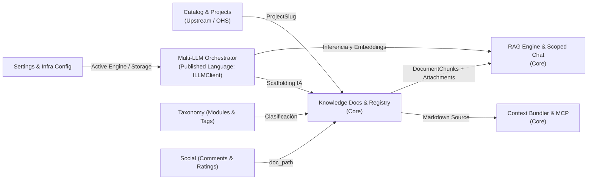

# Modelo de Dominio DDD, Subdominios, Context Map y Tarjetas CRC

> [!NOTE]
> Análisis estratégico y táctico basado en **Domain-Driven Design (DDD)** sobre los 12 contextos de dominio definidos en `src/domain/` y `src/core/domain/`.

---

## 1. Clasificación de Subdominios

| Subdominio | Tipo DDD | Contextos en `src/domain/` | Valor Estratégico |
|---|---|---|---|
| **Gestión Documental Docs-as-Code** | *Core Domain* | `knowledge_docs`, `book_registry` | Núcleo diferenciador: Markdown plano como fuente de verdad + edición dual + extractores multiformato. |
| **Recuperación Híbrida & Chat RAG** | *Core Domain* | `rag_engine`, `chat` | Inteligencia contextual soberana con RRF $k=60$ y Zero-RAG Bypass ($\le 32\text{k}$). |
| **Orquestación Multi-LLM & MCP** | *Core Domain* | `llm`, `context_builder` | Portabilidad total entre 15 motores de IA y consumo nativo desde IDEs vía MCP. |
| **Catálogo, Proyectos y Taxonomía** | *Supporting Domain* | `catalog`, `taxonomy`, `core/domain/project` | Aislamiento multi-proyecto, clasificación por módulos/etiquetas y ciclo de vida editorial. |
| **Capa Social Colaborativa** | *Supporting Domain* | `social` | Discusión técnica, comentarios y calificaciones sobre documentos vivos. |
| **Configuración e Infraestructura** | *Generic Subdomain* | `settings`, `infrastructure_config`, `shared_kernel` | Persistencia de preferencias, selección de motores de BD/Storage y primitivos compartidos. |

---

## 2. Context Map (Relaciones entre Bounded Contexts)

---

## 3. Tarjetas CRC (Class-Responsibility-Collaborator)

### CRC-01: `ProjectSlug` (`src/core/domain/project.py`)
- **Responsabilidades**: Normalizar identificadores de proyecto a minúsculas, validar expresión regular estricta `^[a-z0-9][a-z0-9-_]*[a-z0-9]$` y longitud máxima de 50 caracteres.
- **Colaboradores**: `Project`, `SqliteProjectRepository`, `ChromaVectorRepository`, `BM25LexicalRepository`.

### CRC-02: `LLMConfiguration` (`src/domain/llm/entities.py`)
- **Responsabilidades**: Modelar parámetros de un proveedor de IA (tipo de motor, modelo por defecto, temperatura, tokens, comando/args CLI), enmascarar claves API (`mask_api_key`) y sanitizar entradas.
- **Colaboradores**: `LLMFactory`, `SqlLLMConfigRepository`, `ActivateLLMProviderCommandHandler`.

### CRC-03: `HybridSearchService` (`src/application/rag_engine/services/hybrid_searcher.py`)
- **Responsabilidades**: Ejecutar recuperación semántica y léxica aislada por `project_slug` y fusionar resultados mediante *Reciprocal Rank Fusion* ($k=60$).
- **Colaboradores**: `IVectorRepository` (`ChromaVectorRepository`), `ILexicalIndexRepository` (`BM25LexicalRepository`).

### CRC-04: `ScopedChatService` (`src/application/chat/services/scoped_chat_service.py`)
- **Responsabilidades**: Evaluar tamaño de documento para aplicar *Zero-RAG Bypass* ($\le 32.000$ chars) o búsqueda vectorial focalizada, inyectar historial conversacional y devolver respuesta con fuentes.
- **Colaboradores**: `IVectorRepository`, `ILLMClient`.

### CRC-05: `CLIProcessClient` (`src/infrastructure/external/llm/cli_process_client.py`)
- **Responsabilidades**: Resolver binarios CLI en Windows/Linux/macOS, construir argumentos sin `shell=True` respetando orden de flags (`--dangerously-skip-permissions` antes de `-p=...` para `agy`), ejecutar streaming UTF-8 incremental con fallback multihilo ante `NotImplementedError`.
- **Colaboradores**: `ILLMClient`, `LLMFactory`, `subprocess.Popen`, `asyncio.Queue`.

### CRC-06: `FastMCP` (`src/presentation/mcp/server.py`)
- **Responsabilidades**: Registrar herramientas MCP (`search_project_context`, `get_document_full`, `list_project_structure`), procesar JSON-RPC 2.0 (`initialize`, `ping`, `tools/list`, `tools/call`) y servir transporte dual SSE (`/mcp/sse`) y STDIO (`run_mcp.py`).
- **Colaboradores**: `MCPQueryContextQueryHandler`, `HybridSearchService`, `IDocumentRepository`.
