# MASTER PROJECT KNOWLEDGE — ContextForge (IntegrationLibrary)

> [!NOTE]
> Megadocumento unificado compilado automáticamente con el **100% íntegro** de los 45 documentos de la Base de Conocimiento Soberana de **ContextForge** (sin recortes ni resúmenes).

## Tabla de Contenidos

1. `01-project-overview-and-business.md`
2. `02-architecture-and-patterns.md`
3. `03-capabilities-and-features.md`
4. `04-domain-ddd-and-crc.md`
5. `c4-model.md`
6. `uml-diagrams.md`
7. `data-dictionary.md`
8. `business-rules.md`
9. `external-services.md`
10. `functional-requirements.md`
11. `coding-standards.md`
12. `adr-catalog.md`
13. `design-system-and-ui.md`
14. `runbooks-and-operations.md`
15. `ai-runs-log.md`
16. `modules/knowledge-docs-and-registry/module-spec.md`
17. `modules/knowledge-docs-and-registry/requirements-and-rules.md`
18. `modules/knowledge-docs-and-registry/data-and-transactions.md`
19. `modules/knowledge-docs-and-registry/diagrams.md`
20. `modules/knowledge-docs-and-registry/technical-debt-refactoring.md`
21. `modules/rag-engine-and-scoped-chat/module-spec.md`
22. `modules/rag-engine-and-scoped-chat/requirements-and-rules.md`
23. `modules/rag-engine-and-scoped-chat/data-and-transactions.md`
24. `modules/rag-engine-and-scoped-chat/diagrams.md`
25. `modules/rag-engine-and-scoped-chat/technical-debt-refactoring.md`
26. `modules/multi-llm-and-cli-orchestrator/module-spec.md`
27. `modules/multi-llm-and-cli-orchestrator/requirements-and-rules.md`
28. `modules/multi-llm-and-cli-orchestrator/data-and-transactions.md`
29. `modules/multi-llm-and-cli-orchestrator/diagrams.md`
30. `modules/multi-llm-and-cli-orchestrator/technical-debt-refactoring.md`
31. `modules/context-bundler-and-mcp-bridge/module-spec.md`
32. `modules/context-bundler-and-mcp-bridge/requirements-and-rules.md`
33. `modules/context-bundler-and-mcp-bridge/data-and-transactions.md`
34. `modules/context-bundler-and-mcp-bridge/diagrams.md`
35. `modules/context-bundler-and-mcp-bridge/technical-debt-refactoring.md`
36. `modules/catalog-projects-and-taxonomy/module-spec.md`
37. `modules/catalog-projects-and-taxonomy/requirements-and-rules.md`
38. `modules/catalog-projects-and-taxonomy/data-and-transactions.md`
39. `modules/catalog-projects-and-taxonomy/diagrams.md`
40. `modules/catalog-projects-and-taxonomy/technical-debt-refactoring.md`
41. `modules/screaming-ui-and-persistence/module-spec.md`
42. `modules/screaming-ui-and-persistence/requirements-and-rules.md`
43. `modules/screaming-ui-and-persistence/data-and-transactions.md`
44. `modules/screaming-ui-and-persistence/diagrams.md`
45. `modules/screaming-ui-and-persistence/technical-debt-refactoring.md`

---

<!-- SOURCE: 01-project-overview-and-business.md -->

# Visión del Producto, Contexto de Negocio y Stakeholders (IEEE Std. 830-1998)

> [!NOTE]
> Especificación formal del propósito, alcance, límites, perfiles de usuario y gobernanza de **ContextForge (IntegrationLibrary)** — plataforma soberana de gestión de conocimiento técnico, recuperación híbrida RAG y construcción de contexto para agentes de IA bajo el paradigma **Docs-as-Code**.

---

## 1. Naturaleza y Propósito del Proyecto

**ContextForge** (`contextforge` v0.1.0) es una plataforma full-stack **100% soberana (Zero-Leakage / On-Premise)** diseñada para gestionar, indexar, consultar y empaquetar conocimiento técnico de ingeniería en formato **Markdown plano (`.md`)** junto con anexos multiformato (PDF, DOCX, XLSX/CSV, imágenes y audio).

### 1.1 Formulación del Problema

#### Dolor de Negocio
- **Dependencia Oral y Bus Factor Crítico**: El conocimiento arquitectónico, las reglas de negocio y las políticas de integración suelen dispersarse en wikis desactualizadas, chats efímeros o en la memoria de desarrolladores senior.
- **Riesgo de Fuga de Propiedad Intelectual**: Subir especificaciones propietarias, ADRs o documentos internos a servicios SaaS de IA en la nube viola políticas de confidencialidad y cumplimiento corporativo.
- **Alucinaciones de Asistentes de Código**: Los IDEs y agentes de IA (Cursor, Claude Code, Antigravity, OpenCode) generan implementaciones incompatibles cuando carecen de acceso estructurado y verificable a la documentación real del proyecto.

#### Dolor Técnico
- **Búsqueda Semántica vs. Léxica Incompleta**: Las búsquedas puramente vectoriales fallan con identificadores exactos (`BR-PAY-001`, códigos HTTP, slugs), mientras que las búsquedas puramente léxicas pierden intención conceptual.
- **Acoplamiento a un Único Proveedor de IA o Persistencia**: Los equipos necesitan alternar sin fricción entre motores locales offline (Ollama, LM Studio, vLLM), agentes CLI soberanos (`agy`, `claude`, `opencode`, `codex`, `gemini`, `aider`) y APIs comerciales (Gemini, OpenAI, Anthropic, DeepSeek).

---

## 2. Declaración Formal de la Visión del Producto

> **PARA** equipos de ingeniería de software, arquitectos de soluciones y desarrolladores asistidos por IA,  
> **QUIENES** necesitan centralizar documentación técnica viva, consultar reglas de negocio con atribución exacta de fuentes y suministrar contexto determinista a agentes de código sin fugar datos propietarios,  
> **EL** sistema **ContextForge (IntegrationLibrary)**,  
> **QUE ES UNA** plataforma soberana de conocimiento técnico Docs-as-Code, RAG Híbrido (ChromaDB + BM25Plus) y servidor universal MCP,  
> **QUE** mantiene archivos Markdown como única fuente de verdad, ofrece editor dual (Markdown Pro + Bloques visuales), recuperación híbrida con *Zero-RAG Bypass* ($\le 32.000$ caracteres), orquestación de 15 motores de IA y exportación directa de bundles de contexto (`.cursorrules` y MCP SSE/STDIO).

---

## 3. Ámbito del Producto (IEEE 830 Secciones 1.2 y 2.2)

### 3.1 Qué HACE el Sistema (Alcance Incluido)
1. **Gestión Multi-Proyecto / Multi-Librería Aislada**: Particionamiento físico de documentos (`./docs/{project_slug}/`), colecciones vectoriales (`cf_project_{slug}`) e índices léxicos BM25Plus por proyecto.
2. **Autoría Dual Docs-as-Code**: Editor Markdown Pro con vista previa HTMX en tiempo real y Constructor Dinámico de Bloques compilado bidireccionalmente a Markdown, más scaffolding asistido por IA mediante Blueprints (ADR, Business Flow, API Integration, Troubleshooting).
3. **Ingesta Multiformato y File Watcher**: Extracción estructurada de anexos PDF (`pypdf`), DOCX (`python-docx`), XLSX/CSV (`openpyxl`/`pandas`), soporte de audio/imágenes en visor modal y sincronización automática con `watchdog` (debounce `1.5s`).
4. **Motor RAG Híbrido y Chat Focalizado (Scoped RAG)**: Fusión *Reciprocal Rank Fusion* (RRF $k=60$) entre ChromaDB y BM25Plus, *Zero-RAG Bypass* para documentos $\le 32.000$ caracteres, streaming SSE y atribución obligatoria de citas.
5. **Orquestación Multi-LLM Universal (15 Proveedores)**: Soporte unificado para servidores locales HTTP (Ollama, LM Studio, vLLM, LocalAI), APIs Cloud (Gemini, OpenAI, Anthropic, DeepSeek) y agentes CLI locales (`agy`, `claude`, `opencode`, `codex`, `gemini`, `aider`, `ollama`) con persistencia en SQLite.
6. **Context Bundler & Servidor Universal MCP**: Compilación de archivos `.cursorrules`/`.md`, widget de chat embebible (`widget.js`), colección Postman auto-generada y servidor `FastMCP` sobre SSE (`/mcp/sse`) y STDIO (`run_mcp.py`).
7. **Taxonomía Dinámica y Capa Social**: Gestión de módulos y etiquetas (`modules`, `tags`), hilos de discusión (`discussion_threads`), comentarios (`document_comments`) y calificaciones (`ratings`).

### 3.2 Qué NO HACE el Sistema (Exclusiones Explícitas)
- **No sustituye a Git**: ContextForge gestiona archivos locales en `./docs/` preparados para versionamiento Git, pero no ejecuta `git push` ni reemplaza flujos de Pull Request.
- **No incluye autenticación empresarial SSO/OAuth2 nativa**: Opera orientado a entornos locales/intranet confiables; la exposición pública requiere un reverse proxy externo con autenticación.
- **No entrena ni realiza fine-tuning de modelos**: Utiliza inferencia RAG sobre modelos existentes (locales o cloud).

---

## 4. Catálogo de Stakeholders, Perfiles de Usuario y Matriz RACI

### 4.1 Stakeholders y Perfiles (IEEE 830 Sección 2.3)

| Stakeholder / Perfil | Formación y Experiencia | Responsabilidad Principal | Dolor / Necesidad Clave |
|---|---|---|---|
| **Arquitecto de Software / Tech Lead** | Ingeniería de Sistemas / >7 años | Definir ADRs, taxonomía de módulos y estándares de contexto | Evitar desalineación arquitectónica y mantener documentación viva |
| **Desarrollador Backend / Full-Stack** | Ingeniería o técnico / 1–6 años | Consultar reglas de negocio, redactar specs y consumir bundles en IDE | Reducir tiempo de búsqueda y obtener citas verificables sin interrumpir seniors |
| **Agente de IA / IDE (Cursor, Antigravity, Claude Code)** | Cliente automatizado MCP / REST | Consultar `search_project_context`, `get_document_full`, `list_project_structure` | Recibir contexto exacto y sin ruido antes de generar código |
| **QA / Especialista de Integración** | Ingeniería QA / 2–5 años | Validar contratos API, descargar colección Postman y auditar anexos | Acceder a endpoints documentados y pruebas reproducibles |

### 4.2 Matriz RACI

| Capacidad / Proceso | Tech Lead | Desarrollador | Agente IA (MCP) | QA |
|---|---|---|---|---|
| **Gobernanza de Proyectos y Taxonomía** | A / R | C | I | I |
| **Autoría y Mantenimiento Docs-as-Code** | A | R | C | C |
| **Configuración de Motores LLM / Storage** | A / R | C | I | I |
| **Consumo RAG / Scoped Chat / MCP** | C | R | R | R |
| **Validación API y Regresión (`pytest`/`mypy`)** | A | R | C | R |

---

## 5. Restricciones, Asunciones y Glosario Canónico

### 5.1 Restricciones y Asunciones (IEEE 830 Secciones 2.4 y 2.5)
- **Runtime**: Python `>=3.11` (validado en Python 3.13) con tipado estricto (`mypy --strict src` = 0 errores en 302 archivos).
- **Soberanía de Datos**: SQLite (`./data/contextforge.db`) y ChromaDB (`./data/chroma`) operan localmente sin requerir conectividad externa; las APIs cloud son estrictamente opcionales.
- **Compatibilidad Windows/Linux/macOS**: El adaptador `CLIProcessClient` resuelve ejecutables por SO y aplica `WindowsProactorEventLoopPolicy` más fallback multihilo `subprocess.Popen` ante `NotImplementedError`.

### 5.2 Glosario Canónico (IEEE 830 Sección 1.3)

| Término / Sigla | Definición Canónica en ContextForge |
|---|---|
| **Docs-as-Code** | Paradigma donde los archivos Markdown en `./docs/{project_slug}/` son la única fuente de verdad documental. |
| **Zero-RAG Bypass** | Estrategia de `ScopedChatService` que inyecta el documento completo al LLM cuando su tamaño es $\le 32.000$ caracteres, evitando fragmentación innecesaria. |
| **RRF ($k=60$)** | *Reciprocal Rank Fusion*, algoritmo determinista que combina rankings semánticos (ChromaDB) y léxicos (BM25Plus). |
| **Context Bundle** | Paquete compilado en `.cursorrules` o `.md` que consolida documentos seleccionados de un proyecto para inyección directa en IDEs. |
| **MCP (Model Context Protocol)** | Protocolo JSON-RPC 2.0 expuesto por `FastMCP` en `/mcp/sse` y `run_mcp.py` (STDIO) para consumo nativo por agentes IA. |
| **ProjectSlug** | Value Object normalizado (`^[a-z0-9][a-z0-9-_]*[a-z0-9]$`, máx. 50 chars) que aísla cada librería/proyecto. |

---

<!-- SOURCE: 02-architecture-and-patterns.md -->

# Diagnóstico AS-IS de Arquitectura, Flujos de Datos y Catálogo de Patrones

> [!NOTE]
> Diagnóstico forense real (*AS-IS*) de los **302 archivos Python** en `src/` y **28 plantillas HTML** en `src/presentation/frontend/` de **ContextForge (IntegrationLibrary)**.

---

## 1. Diagnóstico del Estilo Arquitectónico Implementado (AS-IS)

ContextForge implementa una **Arquitectura Híbrida Clean Architecture + Hexagonal (Puertos y Adaptadores) + CQRS Granular + Screaming Frontend**, en estado de convivencia controlada con una capa `src/core/` de transición (patrón *Strangler Fig*):

### 1.1 Organización de Directorios y Dirección de Dependencias

```text
src/
├── main.py                      # Composition Root: FastAPI Factory, Lifespan, CORS, Timing, RFC 7807, Mount /mcp
├── domain/                      # CAPA 1: Dominio Puro (12 bounded contexts, 0 dependencias de framework)
│   ├── book_registry/           # DraftBook, DocumentBlock, Attachment, BlockType
│   ├── catalog/                 # Book, Library, IBookRepository, ILibraryRepository
│   ├── chat/                    # ChatMessage, ScopedChatSession, DocumentSourceRef
│   ├── context_builder/         # ContextBundle, IBundleStorageRepository
│   ├── infrastructure_config/   # DatabaseConfiguration, StorageConfiguration (Hexagonal)
│   ├── knowledge_docs/          # Document, DocumentChunk, IDocumentRepository
│   ├── llm/                     # LLMConfiguration, LLMProvider (15), EngineType, ILLMClient
│   ├── rag_engine/              # RetrievalResult, Citation, PromptContext, IOllamaClient
│   ├── settings/                # SystemSettings, ISettingsRepository
│   ├── shared_kernel/           # Entity, ValueObject, DomainException
│   ├── social/                  # Comment, Rating, DiscussionThread, ISocialRepository
│   └── taxonomy/                # ModuleEntity, TagEntity, ITaxonomyRepository
├── application/                 # CAPA 2: Casos de Uso CQRS Granular (commands/queries/validators/handlers)
│   ├── commons/                 # Mediator, IUnitOfWork, Behaviors (Validation, Logging, Transaction)
│   ├── book_registry/           # create_book_from_blocks, save_raw_markdown, upload_attachment
│   ├── catalog/                 # get_library_catalog, get_books, update_book_status
│   ├── chat/                    # ask_project_context, ask_scoped_document, send_scoped_message, ScopedChatService
│   ├── context_bridge/          # export_agent_rules, mcp_query_context
│   ├── context_builder/         # ContextBundleCompiler
│   ├── knowledge_docs/          # IngestDocsCommand, CreateDocumentCommand, GetDocumentsQuery
│   ├── rag_engine/              # HybridSearchService (RRF k=60), PromptBuilder, AskRagQueryHandler
│   ├── settings/                # SaveLLMConfig, ActivateLLMProvider, TestLLMConnection, DiscoverCLIEngines
│   └── social/                  # add_comment, moderate_comment, get_book_comments
├── core/                        # CAPA LEGACY EN TRANSICIÓN (Strangler Fig): ProjectSlug, Blueprints, ScaffoldDocUseCase
├── infrastructure/              # CAPA 3: Adaptadores Concretos
│   ├── database/                # AsyncEngine SQLite/SQLAlchemy, auto-migraciones DDL, seed inicial
│   ├── persistence/             # ORM models desacoplados (models/*.py), DatabaseFactory + strategies
│   ├── storage/                 # StorageFactory + strategies (local_fs, supabase_storage, s3, firebase)
│   ├── repositories/            # Sql*, LocalFilesystem, ChromaVector, BM25Lexical, JsonInfraConfig, mongo/, firebase/
│   ├── external/                # llm/ (LLMFactory + strategies + CLIProcessClient + HTTP clients), extractors/ (PDF/DOCX/XLSX)
│   └── services/                # BackgroundDocsWatcher (watchdog con debounce 1.5s)
└── presentation/                # CAPA 4: Presentación Híbrida (REST v1 + MCP + Screaming UI)
    ├── api/v1/                  # 14 routers REST + RFC 7807 ProblemDetails + DI (dependencies.py)
    ├── mcp/                     # FastMCP server (SSE /mcp/sse y STDIO run_mcp.py)
    └── frontend/                # Screaming UI: Jinja2 + HTMX + Alpine.js + Tailwind v4 (8 módulos)
```

### 1.2 Estado de Evolución Arquitectónica
- **Migrado a Clean Architecture + CQRS Granular**: `book_registry`, `catalog`, `chat`, `social`, `context_bridge`, `llm`, `settings`, `taxonomy`, `infrastructure_config`.
- **Capa `src/core/` (Transición Activa)**: Mantiene `ProjectSlug`, `Project`, `blueprints.py`, `IngestDocsUseCase` y `ScaffoldDocUseCase`, consumidos desde `presentation/api/dependencies.py`. Planificada su consolidación paulatina en `src/domain/` y `src/application/`.

---

## 2. Catálogo Forense de Patrones de Diseño Detectados

| Patrón de Diseño | Categoría | Archivo / Clase Exacta | Problema que Resuelve en ContextForge |
|---|---|---|---|
| **Clean / Hexagonal (Ports & Adapters)** | Arquitectónico | `src/domain/*/repositories.py` + `src/infrastructure/` | Desacopla reglas de negocio de SQLite, ChromaDB, Ollama, APIs Cloud y CLIs. |
| **CQRS Granular** | Arquitectónico | `src/application/{mod}/commands/*`, `queries/*` | Separa lecturas y escrituras en DTOs inmutables, validadores y handlers atómicos. |
| **Factory + Strategy + Options + Registry** | Creacional / Comportamiento | `src/infrastructure/external/llm/llm_factory.py`, `database_factory.py`, `storage_factory.py` | Instancia dinámicamente 15 proveedores LLM, 4 estrategias de embeddings, 6 BD y 4 storages bajo principio Open/Closed. |
| **Repository Pattern** | Persistencia | `src/infrastructure/repositories/sql_*_repo.py`, `chroma_vector_repo.py`, `bm25_lexical_repo.py` | Abstrae consultas SQL, búsqueda vectorial, búsqueda léxica y filesystem Docs-as-Code. |
| **Unit of Work** | Persistencia | `src/application/commons/interfaces/unit_of_work.py`, `SqlAlchemyUnitOfWork` | Garantiza atomicidad transaccional sobre sesiones asíncronas de SQLAlchemy. |
| **Pipeline / Chain of Responsibility** | Comportamiento | `src/application/commons/behaviors/` (`Validation`, `Logging`, `Transaction`), `src/main.py` middlewares | Encadena validación, logging, timing (`X-Response-Time-Ms`) y captura RFC 7807. |
| **Adapter Pattern** | Estructural | `CLIProcessClient`, `GeminiHttpClient`, `AnthropicHttpClient`, `OpenAIHttpClient` | Uniformiza 15 motores heterogéneos (HTTP y procesos CLI) tras la interfaz única `ILLMClient`. |
| **Facade / Orchestrator** | Estructural | `HybridSearchService`, `ScopedChatService`, `ContextBundleCompiler` | Coordina múltiples repositorios (Chroma + BM25 + LLM) tras una fachada simple. |
| **Observer / Debounced File Watcher** | Comportamiento | `src/infrastructure/services/fs_watcher.py` (`BackgroundDocsWatcher`) | Detecta cambios en `./docs/` vía `watchdog` y dispara reindexación incremental tras debounce de `1.5s`. |
| **Zero-RAG Bypass (Adaptive Strategy)** | Dominio / IA | `src/application/chat/services/scoped_chat_service.py` | Inyecta el documento entero cuando tiene $\le 32.000$ caracteres y activa RAG focalizado cuando lo supera. |
| **RFC 7807 Problem Details** | Resiliencia / API | `src/presentation/api/middlewares/problem_details_middleware.py` | Normaliza errores de dominio y HTTP en respuestas JSON estándar RFC 7807. |
| **Threaded Subprocess Fallback** | Concurrencia / Resiliencia | `src/infrastructure/external/llm/cli_process_client.py` | Mitiga `NotImplementedError` en `SelectorEventLoop` de Windows mediante `subprocess.Popen` + `asyncio.Queue` + `call_soon_threadsafe`. |

---

## 3. Flujos de Datos Extremo a Extremo (Data Flows)

### 3.1 Flujo de Lectura RAG Streaming (SSE)
1. El usuario envía una consulta desde `chat.html` (`GET /chat/stream?q=...&project=...`).
2. `rag_chat/routes.py` resuelve `AskRagQueryHandler` mediante FastAPI DI (`get_ask_rag_handler`), que inyecta el `ILLMClient` activo desde `SqlLLMConfigRepository.get_active()`.
3. `HybridSearchService.search()` ejecuta en paralelo búsqueda vectorial (`ChromaVectorRepository`) y léxica (`BM25LexicalRepository`) estrictamente sobre `project_slug`, combinando resultados con **RRF ($k=60$)**.
4. `PromptBuilder` ensambla el contexto con citas exactas (`file_path`, `header`) y emite primero el evento SSE `event: citations`.
5. El cliente activo (`OllamaHttpClient`, `GeminiHttpClient`, `CLIProcessClient`, etc.) transmite tokens progresivamente vía `event: token` con decodificación UTF-8 incremental hasta emitir `event: done`.

### 3.2 Flujo de Escritura Docs-as-Code + Auto-Reindexación
1. El usuario guarda desde el Editor Dual (`POST /api/v1/books/save` o `POST /docs/new`).
2. `LocalFilesystemRepository` escribe el archivo `.md` con frontmatter YAML en `./docs/{project_slug}/{module}/{slug}.md` (única fuente de verdad).
3. `IngestDocsCommandHandler` (y en segundo plano `BackgroundDocsWatcher`) trocea el documento por encabezados `h1`–`h6`, extrae anexos vinculados (PDF/DOCX/XLSX) y actualiza atómicamente ChromaDB (`cf_project_{slug}`) y BM25Plus.
4. `SqlBookRepository` actualiza los metadatos de catálogo en SQLite (`books`).

---

<!-- SOURCE: 03-capabilities-and-features.md -->

# Catálogo Exhaustivo de Capacidades, Features y Desglose Funcional (DeepWiki)

> [!NOTE]
> Descomposición funcional jerárquica de **ContextForge (IntegrationLibrary)** conectando capacidades de negocio, features granulares, recorridos de usuario (*User Journeys*), archivos fuente (*Deep Source Linking*) y cobertura de pruebas automatizadas (`158/158` tests pasando).

---

## 1. Mapa Mental de Capacidades del Sistema (Mermaid Mindmap)

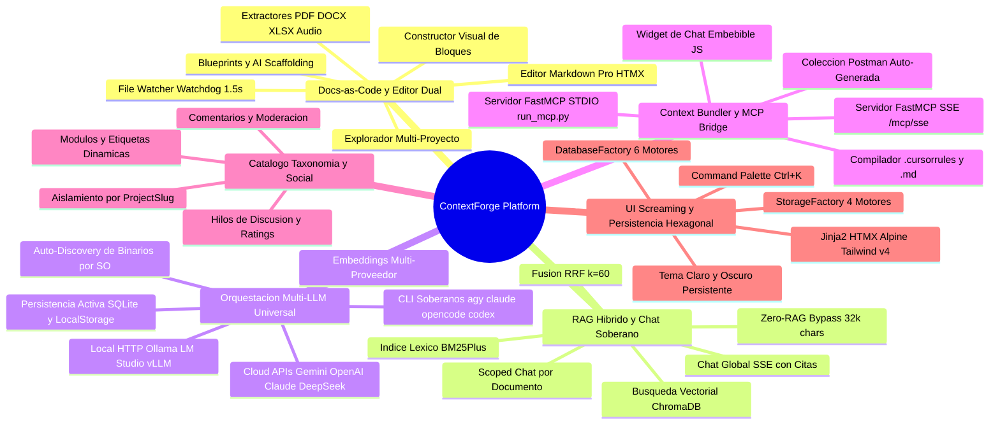

---

## 2. Matriz de Capacidades y Features Granulares

### Capacidad 1 (`CAP-DOC`): Gestión Docs-as-Code, Editor Dual y Anexos Multiformato

| ID | Feature | Disparador / Endpoint | Invariantes (`BR-*`) | Código Fuente | Cobertura de Tests |
|---|---|---|---|---|---|
| `CAP-DOC-001` | Explorador y Visor Editorial con Lightbox/Audio/PDF/DOCX/XLSX | `GET /docs/browser`, `GET /docs/view/{path}` | `BR-DOC-001`, `BR-DOC-003` | [`docs_api.py`](file:///c:/Users/nayid/Documents/Proyectos/Proyecto%20-%20IntegrationLibrary/IntegrationLibrary/src/presentation/api/v1/docs_api.py), [`doc_detail.html`](file:///c:/Users/nayid/Documents/Proyectos/Proyecto%20-%20IntegrationLibrary/IntegrationLibrary/src/presentation/frontend/modules/knowledge_docs/views/doc_detail.html) | `tests/e2e/test_contextforge_e2e.py` |
| `CAP-DOC-002` | Editor Dual (Markdown Pro $\leftrightarrow$ Bloques Visuales) | `POST /api/v1/books/save`, `POST /api/v1/books/compile-blocks` | `BR-DOC-001`, `BR-DOC-002` | [`registry_api.py`](file:///c:/Users/nayid/Documents/Proyectos/Proyecto%20-%20IntegrationLibrary/IntegrationLibrary/src/presentation/api/v1/registry_api.py), [`doc_editor.html`](file:///c:/Users/nayid/Documents/Proyectos/Proyecto%20-%20IntegrationLibrary/IntegrationLibrary/src/presentation/frontend/modules/knowledge_docs/views/doc_editor.html) | `tests/e2e/test_dual_editor_and_scoped_rag.py` |
| `CAP-DOC-003` | Carga y Extracción Multiformato (PDF, DOCX, XLSX, Audio) | `POST /api/v1/books/upload-attachment`, `GET /api/v1/assets/{path}` | `BR-DOC-003` | [`src/infrastructure/external/extractors/`](file:///c:/Users/nayid/Documents/Proyectos/Proyecto%20-%20IntegrationLibrary/IntegrationLibrary/src/infrastructure/external/extractors) | `tests/unit/test_multiformat_extractors.py` |
| `CAP-DOC-004` | Scaffolding de Documentación con IA y Blueprints | `GET /api/v1/docs/templates`, `POST /api/v1/docs/scaffold-ai` | `BR-DOC-001` | [`scaffold_api.py`](file:///c:/Users/nayid/Documents/Proyectos/Proyecto%20-%20IntegrationLibrary/IntegrationLibrary/src/presentation/api/v1/scaffold_api.py), [`blueprints.py`](file:///c:/Users/nayid/Documents/Proyectos/Proyecto%20-%20IntegrationLibrary/IntegrationLibrary/src/core/templates/blueprints.py) | `tests/unit/test_blueprints_and_scaffold.py`, `tests/e2e/test_scaffold_api.py` |
| `CAP-DOC-005` | Sincronización Automática con File Watcher (`watchdog`) | Evento FS en `./docs/` (debounce `1.5s`) | `BR-RAG-001` | [`fs_watcher.py`](file:///c:/Users/nayid/Documents/Proyectos/Proyecto%20-%20IntegrationLibrary/IntegrationLibrary/src/infrastructure/services/fs_watcher.py) | `tests/integration/test_fs_watcher.py` |

### Capacidad 2 (`CAP-RAG`): Motor RAG Híbrido y Chat Conversacional

| ID | Feature | Disparador / Endpoint | Invariantes (`BR-*`) | Código Fuente | Cobertura de Tests |
|---|---|---|---|---|---|
| `CAP-RAG-001` | Búsqueda Híbrida BM25Plus + ChromaDB (RRF $k=60$) | `GET /api/v1/search/hybrid` | `BR-RAG-001`, `BR-RAG-002` | [`hybrid_searcher.py`](file:///c:/Users/nayid/Documents/Proyectos/Proyecto%20-%20IntegrationLibrary/IntegrationLibrary/src/application/rag_engine/services/hybrid_searcher.py) | `tests/integration/test_multi_project_rag.py` |
| `CAP-RAG-002` | Chat RAG Global con Streaming SSE y Citas | `GET /chat/stream`, `POST /api/v1/rag/ask` | `BR-RAG-002`, `BR-RAG-003` | [`rag_api.py`](file:///c:/Users/nayid/Documents/Proyectos/Proyecto%20-%20IntegrationLibrary/IntegrationLibrary/src/presentation/api/v1/rag_api.py), [`chat.html`](file:///c:/Users/nayid/Documents/Proyectos/Proyecto%20-%20IntegrationLibrary/IntegrationLibrary/src/presentation/frontend/modules/rag_chat/views/chat.html) | `tests/unit/test_contextforge_domain_and_app.py` |
| `CAP-RAG-003` | Chat Focalizado por Documento con Zero-RAG Bypass ($\le 32\text{k}$) | `POST /api/v1/chat/scoped`, `POST /api/v1/chat/messages` | `BR-RAG-004` | [`scoped_chat_service.py`](file:///c:/Users/nayid/Documents/Proyectos/Proyecto%20-%20IntegrationLibrary/IntegrationLibrary/src/application/chat/services/scoped_chat_service.py) | `tests/unit/test_scoped_chat_service.py`, `tests/e2e/test_dual_editor_and_scoped_rag.py` |

### Capacidad 3 (`CAP-LLM`): Orquestación Multi-LLM Universal y Agentes CLI

| ID | Feature | Disparador / Endpoint | Invariantes (`BR-*`) | Código Fuente | Cobertura de Tests |
|---|---|---|---|---|---|
| `CAP-LLM-001` | Gestión y Activación Persistente de 15 Proveedores LLM | `GET/POST /api/v1/settings/llm`, `POST /api/v1/settings/llm/activate` | `BR-LLM-001`, `BR-LLM-002` | [`llm_settings_api.py`](file:///c:/Users/nayid/Documents/Proyectos/Proyecto%20-%20IntegrationLibrary/IntegrationLibrary/src/presentation/api/v1/llm_settings_api.py), [`llm_factory.py`](file:///c:/Users/nayid/Documents/Proyectos/Proyecto%20-%20IntegrationLibrary/IntegrationLibrary/src/infrastructure/external/llm/llm_factory.py) | `tests/unit/test_multi_llm_subsystem.py` |
| `CAP-LLM-002` | Ejecución Segura y Streaming de Agentes CLI (`agy`, `claude`, `opencode`) | `CLIProcessClient.generate()`, `stream_generate()` | `BR-LLM-003`, `BR-LLM-004` | [`cli_process_client.py`](file:///c:/Users/nayid/Documents/Proyectos/Proyecto%20-%20IntegrationLibrary/IntegrationLibrary/src/infrastructure/external/llm/cli_process_client.py) | `tests/unit/test_multi_llm_subsystem.py` |
| `CAP-LLM-003` | Auto-Discovery de Binarios CLI y Test de Embeddings | `GET /api/v1/settings/llm/discover-cli`, `POST /api/v1/settings/llm/test-embedding` | `BR-LLM-002` | [`discover_cli_engines`](file:///c:/Users/nayid/Documents/Proyectos/Proyecto%20-%20IntegrationLibrary/IntegrationLibrary/src/application/settings/queries/discover_cli_engines) | `tests/test_universal_engines_and_mcp.py` |

### Capacidad 4 (`CAP-MCP`): Context Bundler, Servidor MCP e Integraciones

| ID | Feature | Disparador / Endpoint | Invariantes (`BR-*`) | Código Fuente | Cobertura de Tests |
|---|---|---|---|---|---|
| `CAP-MCP-001` | Compilación y Descarga de Context Bundles (`.cursorrules`/`.md`) | `POST /api/v1/bundles/export`, `GET /api/v1/bundles/{id}/download` | `BR-BND-001` | [`bundles_api.py`](file:///c:/Users/nayid/Documents/Proyectos/Proyecto%20-%20IntegrationLibrary/IntegrationLibrary/src/presentation/api/v1/bundles_api.py) | `tests/unit/test_projects_and_ui_bundler.py` |
| `CAP-MCP-002` | Servidor Universal FastMCP (SSE + STDIO JSON-RPC 2.0) | `GET /mcp/sse`, `POST /mcp/messages`, `python run_mcp.py` | `BR-MCP-001` | [`server.py`](file:///c:/Users/nayid/Documents/Proyectos/Proyecto%20-%20IntegrationLibrary/IntegrationLibrary/src/presentation/mcp/server.py), [`run_mcp.py`](file:///c:/Users/nayid/Documents/Proyectos/Proyecto%20-%20IntegrationLibrary/IntegrationLibrary/run_mcp.py) | `tests/test_universal_engines_and_mcp.py` |
| `CAP-MCP-003` | Widget Embebible JS y Colección Postman | `GET /api/v1/integrations/widget.js`, `GET /api/v1/integrations/postman-collection` | `BR-INT-001` | [`integrations_api.py`](file:///c:/Users/nayid/Documents/Proyectos/Proyecto%20-%20IntegrationLibrary/IntegrationLibrary/src/presentation/api/v1/integrations_api.py) | `tests/unit/test_integrations_and_widget.py` |

---

## 3. Flujo de Usuario de Extremo a Extremo (User Journey)

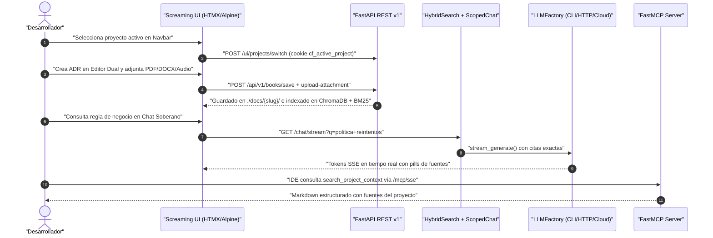

---

<!-- SOURCE: 04-domain-ddd-and-crc.md -->

# Modelo de Dominio DDD, Subdominios, Context Map y Tarjetas CRC

> [!NOTE]
> Análisis estratégico y táctico basado en **Domain-Driven Design (DDD)** sobre los 12 contextos de dominio definidos en `src/domain/` y `src/core/domain/`.

---

## 1. Clasificación de Subdominios

| Subdominio | Tipo DDD | Contextos en `src/domain/` | Valor Estratégico |
|---|---|---|---|
| **Gestión Documental Docs-as-Code** | *Core Domain* | `knowledge_docs`, `book_registry` | Núcleo diferenciador: Markdown plano como fuente de verdad + edición dual + extractores multiformato. |
| **Recuperación Híbrida & Chat RAG** | *Core Domain* | `rag_engine`, `chat` | Inteligencia contextual soberana con RRF $k=60$ y Zero-RAG Bypass ($\le 32\text{k}$). |
| **Orquestación Multi-LLM & MCP** | *Core Domain* | `llm`, `context_builder` | Portabilidad total entre 15 motores de IA y consumo nativo desde IDEs vía MCP. |
| **Catálogo, Proyectos y Taxonomía** | *Supporting Domain* | `catalog`, `taxonomy`, `core/domain/project` | Aislamiento multi-proyecto, clasificación por módulos/etiquetas y ciclo de vida editorial. |
| **Capa Social Colaborativa** | *Supporting Domain* | `social` | Discusión técnica, comentarios y calificaciones sobre documentos vivos. |
| **Configuración e Infraestructura** | *Generic Subdomain* | `settings`, `infrastructure_config`, `shared_kernel` | Persistencia de preferencias, selección de motores de BD/Storage y primitivos compartidos. |

---

## 2. Context Map (Relaciones entre Bounded Contexts)

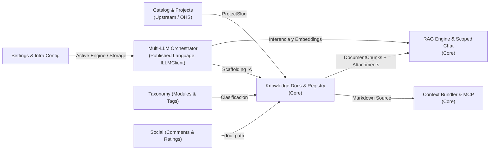

---

## 3. Tarjetas CRC (Class-Responsibility-Collaborator)

### CRC-01: `ProjectSlug` (`src/core/domain/project.py`)
- **Responsabilidades**: Normalizar identificadores de proyecto a minúsculas, validar expresión regular estricta `^[a-z0-9][a-z0-9-_]*[a-z0-9]$` y longitud máxima de 50 caracteres.
- **Colaboradores**: `Project`, `SqliteProjectRepository`, `ChromaVectorRepository`, `BM25LexicalRepository`.

### CRC-02: `LLMConfiguration` (`src/domain/llm/entities.py`)
- **Responsabilidades**: Modelar parámetros de un proveedor de IA (tipo de motor, modelo por defecto, temperatura, tokens, comando/args CLI), enmascarar claves API (`mask_api_key`) y sanitizar entradas.
- **Colaboradores**: `LLMFactory`, `SqlLLMConfigRepository`, `ActivateLLMProviderCommandHandler`.

### CRC-03: `HybridSearchService` (`src/application/rag_engine/services/hybrid_searcher.py`)
- **Responsabilidades**: Ejecutar recuperación semántica y léxica aislada por `project_slug` y fusionar resultados mediante *Reciprocal Rank Fusion* ($k=60$).
- **Colaboradores**: `IVectorRepository` (`ChromaVectorRepository`), `ILexicalIndexRepository` (`BM25LexicalRepository`).

### CRC-04: `ScopedChatService` (`src/application/chat/services/scoped_chat_service.py`)
- **Responsabilidades**: Evaluar tamaño de documento para aplicar *Zero-RAG Bypass* ($\le 32.000$ chars) o búsqueda vectorial focalizada, inyectar historial conversacional y devolver respuesta con fuentes.
- **Colaboradores**: `IVectorRepository`, `ILLMClient`.

### CRC-05: `CLIProcessClient` (`src/infrastructure/external/llm/cli_process_client.py`)
- **Responsabilidades**: Resolver binarios CLI en Windows/Linux/macOS, construir argumentos sin `shell=True` respetando orden de flags (`--dangerously-skip-permissions` antes de `-p=...` para `agy`), ejecutar streaming UTF-8 incremental con fallback multihilo ante `NotImplementedError`.
- **Colaboradores**: `ILLMClient`, `LLMFactory`, `subprocess.Popen`, `asyncio.Queue`.

### CRC-06: `FastMCP` (`src/presentation/mcp/server.py`)
- **Responsabilidades**: Registrar herramientas MCP (`search_project_context`, `get_document_full`, `list_project_structure`), procesar JSON-RPC 2.0 (`initialize`, `ping`, `tools/list`, `tools/call`) y servir transporte dual SSE (`/mcp/sse`) y STDIO (`run_mcp.py`).
- **Colaboradores**: `MCPQueryContextQueryHandler`, `HybridSearchService`, `IDocumentRepository`.

---

<!-- SOURCE: c4-model.md -->

# Atlas de Arquitectura C4 — ContextForge (IntegrationLibrary)

> [!NOTE]
> Modelado arquitectónico multinivel (C1 a C4) conforme a Simon Brown (C4 Model) e IEEE 830 Sección 2.1, reflejando con fidelidad el código fuente en `src/`.

---

## Nivel 1: Diagrama de Contexto de Sistema (C1)

Muestra los límites de **ContextForge**, los actores humanos y agentes de IA, y los sistemas externos con los que interactúa:

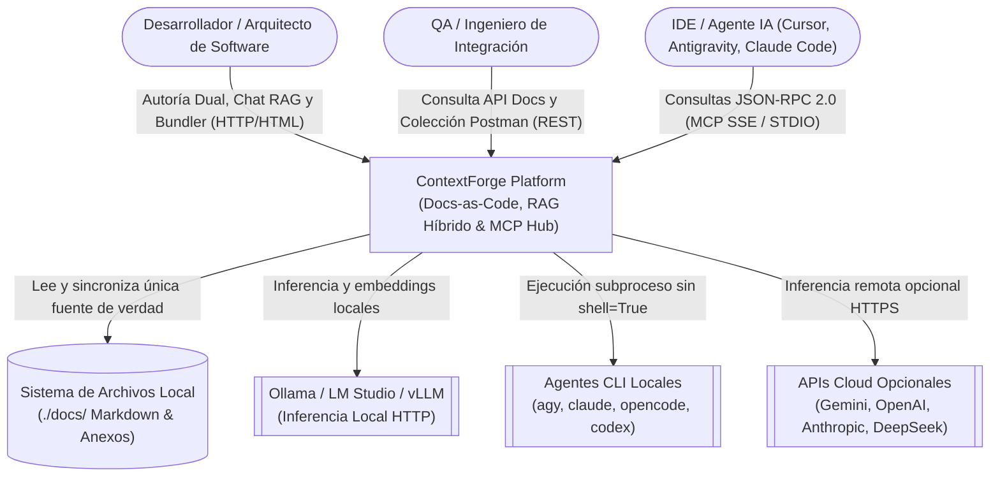

---

## Nivel 2: Diagrama de Contenedores (C2)

Descompone **ContextForge** en sus contenedores de ejecución, motores de persistencia y protocolos reales:

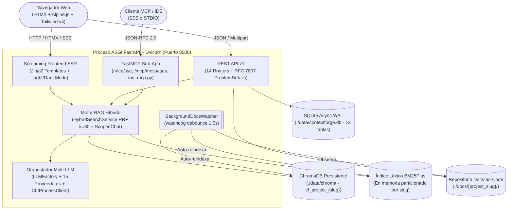

---

## Nivel 3: Diagrama de Componentes Internos (C3)

Desglose de las 4 capas de **Clean Architecture** dentro de `src/`:

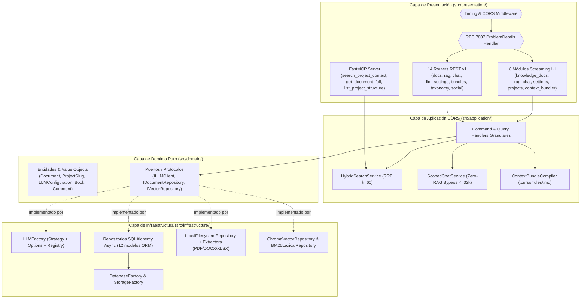

---

## Nivel 4: Topología de Despliegue e Infraestructura (C4)

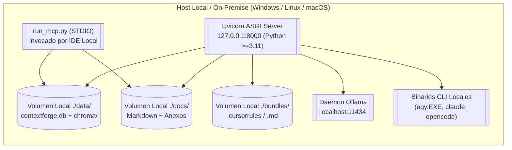

---

<!-- SOURCE: uml-diagrams.md -->

# Atlas UML 2.5 — ContextForge (IntegrationLibrary)

> [!NOTE]
> Modelado conductual y estructural UML 2.5 verificado directamente contra las entidades en `src/domain/`, los handlers CQRS en `src/application/` y los adaptadores en `src/infrastructure/`.

---

## 1. Diagrama de Clases del Dominio ContextForge

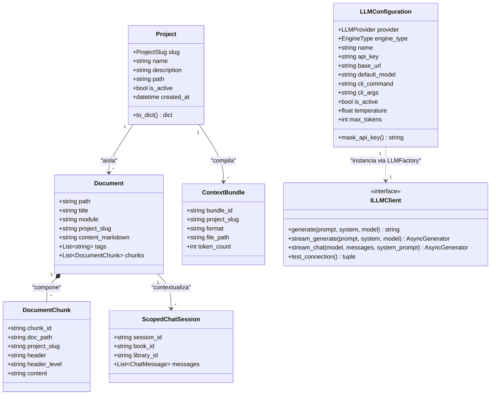

---

## 2. Diagrama de Secuencia: Ciclo de Consulta RAG Híbrido y Streaming SSE

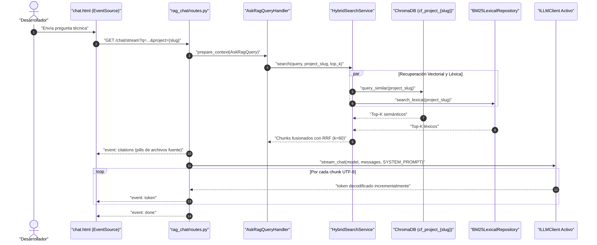

---

## 3. Diagrama de Secuencia: Scoped Chat con Zero-RAG Bypass

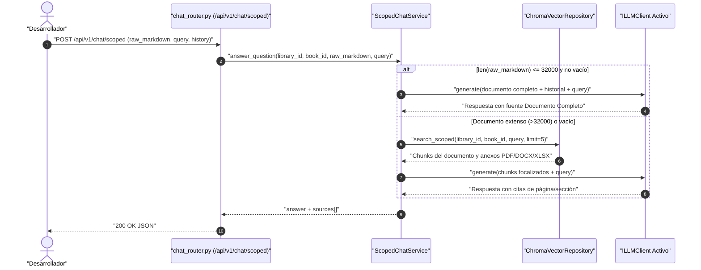

---

## 4. Diagrama de Máquina de Estados: Ciclo de Vida de un Documento (`Book`)

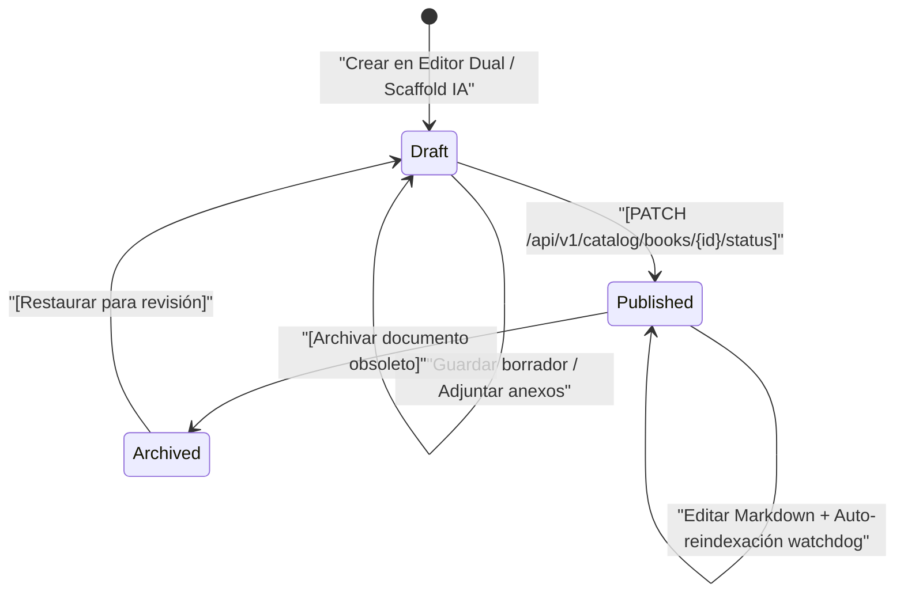

---

## 5. Diagrama de Casos de Uso UML

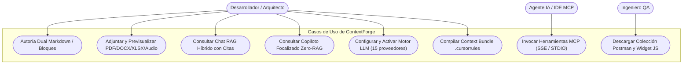

---

<!-- SOURCE: data-dictionary.md -->

# Diccionario de Datos Relacional, Almacén Vectorial y ERD

> [!NOTE]
> Esquema relacional verificado directamente contra los **12 modelos ORM SQLAlchemy Async** en `src/infrastructure/database/orm_models.py` y `src/infrastructure/persistence/models/*.py`, más la persistencia vectorial en ChromaDB (`./data/chroma/`).

---

## 1. Diagrama Entidad-Relación (ERD Crow's Foot)

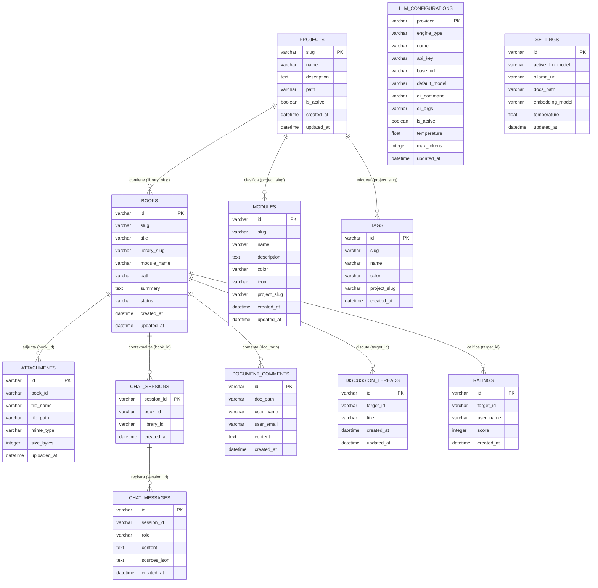

---

## 2. Catálogo de Tablas Relacionales (`./data/contextforge.db`)

| Tabla | Clave Primaria | Columnas Principales | Propósito Funcional |
|---|---|---|---|
| `projects` | `slug` (`VARCHAR(50)`) | `name`, `description`, `path`, `is_active`, `created_at`, `updated_at` | Registro de librerías/proyectos aislados. Seed automático: `default`. |
| `books` | `id` (`VARCHAR(64)`) | `slug`, `title`, `library_slug`, `module_name`, `path`, `summary`, `status` | Metadatos de catálogo y estado editorial de documentos Markdown. |
| `attachments` | `id` (`VARCHAR(36)`) | `book_id`, `file_name`, `file_path`, `mime_type`, `size_bytes`, `uploaded_at` | Inventario de anexos (PDF, DOCX, XLSX, imágenes, audio `.ogg`/`.mp3`). |
| `chat_sessions` | `session_id` (`VARCHAR(64)`) | `book_id`, `library_id`, `created_at` | Sesiones persistentes de chat focalizado por documento. |
| `chat_messages` | `id` (`VARCHAR(64)`) | `session_id`, `role`, `content`, `sources_json`, `created_at` | Turnos conversacionales y citas JSON serializadas. |
| `llm_configurations` | `provider` (`VARCHAR(50)`) | `engine_type`, `name`, `api_key`, `base_url`, `default_model`, `cli_command`, `cli_args`, `is_active`, `temperature`, `max_tokens` | Configuración de los 15 proveedores LLM (auto-migración DDL en `connection.py`). |
| `settings` | `id` (`VARCHAR(50)`) | `active_llm_model`, `ollama_url`, `docs_path`, `embedding_model`, `temperature` | Preferencias globales del sistema (`id = "default"`). |
| `modules` | `id` (`VARCHAR(64)`) | `slug`, `name`, `description`, `color`, `icon`, `project_slug` | Taxonomía dinámica de módulos por proyecto. |
| `tags` | `id` (`VARCHAR(64)`) | `slug`, `name`, `color`, `project_slug` | Etiquetas semánticas por proyecto. |
| `document_comments` | `id` (`VARCHAR(36)`) | `doc_path`, `user_name`, `user_email`, `content`, `created_at` | Comentarios colaborativos sobre documentos. |
| `discussion_threads` | `id` (`VARCHAR(36)`) | `target_id`, `title`, `created_at`, `updated_at` | Hilos de discusión estructurados por recurso. |
| `ratings` | `id` (`VARCHAR(36)`) | `target_id`, `user_name`, `score`, `created_at` | Calificaciones de utilidad de documentación. |

---

## 3. Almacén Vectorial (`ChromaDB`) y Configuración de Infraestructura

- **ChromaDB (`./data/chroma/`)**: Particionado estrictamente por proyecto en colecciones nombradas `cf_project_{slug}`. Cada documento indexado almacena metadatos `file_path`, `project_slug`, `header`, `header_level` (`h1`–`h6`), `attachment_name` y `location` (ej. `Pág. 4`).
- **BM25Plus (En Memoria)**: Índice léxico particionado por `project_slug`, reconstruido al iniciar `lifespan` en `src/main.py` y actualizado incrementalmente por `BackgroundDocsWatcher`.
- **Infraestructura Hexagonal (`./data/infrastructure_configs.json`)**: Persiste las configuraciones activas de `DatabaseFactory` (SQLite, PostgreSQL, Supabase, SQL Server, MongoDB, Firebase) y `StorageFactory` (Local FS, Supabase Storage, S3, Firebase Storage).

---

<!-- SOURCE: business-rules.md -->

# Catálogo Maestro de Reglas de Negocio e Invariantes (`BR-*`)

> [!IMPORTANT]
> Toda nueva funcionalidad, refactorización o corrección en **ContextForge** DEBE respetar estrictamente estas invariantes verificadas en el código fuente y respaldadas por la suite de 158 pruebas automatizadas.

---

## 1. Reglas de Proyectos y Aislamiento Multi-Tenant (`BR-PROJ-*`)

| ID | Severidad | Regla / Invariante | Implementación Verificada |
|---|---|---|---|
| `BR-PROJ-001` | Crítica | **Normalización y Validación Estricta de `ProjectSlug`**: Todo identificador de proyecto se normaliza a minúsculas, debe cumplir `^[a-z0-9][a-z0-9-_]*[a-z0-9]$` y tener máximo 50 caracteres. | `src/core/domain/project.py` |
| `BR-PROJ-002` | Crítica | **Aislamiento Zero-Leakage entre Proyectos**: Ninguna búsqueda vectorial (ChromaDB `cf_project_{slug}`), léxica (BM25Plus) ni documental (`./docs/{slug}/`) puede retornar contenido perteneciente a otro proyecto. | `chroma_vector_repo.py`, `bm25_lexical_repo.py`, `tests/integration/test_multi_project_rag.py` |

---

## 2. Reglas de Documentación Docs-as-Code y Anexos (`BR-DOC-*`)

| ID | Severidad | Regla / Invariante | Implementación Verificada |
|---|---|---|---|
| `BR-DOC-001` | Crítica | **Markdown como Única Fuente de Verdad**: El contenido autoritativo reside en `./docs/{project_slug}/{module}/*.md`. SQLite únicamente mantiene metadatos de catálogo e índices auxiliares. | `local_filesystem_repo.py`, `src/main.py` |
| `BR-DOC-002` | Alta | **Fidelidad Bidireccional del Editor Dual**: La conversión Markdown $\leftrightarrow$ Bloques Visuales debe preservar encabezados, listas, bloques de código, diagramas Mermaid y enlaces de anexos. | `registry_api.py`, `doc_editor.html` |
| `BR-DOC-003` | Alta | **Soporte de Rutas con Espacios y Previsualización Inline**: Los enlaces Markdown con espacios en anexos (`.docx`, `.ogg`, `.pdf`, `.xlsx`) deben envolverse conforme a CommonMark (`<path>`) y servirse con `content_disposition_type="inline"` para previsualización/reproducción en navegador. | `markdown_parser.py`, `registry_api.py`, `attachment_card.html` |

---

## 3. Reglas del Motor RAG Híbrido y Chat (`BR-RAG-*`)

| ID | Severidad | Regla / Invariante | Implementación Verificada |
|---|---|---|---|
| `BR-RAG-001` | Crítica | **Fusión Determinista RRF ($k=60$)**: La recuperación híbrida combina rankings de ChromaDB y BM25Plus mediante $\text{score} = \sum \frac{1}{60 + \text{rank}}$. | `hybrid_searcher.py` |
| `BR-RAG-002` | Crítica | **Atribución Obligatoria de Fuentes**: Toda respuesta RAG debe incluir referencias exactas (`file_path`, `header` o `attachment_name` + `location`). En SSE, `event: citations` se emite antes del primer `event: token`. | `rag_chat/routes.py`, `prompt_builder.py` |
| `BR-RAG-003` | Alta | **Decodificación Incremental UTF-8 en Streaming**: El streaming de tokens CLI/HTTP debe usar `codecs.getincrementaldecoder("utf-8")` para no corromper caracteres multibyte (`¿`, `é`, `ñ`). | `cli_process_client.py` |
| `BR-RAG-004` | Crítica | **Zero-RAG Bypass ($\le 32.000$ caracteres)**: En `ScopedChatService`, si `raw_markdown` no está vacío y `len(raw_markdown) <= 32000`, se inyecta el documento completo sin invocar búsqueda vectorial; solo si excede 32.000 chars o está vacío se ejecuta `search_scoped`. | `scoped_chat_service.py`, `tests/unit/test_scoped_chat_service.py` |

---

## 4. Reglas de Orquestación Multi-LLM y CLI (`BR-LLM-*`)

| ID | Severidad | Regla / Invariante | Implementación Verificada |
|---|---|---|---|
| `BR-LLM-001` | Crítica | **Conmutación Atómica y Persistencia Permanente**: Al activar un proveedor LLM (`set_active_provider`), exactamente un registro en `llm_configurations` queda con `is_active = True`, se sincroniza `settings.active_llm_model` y se persiste entre reinicios del servidor. | `sql_llm_config_repo.py`, `handlers.py` |
| `BR-LLM-002` | Crítica | **Enmascaramiento y Preservación de API Keys**: Las claves API nunca se retornan en texto claro hacia la UI (`mask_api_key()`). Al guardar una configuración con clave enmascarada (`•••`), se conserva la clave real existente en SQLite. | `domain/llm/entities.py`, `sql_llm_config_repo.py` |
| `BR-LLM-003` | Crítica | **Seguridad de Subprocesos y Orden de Flags CLI (`agy`)**: Prohibido usar `shell=True`. En `CLIProcessClient._build_command`, los flags de prompt (`-p`, `--prompt`, `--print`) se depuran de `base_args`; para `agy`, `--dangerously-skip-permissions` y `--model` preceden siempre a `-p={full_prompt}`. | `cli_process_client.py`, `tests/unit/test_multi_llm_subsystem.py` |
| `BR-LLM-004` | Alta | **Resiliencia Async en Windows**: En `win32`, `main.py` configura `WindowsProactorEventLoopPolicy` y `CLIProcessClient` provee fallback multihilo `subprocess.Popen` + `asyncio.Queue` ante `NotImplementedError`. | `src/main.py`, `cli_process_client.py` |

---

## 5. Reglas de MCP, Bundler y UX (`BR-MCP-*`, `BR-UI-*`)

| ID | Severidad | Regla / Invariante | Implementación Verificada |
|---|---|---|---|
| `BR-MCP-001` | Alta | **Paridad Dual SSE y STDIO en FastMCP**: Las herramientas `search_project_context`, `get_document_full` y `list_project_structure` deben operar idénticamente vía JSON-RPC 2.0 sobre `/mcp/sse` y `run_mcp.py`. | `src/presentation/mcp/server.py`, `run_mcp.py` |
| `BR-UI-001` | Alta | **Cero `alert()` Nativos y Seguridad DOM**: Toda notificación de usuario se enruta por `window.$toast` y los botones dinámicos de chat usan `addEventListener` sin interpolación inline `onclick` vulnerable a fuga de HTML. | `base.html`, `chat.html`, `settings.html` |
| `BR-UI-002` | Media | **Paridad Visual Modo Claro y Oscuro**: Todo componente UI, editor, visor multimedia y barra lateral debe adaptarse coherentemente a ambos temas persistidos en `localStorage.contextforge_theme`. | `base.html`, `main.css` |

---

<!-- SOURCE: external-services.md -->

# Servicios Externos, Contratos API REST v1 y Servidor MCP

> [!NOTE]
> Catálogo completo de integraciones externas, 15 motores LLM soportados, estrategias de embeddings, adaptadores de persistencia/almacenamiento y contratos HTTP/MCP verificados en el repositorio.

---

## 1. Catálogo de Proveedores LLM y Embeddings (`LLMFactory`)

| Categoría (`EngineType`) | Proveedor (`LLMProvider`) | Protocolo / Binario | Modelo por Defecto | Estrategia en `LLMFactory` |
|---|---|---|---|---|
| `local_http` | `ollama`, `ollama_http` | HTTP (`localhost:11434`) | `llama3.1:8b` | `OllamaLLMStrategy` |
| `local_http` | `lm_studio` | OpenAI-Compat (`localhost:1234/v1`) | Configurable | `OpenAICompatibleLLMStrategy` |
| `local_http` | `vllm` | OpenAI-Compat (`localhost:8000/v1`) | `Qwen/Qwen3-Coder-30B-A3B-Instruct` | `OpenAICompatibleLLMStrategy` |
| `local_http` | `localai` | OpenAI-Compat (`localhost:8080/v1`) | `llama-3.1-8b-instruct` | `OpenAICompatibleLLMStrategy` |
| `cloud_api` | `gemini` | HTTPS (`generativelanguage.googleapis.com/v1beta`) | `gemini-2.5-flash` | `GeminiLLMStrategy` |
| `cloud_api` | `openai` | HTTPS (`api.openai.com/v1`) | `gpt-4o-mini` | `OpenAICloudLLMStrategy` |
| `cloud_api` | `anthropic` | HTTPS (`api.anthropic.com/v1`) | `claude-sonnet-4-5` | `AnthropicLLMStrategy` |
| `cloud_api` | `deepseek` | HTTPS (`api.deepseek.com`) | `deepseek-chat` | `DeepSeekLLMStrategy` |
| `local_cli` | `antigravity_cli` | Subproceso `agy` (`--dangerously-skip-permissions -p=...`) | `gemini-3.8-flash` | `CliLLMStrategy` |
| `local_cli` | `claude_code_cli` | Subproceso `claude` (`--output-format text -p ...`) | `claude-sonnet-4-5` | `CliLLMStrategy` |
| `local_cli` | `open_code_cli` | Subproceso `opencode` (`run --model ...`) | `anthropic/claude-sonnet-4-5` | `CliLLMStrategy` |
| `local_cli` | `codex_cli` | Subproceso `codex` (`-p ...`) | `gpt-5.4` | `CliLLMStrategy` |
| `local_cli` | `gemini_cli` | Subproceso `gemini` (`-p ...`) | `gemini-2.5-pro` | `CliLLMStrategy` |
| `local_cli` | `aider_cli` | Subproceso `aider` (`--message ...`) | `qwen2.5-coder` | `CliLLMStrategy` |
| `local_cli` | `ollama_cli` | Subproceso `ollama` (`run <model> ...`) | `llama3.1:8b` | `CliLLMStrategy` |

### Estrategias de Embeddings (`_EMBEDDING_STRATEGIES`)
- `ollama` (`OllamaEmbeddingStrategy` — `nomic-embed-text`)
- `gemini` (`GeminiEmbeddingStrategy`)
- `openai`, `lm_studio`, `localai` (`OpenAICompatibleEmbeddingStrategy`)
- `voyage`, `anthropic` (`AnthropicVoyageEmbeddingStrategy` — variable opcional `VOYAGE_API_KEY`)

---

## 2. Contratos REST API v1 (`src/presentation/api/v1/`)

Todos los errores de dominio y validación retornan respuestas normalizadas bajo **RFC 7807 (`application/problem+json`)** y cabecera de telemetría `X-Response-Time-Ms`.

| Grupo | Endpoints Principales |
|---|---|
| **Knowledge Docs** | `GET /api/v1/docs-api`, `GET /api/v1/docs-api/{path}`, `POST /api/v1/docs-api`, `POST /api/v1/docs-api/ingest` |
| **Book Registry & Assets** | `POST /api/v1/books/save`, `POST /api/v1/books/parse-markdown`, `POST /api/v1/books/compile-blocks`, `POST /api/v1/books/upload-attachment`, `GET /api/v1/assets/{path}` |
| **Scaffolding IA** | `GET /api/v1/docs/templates`, `POST /api/v1/docs/scaffold-ai` |
| **RAG & Search** | `GET /api/v1/search/hybrid`, `POST /api/v1/rag/ask`, `GET /api/v1/rag/stream`, `GET /chat/stream` |
| **Scoped & Project Chat** | `POST /api/v1/chat/scoped`, `POST /api/v1/chat/messages`, `GET /api/v1/chat/session/{session_id}`, `POST /api/v1/chat/project` |
| **Multi-LLM Settings** | `GET /api/v1/settings/llm`, `POST /api/v1/settings/llm`, `POST /api/v1/settings/llm/activate`, `POST /api/v1/settings/llm/test`, `POST /api/v1/settings/llm/test-embedding`, `GET /api/v1/settings/llm/discover-cli` |
| **Infraestructura & Settings** | `GET/POST /api/v1/settings`, `GET /api/v1/settings/ollama-models`, `GET /api/v1/settings/infrastructure`, `POST /api/v1/settings/database/{activate\|test}`, `POST /api/v1/settings/storage/{activate\|test}` |
| **Catalog & Taxonomy** | `GET /api/v1/catalog/libraries`, `GET /api/v1/catalog/books`, `PATCH /api/v1/catalog/books/{book_id}/status`, `GET/POST /api/v1/taxonomy/modules`, `GET/POST /api/v1/taxonomy/tags` |
| **Context Bundles** | `POST /api/v1/bundles/export`, `GET /api/v1/bundles/{bundle_id}/download`, `POST /api/v1/bundles/export-agent-rules` |
| **Social** | `POST /api/v1/social/comments`, `GET /api/v1/social/comments`, `DELETE /api/v1/social/comments/{comment_id}` |
| **Integraciones & Salud** | `GET /health`, `GET /api/v1/integrations/postman-collection`, `GET /api/v1/integrations/widget.js` |

---

## 3. Contrato del Servidor Universal MCP (`FastMCP`)

- **Protocolo**: JSON-RPC 2.0 (`protocolVersion: "2024-11-05"`), nombre `ContextForge-Knowledge-Hub`.
- **Transportes**:
  1. **SSE HTTP**: `GET /mcp/info`, `GET /mcp/sse`, `POST /mcp/messages?session_id={id}`.
  2. **STDIO Local**: `python run_mcp.py` para Cursor, Claude Code y Antigravity.
- **Herramientas Registradas**:
  - `search_project_context(query: str, project_slug: str = "default", top_k: int = 5)`
  - `get_document_full(doc_path: str, project_slug: str = "default")`
  - `list_project_structure(project_slug: str = "default")`

---

<!-- SOURCE: functional-requirements.md -->

# Especificación de Requisitos Funcionales y No Funcionales (SRS IEEE 830)

> [!NOTE]
> Requisitos funcionales (`RF-*`) con criterios verificables Gherkin, interfaces externas y requisitos no funcionales (`RNF-*` bajo FURPS+) extraídos forensicamente de **ContextForge**.

---

## 1. Requisitos Funcionales (`RF-*`)

### `RF-PROJ-001`: Gestión y Aislamiento Multi-Proyecto
- **Descripción**: El sistema debe permitir crear, listar y alternar proyectos aislados por `ProjectSlug`, particionando documentos en `./docs/{slug}/`, vectores en `cf_project_{slug}` e índices BM25.
- **Escenario Gherkin**:
  ```gherkin
  Given existen dos proyectos "iuristrack" y "fintech-core" con documentos propios
  When un usuario ejecuta una búsqueda híbrida sobre "fintech-core"
  Then los resultados contienen únicamente fragmentos de "fintech-core" sin fuga de "iuristrack"
  ```

### `RF-DOC-001`: Autoría Dual Docs-as-Code y Anexos Multiformato
- **Descripción**: El sistema debe permitir redactar documentos en Markdown Pro o Constructor de Bloques, adjuntar archivos (PDF, DOCX, XLSX/CSV, imágenes y audio `.ogg`/`.mp3`), extraer su texto para RAG y previsualizarlos inline sin descarga forzada.
- **Escenario Gherkin**:
  ```gherkin
  Given un documento con anexos ".docx" y ".ogg" cuyos nombres contienen espacios
  When el usuario visualiza el detalle del documento
  Then los enlaces se compilan como tarjetas interactivas con visor Mammoth.js y reproductor de audio nativo
  ```

### `RF-RAG-001`: Recuperación Híbrida RRF y Streaming SSE con Citas
- **Descripción**: El sistema debe combinar resultados de ChromaDB y BM25Plus mediante RRF ($k=60$) y transmitir la respuesta vía SSE emitiendo las fuentes (`citations`) antes de los tokens generados.

### `RF-RAG-002`: Chat Focalizado con Zero-RAG Bypass
- **Descripción**: El sistema debe inyectar el documento íntegro al LLM cuando su extensión sea $\le 32.000$ caracteres y conmutar automáticamente a búsqueda vectorial focalizada cuando supere dicho umbral.

### `RF-LLM-001`: Orquestación Multi-LLM Universal y Persistencia Activa
- **Descripción**: El sistema debe permitir configurar, probar conectividad/embeddings y activar cualquiera de los 15 proveedores LLM (Local HTTP, Cloud API, Local CLI) persistiendo la selección en SQLite tras reinicios.

### `RF-MCP-001`: Exposición Universal de Contexto vía Bundler y MCP
- **Descripción**: El sistema debe compilar Context Bundles (`.cursorrules`/`.md`) y exponer `search_project_context`, `get_document_full` y `list_project_structure` mediante `FastMCP` en SSE (`/mcp/sse`) y STDIO (`run_mcp.py`).

---

## 2. Requisitos de Interfaces Externas (IEEE 830 Sección 3.1)

- **Interfaces de Usuario (UI)**: Interfaz web responsiva SSR con Jinja2, HTMX, Alpine.js y TailwindCSS v4; tema claro/oscuro sincronizado; paleta de comandos `Ctrl+K`; notificaciones toast (`window.$toast`).
- **Interfaces de Software**: SQLite vía `SQLAlchemy 2.0 Async + aiosqlite`, ChromaDB persistente, Ollama HTTP API, APIs REST de Gemini/OpenAI/Anthropic/DeepSeek y subprocesos CLI sin `shell=True`.
- **Interfaces de Comunicaciones**: HTTP/1.1 REST JSON (puerto `8000`), Server-Sent Events (`text/event-stream`) para RAG y MCP, JSON-RPC 2.0 sobre STDIO (`run_mcp.py`).

---

## 3. Requisitos No Funcionales (`RNF-*` — FURPS+)

| ID | Categoría FURPS+ | Requisito Verificado | Métrica / Evidencia |
|---|---|---|---|
| `RNF-001` | **Confiabilidad / Tipado** | Todo el código fuente en `src/` debe compilar bajo tipado estricto sin errores. | `mypy --strict src`: 0 errores en 302 archivos. |
| `RNF-002` | **Mantenibilidad / QA** | Cobertura automatizada multinivel (unit, integration, e2e). | `pytest`: 158 pruebas pasando al 100%. |
| `RNF-003` | **Seguridad / Soberanía** | Cero exposición de API Keys en respuestas HTTP; prohibido `shell=True` en llamadas CLI; operación 100% offline con Ollama/SQLite/ChromaDB. | `mask_api_key()`, `CLIProcessClient._build_command()`. |
| `RNF-004` | **Rendimiento** | Cabecera `X-Response-Time-Ms` en todas las respuestas HTTP; debounce de `1.5s` en `BackgroundDocsWatcher` para evitar reindexaciones redundantes. | `src/main.py`, `fs_watcher.py`. |
| `RNF-005` | **Portabilidad** | Ejecución nativa en Windows, Linux y macOS con resolución automática de binarios CLI y política Proactor/fallback multihilo en Windows. | `cli_process_client.py`, `verify.sh`. |

---

<!-- SOURCE: coding-standards.md -->

# Estándares Canónicos de Código y Directrices Anti-Sesgo

> [!IMPORTANT]
> Directrices normativas verificadas en [`pyproject.toml`](file:///c:/Users/nayid/Documents/Proyectos/Proyecto%20-%20IntegrationLibrary/IntegrationLibrary/pyproject.toml) y en la arquitectura real de **ContextForge**.

---

## 1. Stack y Lista Blanca de Dependencias

Solo se permite utilizar paquetes declarados en `pyproject.toml`:
- **Web / ASGI**: `fastapi`, `uvicorn[standard]`, `jinja2`, `python-multipart`, `aiofiles`, `httpx`.
- **Validación y Configuración**: `pydantic`, `pydantic-settings`, `python-frontmatter`, `marko`.
- **Persistencia y Búsqueda**: `sqlalchemy` (2.0 Async), `aiosqlite`, `greenlet`, `chromadb`, `rank-bm25`, `tiktoken`, `watchdog`.
- **Extractores Multiformato**: `pypdf`, `python-docx`, `openpyxl`, `pandas`.
- **Calidad y Tests**: `pytest`, `pytest-asyncio`, `pytest-cov`, `mypy`.

Queda prohibido introducir ORMs alternativos, bundlers JS pesados (Webpack/Vite) o paquetes no registrados sin aprobación previa.

---

## 2. Convenciones de Código Python y Frontend

| Aspecto | Convención Obligatoria |
|---|---|
| **Tipado Estático** | `from __future__ import annotations` + 100% compatibilidad con `mypy --strict src`. |
| **Capas Clean Architecture** | `domain/` nunca importa de `infrastructure/` ni `presentation/`. |
| **CQRS Granular** | Cada caso de uso nuevo en `src/application/{modulo}/{commands|queries}/{accion}/` con `command.py`/`query.py`, `response.py`, `validator.py` y `handler.py`. |
| **Seguridad CLI** | Prohibido `shell=True` en `subprocess`. Pasar siempre listas de argumentos y enmascarar API keys en respuestas HTTP. |
| **Frontend Screaming UI** | Jinja2 + HTMX + Alpine.js + TailwindCSS v4. Cero `alert()` nativos (usar `window.$toast`). Cero interpolación inline `onclick` con texto libre del LLM (usar `addEventListener`). |
| **Tema Claro / Oscuro** | Toda clase de color en HTML/CSS debe declarar explícitamente variantes de modo claro y `dark:*`. |
| **Idioma** | Inglés para código, clases, variables y commits semánticos; español para documentación y copy de usuario. |

---

<!-- SOURCE: adr-catalog.md -->

# Catálogo Consolidado de Decisiones de Arquitectura (ADRs)

| ID | Título | Estado | Decisión Clave | Consecuencia Principal |
|---|---|---|---|---|
| `ADR-001` | **Markdown Docs-as-Code como Única Fuente de Verdad** | Aceptado | Persistir todo documento en `./docs/{project_slug}/{module}/*.md` y usar SQLite únicamente para metadatos, catálogo, chat y configuración. | Portabilidad total con Git y cero vendor lock-in documental. |
| `ADR-002` | **Clean Architecture + CQRS Granular + Screaming UI** | Aceptado | Separar estrictamente `domain/`, `application/`, `infrastructure/` y `presentation/` con SSR Jinja2 + HTMX + Alpine.js + Tailwind v4. | Alta testabilidad (`158` tests), `mypy --strict` con 0 errores y cero sobrecarga de SPA. |
| `ADR-003` | **Motor RAG Híbrido (ChromaDB + BM25Plus) con RRF $k=60$** | Aceptado | Combinar búsqueda semántica y léxica particionadas por `project_slug` mediante *Reciprocal Rank Fusion*. | Alta precisión tanto en consultas conceptuales como en identificadores exactos (`BR-*`, códigos). |
| `ADR-004` | **Zero-RAG Bypass ($\le 32.000$ caracteres) en Scoped Chat** | Aceptado | Inyectar el documento íntegro al LLM cuando su tamaño es $\le 32\text{k}$ caracteres y usar RAG focalizado solo cuando lo supera. | Elimina pérdida de coherencia por chunking en documentos técnicos cortos y medianos. |
| `ADR-005` | **Hexagonal Multi-LLM Factory (Strategy + Options + Registry)** | Aceptado | Desacoplar 15 proveedores (Local HTTP, Cloud APIs y Local CLI) tras `ILLMClient` y `LLMFactory`, persistiendo el motor activo en SQLite. | Cambio en caliente entre Ollama, Gemini, Claude, OpenAI y `agy` sin reiniciar ni tocar casos de uso. |
| `ADR-006` | **Servidor Universal `FastMCP` Dual (SSE + STDIO)** | Aceptado | Implementar protocolo MCP JSON-RPC 2.0 ligero sin dependencias externas sobre `/mcp/sse` y `run_mcp.py`. | Integración nativa inmediata con Cursor, Claude Code y Antigravity. |
| `ADR-007` | **Resiliencia CLI Windows (`Proactor` + Threaded Fallback + Flag Ordering)** | Aceptado | Configurar `WindowsProactorEventLoopPolicy`, fallback multihilo `subprocess.Popen` ante `NotImplementedError` y orden estricto de flags (`--dangerously-skip-permissions` antes de `-p={prompt}` para `agy`). | Ejecución y streaming UTF-8 estable en Windows, Linux y macOS. |

---

<!-- SOURCE: design-system-and-ui.md -->

# Sistema de Diseño, Tokens Visuales y Componentes UI

> [!NOTE]
> Documentación del sistema visual **Blog de Ingeniería + Claude AI Aesthetic** implementado en `src/presentation/frontend/` (**28 plantillas HTML**, TailwindCSS v4, HTMX y Alpine.js).

---

## 1. Arquitectura de Presentación (Screaming UI)

```text
src/presentation/frontend/
├── layouts/base.html                     # Shell maestro, tema claro/oscuro sin FOUC, Toast Manager, Command Palette Ctrl+K, Mermaid.js
├── shared/
│   ├── ui/ (navbar.html, footer.html)    # Sidebar colapsable, selector de proyecto HTMX, toggle de tema
│   ├── components/                       # Macros Jinja2 DRY:
│   │   ├── active_model_badge.html       # Indicador del motor LLM y modelo activo
│   │   ├── empty_state.html              # Estado vacío estandarizado
│   │   ├── page_header.html              # Cabecera de página reutilizable
│   │   ├── pagination.html               # Paginación reactiva HTMX (10, 25, 50)
│   │   └── search_input.html             # Buscador reutilizable
│   └── assets/css/main.css               # Estilos tipográficos prose, scrollbars y overrides de tema
└── modules/                              # 8 módulos autónomos:
    ├── knowledge_docs/                   # Explorador, visor editorial, editor dual, tarjetas de anexos, guía de integración
    ├── rag_chat/                         # Chat RAG soberano con streaming SSE y botones DOM seguros
    ├── settings/                         # Panel Multi-LLM (15 motores), grid Ollama, BD/Storage hexagonal
    ├── projects/                         # Listado de proyectos y selector global de navbar
    ├── context_bundler/                  # Compilador de bundles y sincronización de reglas de agente
    ├── BookRegistry/                     # Editor dual de bloques y registro
    ├── Catalog/                          # Modal de previsualización multiformato (PDF/DOCX/XLSX/Audio/Imagen)
    └── Chat/                             # Drawer lateral de Scoped Chat
```

---

## 2. Sistema de Temas Claro y Oscuro

- **Persistencia**: `localStorage.getItem('contextforge_theme')` (`dark` / `light`).
- **Prevención de FOUC**: Script bloqueante mínimo en `<head>` de `base.html` aplica la clase `.dark` antes del primer pintado.
- **Notificaciones Globales**: Puente `window.$toast = { success, error, info, warning }` con auto-dismiss de `4.5s` y anulación segura de `window.alert`.
- **Visor Multimedia**: Tarjetas interactivas (`attachment_card.html`) + modal (`FilePreviewModal.html`) con soporte para PDF (`iframe` inline), DOCX (`Mammoth.js`), XLSX/CSV (`SheetJS`), Imágenes (lightbox con zoom) y Audio (`.ogg`/`.mp3`/`.wav`/`.m4a` con pausa automática al cerrar).

---

<!-- SOURCE: runbooks-and-operations.md -->

# Manual Operativo, Verificación y Runbooks de Soporte

> [!NOTE]
> Procedimientos verificados para instalación, arranque, verificación automatizada y resolución de incidentes comunes en **ContextForge**.

---

## 1. Comandos Operativos Canónicos

| Operación | Comando |
|---|---|
| **Arranque Desarrollo (Reload)** | `.\.venv\Scripts\python.exe -m uvicorn main:app --app-dir src --reload --host 127.0.0.1 --port 8000` |
| **Arranque Producción Local** | `uvicorn main:app --app-dir src --host 0.0.0.0 --port 8000` |
| **Servidor MCP STDIO (IDEs)** | `.\.venv\Scripts\python.exe run_mcp.py` |
| **Tipado Estricto (`mypy`)** | `.\.venv\Scripts\python.exe -m mypy --strict src` |
| **Pruebas Unitarias** | `.\.venv\Scripts\python.exe -m pytest tests/unit/` |
| **Suite Completa (Unit + Int + E2E)** | `.\.venv\Scripts\python.exe -m pytest` |
| **Verificación Integral** | `bash verify.sh` (o `"C:\Program Files\Git\bin\bash.exe" verify.sh` en Windows) |

---

## 2. Runbooks de Resolución de Incidentes

### Runbook 1: `NotImplementedError` o error de flags al invocar Antigravity CLI (`agy`) en Windows
- **Síntoma**: Error `NotImplementedError` al iniciar subproceso en Uvicorn o error `-p took "--dangerously-skip-permissions" as its prompt`.
- **Causa**: Event loop `SelectorEventLoop` en Windows o argumento `-p` legado en `llm_configurations.cli_args`.
- **Resolución Verificada**:
  1. `src/main.py` aplica `asyncio.WindowsProactorEventLoopPolicy()` al arrancar y `CLIProcessClient` incluye fallback multihilo `subprocess.Popen`.
  2. `SqlLLMConfigRepository._upgrade_legacy_orm()` migra automáticamente `cli_args` a `--dangerously-skip-permissions` y `_build_command()` adjunta `-p={full_prompt}` al final.
  3. Verificar localmente con `agy --version` (o comprobar `%LOCALAPPDATA%\agy\bin\agy.EXE`).

### Runbook 2: Desajuste Dimensional o Corrupción de Colección ChromaDB
- **Síntoma**: Error de dimensiones al cambiar modelo de embeddings (ej. de `nomic-embed-text` a `gemini-embedding-2`).
- **Resolución**:
  1. Invocar `POST /api/v1/docs-api/ingest` para recrear la colección `cf_project_{slug}` y reindexar `./docs/{slug}/`.
  2. Validar embeddings en `/settings` con el botón **Probar Embeddings** (`POST /api/v1/settings/llm/test-embedding`).

### Runbook 3: Health Check y Monitoreo
- **Endpoint**: `GET http://127.0.0.1:8000/health` (esperado: `200 OK`, `{"status": "healthy"}`).
- **Estado MCP**: `GET http://127.0.0.1:8000/mcp/info` (verifica las 3 herramientas registradas).

---

<!-- SOURCE: ai-runs-log.md -->

# Registro de Auditoría de Ejecuciones de Agentes IA

| Fecha (UTC) | Agente / Skill | Alcance | Resultado | Evidencia |
|---|---|---|---|---|
| `2026-10-16` | `implementer` | FASE 10: Previsualización multimedia (Audio/Word/Excel/PDF), Light/Dark Mode y paginación DRY | Completado | `mypy --strict src` (0 errores), `pytest tests/unit/` (126 passed) |
| `2026-10-17` | `implementer` | Subsanación CLI `agy` Windows (`NotImplementedError`, orden de flags `-p=`) y persistencia de motor IA | Completado | Prueba en vivo `agy.EXE 1.4.0`, `pytest tests/unit/` (128 passed) |
| `2026-10-31` | `technical-audit` & `generate-verify` | Auditoría técnica integral y generación de `project-spec.yaml` y `verify.sh` | Completado | `verify.sh` (18/18 passed), `pytest` completo (158 passed) |
| `2026-11-24` | `project-knowledge` | Extracción forense completa de Base de Conocimiento Soberana de ContextForge (C4, UML, ERD, BR-*, 6 módulos y MASTER) | Completado | `project-docs/knowledge/` + `node project-docs/sync-data.js` |

---

<!-- SOURCE: modules/knowledge-docs-and-registry/module-spec.md -->

# Módulo: Knowledge Docs, Book Registry & Multiformat Extractors (`knowledge-docs-and-registry`)

> **Estado de Cobertura**: `COMPLETAMENTE CUBIERTO`

## 1. Propósito del Módulo
Gestiona la autoría Docs-as-Code en Markdown, el Editor Dual (Markdown Pro <-> Bloques Visuales), los Blueprints con AI Scaffolding, extractores de anexos (PDF, DOCX, XLSX, Audio) y la auto-reindexación con Watchdog.

## 2. Patrones de Diseño Aplicados

| Patrón | Implementación | Propósito |
|---|---|---|
| **Repository Pattern** | `LocalFilesystemRepository` | Abstrae lectura/escritura Markdown en ./docs/{project_slug}/ |
| **Strategy / Extractor** | `PDFExtractor, DocxExtractor, ExcelExtractor` | Extrae texto y tablas estructuradas por tipo MIME |
| **Observer + Debounce** | `BackgroundDocsWatcher` | Observa cambios en disco con watchdog y debounce de 1.5s |
| **Template Method / Blueprints** | `src/core/templates/blueprints.py` | Define plantillas ADR, Business Flow, API Integration y Troubleshooting |

## 3. Contratos y Endpoints Expuestos
- `GET /api/v1/docs-api`
- `GET /api/v1/docs-api/{path}`
- `POST /api/v1/docs-api`
- `POST /api/v1/docs-api/ingest`
- `POST /api/v1/books/save`
- `POST /api/v1/books/parse-markdown`
- `POST /api/v1/books/compile-blocks`
- `POST /api/v1/books/upload-attachment`
- `GET /api/v1/assets/{path}`
- `GET /api/v1/docs/templates`
- `POST /api/v1/docs/scaffold-ai`

## 4. Rutas de Código Fuente (Deep Source Linking)
- `src/domain/knowledge_docs/`
- `src/domain/book_registry/`
- `src/application/knowledge_docs/`
- `src/application/book_registry/`
- `src/infrastructure/repositories/local_filesystem_repo.py`
- `src/infrastructure/external/extractors/`
- `src/infrastructure/external/markdown_parser.py`
- `src/infrastructure/services/fs_watcher.py`
- `src/presentation/api/v1/docs_api.py`
- `src/presentation/api/v1/registry_api.py`
- `src/presentation/api/v1/scaffold_api.py`

## 5. Suites de Pruebas Asociadas
- `tests/unit/test_book_registry_and_parser.py`
- `tests/unit/test_markdown_parser.py`
- `tests/unit/test_multiformat_extractors.py`
- `tests/unit/test_blueprints_and_scaffold.py`
- `tests/integration/test_fs_watcher.py`
- `tests/e2e/test_scaffold_api.py`

---

<!-- SOURCE: modules/knowledge-docs-and-registry/requirements-and-rules.md -->

# Requisitos Funcionales y Reglas de Negocio — `knowledge-docs-and-registry`

## 1. Requisitos Funcionales (`RF-*`)

| ID | Especificación |
|---|---|
| `RF-DOC-001` | Autoría dual Markdown/Bloques con guardado atómico e ingesta automática. |
| `RF-DOC-002` | Extracción multiformato de PDF, DOCX, XLSX/CSV y reproducción inline de audio (.ogg/.mp3). |
| `RF-DOC-003` | Scaffolding asistido por IA basado en plantillas técnicas Blueprints. |

## 2. Invariantes y Reglas de Negocio (`BR-*`)

| ID | Severidad | Regla de Negocio |
|---|---|---|
| `BR-DOC-001` | Crítica | Los archivos Markdown en ./docs/{project_slug}/ son la única fuente de verdad. |
| `BR-DOC-002` | Alta | Conversión bidireccional fiel entre Markdown Pro y Bloques Visuales. |
| `BR-DOC-003` | Alta | Rutas con espacios normalizadas bajo CommonMark y servidas inline para previsualización/audio. |

---

<!-- SOURCE: modules/knowledge-docs-and-registry/data-and-transactions.md -->

# Datos, Persistencia y Fronteras Transaccionales — `knowledge-docs-and-registry`

## 1. Tablas y Recursos de Persistencia

| Tabla / Recurso | Operación | Descripción |
|---|---|---|
| `books` | Escritura / Lectura | Metadatos de catálogo, ruta relativa y estado editorial. |
| `attachments` | Escritura / Lectura | Inventario de anexos binarios asociados a cada book_id. |

## 2. Fronteras Transaccionales y Concurrencia
- Las operaciones SQL se ejecutan mediante sesiones asíncronas de `SQLAlchemy 2.0 + aiosqlite` (`AsyncSession`) con commit explícito por caso de uso o `SqlAlchemyUnitOfWork`.
- Las escrituras documentales en `./docs/` preceden a la actualización de índices secundarios (ChromaDB y BM25Plus) respetando `BR-DOC-001`.

---

<!-- SOURCE: modules/knowledge-docs-and-registry/diagrams.md -->

# 6 Diagramas Técnicos del Módulo `knowledge-docs-and-registry`

## 1. Diagrama de Componentes (C3)
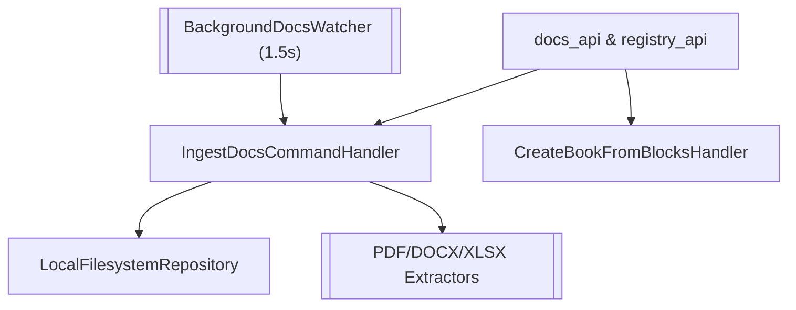

## 2. Diagrama de Clases UML
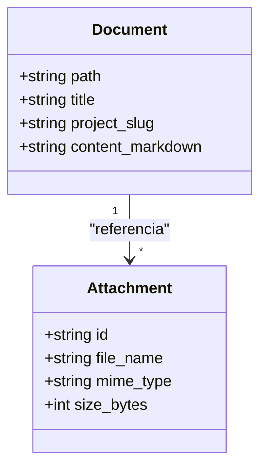

## 3. Diagrama de Secuencia Transaccional
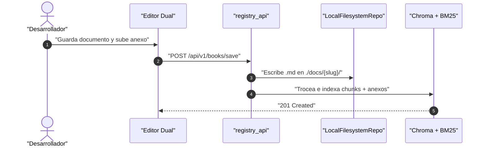

## 4. Diagrama de Máquina de Estados
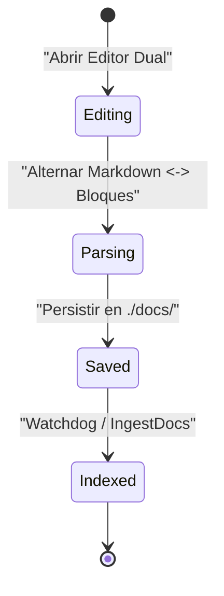

## 5. Diagrama de Actividades
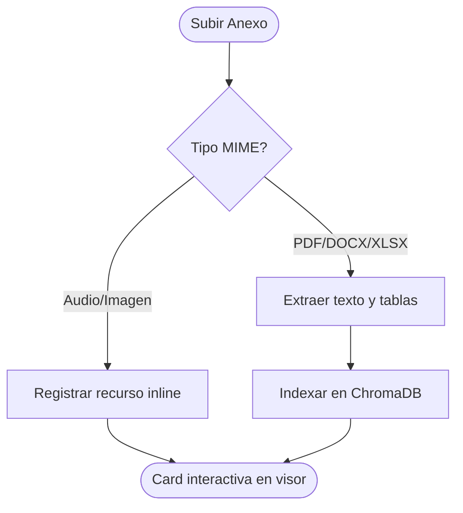

## 6. Sub-ERD del Módulo
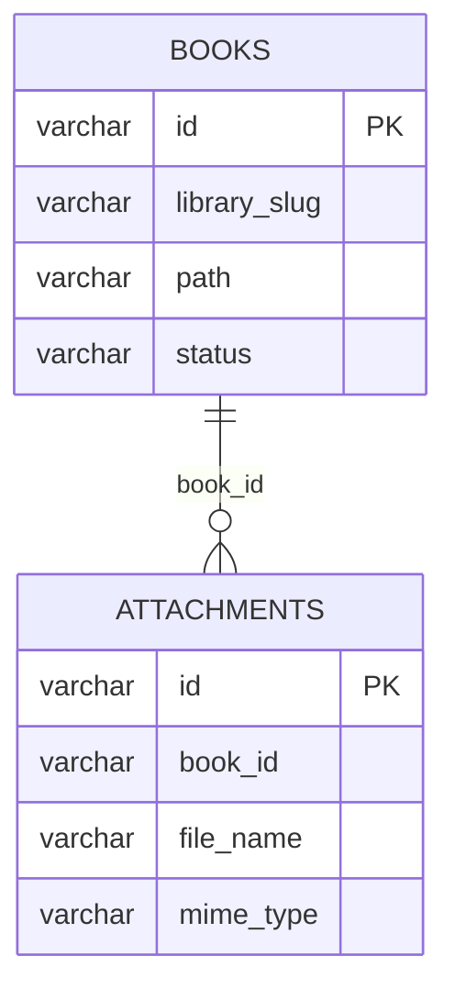

---

<!-- SOURCE: modules/knowledge-docs-and-registry/technical-debt-refactoring.md -->

# Auditoría de Deuda Técnica y Plan de Mejora — `knowledge-docs-and-registry`

> **Semáforo de Cobertura**: `COMPLETAMENTE CUBIERTO` (`mypy --strict` = 0 errores, `pytest` = 100% en verde)

## 1. Hallazgos y Plan de Refactorización

| Hallazgo / Code Smell | Prioridad | Acción Recomendada |
|---|---|---|
| Migración de src/core/templates/blueprints.py y src/core/use_cases/scaffold_doc.py hacia src/domain/ y src/application/ | Media | Consolidar la capa legacy Strangler Fig en Clean Architecture pura. |
| Unificación de registry_api.py y registry_router.py | Baja | Reducir duplicidad de rutas de registro de libros. |

---

<!-- SOURCE: modules/rag-engine-and-scoped-chat/module-spec.md -->

# Módulo: RAG Engine Híbrido (RRF k=60) & Scoped Chat (Zero-RAG Bypass) (`rag-engine-and-scoped-chat`)

> **Estado de Cobertura**: `COMPLETAMENTE CUBIERTO`

## 1. Propósito del Módulo
Orquesta la recuperación híbrida semántica (ChromaDB) y léxica (BM25Plus) particionada por proyecto, la fusión determinista RRF k=60, el Chat Global SSE y el Copiloto Focalizado con Zero-RAG Bypass (<=32.000 chars).

## 2. Patrones de Diseño Aplicados

| Patrón | Implementación | Propósito |
|---|---|---|
| **Hybrid Retrieval + RRF (k=60)** | `HybridSearchService` | Combina relevancia vectorial y coincidencia exacta de tokens |
| **Adaptive Zero-RAG Bypass** | `ScopedChatService` | Inyecta documento completo cuando <=32.000 chars; RAG focalizado si excede |
| **SSE Token Streaming** | `rag_chat/routes.py` | Emite citas primero (event: citations) y tokens UTF-8 progresivos |
| **CQRS Query/Command** | `AskRagQueryHandler, SendScopedMessageHandler` | Separa consulta sin estado de sesiones persistentes |

## 3. Contratos y Endpoints Expuestos
- `GET /api/v1/search/hybrid`
- `POST /api/v1/rag/ask`
- `GET /api/v1/rag/stream`
- `GET /chat/stream`
- `POST /api/v1/chat/scoped`
- `POST /api/v1/chat/messages`
- `GET /api/v1/chat/session/{session_id}`
- `POST /api/v1/chat/project`

## 4. Rutas de Código Fuente (Deep Source Linking)
- `src/domain/rag_engine/`
- `src/domain/chat/`
- `src/application/rag_engine/`
- `src/application/chat/`
- `src/infrastructure/repositories/chroma_vector_repo.py`
- `src/infrastructure/repositories/bm25_lexical_repo.py`
- `src/infrastructure/repositories/sql_chat_repo.py`
- `src/presentation/api/v1/rag_api.py`
- `src/presentation/api/v1/chat_router.py`
- `src/presentation/api/v1/search_api.py`
- `src/presentation/frontend/modules/rag_chat/routes.py`

## 5. Suites de Pruebas Asociadas
- `tests/unit/test_scoped_chat_service.py`
- `tests/unit/test_contextforge_domain_and_app.py`
- `tests/integration/test_multi_project_rag.py`
- `tests/e2e/test_dual_editor_and_scoped_rag.py`

---

<!-- SOURCE: modules/rag-engine-and-scoped-chat/requirements-and-rules.md -->

# Requisitos Funcionales y Reglas de Negocio — `rag-engine-and-scoped-chat`

## 1. Requisitos Funcionales (`RF-*`)

| ID | Especificación |
|---|---|
| `RF-RAG-001` | Búsqueda híbrida aislada por project_slug con atribución de archivo y sección. |
| `RF-RAG-002` | Chat conversacional SSE y sesiones persistentes por documento. |

## 2. Invariantes y Reglas de Negocio (`BR-*`)

| ID | Severidad | Regla de Negocio |
|---|---|---|
| `BR-RAG-001` | Crítica | Fusión híbrida determinista RRF con constante k=60. |
| `BR-RAG-002` | Crítica | Atribución obligatoria de fuentes antes de emitir tokens SSE. |
| `BR-RAG-003` | Alta | Decodificación UTF-8 incremental sin corrupción de caracteres multibyte. |
| `BR-RAG-004` | Crítica | Zero-RAG Bypass automático para documentos <= 32.000 caracteres. |

---

<!-- SOURCE: modules/rag-engine-and-scoped-chat/data-and-transactions.md -->

# Datos, Persistencia y Fronteras Transaccionales — `rag-engine-and-scoped-chat`

## 1. Tablas y Recursos de Persistencia

| Tabla / Recurso | Operación | Descripción |
|---|---|---|
| `chat_sessions` | Escritura / Lectura | Sesiones de chat focalizado por book_id y library_id. |
| `chat_messages` | Escritura / Lectura | Mensajes de usuario/asistente y citas JSON (sources_json). |

## 2. Fronteras Transaccionales y Concurrencia
- Las operaciones SQL se ejecutan mediante sesiones asíncronas de `SQLAlchemy 2.0 + aiosqlite` (`AsyncSession`) con commit explícito por caso de uso o `SqlAlchemyUnitOfWork`.
- Las escrituras documentales en `./docs/` preceden a la actualización de índices secundarios (ChromaDB y BM25Plus) respetando `BR-DOC-001`.

---

<!-- SOURCE: modules/rag-engine-and-scoped-chat/diagrams.md -->

# 6 Diagramas Técnicos del Módulo `rag-engine-and-scoped-chat`

## 1. Diagrama de Componentes (C3)
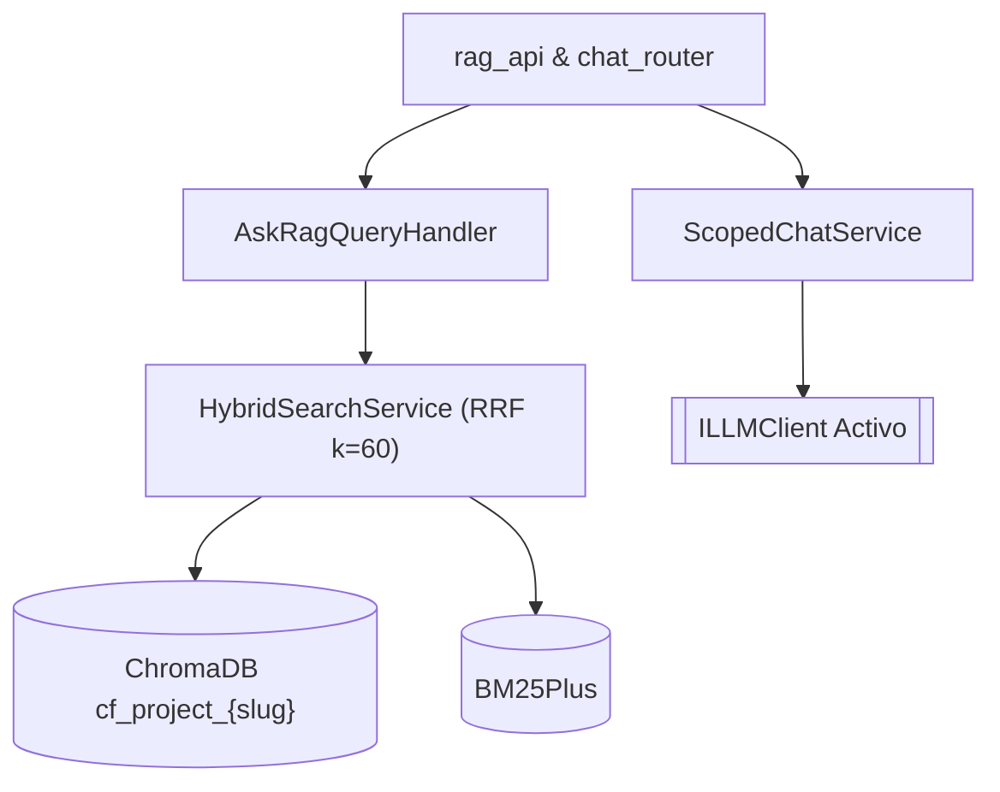

## 2. Diagrama de Clases UML
```mermaid
classDiagram
  class HybridSearchService {
    +search(query, project_slug, top_k) List~RetrievalResult~
  }
  class ScopedChatService {
    +int BYPASS_LIMIT
    +answer_question(library_id, book_id, raw_markdown, query) dict
  }
  ScopedChatService --> HybridSearchService : "usa en docs >32k"
```

## 3. Diagrama de Secuencia Transaccional
```mermaid
sequenceDiagram
  autonumber
  actor Dev as "Desarrollador"
  participant SSE as "/chat/stream"
  participant Hybrid as "HybridSearchService"
  participant LLM as "ILLMClient"
  Dev->>SSE: "Pregunta técnica"
  SSE->>Hybrid: "search(q, project_slug)"
  Hybrid-->>SSE: "Top chunks + citas"
  SSE-->>Dev: "event: citations"
  SSE->>LLM: "stream_chat()"
  LLM-->>Dev: "event: token ... event: done"
```

## 4. Diagrama de Máquina de Estados
```mermaid
stateDiagram-v2
  [*] --> Retrieving : "Consulta recibida"
  Retrieving --> CitationsSent : "Chunks RRF listos"
  CitationsSent --> Streaming : "Tokens LLM activos"
  Streaming --> Completed : "event: done"
  Completed --> [*]
```

## 5. Diagrama de Actividades
```mermaid
flowchart TD
  aIn(["Scoped Query"]) --> aSize{"len(md) <= 32000?"}
  aSize -->|"Sí"| aFull["Zero-RAG Bypass: inyectar completo"]
  aSize -->|"No"| aVec["Chroma search_scoped(book_id)"]
  aFull --> aGen["ILLMClient.generate()"]
  aVec --> aGen
  aGen --> aOut(["Respuesta + Fuentes"])
```

## 6. Sub-ERD del Módulo
```mermaid
erDiagram
  CHAT_SESSIONS ||--o{ CHAT_MESSAGES : "session_id"
  CHAT_SESSIONS {
    varchar session_id PK
    varchar book_id
    varchar library_id
  }
  CHAT_MESSAGES {
    varchar id PK
    varchar session_id
    varchar role
    text sources_json
  }
```

---

<!-- SOURCE: modules/rag-engine-and-scoped-chat/technical-debt-refactoring.md -->

# Auditoría de Deuda Técnica y Plan de Mejora — `rag-engine-and-scoped-chat`

> **Semáforo de Cobertura**: `COMPLETAMENTE CUBIERTO` (`mypy --strict` = 0 errores, `pytest` = 100% en verde)

## 1. Hallazgos y Plan de Refactorización

| Hallazgo / Code Smell | Prioridad | Acción Recomendada |
|---|---|---|
| Deduplicación de ruta /chat/scoped entre chat_router.py y registry_api.py | Media | Consolidar un único endpoint autoritativo para chat focalizado. |

---

<!-- SOURCE: modules/multi-llm-and-cli-orchestrator/module-spec.md -->

# Módulo: Orquestador Multi-LLM Universal (15 Proveedores) & Agentes CLI (`multi-llm-and-cli-orchestrator`)

> **Estado de Cobertura**: `COMPLETAMENTE CUBIERTO`

## 1. Propósito del Módulo
Unifica 15 proveedores de IA (Local HTTP, Cloud APIs y Agentes CLI locales como agy, claude, opencode) mediante LLMFactory (Strategy + Options + Registry), enmascaramiento de secretos, descubrimiento de binarios por SO y persistencia atómica en SQLite.

## 2. Patrones de Diseño Aplicados

| Patrón | Implementación | Propósito |
|---|---|---|
| **Factory + Strategy + Options + Registry** | `LLMFactory` | Resuelve dinámicamente 15 proveedores LLM y 4 estrategias de embeddings |
| **Adapter Pattern** | `CLIProcessClient, GeminiHttpClient, AnthropicHttpClient, OpenAIHttpClient` | Unifica HTTP y subprocesos tras ILLMClient |
| **Threaded Subprocess Fallback** | `CLIProcessClient.stream_generate()` | Evita NotImplementedError en Windows SelectorEventLoop mediante Popen + Queue |
| **Legacy Auto-Migration** | `SqlLLMConfigRepository._upgrade_legacy_orm()` | Actualiza cli_args legados (-p -> --dangerously-skip-permissions) y URLs Gemini |

## 3. Contratos y Endpoints Expuestos
- `GET /api/v1/settings/llm`
- `POST /api/v1/settings/llm`
- `POST /api/v1/settings/llm/activate`
- `POST /api/v1/settings/llm/test`
- `POST /api/v1/settings/llm/test-embedding`
- `GET /api/v1/settings/llm/discover-cli`
- `GET /api/v1/settings`
- `POST /api/v1/settings`
- `GET /api/v1/settings/ollama-models`

## 4. Rutas de Código Fuente (Deep Source Linking)
- `src/domain/llm/`
- `src/domain/settings/`
- `src/application/settings/`
- `src/infrastructure/external/llm/llm_factory.py`
- `src/infrastructure/external/llm/strategies/`
- `src/infrastructure/external/llm/cli_process_client.py`
- `src/infrastructure/repositories/sql_llm_config_repo.py`
- `src/presentation/api/v1/llm_settings_api.py`
- `src/presentation/api/v1/settings_api.py`

## 5. Suites de Pruebas Asociadas
- `tests/unit/test_multi_llm_subsystem.py`
- `tests/test_universal_engines_and_mcp.py`

---

<!-- SOURCE: modules/multi-llm-and-cli-orchestrator/requirements-and-rules.md -->

# Requisitos Funcionales y Reglas de Negocio — `multi-llm-and-cli-orchestrator`

## 1. Requisitos Funcionales (`RF-*`)

| ID | Especificación |
|---|---|
| `RF-LLM-001` | Configuración, test de conexión/embeddings y activación de 15 motores de IA. |
| `RF-LLM-002` | Auto-discovery de binarios CLI locales en Windows, Linux y macOS. |

## 2. Invariantes y Reglas de Negocio (`BR-*`)

| ID | Severidad | Regla de Negocio |
|---|---|---|
| `BR-LLM-001` | Crítica | Activación atómica única y persistencia permanente entre reinicios. |
| `BR-LLM-002` | Crítica | Enmascaramiento y preservación de API Keys reales al guardar. |
| `BR-LLM-003` | Crítica | Cero shell=True; opciones antes de -p={prompt} en agy. |
| `BR-LLM-004` | Alta | WindowsProactorEventLoopPolicy + fallback multihilo ante NotImplementedError. |

---

<!-- SOURCE: modules/multi-llm-and-cli-orchestrator/data-and-transactions.md -->

# Datos, Persistencia y Fronteras Transaccionales — `multi-llm-and-cli-orchestrator`

## 1. Tablas y Recursos de Persistencia

| Tabla / Recurso | Operación | Descripción |
|---|---|---|
| `llm_configurations` | Escritura / Lectura | Credenciales, comandos CLI, flags, modelo activo y bandera is_active. |
| `settings` | Escritura / Lectura | Sincronización de active_llm_model, embedding_model y temperature. |

## 2. Fronteras Transaccionales y Concurrencia
- Las operaciones SQL se ejecutan mediante sesiones asíncronas de `SQLAlchemy 2.0 + aiosqlite` (`AsyncSession`) con commit explícito por caso de uso o `SqlAlchemyUnitOfWork`.
- Las escrituras documentales en `./docs/` preceden a la actualización de índices secundarios (ChromaDB y BM25Plus) respetando `BR-DOC-001`.

---

<!-- SOURCE: modules/multi-llm-and-cli-orchestrator/diagrams.md -->

# 6 Diagramas Técnicos del Módulo `multi-llm-and-cli-orchestrator`

## 1. Diagrama de Componentes (C3)
```mermaid
flowchart TD
  apiLlm["llm_settings_api"] --> hAct["ActivateLLMProviderHandler"]
  hAct --> repoLlm["SqlLLMConfigRepository"]
  repoLlm --> dbSql[("SQLite llm_configurations")]
  facLlm["LLMFactory (Strategy/Registry)"] --> adpCli["CLIProcessClient (agy/claude)"]
  facLlm --> adpHttp["HTTP Clients (Ollama/Gemini/OpenAI/Anthropic)"]
```

## 2. Diagrama de Clases UML
```mermaid
classDiagram
  class LLMFactory {
    +create_client(config) ILLMClient
    +test_embedding_connection(...) dict
  }
  class CLIProcessClient {
    +string binary_name
    +List~string~ base_args
    +_build_command(prompt, system, model) List~string~
  }
  LLMFactory ..> CLIProcessClient : "crea"
```

## 3. Diagrama de Secuencia Transaccional
```mermaid
sequenceDiagram
  autonumber
  actor User as "Usuario"
  participant UI as "settings.html"
  participant API as "/api/v1/settings/llm/activate"
  participant Repo as "SqlLLMConfigRepo"
  User->>UI: "Clic en Activar agy"
  UI->>API: "POST /activate {provider: antigravity_cli}"
  API->>Repo: "set_active_provider() + sync settings"
  Repo-->>UI: "200 OK (persistido en SQLite y localStorage)"
```

## 4. Diagrama de Máquina de Estados
```mermaid
stateDiagram-v2
  [*] --> Inactive : "Seed DEFAULT_CONFIGS"
  Inactive --> Tested : "POST /test"
  Tested --> Active : "POST /activate"
  Active --> Inactive : "Otro proveedor activado"
```

## 5. Diagrama de Actividades
```mermaid
flowchart TD
  cStart(["_build_command()"]) --> cClean["Filtrar -p/--prompt/--print de base_args"]
  cClean --> cBin{"bin_stem == agy?"}
  cBin -->|"Sí"| cAgy["Agregar --dangerously-skip-permissions + --model + -p={prompt}"]
  cBin -->|"No"| cOther["Agregar --model + -p + prompt"]
  cAgy --> cEnd(["Lista segura sin shell=True"])
  cOther --> cEnd
```

## 6. Sub-ERD del Módulo
```mermaid
erDiagram
  LLM_CONFIGURATIONS {
    varchar provider PK
    varchar engine_type
    varchar default_model
    varchar cli_command
    varchar cli_args
    boolean is_active
  }
  SETTINGS {
    varchar id PK
    varchar active_llm_model
    varchar embedding_model
    float temperature
  }
```

---

<!-- SOURCE: modules/multi-llm-and-cli-orchestrator/technical-debt-refactoring.md -->

# Auditoría de Deuda Técnica y Plan de Mejora — `multi-llm-and-cli-orchestrator`

> **Semáforo de Cobertura**: `COMPLETAMENTE CUBIERTO` (`mypy --strict` = 0 errores, `pytest` = 100% en verde)

## 1. Hallazgos y Plan de Refactorización

| Hallazgo / Code Smell | Prioridad | Acción Recomendada |
|---|---|---|
| Unificar interfaz legacy IOllamaClient y moderna ILLMClient | Media | Retirar alias históricos una vez todos los handlers usen ILLMClient. |

---

<!-- SOURCE: modules/context-bundler-and-mcp-bridge/module-spec.md -->

# Módulo: Context Bundler Jerárquico, Servidor FastMCP e Integraciones (`context-bundler-and-mcp-bridge`)

> **Estado de Cobertura**: `COMPLETAMENTE CUBIERTO`

## 1. Propósito del Módulo
Compila bundles de contexto (.cursorrules, .md) para IDEs, expone el servidor universal FastMCP (JSON-RPC 2.0 sobre SSE y STDIO) y entrega la colección Postman y el widget de chat embebible.

## 2. Patrones de Diseño Aplicados

| Patrón | Implementación | Propósito |
|---|---|---|
| **Builder / Compiler** | `ContextBundleCompiler` | Ensambla documentos seleccionados con conteo de tokens tiktoken |
| **Protocol Adapter (MCP)** | `FastMCP` | Sirve JSON-RPC 2.0 sobre transporte dual SSE (/mcp/sse) y STDIO |
| **Facade** | `MCPQueryContextQueryHandler` | Encapsula búsqueda híbrida con fallback lexical para agentes IA |

## 3. Contratos y Endpoints Expuestos
- `POST /api/v1/bundles/export`
- `GET /api/v1/bundles/{bundle_id}/download`
- `POST /api/v1/bundles/export-agent-rules`
- `GET /mcp/info`
- `GET /mcp/sse`
- `POST /mcp/messages`
- `GET /health`
- `GET /api/v1/integrations/postman-collection`
- `GET /api/v1/integrations/widget.js`

## 4. Rutas de Código Fuente (Deep Source Linking)
- `src/domain/context_builder/`
- `src/application/context_builder/`
- `src/application/context_bridge/`
- `src/presentation/mcp/server.py`
- `run_mcp.py`
- `src/presentation/api/v1/bundles_api.py`
- `src/presentation/api/v1/integrations_api.py`

## 5. Suites de Pruebas Asociadas
- `tests/test_universal_engines_and_mcp.py`
- `tests/unit/test_projects_and_ui_bundler.py`
- `tests/unit/test_integrations_and_widget.py`

---

<!-- SOURCE: modules/context-bundler-and-mcp-bridge/requirements-and-rules.md -->

# Requisitos Funcionales y Reglas de Negocio — `context-bundler-and-mcp-bridge`

## 1. Requisitos Funcionales (`RF-*`)

| ID | Especificación |
|---|---|
| `RF-MCP-001` | Exposición de search_project_context, get_document_full y list_project_structure. |
| `RF-BND-001` | Exportación descargable de .cursorrules y reglas de agente. |

## 2. Invariantes y Reglas de Negocio (`BR-*`)

| ID | Severidad | Regla de Negocio |
|---|---|---|
| `BR-MCP-001` | Alta | Paridad funcional entre transporte SSE (/mcp/sse) y STDIO (run_mcp.py). |
| `BR-BND-001` | Media | Todo bundle compilado contabiliza tokens vía tiktoken y se almacena en ./bundles/. |

---

<!-- SOURCE: modules/context-bundler-and-mcp-bridge/data-and-transactions.md -->

# Datos, Persistencia y Fronteras Transaccionales — `context-bundler-and-mcp-bridge`

## 1. Tablas y Recursos de Persistencia

| Tabla / Recurso | Operación | Descripción |
|---|---|---|
| `./bundles/* (FS)` | Escritura / Lectura | Archivos compilados .cursorrules y .md. |

## 2. Fronteras Transaccionales y Concurrencia
- Las operaciones SQL se ejecutan mediante sesiones asíncronas de `SQLAlchemy 2.0 + aiosqlite` (`AsyncSession`) con commit explícito por caso de uso o `SqlAlchemyUnitOfWork`.
- Las escrituras documentales en `./docs/` preceden a la actualización de índices secundarios (ChromaDB y BM25Plus) respetando `BR-DOC-001`.

---

<!-- SOURCE: modules/context-bundler-and-mcp-bridge/diagrams.md -->

# 6 Diagramas Técnicos del Módulo `context-bundler-and-mcp-bridge`

## 1. Diagrama de Componentes (C3)
```mermaid
flowchart TD
  ideCli(["IDE / Agente IA"]) --> fastMcp["FastMCP Server (SSE / STDIO)"]
  fastMcp --> hMcp["MCPQueryContextQueryHandler"]
  apiBnd["bundles_api"] --> comp["ContextBundleCompiler"]
  comp --> fsBnd[("./bundles/")]
  apiInt["integrations_api"] --> wid["widget.js & Postman JSON"]
```

## 2. Diagrama de Clases UML
```mermaid
classDiagram
  class FastMCP {
    +string name
    +tool() decorator
    +handle_jsonrpc(payload) dict
    +sse_app() FastAPI
    +run(transport) None
  }
  class MCPToolDefinition {
    +string name
    +dict input_schema
  }
  FastMCP "1" *-- "*" MCPToolDefinition
```

## 3. Diagrama de Secuencia Transaccional
```mermaid
sequenceDiagram
  autonumber
  actor IDE as "Cursor / Antigravity"
  participant MCP as "FastMCP (/mcp/sse)"
  participant Hybrid as "HybridSearchService"
  IDE->>MCP: "GET /mcp/sse"
  MCP-->>IDE: "event: endpoint (/mcp/messages?session_id=...)"
  IDE->>MCP: "POST tools/call search_project_context"
  MCP->>Hybrid: "search(query, project_slug)"
  Hybrid-->>MCP: "Formatted Markdown hits"
  MCP-->>IDE: "event: message (JSON-RPC 2.0 result)"
```

## 4. Diagrama de Máquina de Estados
```mermaid
stateDiagram-v2
  [*] --> Disconnected
  Disconnected --> SessionOpen : "GET /mcp/sse"
  SessionOpen --> ToolExecuting : "tools/call"
  ToolExecuting --> SessionOpen : "JSON-RPC response"
  SessionOpen --> Disconnected : "Client disconnect"
```

## 5. Diagrama de Actividades
```mermaid
flowchart TD
  mStart(["MCP tools/call"]) --> mTool{"Herramienta existe?"}
  mTool -->|"No"| mErr["JSON-RPC -32601 Not Found"]
  mTool -->|"Sí"| mExec["Ejecutar coroutine registrada"]
  mExec --> mOk["Retornar content[text] + isError:false"]
```

## 6. Sub-ERD del Módulo
```mermaid
erDiagram
  PROJECTS ||--o{ BUNDLES : "compila"
  PROJECTS {
    varchar slug PK
    varchar name
  }
  BUNDLES {
    varchar bundle_id PK
    varchar format
    int token_count
  }
```

---

<!-- SOURCE: modules/context-bundler-and-mcp-bridge/technical-debt-refactoring.md -->

# Auditoría de Deuda Técnica y Plan de Mejora — `context-bundler-and-mcp-bridge`

> **Semáforo de Cobertura**: `COMPLETAMENTE CUBIERTO` (`mypy --strict` = 0 errores, `pytest` = 100% en verde)

## 1. Hallazgos y Plan de Refactorización

| Hallazgo / Code Smell | Prioridad | Acción Recomendada |
|---|---|---|
| Añadir política de limpieza/TTL de bundles temporales en ./bundles/ | Baja | Evitar acumulación histórica de artefactos descargados. |

---

<!-- SOURCE: modules/catalog-projects-and-taxonomy/module-spec.md -->

# Módulo: Catálogo Multi-Proyecto, Taxonomía Dinámica y Capa Social (`catalog-projects-and-taxonomy`)

> **Estado de Cobertura**: `COMPLETAMENTE CUBIERTO`

## 1. Propósito del Módulo
Administra proyectos aislados (ProjectSlug), catálogo de libros/documentos, taxonomía personalizable de módulos y etiquetas, y la capa colaborativa de comentarios, hilos de discusión y calificaciones.

## 2. Patrones de Diseño Aplicados

| Patrón | Implementación | Propósito |
|---|---|---|
| **Value Object Validation** | `ProjectSlug` | Inmutabilidad y regex estricta para slugs multi-proyecto |
| **Granular CQRS** | `GetLibraryCatalog, UpdateBookStatus, AddComment, ModerateComment` | Comandos/Consultas con validadores independientes |
| **Repository Pattern** | `SqliteProjectRepository, SqlTaxonomyRepository` | Persistencia asíncrona desacoplada por agregado |

## 3. Contratos y Endpoints Expuestos
- `GET /api/v1/catalog/libraries`
- `GET /api/v1/catalog/books`
- `PATCH /api/v1/catalog/books/{book_id}/status`
- `GET /api/v1/taxonomy/modules`
- `POST /api/v1/taxonomy/modules`
- `GET /api/v1/taxonomy/tags`
- `POST /api/v1/taxonomy/tags`
- `POST /api/v1/social/comments`
- `GET /api/v1/social/comments`
- `DELETE /api/v1/social/comments/{comment_id}`

## 4. Rutas de Código Fuente (Deep Source Linking)
- `src/core/domain/project.py`
- `src/domain/catalog/`
- `src/domain/taxonomy/`
- `src/domain/social/`
- `src/application/catalog/`
- `src/application/social/`
- `src/infrastructure/repositories/sqlite_project_repo.py`
- `src/infrastructure/repositories/sql_catalog_repo.py`
- `src/infrastructure/repositories/sql_taxonomy_repo.py`
- `src/presentation/api/v1/catalog_router.py`
- `src/presentation/api/v1/taxonomy_api.py`
- `src/presentation/api/v1/social_router.py`

## 5. Suites de Pruebas Asociadas
- `tests/unit/test_project_domain.py`
- `tests/unit/test_taxonomy_and_paged_docs.py`
- `tests/unit/test_granular_cqrs.py`
- `tests/integration/test_sql_repositories_and_api.py`

---

<!-- SOURCE: modules/catalog-projects-and-taxonomy/requirements-and-rules.md -->

# Requisitos Funcionales y Reglas de Negocio — `catalog-projects-and-taxonomy`

## 1. Requisitos Funcionales (`RF-*`)

| ID | Especificación |
|---|---|
| `RF-PROJ-001` | Alta, listado y conmutación de proyectos con auto-seed de README. |
| `RF-TAX-001` | Creación dinámica de módulos con color/icono y etiquetas por proyecto. |
| `RF-SOC-001` | Publicación, consulta y moderación de comentarios y calificaciones. |

## 2. Invariantes y Reglas de Negocio (`BR-*`)

| ID | Severidad | Regla de Negocio |
|---|---|---|
| `BR-PROJ-001` | Crítica | Validación regex estricta y longitud <= 50 caracteres en ProjectSlug. |
| `BR-PROJ-002` | Crítica | Aislamiento total de catálogo, taxonomía y documentos por proyecto. |

---

<!-- SOURCE: modules/catalog-projects-and-taxonomy/data-and-transactions.md -->

# Datos, Persistencia y Fronteras Transaccionales — `catalog-projects-and-taxonomy`

## 1. Tablas y Recursos de Persistencia

| Tabla / Recurso | Operación | Descripción |
|---|---|---|
| `projects` | Escritura / Lectura | Proyectos registrados y bandera de proyecto activo. |
| `modules` | Escritura / Lectura | Módulos taxonómicos por project_slug. |
| `tags` | Escritura / Lectura | Etiquetas semánticas por project_slug. |
| `document_comments` | Escritura / Lectura | Comentarios técnicos asociados a doc_path. |
| `discussion_threads` | Escritura / Lectura | Hilos de discusión. |
| `ratings` | Escritura / Lectura | Calificaciones numéricas por recurso. |

## 2. Fronteras Transaccionales y Concurrencia
- Las operaciones SQL se ejecutan mediante sesiones asíncronas de `SQLAlchemy 2.0 + aiosqlite` (`AsyncSession`) con commit explícito por caso de uso o `SqlAlchemyUnitOfWork`.
- Las escrituras documentales en `./docs/` preceden a la actualización de índices secundarios (ChromaDB y BM25Plus) respetando `BR-DOC-001`.

---

<!-- SOURCE: modules/catalog-projects-and-taxonomy/diagrams.md -->

# 6 Diagramas Técnicos del Módulo `catalog-projects-and-taxonomy`

## 1. Diagrama de Componentes (C3)
```mermaid
flowchart TD
  apiCat["catalog_router & taxonomy_api & social_router"] --> hCqrs["Granular CQRS Handlers"]
  hCqrs --> rProj["SqliteProjectRepository"]
  hCqrs --> rTax["SqlTaxonomyRepository"]
  hCqrs --> rSoc["SqlSocialRepository"]
  rProj --> dbSql[("SQLite contextforge.db")]
```

## 2. Diagrama de Clases UML
```mermaid
classDiagram
  class ProjectSlug {
    +string value
    +validate() void
  }
  class ModuleEntity {
    +string id
    +string slug
    +string color
    +string project_slug
  }
  class Comment {
    +string id
    +string doc_path
    +string user_name
    +string content
  }
```

## 3. Diagrama de Secuencia Transaccional
```mermaid
sequenceDiagram
  autonumber
  actor User as "Usuario"
  participant API as "taxonomy_api"
  participant Repo as "SqlTaxonomyRepository"
  participant DB as "SQLite"
  User->>API: "POST /api/v1/taxonomy/modules"
  API->>Repo: "create_module(project_slug, name, color)"
  Repo->>DB: "INSERT INTO modules"
  DB-->>User: "201 Created"
```

## 4. Diagrama de Máquina de Estados
```mermaid
stateDiagram-v2
  [*] --> ActiveProject : "Crear proyecto + seed README"
  ActiveProject --> InactiveProject : "Archivar / desactivar"
  InactiveProject --> ActiveProject : "Reactivar"
```

## 5. Diagrama de Actividades
```mermaid
flowchart TD
  pStart(["Crear Proyecto"]) --> pVal{"ProjectSlug válido?"}
  pVal -->|"No"| pErr["422 DomainException"]
  pVal -->|"Sí"| pDir["Crear ./docs/{slug}/ + project.json"]
  pDir --> pDb["Persistir en tabla projects"]
  pDb --> pOk(["Proyecto activo"])
```

## 6. Sub-ERD del Módulo
```mermaid
erDiagram
  PROJECTS ||--o{ MODULES : "project_slug"
  PROJECTS ||--o{ TAGS : "project_slug"
  PROJECTS {
    varchar slug PK
    varchar name
  }
  MODULES {
    varchar id PK
    varchar slug
    varchar project_slug
  }
  TAGS {
    varchar id PK
    varchar slug
    varchar project_slug
  }
```

---

<!-- SOURCE: modules/catalog-projects-and-taxonomy/technical-debt-refactoring.md -->

# Auditoría de Deuda Técnica y Plan de Mejora — `catalog-projects-and-taxonomy`

> **Semáforo de Cobertura**: `COMPLETAMENTE CUBIERTO` (`mypy --strict` = 0 errores, `pytest` = 100% en verde)

## 1. Hallazgos y Plan de Refactorización

| Hallazgo / Code Smell | Prioridad | Acción Recomendada |
|---|---|---|
| Mover Project y ProjectSlug desde src/core/domain/project.py a src/domain/catalog/ | Baja | Eliminar dependencia residual en src/core/. |

---

<!-- SOURCE: modules/screaming-ui-and-persistence/module-spec.md -->

# Módulo: Screaming Frontend (Jinja2/HTMX/Tailwind v4) & Persistencia Hexagonal (`screaming-ui-and-persistence`)

> **Estado de Cobertura**: `COMPLETAMENTE CUBIERTO`

## 1. Propósito del Módulo
Provee la experiencia de usuario web con 8 módulos Screaming, soporte completo de tema claro/oscuro, notificaciones Toast, paginación DRY y la capa hexagonal de bases de datos (DatabaseFactory) y almacenamiento (StorageFactory).

## 2. Patrones de Diseño Aplicados

| Patrón | Implementación | Propósito |
|---|---|---|
| **Screaming UI Architecture** | `src/presentation/frontend/modules/*` | Agrupa vistas, componentes y rutas por capacidad de negocio |
| **DRY Jinja2 Macros** | `shared/components/{pagination,active_model_badge,page_header,empty_state,search_input}.html` | Elimina duplicación HTML entre módulos |
| **Hexagonal Database & Storage Factories** | `DatabaseFactory, StorageFactory` | Soporta 6 motores de BD y 4 motores de Storage |
| **RFC 7807 Problem Details** | `problem_details_middleware.py` | Estandariza excepciones de dominio y HTTP |

## 3. Contratos y Endpoints Expuestos
- `GET / (redirect -> /docs/browser)`
- `GET /docs/browser`
- `GET /docs/view/{path}`
- `GET /docs/new`
- `GET /docs/integration-guide`
- `GET /chat`
- `GET /settings`
- `GET /projects`
- `GET /api/v1/settings/infrastructure`
- `POST /api/v1/settings/database/activate`
- `POST /api/v1/settings/storage/activate`

## 4. Rutas de Código Fuente (Deep Source Linking)
- `src/main.py`
- `src/presentation/frontend/`
- `src/presentation/api/middlewares/problem_details_middleware.py`
- `src/infrastructure/database/connection.py`
- `src/infrastructure/persistence/database_factory.py`
- `src/infrastructure/storage/storage_factory.py`
- `src/infrastructure/repositories/json_infrastructure_config_repo.py`

## 5. Suites de Pruebas Asociadas
- `tests/unit/test_design_patterns_subsystems.py`
- `tests/e2e/test_contextforge_e2e.py`
- `tests/unit/test_coverage_booster.py`

---

<!-- SOURCE: modules/screaming-ui-and-persistence/requirements-and-rules.md -->

# Requisitos Funcionales y Reglas de Negocio — `screaming-ui-and-persistence`

## 1. Requisitos Funcionales (`RF-*`)

| ID | Especificación |
|---|---|
| `RF-UI-001` | Navegación reactiva HTMX, Command Palette Ctrl+K y visor multimedia modal. |
| `RF-INF-001` | Selección y prueba de motores de base de datos y storage desde /settings. |

## 2. Invariantes y Reglas de Negocio (`BR-*`)

| ID | Severidad | Regla de Negocio |
|---|---|---|
| `BR-UI-001` | Alta | Cero alert() nativos (usar window.$toast) y listeners DOM seguros sin fuga HTML. |
| `BR-UI-002` | Media | Compatibilidad visual completa en modo claro y oscuro sin FOUC. |

---

<!-- SOURCE: modules/screaming-ui-and-persistence/data-and-transactions.md -->

# Datos, Persistencia y Fronteras Transaccionales — `screaming-ui-and-persistence`

## 1. Tablas y Recursos de Persistencia

| Tabla / Recurso | Operación | Descripción |
|---|---|---|
| `infrastructure_configs.json` | Escritura / Lectura | Configuración persistida de DatabaseFactory y StorageFactory. |
| `contextforge.db (SQLite)` | Auto-migración DDL | Inicialización y migración incremental en init_db(). |

## 2. Fronteras Transaccionales y Concurrencia
- Las operaciones SQL se ejecutan mediante sesiones asíncronas de `SQLAlchemy 2.0 + aiosqlite` (`AsyncSession`) con commit explícito por caso de uso o `SqlAlchemyUnitOfWork`.
- Las escrituras documentales en `./docs/` preceden a la actualización de índices secundarios (ChromaDB y BM25Plus) respetando `BR-DOC-001`.

---

<!-- SOURCE: modules/screaming-ui-and-persistence/diagrams.md -->

# 6 Diagramas Técnicos del Módulo `screaming-ui-and-persistence`

## 1. Diagrama de Componentes (C3)
```mermaid
flowchart TD
  reqIn(["HTTP Request"]) --> mwCors{{"CORS + Timing + RFC 7807"}}
  mwCors --> webR["web_router (8 módulos Screaming)"]
  webR --> jinja["Jinja2 Templates + Macros DRY"]
  apiInf["settings_api (Infra)"] --> dbFac["DatabaseFactory (6 motores)"]
  apiInf --> stFac["StorageFactory (4 motores)"]
```

## 2. Diagrama de Clases UML
```mermaid
classDiagram
  class DatabaseFactory {
    +create_strategy(config) IDatabaseStrategy
    +test_connection(config) tuple
  }
  class StorageFactory {
    +create_strategy(config) IStorageStrategy
    +test_connection(config) tuple
  }
```

## 3. Diagrama de Secuencia Transaccional
```mermaid
sequenceDiagram
  autonumber
  actor User as "Usuario"
  participant UI as "base.html"
  participant Route as "settings/routes.py"
  participant Fac as "DatabaseFactory"
  User->>UI: "Alterna tema o prueba BD"
  UI->>Route: "POST /api/v1/settings/database/test"
  Route->>Fac: "test_connection(cfg)"
  Fac-->>UI: "JSON healthy + latency_ms -> window.$toast"
```

## 4. Diagrama de Máquina de Estados
```mermaid
stateDiagram-v2
  [*] --> LightMode : "theme == light"
  LightMode --> DarkMode : "Toggle #btn-theme-toggle"
  DarkMode --> LightMode : "Toggle #btn-theme-toggle"
```

## 5. Diagrama de Actividades
```mermaid
flowchart TD
  uStart(["Cargar Página"]) --> uTheme["Script head lee localStorage sin FOUC"]
  uTheme --> uRender["Render SSR Jinja2 + Macros DRY"]
  uRender --> uHydrate["Inicializar HTMX, Alpine, Mermaid y Toast"]
  uHydrate --> uReady(["UI Interactiva Lista"])
```

## 6. Sub-ERD del Módulo
```mermaid
erDiagram
  INFRA_CONFIG {
    string active_database
    string active_storage
    boolean sync_local_mirror
  }
  PROJECTS ||--o{ BOOKS : "renderiza en UI"
```

---

<!-- SOURCE: modules/screaming-ui-and-persistence/technical-debt-refactoring.md -->

# Auditoría de Deuda Técnica y Plan de Mejora — `screaming-ui-and-persistence`

> **Semáforo de Cobertura**: `COMPLETAMENTE CUBIERTO` (`mypy --strict` = 0 errores, `pytest` = 100% en verde)

## 1. Hallazgos y Plan de Refactorización

| Hallazgo / Code Smell | Prioridad | Acción Recomendada |
|---|---|---|
| Consolidar nombres de carpetas frontend PascalCase (BookRegistry/Catalog/Chat) y snake_case (knowledge_docs/rag_chat) | Baja | Estandarizar convención uniforme en src/presentation/frontend/modules/. |
