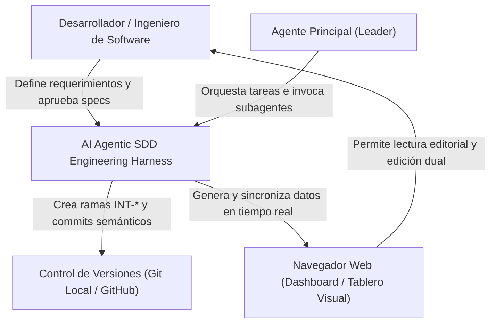
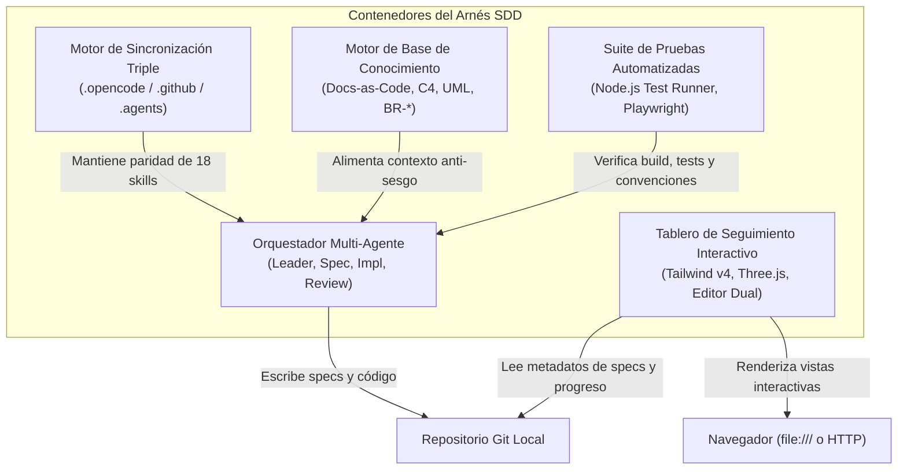
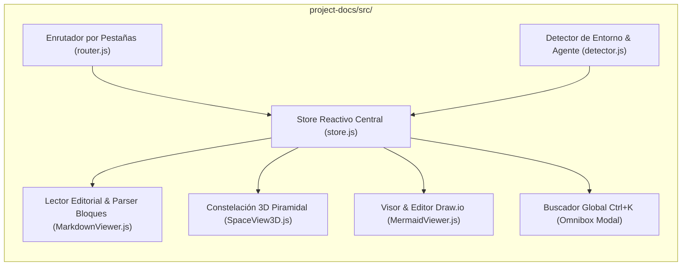
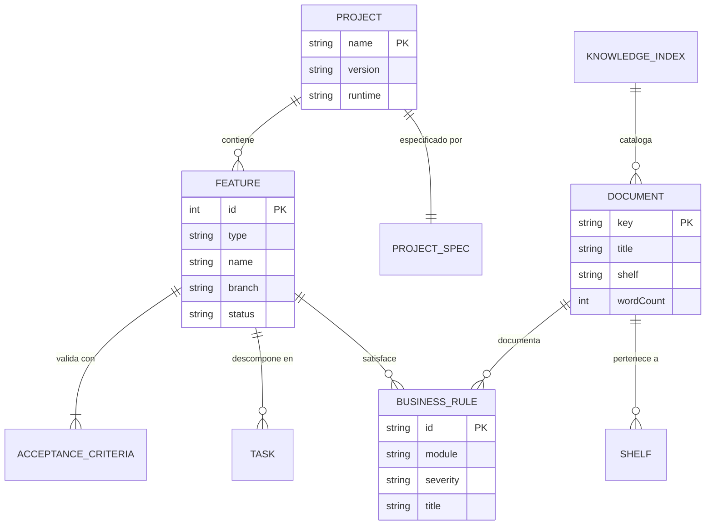

# Dossier Maestro Consolidado de Ingeniería Soberana (MASTER-PROJECT-KNOWLEDGE)

> [!NOTE]
> Documento unificado y autocontenido que consolida el 100% del conocimiento arquitectónico, de negocio, requerimientos, módulos y diagramas del **AI Agentic SDD Engineering Harness**. Diseñado para lectura continua, auditoría técnica integral e inyección en motores LLM de gran ventana de contexto (NotebookLM, Claude Projects, ChatGPT).

---

## Tabla de Contenidos

1. [Capítulo 1: Visión del Producto, Contexto de Negocio y Stakeholders (IEEE 830)](#capítulo-1-visión-del-producto-contexto-de-negocio-y-stakeholders-ieee-830)
2. [Capítulo 2: Diagnóstico AS-IS de la Arquitectura, Flujos de Datos y Patrones](#capítulo-2-diagnóstico-as-is-de-la-arquitectura-flujos-de-datos-y-patrones)
3. [Capítulo 3: Atlas Completo de Diagramas de Arquitectura (C4) y UML 2.5](#capítulo-3-atlas-completo-de-diagramas-de-arquitectura-c4-y-uml-25)
4. [Capítulo 4: Inventario de Capacidades y Especificación Formal de Requisitos (SRS)](#capítulo-4-inventario-de-capacidades-y-especificación-formal-de-requisitos-srs)
5. [Capítulo 5: Catálogo Ágil INVEST, Desglose SPIDR y Tareas de Ingeniería (TI-*)](#capítulo-5-catálogo-ágil-invest-desglose-spidr-y-tareas-de-ingeniería-ti-)
6. [Capítulo 6: Diccionario de Datos, ERD Crow's Foot y Persistencia Híbrida](#capítulo-6-diccionario-de-datos-erd-crows-foot-y-persistencia-híbrida)
7. [Capítulo 7: Catálogo Maestro de Reglas de Negocio (BR-*), ADRs y Servicios Externos](#capítulo-7-catálogo-maestro-de-reglas-de-negocio-br--adrs-y-servicios-externos)
8. [Capítulo 8: Enciclopedia de Módulos & Bounded Contexts](#capítulo-8-enciclopedia-de-módulos--bounded-contexts)
   - [8.1 Módulo: agent-orchestrator](#81-módulo-agent-orchestrator)
   - [8.2 Módulo: dashboard-visualizer](#82-módulo-dashboard-visualizer)
   - [8.3 Módulo: knowledge-engine](#83-módulo-knowledge-engine)
   - [8.4 Módulo: testing-qa-suite](#84-módulo-testing-qa-suite)
   - [8.5 Módulo: triple-sync-engine](#85-módulo-triple-sync-engine)
9. [Capítulo 9: Estándares de Código, Guardrails Anti-Sesgo y Matriz de Trazabilidad (RTM)](#capítulo-9-estándares-de-código-guardrails-anti-sesgo-y-matriz-de-trazabilidad-rtm)

---

## Capítulo 1: Visión del Producto, Contexto de Negocio y Stakeholders (IEEE 830)

### 1.1 Declaración Formal de la Visión
> **PARA** ingenieros de software, arquitectos de soluciones y equipos de desarrollo asistidos por IA,  
> **QUIENES** experimentan alucinaciones, código desalineado con el dominio y regresiones al usar agentes de programación en bases de código medianas y complejas,  
> **EL** AI Agentic SDD Engineering Harness,  
> **QUE ES UN** arnés de ingeniería de software agnóstico basado en Docs-as-Code, orquestación multi-agente y verificación formal en 8 niveles,  
> **QUE** garantiza una precisión funcional $\ge 95\%$ en el código generado por IA mediante un ciclo cerrado y determinista (Especificación EARS $\to$ Puerta Humana $\to$ Implementación TDD/SDD $\to$ Revisión Imparcial $\to$ Verificación Automatizada), triple sincronización de skills y tablero visual offline.

### 1.2 Alcance del Sistema
- **Qué HACE**: Orquesta 4 subagentes (`leader`, `spec-author`, `implementer`, `reviewer`), valida ramas git $\le 80$ caracteres, impone pausas interactivas con `ask_question`, mantiene paridad triple en 18 skills, y provee un tablero interactivo offline-first con editor dual y verificación en 8 niveles.
- **Qué NO HACE**: No sustituye el criterio de arquitectura humano, no realiza `git push` sin autorización, no edita código en fase de revisión y no acopla el código a un runtime particular.

---

## Capítulo 2: Diagnóstico AS-IS de la Arquitectura, Flujos de Datos y Patrones

### 2.1 Screaming Architecture y Organización
El proyecto aplica el principio de **Screaming Architecture**:
- La raíz separa claramente la orquestación (`.agents/`, `.opencode/`, `.github/`), la interfaz y documentación (`project-docs/`) y el arnés de verificación (`tests/`, `verify.sh`).
- El frontend en `project-docs/src/` está modularizado por dominio: `core/`, `features/` y `shared/`, compilado en un bundle IIFE (`dist/app.bundle.js`).

### 2.2 Patrones de Diseño Detectados
1. **Reactive Store (Pub/Sub)**: `store.js` gestiona el estado y propaga cambios a la vista reactivamente.
2. **Fallback Data Cache**: `api.js` y `data-fallback.js` garantizan funcionamiento offline en protocolo `file:///`.
3. **Triple Mirror Sync**: `.opencode/skills/` funciona como fuente canónica y sincroniza unidireccionalmente a `.github/` y `.agents/`.
4. **Dual Editor Mode**: `MarkdownViewer.js` soporta edición textual de Markdown y manipulación visual por bloques con scroll sincronizado.

---

## Capítulo 3: Atlas Completo de Diagramas de Arquitectura (C4) y UML 2.5

### 3.1 Modelo C4 — Contexto de Sistema (C1)

### 3.2 Modelo C4 — Contenedores del Arnés (C2)

### 3.3 Modelo C4 — Componentes del Tablero Web (C3)

---

## Capítulo 4: Inventario de Capacidades y Especificación Formal de Requisitos (SRS)

### Requerimientos Funcionales Nucleares
- **RF-ORCH-001**: Creación y validación de ramas `{type}/INT-{id}/{name}` con longitud $\le 80$ caracteres.
- **RF-ORCH-002**: Puerta humana obligatoria con `ask_question` previa a la implementación.
- **RF-ORCH-003**: Partición formal en subtareas Scrum Jira DEV/QA y captura automatizada de evidencias visuales en `specs/{NNN}_{name}/evidence/`.
- **RF-DASH-001**: Operación offline nativa en protocolo `file:///` con carga instantánea de fallback.
- **RF-DASH-002**: Editor dual Markdown/Bloques con scroll sincronizado.
- **RF-SYNC-001**: Sincronización unidireccional de 18 skills desde `.opencode/`.
- **RF-TEST-001**: Verificación integral en 9 niveles mediante `verify.sh`.

---

## Capítulo 5: Catálogo Ágil INVEST, Desglose SPIDR y Tareas de Ingeniería (TI-*)

### Historias de Usuario Principales
1. **HU-ORCH-01**: Gobernanza de ramas y puertas humanas (3 SP).
   - `TI-ORCH-01`: Validador regex de nombres de rama y contador $\le 80$c.
   - `TI-ORCH-02`: Suite BVA de ramas límite en pruebas de caja negra.
2. **HU-DASH-01**: Experiencia editorial y editor dual en el tablero (5 SP).
   - `TI-DASH-01`: Parser bidireccional Markdown $\leftrightarrow$ Bloques.
   - `TI-DASH-02`: Detección de protocolo `file:///` en `api.js`.
3. **HU-SYNC-01**: Homologación triple de skills (2 SP).
   - `TI-SYNC-01`: Script verificador de paridad de frontmatter YAML.
4. **HU-ORCH-02**: Desglose Scrum DEV/QA y captura automatizada de evidencias (5 SP).
   - `TI-ORCH-03`: Implementar runner de capturas headless en `scripts/capture-evidence.js`.
   - `TI-ORCH-04`: Integrar visualización de subtareas DEV/QA y visor de evidencias en `Modal.js`.
   - `TI-ORCH-05`: Añadir pruebas E2E con Playwright en `tests/acceptance/scrum-evidence-capture.spec.js`.

---

## Capítulo 6: Diccionario de Datos, ERD Crow's Foot y Persistencia Híbrida

### Diagrama Entidad-Relación Global

---

## Capítulo 7: Catálogo Maestro de Reglas de Negocio (BR-*), ADRs y Servicios Externos

### Invariantes Críticas
- **BR-ORCH-001**: Ramas Git obligatoriamente `{feature|bugfix}/INT-{numero}/{nombre}` y longitud $\le 80$ caracteres.
- **BR-ORCH-002**: Prohibido implementar código sin aprobación del spec al 100% mediante `ask_question`.
- **BR-ORCH-003**: El subagente `reviewer` audita de forma imparcial y no modifica código.
- **BR-ORCH-004**: Toda User Story cerrada debe contar con subtareas Scrum DEV/QA completadas y al menos una captura de pantalla de evidencia.
- **BR-SYNC-001**: `.opencode/skills/` es la única fuente de verdad; los demás son espejos.
- **BR-KNOW-001**: Sintaxis Mermaid ultra-estricta (IDs alfanuméricos simples y textos entrecomillados).
- **BR-KNOW-002**: Consulta obligatoria de `project-docs/knowledge/` antes de codificar.
- **BR-DASH-001**: Compatibilidad offline nativa en protocolo `file:///`.
- **BR-DASH-002**: Cero emojis en interfaz y código; solo iconos SVG de `Icons.js`.

---

## Capítulo 8: Enciclopedia de Módulos & Bounded Contexts

### 8.1 Módulo: agent-orchestrator
- **Propósito**: Orquestación multi-agente, validación de ramas git, gobernanza de puertas humanas y subtareas Scrum DEV/QA.
- **Tareas Asociadas**: `INT-001` (Refactorización del arnés) e `INT-009` (Subtareas Scrum Jira DEV/QA y evidencias de prueba).
- **Artefactos**: `module-spec.md`, `requirements-and-rules.md`, `data-and-transactions.md`, `diagrams.md`, `technical-debt-refactoring.md`.

### 8.2 Módulo: dashboard-visualizer
- **Propósito**: Tablero web interactivo, métricas KPI, editor dual ContextForge y soporte offline `file:///`.
- **Tareas Asociadas**: `INT-004`, `INT-005`, `INT-006`.
- **Artefactos**: `module-spec.md`, `requirements-and-rules.md`, `data-and-transactions.md`, `diagrams.md`, `technical-debt-refactoring.md`.

### 8.3 Módulo: knowledge-engine
- **Propósito**: Extracción, preservación y estandarización de la base de conocimiento Docs-as-Code.
- **Tareas Asociadas**: `INT-003`.
- **Artefactos**: `module-spec.md`, `requirements-and-rules.md`, `data-and-transactions.md`, `diagrams.md`, `technical-debt-refactoring.md`.

### 8.4 Módulo: testing-qa-suite
- **Propósito**: Automatización de pruebas en 9 fases, runner de `verify.sh` y Playwright E2E.
- **Tareas Asociadas**: `INT-007`, `INT-008`.
- **Artefactos**: `module-spec.md`, `requirements-and-rules.md`, `data-and-transactions.md`, `diagrams.md`, `technical-debt-refactoring.md`.

### 8.5 Módulo: triple-sync-engine
- **Propósito**: Sincronización triple y paridad absoluta de 18 skills entre OpenCode, Copilot y Antigravity.
- **Tareas Asociadas**: `INT-002`.
- **Artefactos**: `module-spec.md`, `requirements-and-rules.md`, `data-and-transactions.md`, `diagrams.md`, `technical-debt-refactoring.md`.

---

## Capítulo 9: Estándares de Código, Guardrails Anti-Sesgo y Matriz de Trazabilidad (RTM)

### 9.1 Guardrails Anti-Sesgo para IA
- **Lista Blanca Autorizada**: Vanilla JS (ES Modules), Tailwind CSS v4 (`@tailwindcss/browser@4`), Three.js (r128), Node.js Test Runner nativo (`node:test`), Playwright (`@playwright/test`), esbuild.
- **Lista Negra Terminantemente Prohibida**: Frameworks pesados no autorizados (React, Vue o Angular en `project-docs`), librerías de estilos adicionales, emojis unicode en código de producción o commits directos a ramas base sin confirmación.

### 9.2 Matriz de Trazabilidad Bidireccional (RTM)
| Requerimiento (`RF-*`) | Regla (`BR-*`) | Historia (`HU-*`) | Componente Implementado | Suite de Pruebas | Estado |
|---|---|---|---|---|---|
| `RF-ORCH-001` | `BR-ORCH-001` | `HU-ORCH-01` | `.opencode/rules/branches.md` | `tests/unit/branching-rules.test.js`, `tests/blackbox/bva-inputs.test.js` | Cubierto |
| `RF-ORCH-002` | `BR-ORCH-002` | `HU-ORCH-01` | `.agents/rules/antigravity-harness.md` | Manual con `ask_question` | Cubierto |
| `RF-ORCH-003` | `BR-ORCH-004` | `HU-ORCH-02` | `scripts/capture-evidence.js`, `Modal.js` | `tests/acceptance/scrum-evidence-capture.spec.js` | Cubierto |
| `RF-DASH-001` | `BR-DASH-001` | `HU-DASH-01` | `project-docs/src/core/api.js` | `tests/system/offline-fallback.test.js` | Cubierto |
| `RF-DASH-002` | `BR-DASH-001` | `HU-DASH-01` | `project-docs/src/shared/MarkdownViewer.js` | `tests/acceptance/dual-editor.spec.js` | Cubierto |
| `RF-DASH-003` | `BR-DASH-002` | `HU-DASH-01` | `project-docs/src/shared/Icons.js` | `tests/unit/ui-anti-emoji.test.js` | Cubierto |
| `RF-SYNC-001` | `BR-SYNC-001` | `HU-SYNC-01` | `.agents/skills/sync-skills/` | `tests/whitebox/sync-pipeline.test.js` | Cubierto |
| `RF-TEST-001` | `BR-TEST-001` | `HU-ORCH-01` | `verify.sh` | Suite de 9 fases (16 unit, 12 wb, 8 bb, 7 sys, 1 load, 5 e2e, 10 acceptance) | Cubierto |
