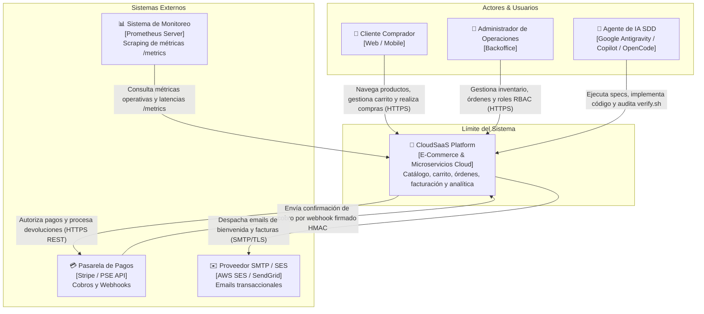
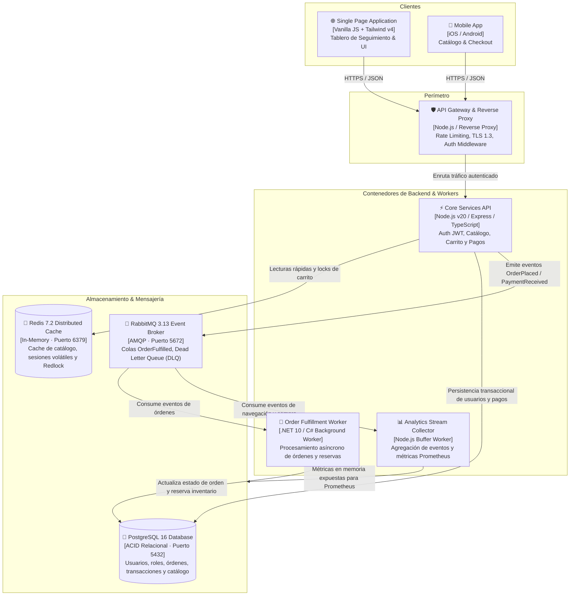
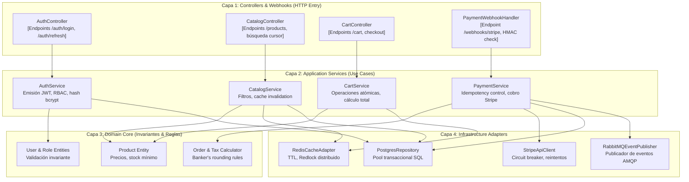

# Modelo C4 de Arquitectura — CloudSaaS Platform

Este documento define la arquitectura del sistema en tres niveles del modelo C4 (Contexto, Contenedores y Componentes), permitiendo a los desarrolladores y agentes de IA comprender las fronteras, responsabilidades y protocolos de comunicación sin ambigüedad.

---

## Nivel 1: Diagrama de Contexto del Sistema (System Context - C1)

Muestra cómo el sistema `CloudSaaS Platform` interactúa con los usuarios y los sistemas externos.

---

## Nivel 2: Diagrama de Contenedores (Container Diagram - C2)

Muestra las aplicaciones ejecutables, APIs, almacenes de datos y brokers de mensajería que componen la solución.

---

## Nivel 3: Diagrama de Componentes del Core API (Component Diagram - C3)

Detalla la arquitectura limpia (Clean Architecture) dentro del contenedor principal `Core Services API`.

