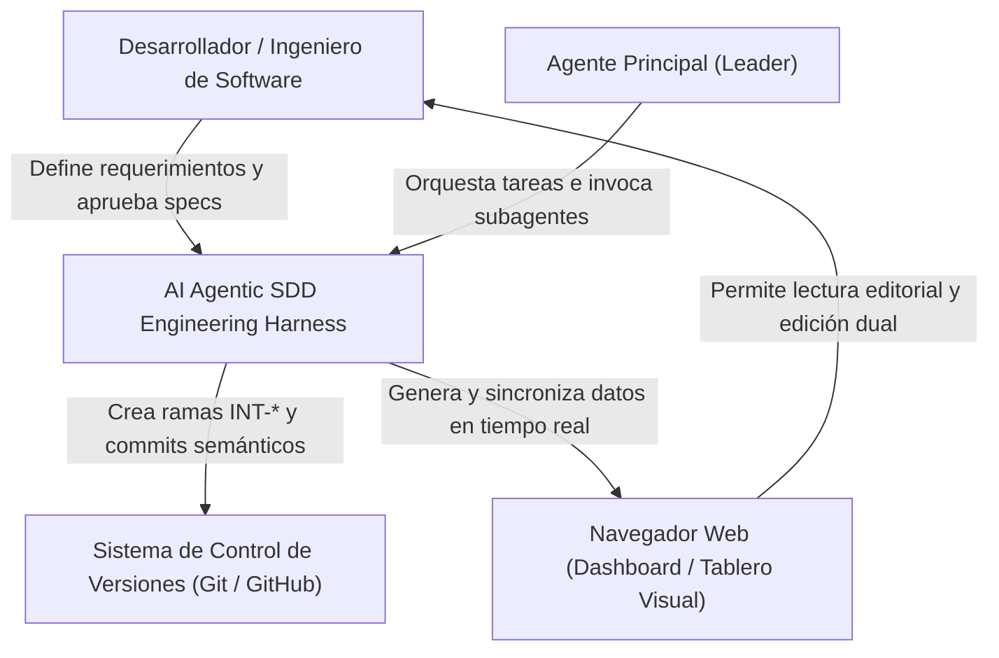
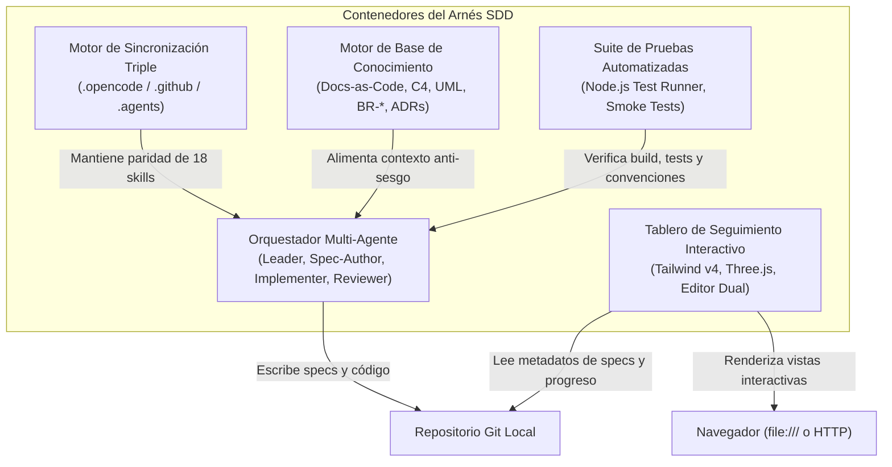
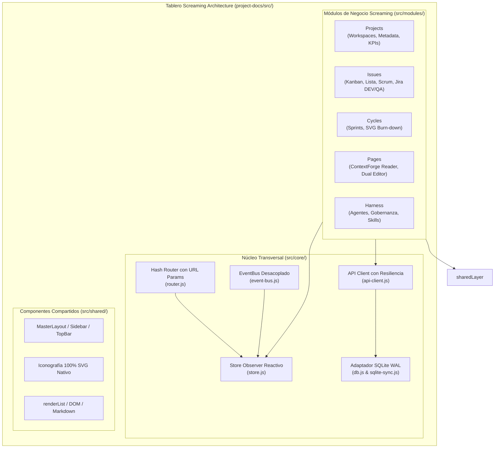
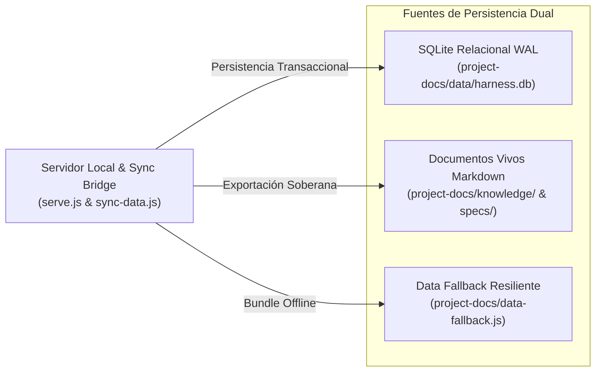

# Modelo C4 — AI Agentic SDD Engineering Harness

> [!NOTE]
> Arquitectura de Sistema, Contenedores y Componentes del Arnés de Ingeniería Dirigida por Especificaciones (SDD).

---

## Nivel 1: Diagrama de Contexto del Sistema (C1)

Muestra los límites del arnés, los actores principales y los sistemas externos con los que interactúa:

---

## Nivel 2: Diagrama de Contenedores (C2)

Descompone el arnés en sus subsistemas y aplicaciones principales:

---

## Nivel 3: Diagrama de Componentes del Tablero Web (C3)

Desglose interno de la aplicación web en `project-docs/` bajo Screaming Architecture modular:

---

## Nivel 4: Persistencia Dual Determinista (C4 / Data Storage)

