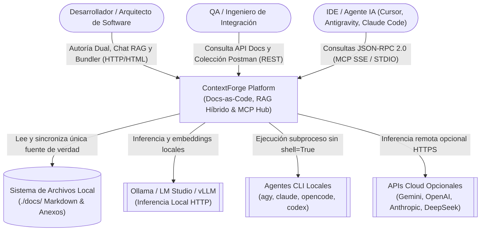
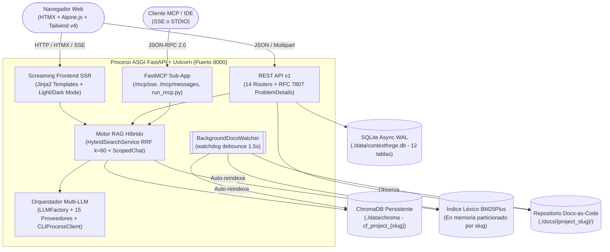
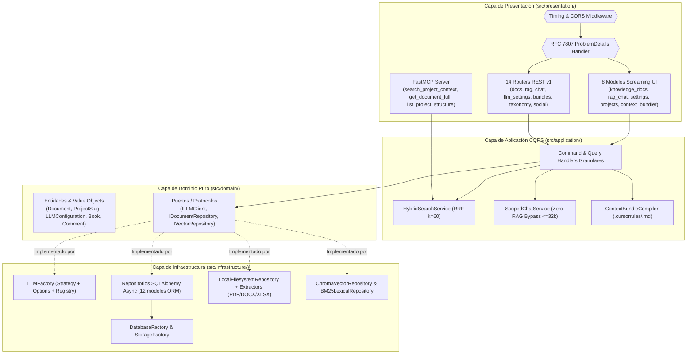
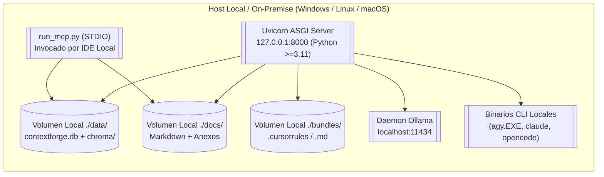

# Atlas de Arquitectura C4 — ContextForge (IntegrationLibrary)

> [!NOTE]
> Modelado arquitectónico multinivel (C1 a C4) conforme a Simon Brown (C4 Model) e IEEE 830 Sección 2.1, reflejando con fidelidad el código fuente en `src/`.

---

## Nivel 1: Diagrama de Contexto de Sistema (C1)

Muestra los límites de **ContextForge**, los actores humanos y agentes de IA, y los sistemas externos con los que interactúa:

---

## Nivel 2: Diagrama de Contenedores (C2)

Descompone **ContextForge** en sus contenedores de ejecución, motores de persistencia y protocolos reales:

---

## Nivel 3: Diagrama de Componentes Internos (C3)

Desglose de las 4 capas de **Clean Architecture** dentro de `src/`:

---

## Nivel 4: Topología de Despliegue e Infraestructura (C4)

