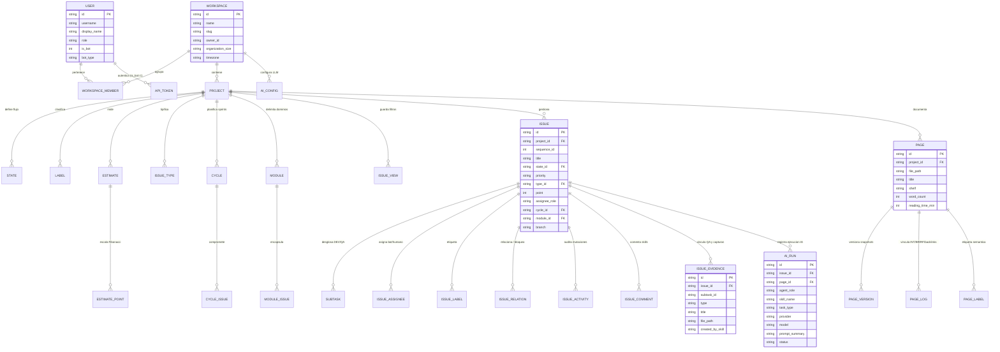

# Diccionario de Datos & Persistencia Dual (Plane SQLite + Docs-as-Code)

> [!NOTE]
> Especificación formal del modelo relacional completo de Plane (28 tablas en `project-docs/data/harness.db` con modo WAL), su integración con Inteligencia Artificial (`ai_configs`, `ai_runs`, `users.is_bot`, `api_tokens`), su grafo de conocimiento (`page_logs`, `page_labels`, `page_versions`) y su espejo bidireccional con documentos Markdown (`.md`) y JSON.

---

## 1. Diagrama Entidad-Relación (ERD) del Arnés & Plane AI

---

## 2. Catálogo de las 29 Tablas Relacionales SQLite (`project-docs/data/harness.db`)

### 2.1 Núcleo Organizacional y Agentes IA (`users`, `api_tokens`, `ai_configs`, `ai_runs`)
1. `workspaces`: Espacio de trabajo soberano (`ws-harness`).
2. `users`: Usuarios humanos e identidades de subagentes IA (`is_bot = 1`, `bot_type` para `leader`, `spec-author`, `implementer`, `reviewer`).
3. `workspace_members`: Membresía y permisos RBAC por espacio de trabajo.
4. `api_tokens`: Tokens de servicio (`user_type = 1` para bots) empleados por skills y agentes.
5. `ai_configs`: Configuración del motor IA (`LLM_PROVIDER`, `LLM_MODEL`, `DUAL_PERSISTENCE_ENGINE`).
6. `ai_runs`: Registro inmutable de cada invocación de skill o subagente IA, sincronizado automáticamente con `project-docs/knowledge/ai-runs-log.md`.

### 2.2 Gestión de Proyectos, Tareas y Trazabilidad (`projects`, `issues`, `evidences`)
7. `projects`: Configuración del proyecto (`proj-harness`, identificador `INT`, flags de vistas).
8. `states`: Máquina de estados Kanban (`Backlog`, `Todo`, `In Progress`, `In Review`, `Done`, `Cancelled`).
9. `labels`: Etiquetas semánticas (`feature`, `bugfix`, `sdd-spec`, `tdd-verified`, `qa-evidence`, `screaming-arch`, `ai-agent`).
10. `estimates` y 11. `estimate_points`: Escala Fibonacci (`1, 2, 3, 5, 8, 13` puntos) para estimación ágil.
12. `issue_types`: Tipos de elemento de trabajo (`Feature`, `Bugfix`, `Epic`).
13. `cycles`: Sprints de iteración con estados canónicos (`draft`, `upcoming`, `current`, `completed`), fechas de inicio/fin y progreso.
14. `modules`: Bounded contexts de arquitectura (`Agent Orchestrator`, `Dashboard Visualizer`, `Testing QA Suite`, `Knowledge Engine`, `Harness Core`).
15. `issues`: Unidades de trabajo con historia de usuario Scrum (`as_a`, `i_want`, `so_that`), criterios EARS, puntos Fibonacci y rama Git.
16. `subtasks`: Subtareas técnicas Jira (`DEV` y `QA`).
17. `issue_assignees`: Asignación relacional entre tareas y agentes bot/humanos.
18. `issue_labels`: Tabla puente muchos-a-muchos entre `issues` y `labels`.
19. `issue_relations`: Grafo de dependencias entre tareas (`blocked_by`, `blocks`, `relates_to`).
20. `issue_activities`: Bitácora de auditoría (`IssueActivity`) de cada cambio de estado, evidencia o ejecución de skill.
21. `issue_comments`: Comentarios técnicos en Markdown emitidos por agentes o skills.
22. `issue_evidences`: Artefactos de evidencia QA, reportes de verificación, planes API y capturas Playwright E2E vinculados a cada tarea.
23. `cycle_issues` y 24. `module_issues`: Tablas puente de asociación con sprints y módulos.
25. `issue_views`: Vistas personalizadas con filtros y agrupaciones guardadas.

### 2.3 Gestión Documental Viva y Grafo de Conocimiento (`collections`, `pages`, `page_versions`, `page_logs`, `page_labels`)
26. `collections`: Espacios de conocimiento dinámicos de Plane Wiki (`id`, `project_id`, `workspace_id`, `name`, `description`, `icon`, `color`, `is_private`, `sort_order`, `archived_at`).
27. `pages`: Documentos Markdown de `project-docs/knowledge/` y `project-docs/specs/` con claves foráneas `FOREIGN KEY (collection_id) REFERENCES collections(id) ON DELETE RESTRICT` y `FOREIGN KEY (parent_id) REFERENCES pages(id) ON DELETE SET NULL`, jerarquía (`parent_id`, `depth <= 4`), slugs únicos (`idx_pages_collection_slug`), autoría (`owner_name`, `owned_by_id`), telemetría (`word_count`, `char_count`, `paragraph_count`, `diagrams_count`, `reading_time_min`) y banderas de acceso/bloqueo (`access = 0` Public / `1` Private, `is_locked = 1`, `is_favorite = 1`, `view_props`).
28. `page_versions`: Snapshots históricos de versiones (`id`, `page_id`, `version_number`, `content_markdown`, `description_html`, `description_stripped`, `owned_by_role`, `word_count`, `last_saved_at`, `created_at`) con `FOREIGN KEY (page_id) REFERENCES pages(id) ON DELETE CASCADE` y restauración en un clic (`restorePageVersionInSQLite`).
29. `page_logs` y `page_labels`: Grafo relacional de menciones cruzadas (`INT-XXX`, `BR-XXX`, `RF-XXX`, `ADR-XXX`, `CAP-XXX`, `forward_link`, `back_link`), auditoría estricta de bloqueo y desbloqueo normativo (`action = 'unlocked' | 'locked'`, `log_message`, `entity_identifier` con actor) y etiquetas semánticas (`page_labels`).

---

## 3. Catálogo de Esquemas JSON / YAML & Sincronización Dual

### 3.1 `project-docs/project-spec.yaml` (Especificación Técnica del Proyecto)
- `project.name`: Nombre canónico del sistema.
- `project.type`: Tipo de arquitectura (`universal-agentic-harness`, `web-api`, `microservices`).
- `runtime.language`: Lenguaje de programación principal.
- `checks.build`, `checks.test`, `checks.verify`: Comandos de verificación ejecutables.

### 3.2 `project-docs/feature_list.json` (Espejo JSON de Tareas)
- Sincronizado bidireccionalmente con las tablas `issues`, `subtasks`, `issue_relations` e `issue_evidences` mediante `project-docs/src/core/sqlite-sync.js`.

### 3.3 `project-docs/knowledge/ai-runs-log.md` (Espejo Markdown de IA)
- Generado y actualizado automáticamente por `recordSkillExecution()` cada vez que una skill SDD ejecuta `node project-docs/cli.js ai log`.

