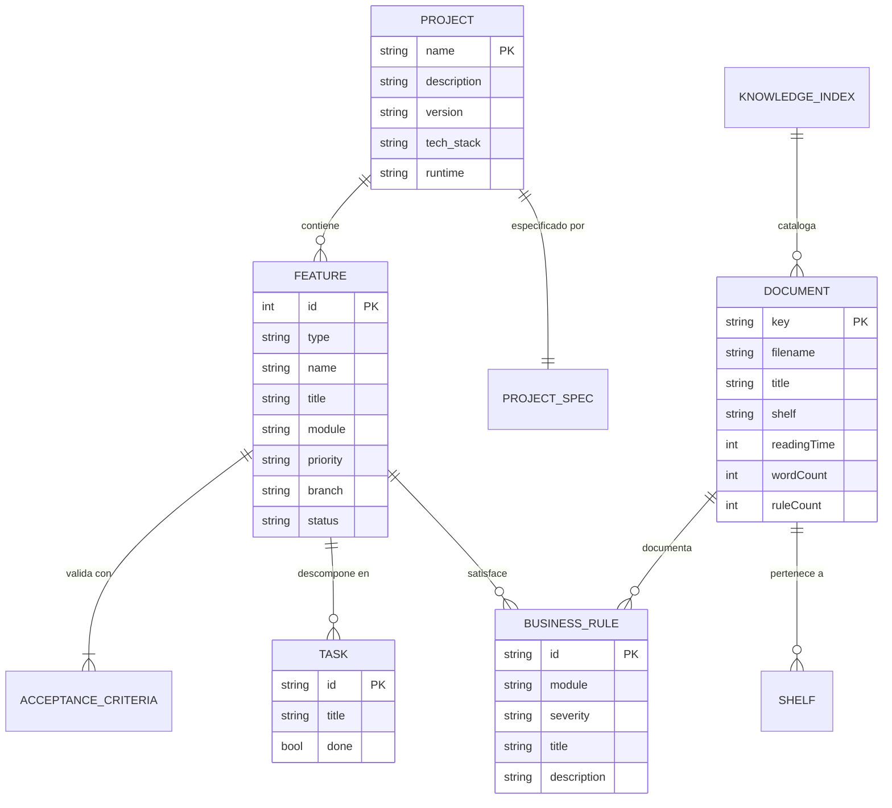

# Diccionario de Datos & Persistencia Docs-as-Code

> [!NOTE]
> Especificación formal de los esquemas de persistencia JSON y YAML del arnés de ingeniería SDD.

---

## 1. Diagrama Entidad-Relación (ERD) del Arnés

---

## 2. Catálogo de Esquemas JSON / YAML

### 2.1 `project-spec.yaml` (Especificación Técnica del Proyecto)
- `project.name`: Nombre canónico del sistema.
- `project.type`: Tipo de arquitectura (`universal-agentic-harness`, `web-api`, `microservices`).
- `runtime.language`: Lenguaje de programación principal.
- `modules[]`: Colección de módulos con `id`, `name`, `tech`, `features`.
- `checks.build`: Comando de compilación (`npm run build`, `dotnet build`, etc.).
- `checks.test`: Comando de pruebas (`npm test`, `pytest`, `dotnet test`).
- `checks.verify`: Comando de verificación integral (`node project-docs/sync-data.js`).

### 2.2 `feature_list.json` (Backlog Canónico de Tareas)
- `features[].id`: Número secuencial único (`INT-001`).
- `features[].type`: `feature` o `bugfix`.
- `features[].name`: Identificador en `snake_case` descriptivo.
- `features[].branch`: Rama Git `{type}/INT-{id}/{name}` ($\le 80$ caracteres).
- `features[].status`: `pending` | `spec_ready` | `in_progress` | `done` | `blocked`.
- `features[].acceptance`: Lista de criterios de aceptación verificables.

### 2.3 `knowledge-index.json` (Índice de la Base de Conocimiento)
- `docs{}`: Mapa de clave de archivo a contenido Markdown completo.
- `docMetadata{}`: Metadatos calculados (`readingTime`, `wordCount`, `ruleCount`, `reqCount`, `adrCount`, `shelf`).
- `shelves{}`: Clasificación en 6 estantes temáticos (`architecture`, `business_rules`, `requirements`, `adrs`, `standards`, `modules`).
- `business_rules[]`: Catálogo estructurado de invariantes con `id`, `module`, `severity`, `title`, `description`.
- `coding_standards`: Guardrails anti-sesgo y directrices de nombrado.
