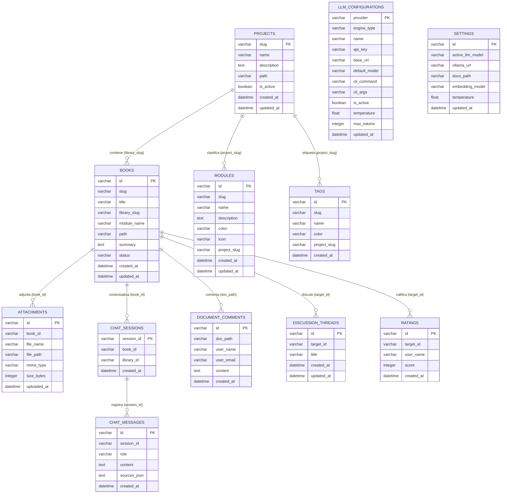

# Diccionario de Datos Relacional, Almacén Vectorial y ERD

> [!NOTE]
> Esquema relacional verificado directamente contra los **12 modelos ORM SQLAlchemy Async** en `src/infrastructure/database/orm_models.py` y `src/infrastructure/persistence/models/*.py`, más la persistencia vectorial en ChromaDB (`./data/chroma/`).

---

## 1. Diagrama Entidad-Relación (ERD Crow's Foot)

---

## 2. Catálogo de Tablas Relacionales (`./data/contextforge.db`)

| Tabla | Clave Primaria | Columnas Principales | Propósito Funcional |
|---|---|---|---|
| `projects` | `slug` (`VARCHAR(50)`) | `name`, `description`, `path`, `is_active`, `created_at`, `updated_at` | Registro de librerías/proyectos aislados. Seed automático: `default`. |
| `books` | `id` (`VARCHAR(64)`) | `slug`, `title`, `library_slug`, `module_name`, `path`, `summary`, `status` | Metadatos de catálogo y estado editorial de documentos Markdown. |
| `attachments` | `id` (`VARCHAR(36)`) | `book_id`, `file_name`, `file_path`, `mime_type`, `size_bytes`, `uploaded_at` | Inventario de anexos (PDF, DOCX, XLSX, imágenes, audio `.ogg`/`.mp3`). |
| `chat_sessions` | `session_id` (`VARCHAR(64)`) | `book_id`, `library_id`, `created_at` | Sesiones persistentes de chat focalizado por documento. |
| `chat_messages` | `id` (`VARCHAR(64)`) | `session_id`, `role`, `content`, `sources_json`, `created_at` | Turnos conversacionales y citas JSON serializadas. |
| `llm_configurations` | `provider` (`VARCHAR(50)`) | `engine_type`, `name`, `api_key`, `base_url`, `default_model`, `cli_command`, `cli_args`, `is_active`, `temperature`, `max_tokens` | Configuración de los 15 proveedores LLM (auto-migración DDL en `connection.py`). |
| `settings` | `id` (`VARCHAR(50)`) | `active_llm_model`, `ollama_url`, `docs_path`, `embedding_model`, `temperature` | Preferencias globales del sistema (`id = "default"`). |
| `modules` | `id` (`VARCHAR(64)`) | `slug`, `name`, `description`, `color`, `icon`, `project_slug` | Taxonomía dinámica de módulos por proyecto. |
| `tags` | `id` (`VARCHAR(64)`) | `slug`, `name`, `color`, `project_slug` | Etiquetas semánticas por proyecto. |
| `document_comments` | `id` (`VARCHAR(36)`) | `doc_path`, `user_name`, `user_email`, `content`, `created_at` | Comentarios colaborativos sobre documentos. |
| `discussion_threads` | `id` (`VARCHAR(36)`) | `target_id`, `title`, `created_at`, `updated_at` | Hilos de discusión estructurados por recurso. |
| `ratings` | `id` (`VARCHAR(36)`) | `target_id`, `user_name`, `score`, `created_at` | Calificaciones de utilidad de documentación. |

---

## 3. Almacén Vectorial (`ChromaDB`) y Configuración de Infraestructura

- **ChromaDB (`./data/chroma/`)**: Particionado estrictamente por proyecto en colecciones nombradas `cf_project_{slug}`. Cada documento indexado almacena metadatos `file_path`, `project_slug`, `header`, `header_level` (`h1`–`h6`), `attachment_name` y `location` (ej. `Pág. 4`).
- **BM25Plus (En Memoria)**: Índice léxico particionado por `project_slug`, reconstruido al iniciar `lifespan` en `src/main.py` y actualizado incrementalmente por `BackgroundDocsWatcher`.
- **Infraestructura Hexagonal (`./data/infrastructure_configs.json`)**: Persiste las configuraciones activas de `DatabaseFactory` (SQLite, PostgreSQL, Supabase, SQL Server, MongoDB, Firebase) y `StorageFactory` (Local FS, Supabase Storage, S3, Firebase Storage).
