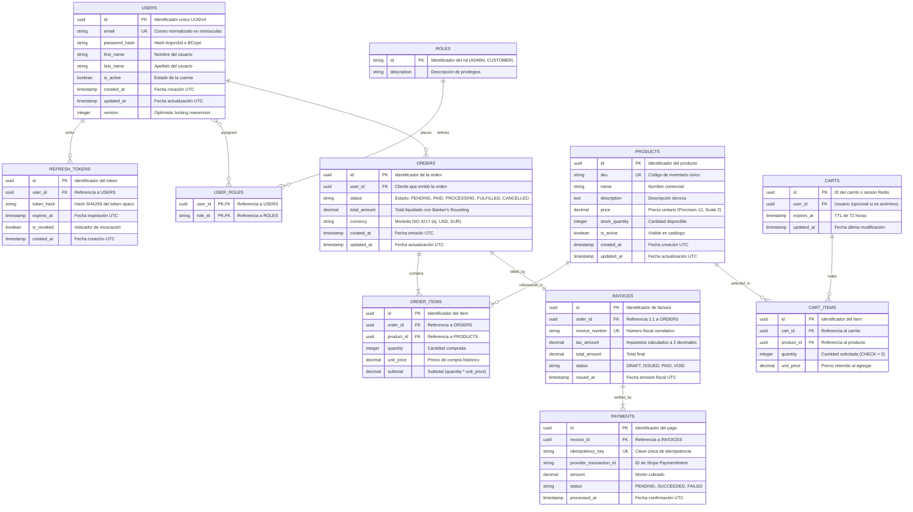

# Diccionario de Datos & Modelo de Persistencia (ERD)

> [!NOTE]
> Este documento define el modelo relacional, las restricciones de integridad y las políticas de persistencia en PostgreSQL 16 y Redis 7.2. Proporciona a los desarrolladores y agentes de IA un conocimiento exacto de las tablas, columnas, tipos nativos y llaves foráneas para evitar alucinaciones en consultas SQL o migraciones.

---

## 1. Diagrama Entidad-Relación (ERD)

---

## 2. Catálogo Detallado de Tablas & Restricciones

### 2.1 Tabla: `users`
- **Propósito**: Gestión de identidades, credenciales seguras y estado de acceso.
- **Llave Primaria**: `id` (`UUID`, generado por defecto con `gen_random_uuid()`).
- **Restricciones de Integridad**:
  - `UNIQUE (email)`: Índice único normalizado.
  - `CHECK (email ~* '^[A-Za-z0-9._%+-]+@[A-Za-z0-9.-]+\.[A-Za-z]{2,}$')`: Validación de sintaxis RFC 5322.
- **Concurrencia**: Columna `version INTEGER NOT NULL DEFAULT 1` utilizada para **Optimistic Concurrency Control (OCC)**.
- **Borrado**: **Soft Delete** mediante `deleted_at TIMESTAMP WITH TIME ZONE NULL`. Los índices únicos de email incluyen cláusula parcial `WHERE deleted_at IS NULL`.

---

### 2.2 Tabla: `products`
- **Propósito**: Catálogo maestro de productos y existencias disponibles para venta.
- **Llave Primaria**: `id` (`UUID`).
- **Restricciones de Integridad**:
  - `UNIQUE (sku)`: SKU comercial único.
  - `CHECK (price >= 0.00)`: Prohibidos precios negativos.
  - `CHECK (stock_quantity >= 0)`: Prohibidas existencias negativas a nivel de base de datos.
- **Índices de Búsqueda**:
  - Índice B-Tree compuesto: `(created_at DESC, id DESC)` para paginación estable por cursor.
  - Índice GIN en `to_tsvector('spanish', name || ' ' || description)` para búsqueda full-text.

---

### 2.3 Tablas de Checkout & Facturación: `invoices`, `payments`
- **Propósito**: Liquidación financiera, emisión de comprobantes y registro de cobros con pasarelas externas (Stripe).
- **Restricciones Críticas de Negocio**:
  - `payments.idempotency_key` con restricción `UNIQUE` para evitar cobros dobles en caso de reintentos concurrentes de red.
  - Precios e impuestos almacenados como `NUMERIC(12, 2)` exacto, prohibiendo el uso de tipos de coma flotante (`FLOAT` o `REAL`) que provoquen errores de redondeo.

---

### 2.4 Almacén en Memoria: Redis 7.2
- **Esquema de Claves**:
  - `cart:{cart_id}`: Hash de Redis que contiene los ítems del carrito con TTL de 72 horas.
  - `idempotency:{key}`: String JSON con TTL de 120s en estado `IN_PROGRESS` y 24h tras éxito (`COMPLETED`).
  - `catalog:page:{hash}`: String JSON con la página cacheada del catálogo con TTL de 300 segundos.
  - `stock:lock:{product_id}`: Cerrojo distribuido Redlock para operaciones concurrentes de inventario con TTL de 5 segundos.

---

## 3. Campos de Auditoría Estándar (Invariantes Globales)

Toda tabla transaccional del sistema incluye obligatoriamente los siguientes campos:

| Campo | Tipo SQL | Descripción |
| :--- | :--- | :--- |
| `created_at` | `TIMESTAMP WITH TIME ZONE NOT NULL DEFAULT clock_timestamp()` | Marca temporal inmutable de creación en UTC. |
| `updated_at` | `TIMESTAMP WITH TIME ZONE NOT NULL DEFAULT clock_timestamp()` | Marca temporal de última modificación actualizada por trigger. |
| `tenant_id` | `UUID NULL` | Identificador de partición multi-inquilino (*multi-tenancy*). |
