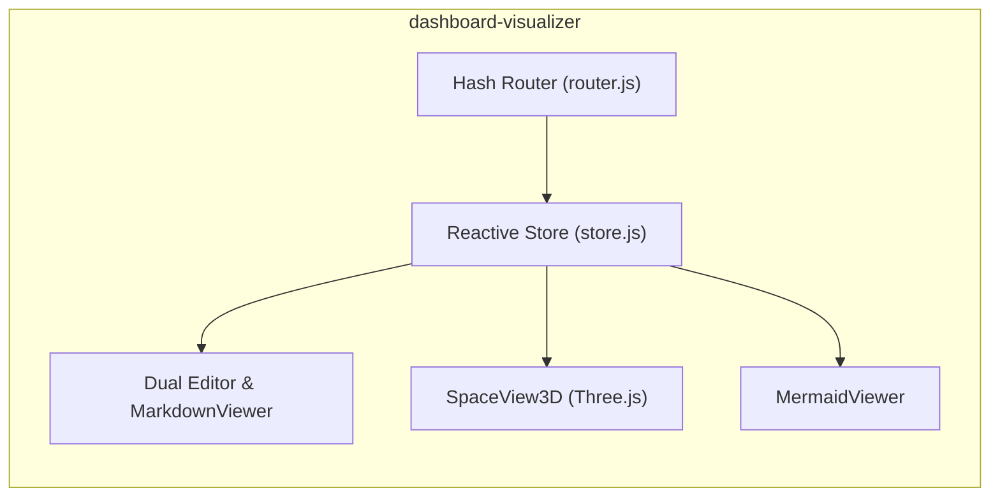
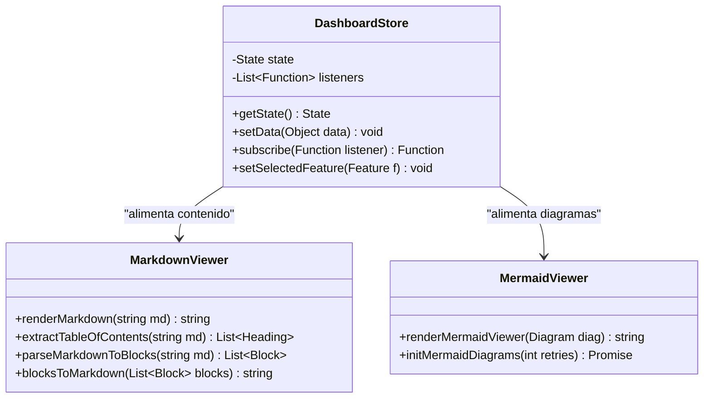
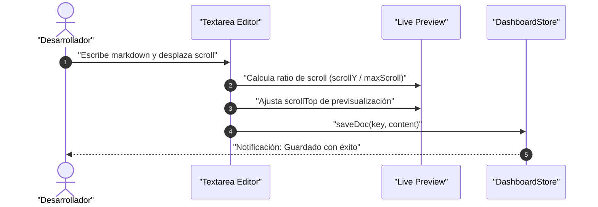
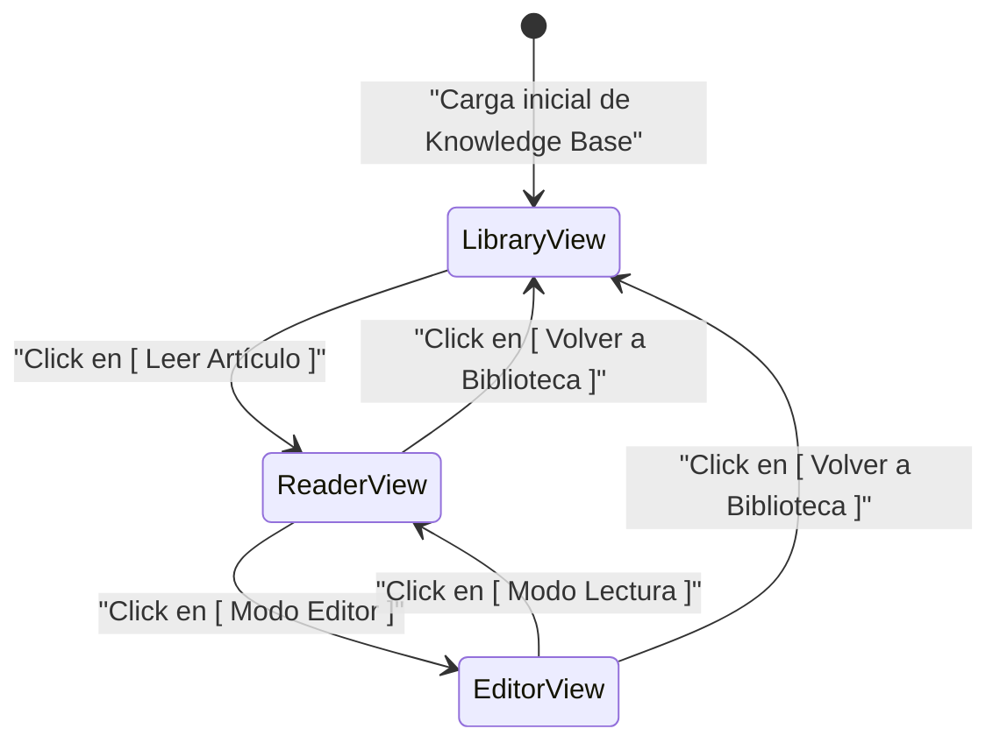
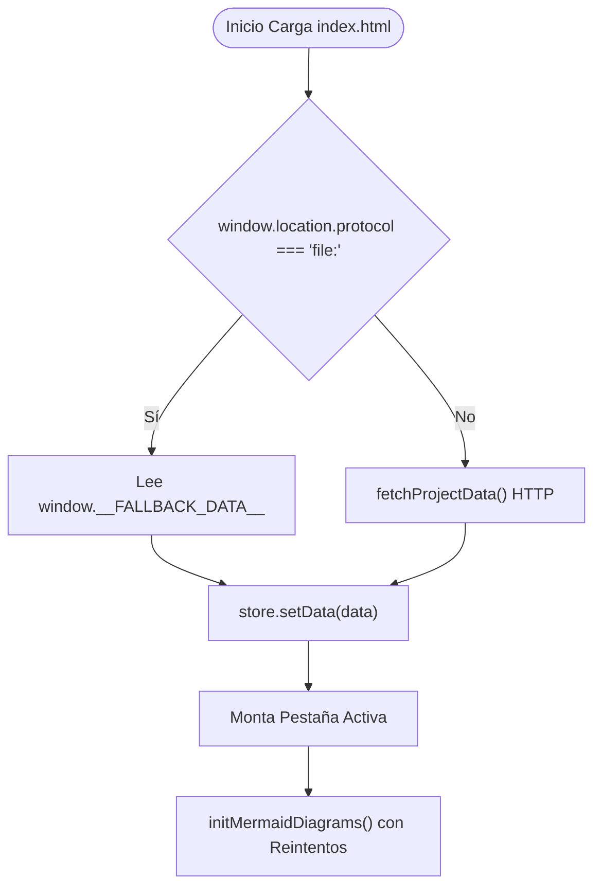
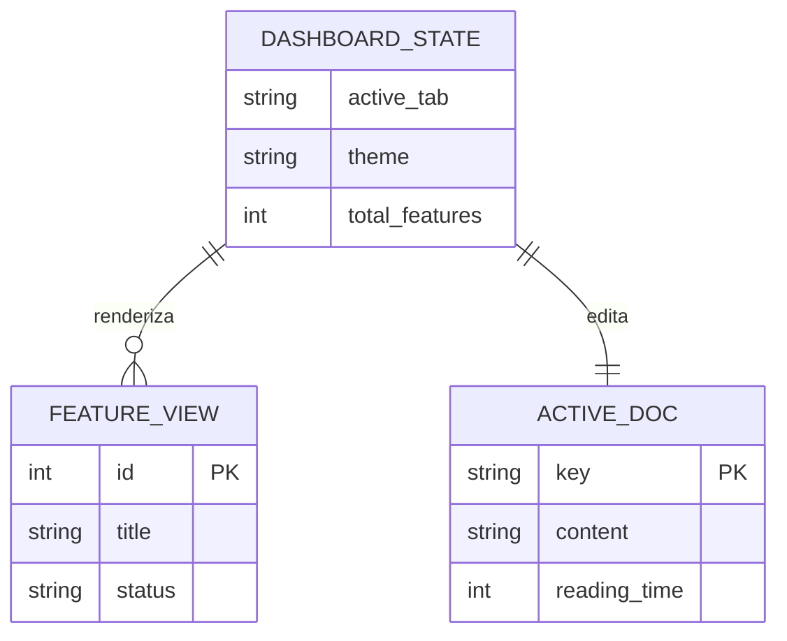

# Módulo: dashboard-visualizer — Suite de 6 Diagramas

---

## 1. Diagrama de Componentes C3 del Módulo

---

## 2. Diagrama de Clases UML del Módulo

---

## 3. Diagrama de Secuencia: Editor Dual con Scroll Sincronizado

---

## 4. Diagrama de Máquina de Estados del Visor

---

## 5. Diagrama de Actividades de Inicialización

---

## 6. Sub-Diagrama Entidad-Relación (ERD)

