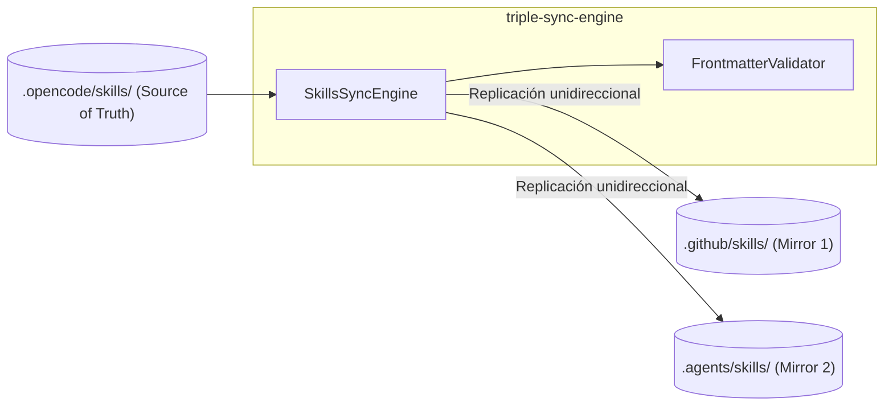
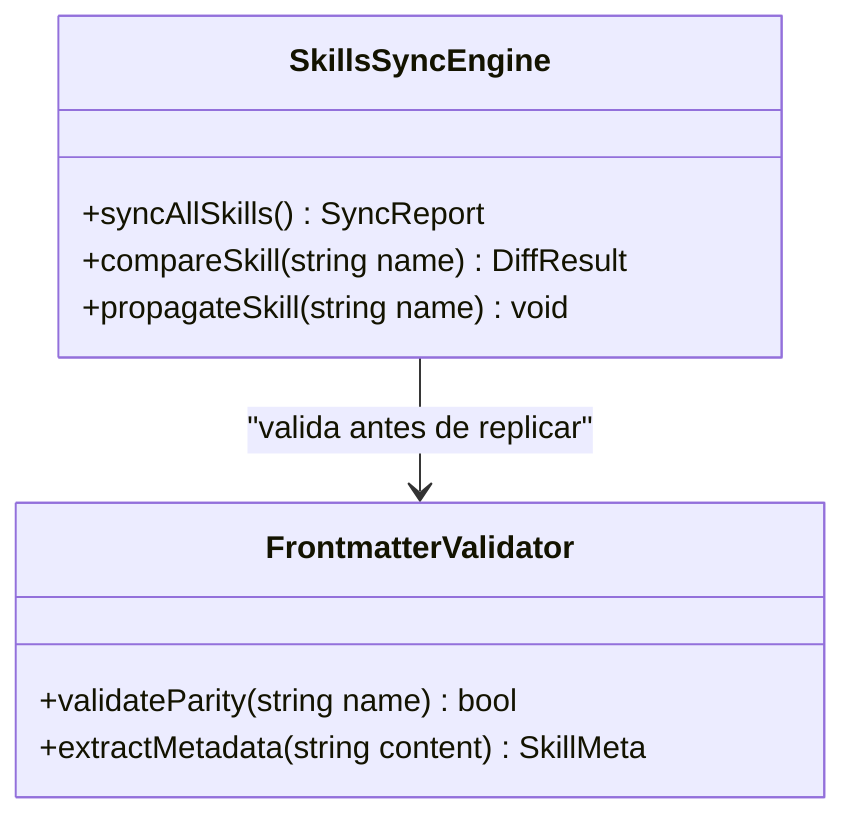
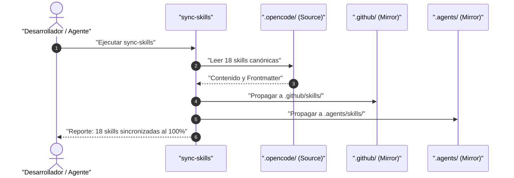
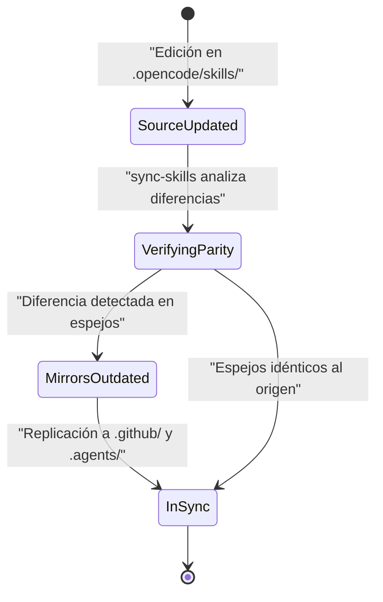
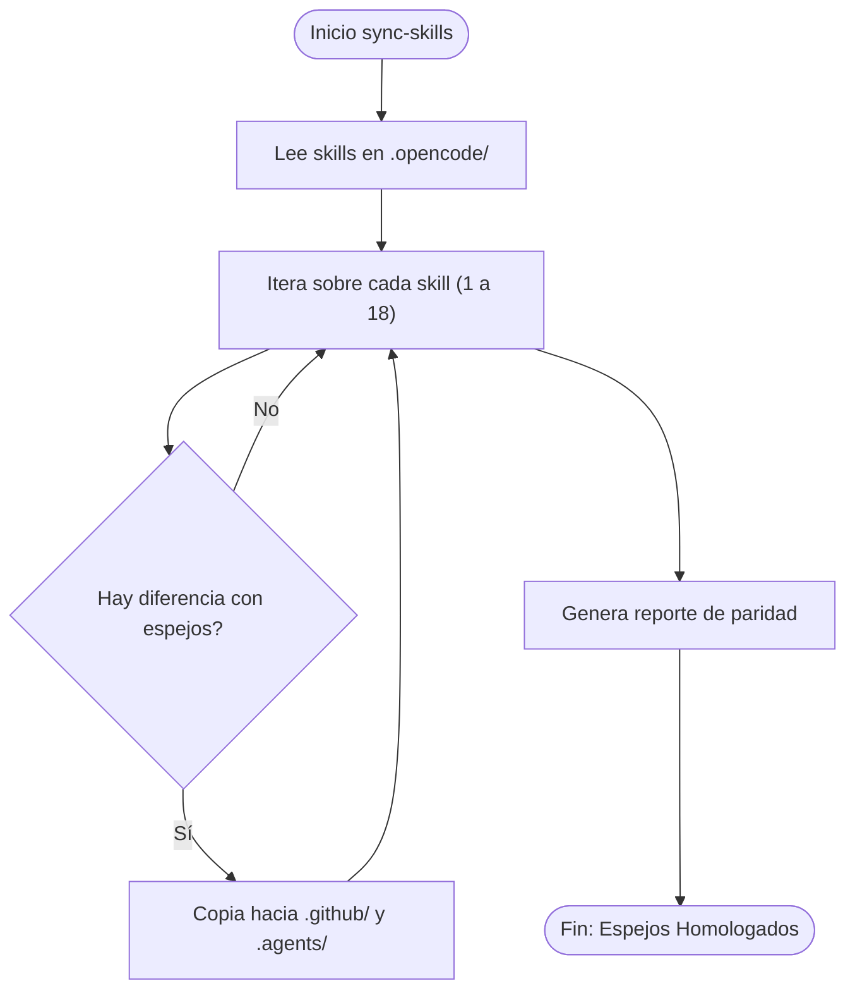
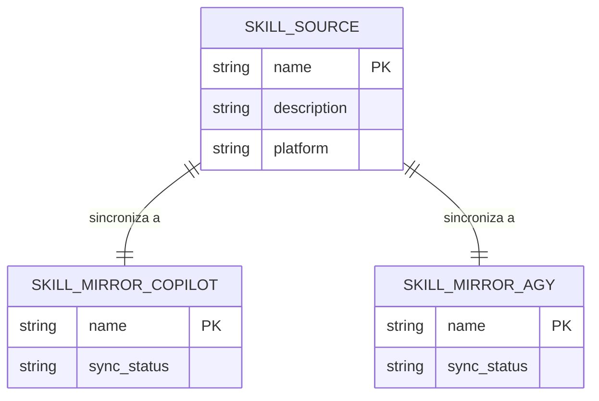

# Módulo: triple-sync-engine — Suite de 6 Diagramas

---

## 1. Diagrama de Componentes C3 del Módulo

---

## 2. Diagrama de Clases UML del Módulo

---

## 3. Diagrama de Secuencia de Sincronización Triple

---

## 4. Diagrama de Máquina de Estados de una Skill

---

## 5. Diagrama de Actividades de Sincronización

---

## 6. Sub-Diagrama Entidad-Relación (ERD)

