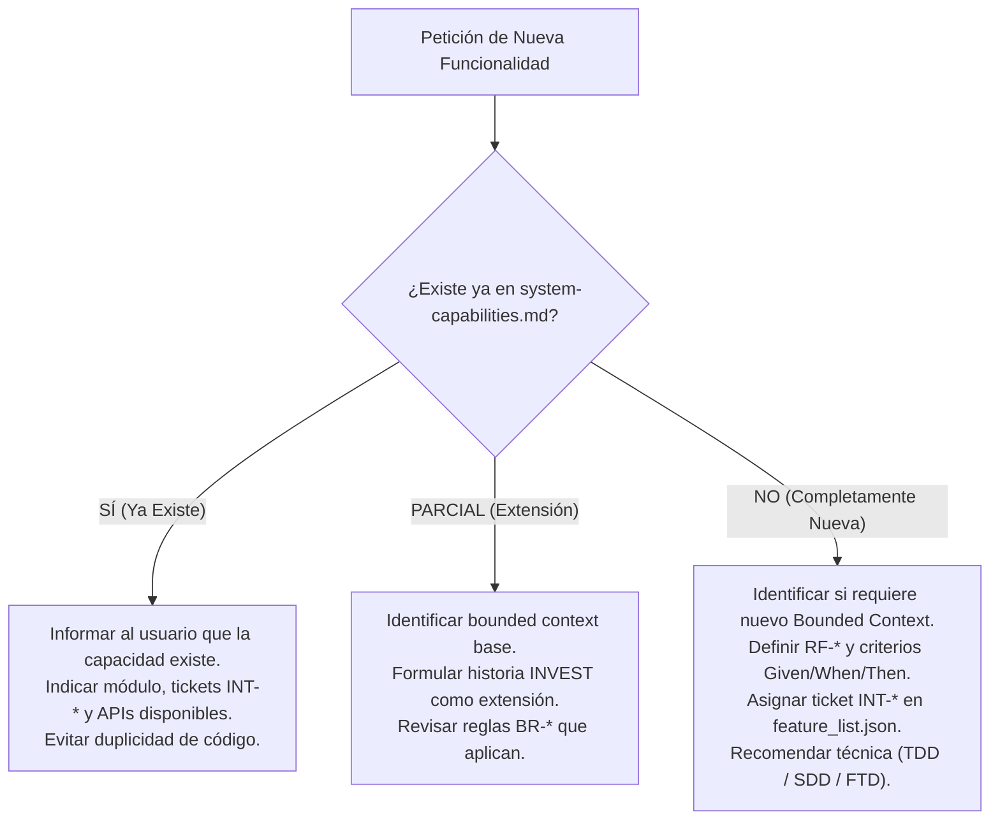

# Inventario de Capacidades del Sistema & Matriz de Onboarding (Zero-Code Re-read)

> [!IMPORTANT]
> Este inventario documenta exhaustivamente **lo que el sistema YA hace** y los módulos involucrados.
> Su propósito es **acelerar el onboarding** de nuevos desarrolladores y permitir que agentes de IA determinen al instante si una funcionalidad ya existe, sin tener que releer recursivamente todos los archivos de código fuente del repositorio.

---

## 1. Matriz Rápida de Capacidades por Bounded Context

| Bounded Context | Capacidades Existentes | Entidades Clave | Eventos Publicados | Tickets Asociados |
| :--- | :--- | :--- | :--- | :--- |
| **`auth`** | Login, Emisión JWT (UTC), Refresh Token, RBAC, Rate Limiting de IPs | `User`, `Role`, `RefreshToken` | `UserLoggedIn`, `TokenRefreshed` | `INT-002`, `INT-003` |
| **`catalog`** | Búsqueda por texto, Filtros por categoría, Paginación por cursor, Cache en Redis (TTL 300s) | `Product`, `Category`, `Price` | `ProductUpdated` | `INT-004` |
| **`cart`** | Gestión atómica de carrito con Lua en Redis, Retención temporal de stock, Expiración en 72h | `Cart`, `CartItem` | `CartAbandoned` | `INT-005` |
| **`billing`** | Checkout transaccional con Stripe, Idempotencia por cabecera (Redis 24h), Redondeo contable Banker's | `Invoice`, `PaymentIntent`, `Charge` | `PaymentSucceeded`, `PaymentFailed` | `INT-006`, `INT-007` |
| **`orders`** | Consumo asíncrono AMQP, Actualización transaccional de inventario, Reintentos con backoff, Dead Letter Queue | `Order`, `OrderItem`, `Shipment` | `OrderProcessing`, `OrderFulfilled` | `INT-008` |
| **`analytics`** | Métricas Prometheus `/metrics`, Detección de anomalías en checkout, Tracking de eventos | `Metric`, `EventLog` | N/A (Consumidor) | `INT-009` |
| **`notifications`** | Envío de correos transaccionales (confirmación de pago, bienvenida), Plantillas HTML seguras, Retries SMTP | `NotificationTemplate`, `DeliveryLog` | `NotificationSent` | `INT-010` |

---

## 2. Flujo de Decisión para Nuevas Historias de Usuario

Cuando el usuario pida: *"Quiero agregar [funcionalidad X]"* o *"Genera historias para [caso de uso]"*, la IA o el desarrollador deben seguir este flujo:



---

## 3. Guía de Impacto Arquitectural para Modificaciones

Si una nueva funcionalidad o cambio de requerimiento ingresa al sistema:

1. **Si impacta dinero, impuestos o pagos**:
   - Módulo afectado: `billing`
   - Reglas obligatorias: `BR-BILL-001` (Idempotencia), `BR-BILL-002` (HMAC Stripe), `BR-BILL-003` (Banker's Rounding).
   - Técnica obligatoria: **TDD** con pruebas de caja blanca en redondeo y concurrencia.
2. **Si impacta autenticación o permisos**:
   - Módulo afectado: `auth`
   - Reglas obligatorias: `BR-AUTH-001` (Epoch UTC estricto).
   - Técnica obligatoria: **TDD** con cobertura en expiración de tokens.
3. **Si impacta concurrencia de inventario**:
   - Módulo afectado: `cart`
   - Reglas obligatorias: `BR-CART-002` (Operaciones atómicas Redis / Lua).
4. **Si impacta colas o workers asíncronos**:
   - Módulo afectado: `orders`
   - Reglas obligatorias: `BR-ORDR-001` (Desvío a DLQ tras 3 fallos).

---

## 4. Protocolo de Mantenimiento Incremental (Soberanía Docs-as-Code)

> [!TIP]
> **Invariante de Actualización Incremental**:  
> Si una regla de negocio o requerimiento cambia en el futuro (ej. "el tiempo de expiración del carrito cambia de 72h a 24h" o "se agrega un nuevo método de pago"):  
> **NO re-analices todo el proyecto ni modifiques todos los archivos.**  
> Únicamente edita el archivo correspondiente:
> - Regla de negocio $\to$ `project-docs/knowledge/business-rules.md` (o `modules/{modulo}/rules.md`).
> - Requerimiento funcional $\to$ `project-docs/knowledge/functional-requirements.md`.
> - Historia de usuario $\to$ `project-docs/knowledge/user-stories-catalog.md`.
> 
> Una vez editado, ejecuta:
> ```bash
> node project-docs/sync-data.js
> ```
> De este modo, tanto el tablero visual como las IAs y subagentes consumirán la regla actualizada de forma inmediata.
