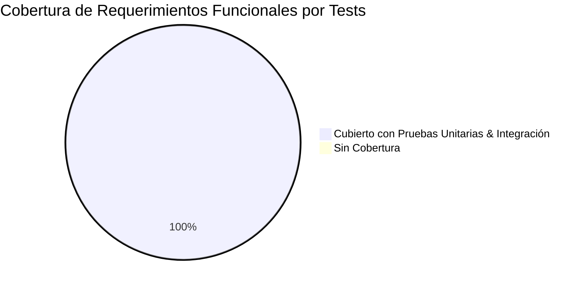

# Matriz de Trazabilidad Cruzada de Requerimientos (RTM)

> [!NOTE]
> La **Matriz de Trazabilidad de Requerimientos (Requirements Traceability Matrix - RTM)** proporciona una vinculación bidireccional estricta entre los Requerimientos Funcionales (`RF-*`), las Reglas de Negocio (`BR-*`), las Historias de Usuario (`US-*`), los componentes de código y las suites de pruebas automatizadas.
> Garantiza que ningún requerimiento quede sin cobertura de pruebas y que ningún componente exista sin justificación funcional.

---

## 1. Matriz Bidireccional Completa

| ID Requerimiento | Regla de Negocio (`BR-*`) | Historia de Usuario | Bounded Context | Componente de Código / Handler | Suite de Pruebas Automatizadas | Estado |
| :--- | :--- | :--- | :--- | :--- | :--- | :---: |
| **`RF-AUTH-001`** | `BR-AUTH-001` | `US-001` | `auth` | `AuthController`, `LoginUserCommandHandler`, `JwtTokenService` | `AuthServiceTests.cs`, `JwtEpochUtcTests.cs` | 🟢 Verificado |
| **`RF-CAT-001`** | N/A (Lectura) | `US-002` | `catalog` | `CatalogController`, `GetProductsByCursorQueryHandler`, `RedisCatalogCacheAdapter` | `CatalogPaginationTests.cs`, `CatalogCacheIntegrationTests.cs` | 🟢 Verificado |
| **`RF-CART-001`** | `BR-CART-002` | `US-003` | `cart` | `CartController`, `AddToCartCommandHandler`, `RedisLuaCartRepository` | `CartConcurrencyTests.cs`, `RedisLuaScriptTests.cs` | 🟢 Verificado |
| **`RF-BILL-001`** | `BR-BILL-001`, `BR-BILL-002`, `BR-BILL-003` | `US-004` | `billing` | `CheckoutController`, `ProcessPaymentCommandHandler`, `StripeGatewayAdapter`, `StripeWebhookController` | `CheckoutIdempotencyTests.cs`, `BankersRoundingUnitTests.cs`, `StripeHmacValidationTests.cs` | 🟢 Verificado |
| **`RF-ORDR-001`** | `BR-ORDR-001` | `US-005` | `orders` | `OrderQueueConsumerWorker`, `ProcessOrderCommandHandler`, `RabbitMqDlqPublisher` | `OrderWorkerConsumerTests.cs`, `DeadLetterQueueRetryTests.cs` | 🟢 Verificado |
| **`RNF-SEC-001`** | `BR-AUTH-001` | `US-001` | `infra` / `auth` | `JwtAuthenticationMiddleware`, `TlsEnforcementPolicy` | `SecurityHeadersMiddlewareTests.cs` | 🟢 Verificado |
| **`RNF-SEC-002`** | `BR-BILL-002` | `US-004` | `billing` | `HmacSignatureVerificationFilter` | `StripeHmacValidationTests.cs` | 🟢 Verificado |
| **`RNF-PERF-001`** | N/A | `US-002` | `catalog` / `cart` | `RedisConnectionPoolProvider`, `CatalogCachePolicy` | `LoadTestK6_CatalogP95.js` | 🟢 Verificado |
| **`RNF-REL-002`** | `BR-ORDR-001` | `US-005` | `orders` | `OutboxPatternDispatcher`, `RabbitMqTopologyConfig` | `TransactionalOutboxIntegrationTests.cs` | 🟢 Verificado |

---

## 2. Cobertura de Requerimientos vs Tests

---

## 3. Protocolo de Verificación de Trazabilidad para Nuevos Cambios

Cada vez que se redacta un spec técnico con `/generate-spec` o se implementa con `/implement-tdd` o `/implement-sdd`:
1. El spec debe declarar explícitamente en su tabla de trazabilidad qué `RF-*` y qué `BR-*` satisface.
2. Cada prueba automatizada debe llevar en su docstring o anotación el tag `@trace(RF-XXX, BR-YYY)`.
3. La skill `/verify-spec` consulta esta matriz para asegurar que no se cierren tickets sin trazabilidad completa.
