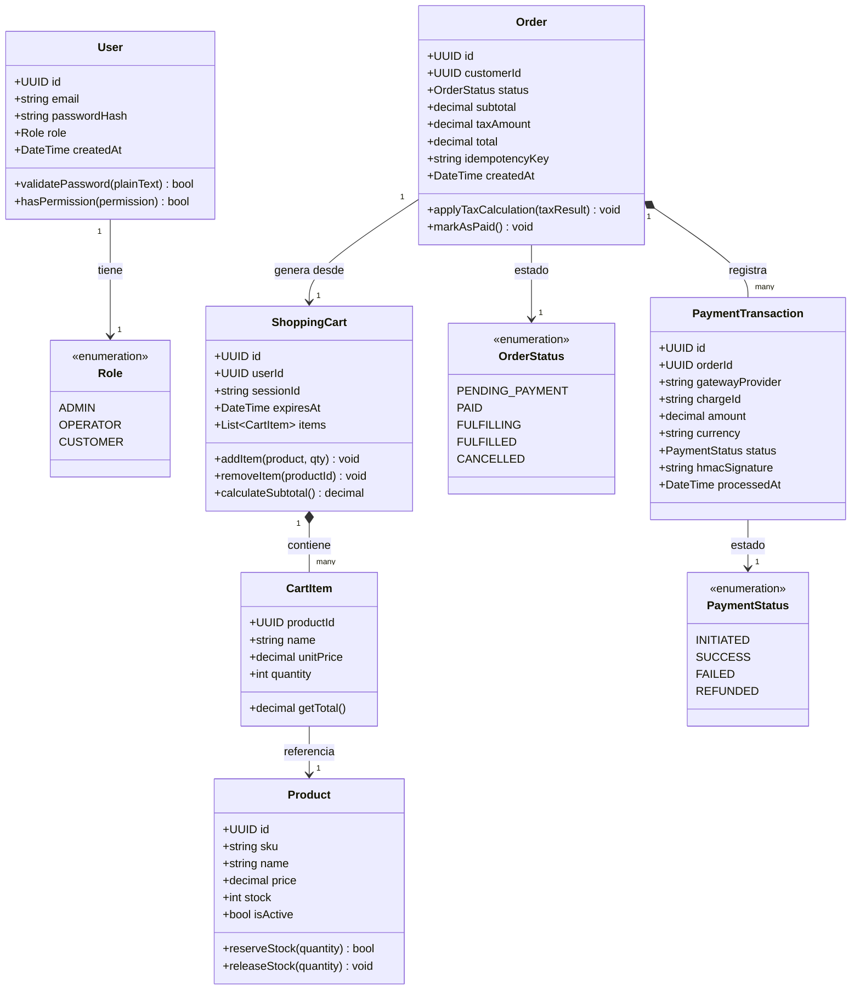
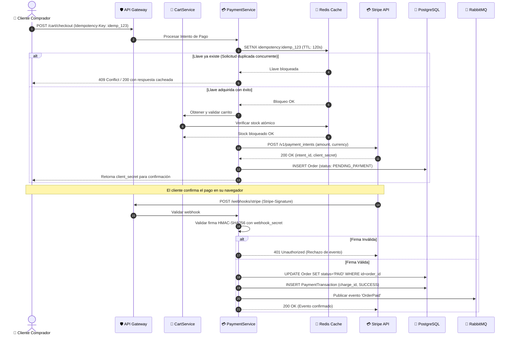
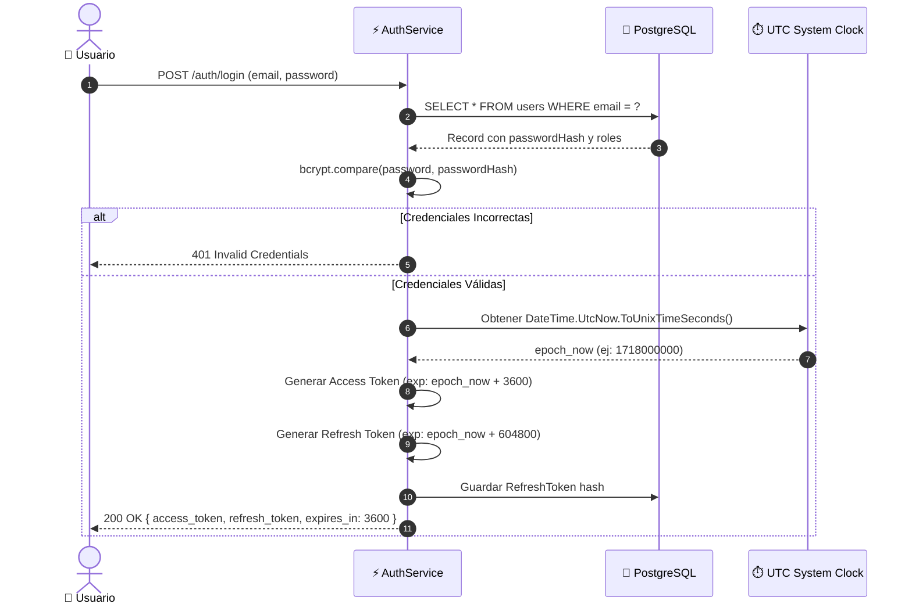
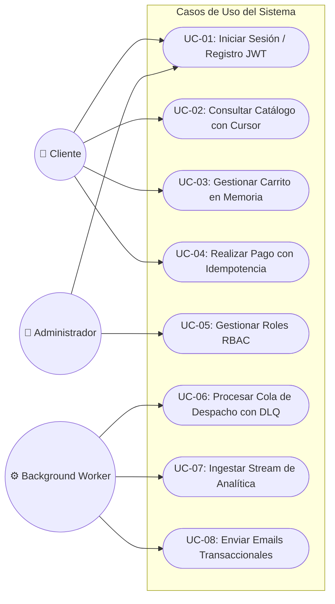

# Diagramas UML del Sistema — CloudSaaS Platform

Este documento recopila los diagramas UML formales para modelar entidades, transacciones críticas y casos de uso del sistema.

---

## 1. Diagrama de Clases de Dominio (Domain Class Diagram)

Modela las entidades de negocio, sus relaciones y contratos de dominio aislados de frameworks.

---

## 2. Diagrama de Secuencia: Checkout & Pago Idempotente con Webhook

Ilustra la interacción entre Cliente, API Gateway, CartService, PaymentService, Redis, Stripe y RabbitMQ.

---

## 3. Diagrama de Secuencia: Autenticación JWT con Desfase UTC

Demuestra la mitigación del bug `INT-003` para servidores con husos horarios dispares mediante tiempo Epoch UTC.

---

## 4. Diagrama de Casos de Uso (Use Case Diagram)

