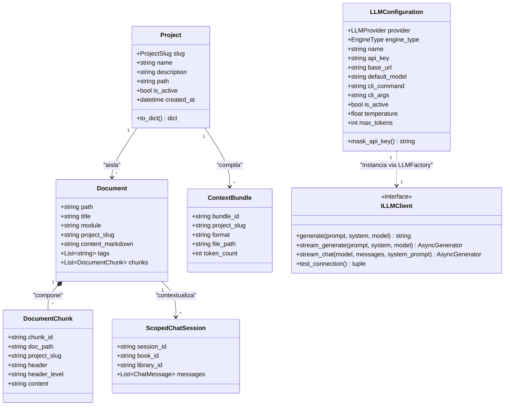
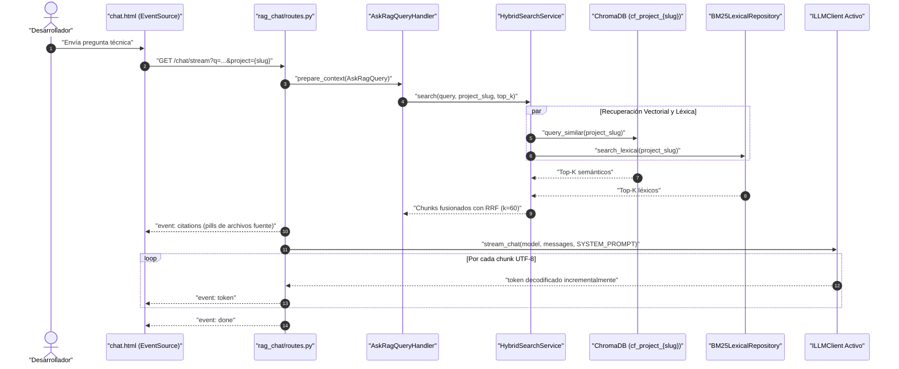
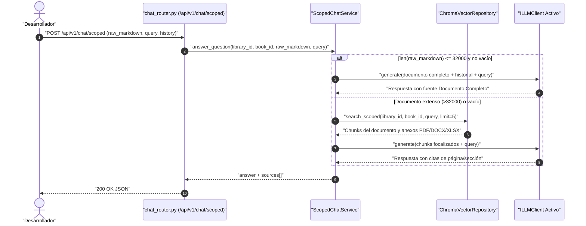
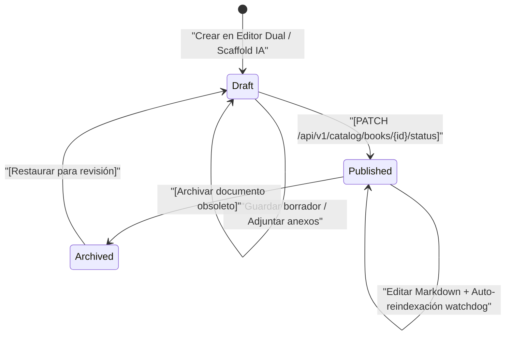
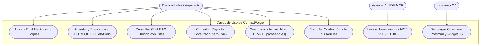

# Atlas UML 2.5 — ContextForge (IntegrationLibrary)

> [!NOTE]
> Modelado conductual y estructural UML 2.5 verificado directamente contra las entidades en `src/domain/`, los handlers CQRS en `src/application/` y los adaptadores en `src/infrastructure/`.

---

## 1. Diagrama de Clases del Dominio ContextForge

---

## 2. Diagrama de Secuencia: Ciclo de Consulta RAG Híbrido y Streaming SSE

---

## 3. Diagrama de Secuencia: Scoped Chat con Zero-RAG Bypass

---

## 4. Diagrama de Máquina de Estados: Ciclo de Vida de un Documento (`Book`)

---

## 5. Diagrama de Casos de Uso UML

