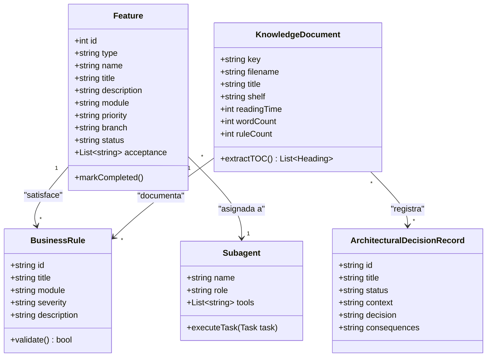
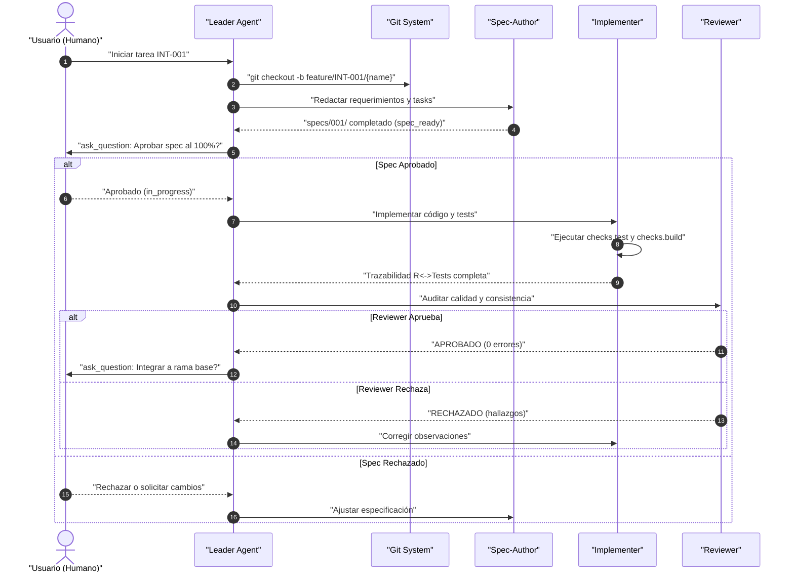
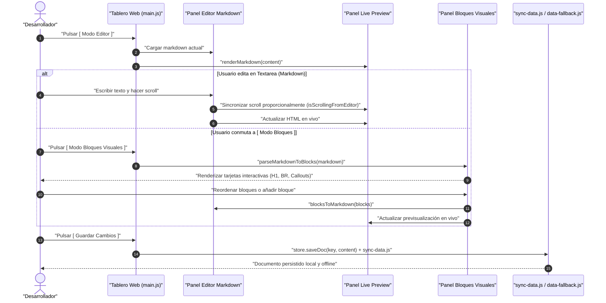
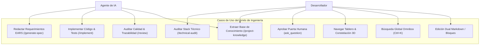

# Diagramas UML — AI Agentic SDD Engineering Harness

---

## 1. Diagrama de Clases del Dominio SDD

Muestra las entidades, value objects y relaciones del modelo conceptual del arnés:

---

## 2. Diagrama de Secuencia: Ciclo de Vida Completo SDD

---

## 3. Diagrama de Secuencia: Editor Dual ContextForge con Scroll Sincronizado

---

## 4. Diagrama de Casos de Uso del Arnés SDD

