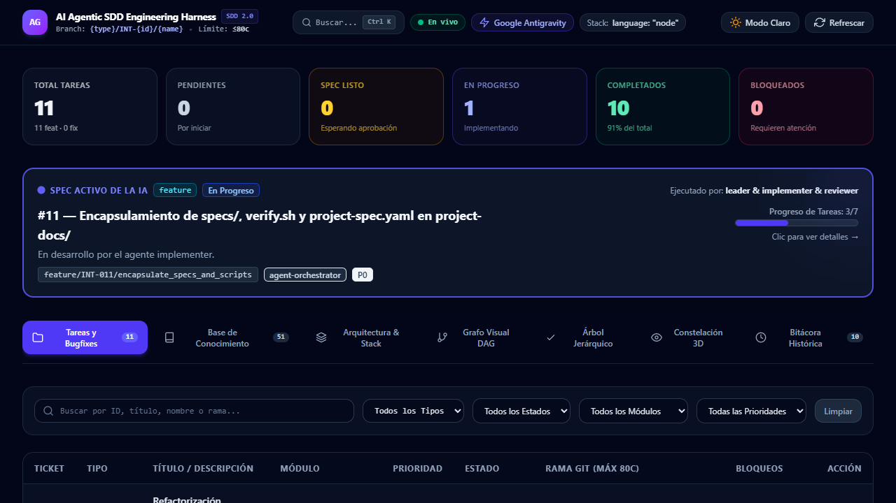
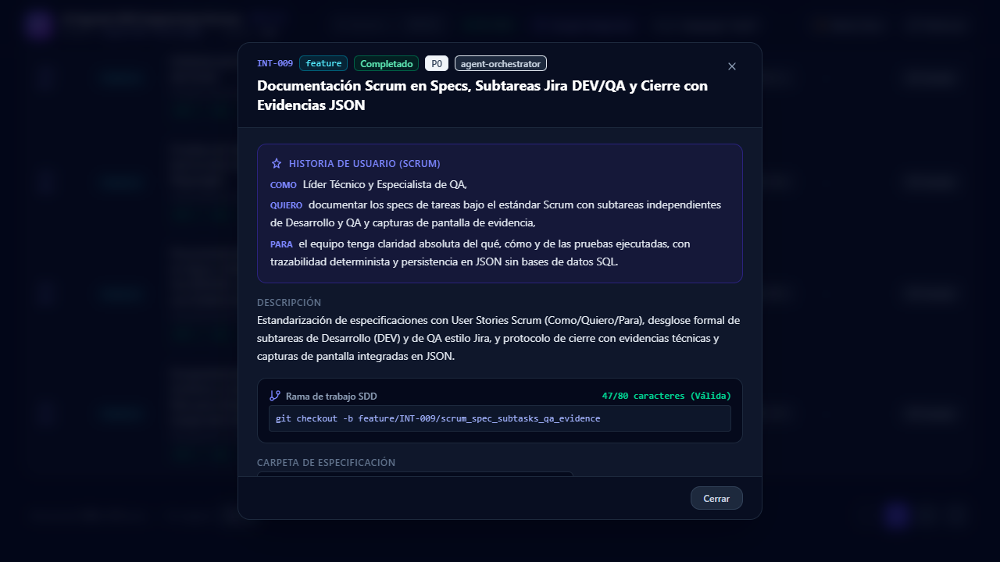
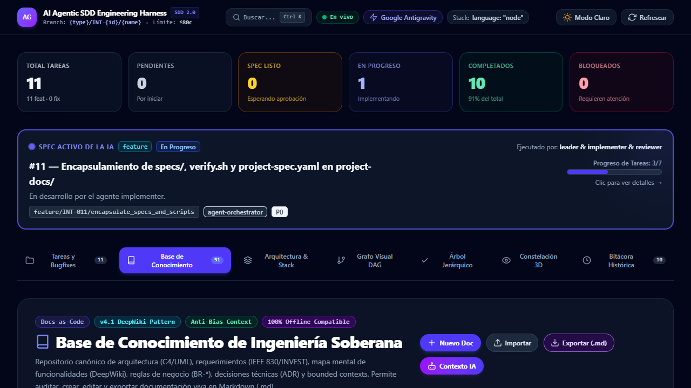

# Reporte Formal de Evidencias de Cierre: INT-009

- **Ticket ID**: INT-009
- **Título**: Documentación Scrum en Specs, Subtareas Jira DEV/QA y Cierre con Evidencias JSON
- **Fecha de Cierre**: 2026-11-03 14:26 UTC
- **Responsables**:
  - Implementación (Subtarea DEV): Subagente `implementer`
  - Aseguramiento de Calidad (Subtarea QA): Subagente `reviewer`
- **Veredicto Final**: [APROBADO] (100% de criterios cumplidos)
- **Persistencia**: 100% en JSON (Sin bases de datos SQL)

---

## 1. Resumen Técnico de Implementación (DEV Summary)

Se extendió y estandarizó la arquitectura del arnés para alinearla con el estándar de la industria en **Scrum / Agile** y **Jira**:
1. **Esquema JSON Enriquecido**: Se extendió `project-docs/feature_list.json` para soportar historias de usuario Scrum (`user_story: { as_a, i_want, so_that }`), Definition of Ready (`definition_of_ready`), Definition of Done (`definition_of_done`), y el desglose en Subtareas Jira independientes (`subtasks: [ DEV, QA ]`).
2. **Subtareas Jira Desacopladas**: Cada feature ahora desglosa una subtarea técnica de Desarrollo (`INT-XXX-DEV`) asignada al `implementer` y una subtarea de Aseguramiento de Calidad (`INT-XXX-QA`) asignada al `reviewer`.
3. **Tablero Visual (Vanilla JS + Tailwind v4)**:
   - Se actualizó [`Modal.js`](file:///c:/Users/NayidJuniorCastellar/Documents/Repositorios/Archivos%20IA/Harness/harness_anginnering/project-docs/src/shared/Modal.js) incorporando la tarjeta de User Story Scrum, la cuadrícula de Subtareas Jira DEV/QA con estados y checkboxes, el checklist de DoD y la galería interactiva de capturas de pantalla.
   - Se actualizó [`FeatureTable.js`](file:///c:/Users/NayidJuniorCastellar/Documents/Repositorios/Archivos%20IA/Harness/harness_anginnering/project-docs/src/features/feature-list/FeatureTable.js) para renderizar badges de estado de DEV y QA en cada fila.
   - Se actualizó [`CurrentSpecCard.js`](file:///c:/Users/NayidJuniorCastellar/Documents/Repositorios/Archivos%20IA/Harness/harness_anginnering/project-docs/src/features/current-spec/CurrentSpecCard.js) para mostrar la subtarea activa.
4. **Skills y Prompts de Agentes Homologados**:
   - `generate-spec` y `spec-author.md` generan la estructura formal Scrum y subtareas Jira.
   - `verify-spec` y `reviewer.md` auditan obligatoriamente la presencia de evidencias y capturas de pantalla antes de permitir el cierre.
   - Se homologaron los cambios de forma triple en `.opencode/`, `.github/` y `.agents/`.

---

## 2. Archivos Creados y Modificados

### Archivos de Especificación y Evidencia
- `specs/009_scrum_spec_subtasks_and_qa_evidence/requirements.md`
- `specs/009_scrum_spec_subtasks_and_qa_evidence/design.md`
- `specs/009_scrum_spec_subtasks_and_qa_evidence/tasks.md`
- `specs/009_scrum_spec_subtasks_and_qa_evidence/evidence.md`
- `specs/009_scrum_spec_subtasks_and_qa_evidence/evidence/01-dashboard-scrum-table.png`
- `specs/009_scrum_spec_subtasks_and_qa_evidence/evidence/02-modal-scrum-subtasks.png`
- `specs/009_scrum_spec_subtasks_and_qa_evidence/evidence/03-knowledge-base-deepwiki.png`

### Archivos de Código y UI
- `project-docs/feature_list.json`
- `project-docs/src/shared/Modal.js`
- `project-docs/src/features/feature-list/FeatureTable.js`
- `project-docs/src/features/current-spec/CurrentSpecCard.js`
- `project-docs/dist/app.bundle.js`
- `project-docs/data-fallback.js`
- `scripts/capture-evidence.js`
- `tests/acceptance/scrum-evidence-capture.spec.js`

### Skills y Agentes
- `.agents/agents/spec-author.md`
- `.agents/agents/reviewer.md`
- `.opencode/skills/generate-spec/SKILL.md` (y espejos `.github/`, `.agents/`)
- `.opencode/skills/verify-spec/SKILL.md` (y espejos `.github/`, `.agents/`)

---

## 3. Matriz de Pruebas Ejecutadas

| ID | Tipo de Prueba | Descripción del Escenario | Resultado |
| -- | -------------- | ------------------------- | --------- |
| **DEV-01** | Unitaria | Integridad del modelo JSON de `feature_list.json` con subtareas DEV/QA | [PASS] |
| **DEV-02** | Unitaria | Anti-Emoji Gate en `project-docs/src/` (0 emojis unicode) | [PASS] |
| **DEV-03** | Build | Recompilación del bundle `app.bundle.js` mediante esbuild | [PASS] |
| **QA-01** | Aceptación E2E | Renderizado de badges Jira DEV y QA en la tabla de features | [PASS] |
| **QA-02** | Aceptación E2E | Apertura de modal con User Story Scrum (*Como/Quiero/Para*) | [PASS] |
| **QA-03** | Aceptación E2E | Desglose de Subtareas DEV y QA con asignados y checkboxes | [PASS] |
| **QA-04** | Aceptación E2E | Checklist de Definition of Done (DoD) visible y formateado | [PASS] |
| **QA-05** | Automatización | Captura de pantallas en alta resolución (`.png`) mediante Playwright | [PASS] |
| **QA-06** | Sistema | Ejecución completa del pipeline determinista `verify.sh` | [PASS] |

---

## 4. Galería de Capturas de Pantalla (Evidencias Visuales)

### Evidencia 1: Tabla de Tareas con Badges de Subtareas Jira DEV y QA

### Evidencia 2: Modal de Detalle con Historia de Usuario Scrum, Subtareas Jira y DoD

### Evidencia 3: Base de Conocimiento Soberana y Desglose de Capacidades DeepWiki

---

## 5. Verificación de Definition of Done (DoD)

- [x] Subtarea de desarrollo (`INT-009-DEV`) concluida al 100%.
- [x] Subtarea de aseguramiento de calidad (`INT-009-QA`) verificada y aprobada.
- [x] Evidencias fotográficas generadas y almacenadas en el repositorio.
- [x] Cero emojis en código fuente e interfaz (iconografía SVG accesible).
- [x] Suite completa de pruebas en verde.
