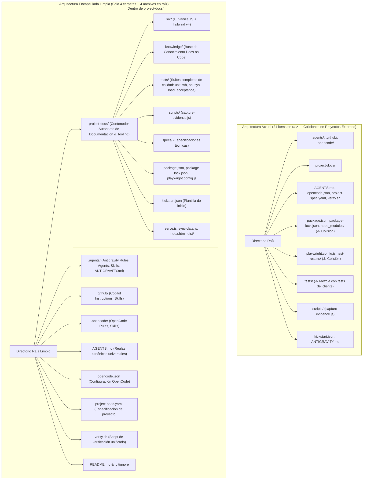

# Design: Encapsulamiento de Archivos y Limpieza de Raíz para Adopción del Arnés

## Feature ID: 10 — `harness_root_cleanliness_encapsulation`

---

## 1. Arquitectura AS-IS vs. TO-BE



---

## 2. Matriz de Migración de Archivos

| Archivo / Directorio Origen | Destino Propuesto | Justificación Técnica |
| :--- | :--- | :--- |
| `package.json` | `project-docs/package.json` | Aísla dependencias de Node (`esbuild`, `@playwright/test`) para no interferir con proyectos cliente. |
| `package-lock.json` | `project-docs/package-lock.json` | Bloqueo de dependencias encapsulado en el contexto de `project-docs/`. |
| `playwright.config.js` | `project-docs/playwright.config.js` | Configuración E2E asociada al servidor y páginas de `project-docs/`. |
| `tests/` | `project-docs/tests/` | Impide que las pruebas internas del tablero colisionen con los tests de negocio del cliente. |
| `scripts/capture-evidence.js` | `project-docs/scripts/capture-evidence.js` | Ubica los scripts utilitarios junto al entorno de pruebas al que sirven. |
| `kickstart.json` | `project-docs/kickstart.json` | Mantiene el template de inicialización dentro de la documentación del arnés. |
| `ANTIGRAVITY.md` | `.agents/ANTIGRAVITY.md` | Consolida la documentación nativa de Antigravity dentro de su carpeta oficial. |
| `test-results/` | `project-docs/test-results/` (o `.gitignore`) | Resultados efímeros de Playwright fuera de la raíz. |

---

## 3. Decisiones de Arquitectura (ADRs)

### `ADR-001`: Encapsulamiento del Tooling del Tablero en `project-docs/`
- **Contexto:** El arnés debe poder copiarse y pegarse en cualquier repositorio existente sin imponer dependencias de Node.js a nivel de raíz.
- **Decisión:** Mover `package.json` y el ecosistema de npm a `project-docs/`.
- **Consecuencias Positivas:** Cero colisiones con repositorios .NET, Python, Go o Java. Si el repositorio cliente ya tiene un `package.json`, este permanece intacto y soberano.
- **Trade-off:** La ejecución de comandos npm desde la raíz requiere usar la bandera `--prefix project-docs` (ej. `npm --prefix project-docs run build`).

### `ADR-002`: Delegación Transparente en `verify.sh`
- **Contexto:** Los usuarios y agentes ejecutan `./verify.sh` desde la raíz para validar el proyecto.
- **Decisión:** Actualizar `verify.sh` para invocar comandos con `npm --prefix project-docs ...` o delegar a la carpeta del arnés.
- **Consecuencias Positivas:** La experiencia de usuario no cambia; ejecutar `./verify.sh` continúa ejecutando todas las fases en verde.

### `ADR-003`: Reubicación de Tests del Arnés a `project-docs/tests/`
- **Contexto:** Proyectos clientes suelen tener una carpeta `tests/` para sus pruebas de dominio.
- **Decisión:** Mover los tests del tablero del arnés a `project-docs/tests/`.
- **Consecuencias:** Ajustar `ROOT_DIR` o paths relativos en las pruebas unitarias y de sistema para que resuelvan correctamente los archivos del proyecto.

---

## 4. Estrategia de Ajuste de Rutas Relativas

### En `project-docs/package.json`:
Los scripts se ajustan al nuevo contexto relativo:
```json
{
  "name": "ai-agentic-sdd-engineering-harness-docs",
  "version": "2.5.0",
  "type": "module",
  "scripts": {
    "test": "node --test tests/unit/**/*.test.js",
    "test:unit": "node --test tests/unit/**/*.test.js",
    "test:e2e": "node --test tests/e2e/**/*.test.js",
    "test:whitebox": "node --test tests/whitebox/**/*.test.js",
    "test:blackbox": "node --test tests/blackbox/**/*.test.js",
    "test:system": "node --test tests/system/**/*.test.js",
    "test:load": "node --test tests/load/**/*.test.js",
    "test:acceptance": "npx playwright test --config=playwright.config.js",
    "build": "npx esbuild src/main.js --bundle --outfile=dist/app.bundle.js --format=iife",
    "sync": "node sync-data.js",
    "start": "node serve.js"
  }
}
```

### En `verify.sh`:
```bash
#!/usr/bin/env bash
set -e

echo "🔍 Iniciando verificación integral de AI Agentic SDD Engineering Harness..."

echo "📦 1. Compilación y bundling..."
npm --prefix project-docs run build

echo "🧪 2. Pruebas unitarias nativas..."
npm --prefix project-docs test

echo "🌐 3. Pruebas de aceptación smoke ATDD..."
npm --prefix project-docs run test:e2e

echo "🔬 4. Pruebas de caja blanca (branch coverage)..."
npm --prefix project-docs run test:whitebox

echo "🎯 5. Pruebas de caja negra (BVA, clases de equivalencia y resiliencia)..."
npm --prefix project-docs run test:blackbox

echo "🔗 6. Pruebas de sistema e integración..."
npm --prefix project-docs run test:system

echo "⚡ 7. Pruebas de carga y rendimiento concurrente..."
npm --prefix project-docs run test:load

echo "🎭 8. Pruebas de aceptación E2E con Playwright (navegador real)..."
npm --prefix project-docs run test:acceptance

echo "💾 9. Sincronización y consistencia de datos..."
node project-docs/sync-data.js

echo "✅ Verificación completada con éxito. Todos los niveles en verde."
```
