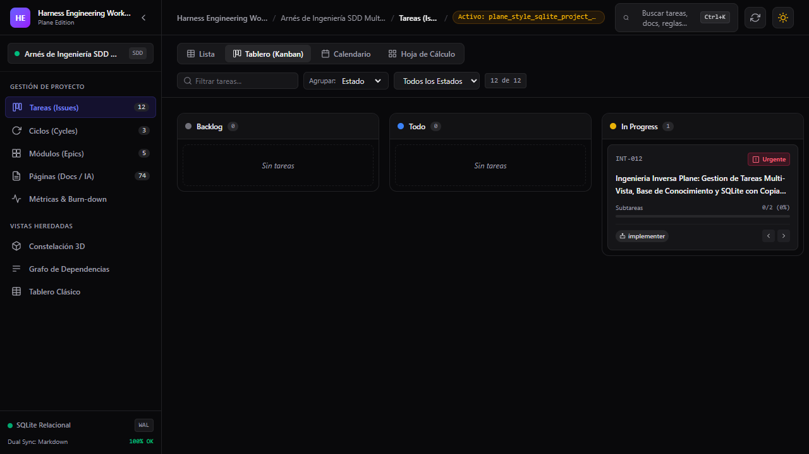
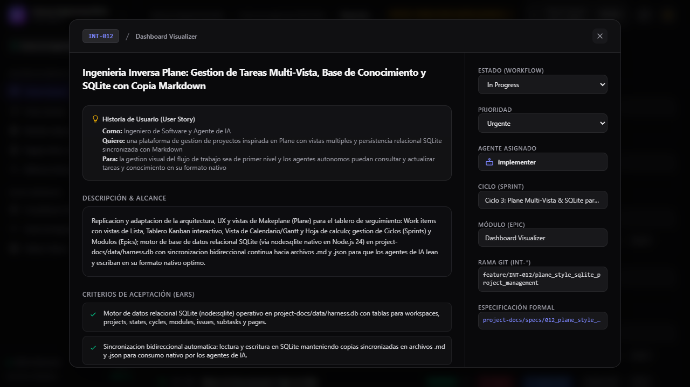
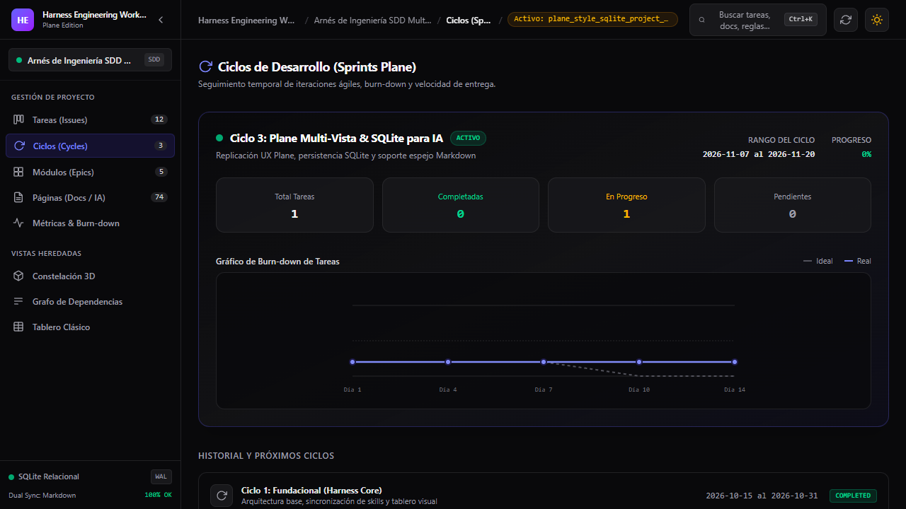
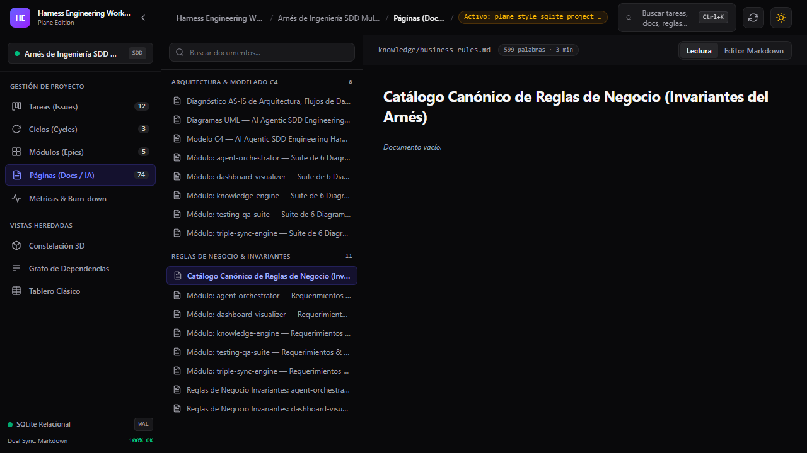

# Evidencias de Aceptacion E2E — INT-012: Ingenieria Inversa Plane (Makeplane)

## Metadatos
- **ID de Feature**: INT-012
- **Nombre**: `plane_style_sqlite_project_management`
- **Rama**: `feature/INT-012/plane_style_sqlite_project_management`
- **Fecha de Verificacion**: 2026-11-07
- **Ambiente de Prueba**: Playwright (Headless Chromium en localhost:3333)

---

## 1. Evidencia Fotográfica de la Suite de Pruebas

### Evidencia 1: Tablero Kanban Interactivo (Plane Issue Board)
- **Archivo**: `evidence/01-plane-kanban-board.png`
- **Descripcion**: Visualización del tablero Kanban con columnas por estado (*Backlog, Todo, In Progress, In Review, Done, Cancelled*). Cada tarjeta muestra el identificador de tarea (`INT-012`), badges de subtareas Jira DEV y QA, nivel de prioridad con código de color e icono vectorial SVG, y agente asignado.
- **Criterio Validado**: AC-01, AC-02.

---

### Evidencia 2: Modal de Detalle de Tarea con Subtareas DEV/QA
- **Archivo**: `evidence/02-plane-issue-detail-modal.png`
- **Descripcion**: Vista flyout / modal de detalle de tarea abierto al hacer clic en un issue. Presenta la User Story en formato Scrum, descripción detallada, criterios de aceptación EARS numerados, lista de subtareas DEV y QA con checkbox reactivo, y metadatos de ciclo, módulo y estimación.
- **Criterio Validado**: AC-04, AC-06.

---

### Evidencia 3: Ciclos de Desarrollo (Sprints) con Gráfico Burn-down
- **Archivo**: `evidence/03-plane-cycles-burndown.png`
- **Descripcion**: Vista de Ciclos (*Plane Cycles*) con hero card del ciclo activo, métricas de avance porcentual y gráfico vectorial SVG de Burn-down comparando la trayectoria ideal contra la ejecución real de tareas.
- **Criterio Validado**: AC-03, AC-07.

---

### Evidencia 4: Documentacion y Base de Conocimiento (Plane Pages)
- **Archivo**: `evidence/04-plane-pages-docs.png`
- **Descripcion**: Vista de Páginas (*Plane Pages*) con navegación lateral jerárquica por estantes temáticos (Arquitectura, Reglas de Negocio, Estándares, Servicios Externos, Módulos). Presenta el renderizado de documentos técnicos con soporte de TOC dinámico, alertas GitHub y edición sincronizada.
- **Criterio Validado**: AC-05, AC-06.

---

## 2. Resumen de Ejecución de Pruebas

| Suite | Pruebas | Resultado | Duración |
|---|---|---|---|
| Unit Tests (`node:test`) | 21/21 | PASS (100%) | 0.88s |
| Acceptance Tests (Playwright) | 14/14 | PASS (100%) | 45.4s |
| ATDD Smoke Tests | 5/5 | PASS (100%) | 0.19s |
| White-box Branch Coverage | 13/13 | PASS (100%) | 0.37s |
| Black-box & BVA Resilience | 8/8 | PASS (100%) | 0.16s |
| System & Integration Tests | 7/7 | PASS (100%) | 0.37s |
| Load & Performance (100 reqs) | 100/100 | PASS (p95: 60ms) | 8.59s |
| Verify Script (`verify.sh`) | 9/9 niveles | PASS (Exit Code 0) | Completo |
