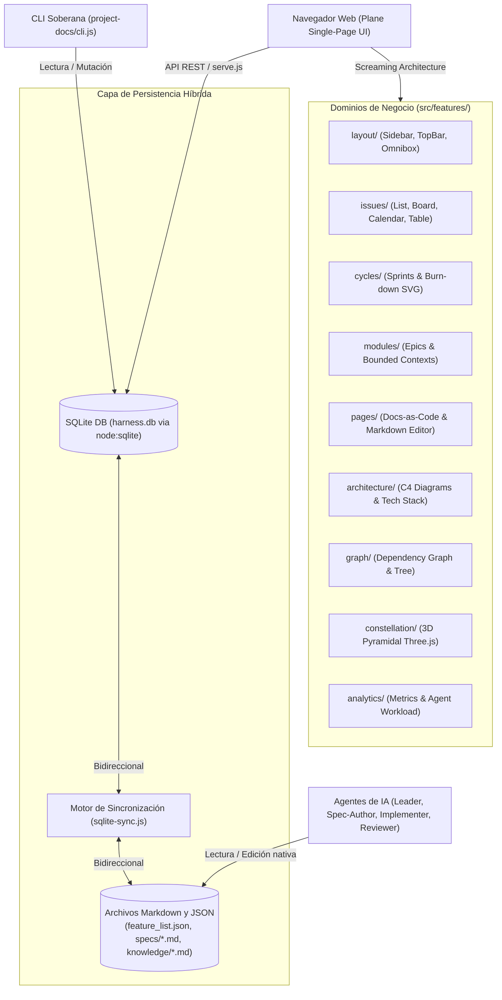

# Diseno Tecnico y Decisiones Arquitectonicas (ADRs) — INT-013: Screaming Architecture & Refactor Unificado Estilo Plane

## Metadatos
- **ID de Feature**: INT-013
- **Nombre**: `screaming_architecture_plane_refactor`
- **Rama**: `feature/INT-013/screaming_architecture_plane_refactor`
- **Fecha**: 2026-11-07
- **Tecnica**: SDD

---

## 1. Arquitectura General y Screaming Domain Structure

El principio rector es **Screaming Architecture**: la estructura de directorios en `project-docs/src/` refleja directamente el dominio de negocio del sistema de gestión de proyectos y arnés de ingeniería, no detalles de infraestructura.

```
project-docs/src/
├── core/                         # Infraestructura transversal del cliente
│   ├── api.js                    # Cliente HTTP para API REST y fallback offline
│   ├── db.js                     # Motor SQLite nativo (node:sqlite)
│   ├── detector.js               # Detección de agentes y stack tecnológico
│   ├── router.js                 # Enrutador por hash unificado
│   ├── sqlite-sync.js            # Motor de sincronización bidireccional SQLite <-> MD/JSON
│   └── store.js                  # Almacén de estado reactivo observable
│
├── features/                     # Dominios de Negocio (Screaming Architecture)
│   ├── layout/                   # Shell principal de la aplicación estilo Plane
│   │   ├── components/           # PlaneSidebar, PlaneTopBar, PlaneControlsBar, OmniboxModal
│   │   └── views/                # MasterLayout.js
│   │
│   ├── issues/                   # Gestión de Tareas y Requerimientos (Work Items)
│   │   ├── components/           # IssueRow, IssueCard, IssueDetailModal, IssueFilterBar
│   │   ├── views/                # IssueListView, IssueBoardView, IssueCalendarView, IssueSpreadsheetView
│   │   └── helpers/              # issueFormatters.js, issueFilters.js
│   │
│   ├── cycles/                   # Ciclos de Desarrollo y Sprints
│   │   ├── components/           # CycleCard, BurnDownChart, CycleProgress
│   │   └── views/                # CyclesView.js
│   │
│   ├── modules/                  # Módulos de Arquitectura y Bounded Contexts
│   │   ├── components/           # ModuleCard, ModuleProgressBar
│   │   └── views/                # ModulesView.js
│   │
│   ├── pages/                    # Base de Conocimiento y Docs-as-Code (Plane Pages)
│   │   ├── components/           # PageShelfTree, ArticleHeader, DynamicTOC, DualMarkdownEditor
│   │   └── views/                # PagesView.js
│   │
│   ├── architecture/             # Arquitectura C4 y Stack Tecnológico
│   │   ├── components/           # C4DiagramViewer, TechStackTable
│   │   └── views/                # ArchitectureView.js
│   │
│   ├── graph/                    # Grafo y Árbol de Dependencias
│   │   ├── components/           # GraphCanvas, TreeHierarchyView
│   │   └── views/                # DependencyGraphView.js
│   │
│   ├── constellation/            # Constelación Piramidal 3D en Three.js
│   │   ├── components/           # ThreeCanvas, OrbitControlsHelper, PyramidNodes
│   │   └── views/                # Constellation3DView.js
│   │
│   └── analytics/                # Analítica, Velocidad y Carga de Trabajo de Agentes
│       ├── components/           # VelocityChart, AgentWorkloadCard, PriorityBar
│       └── views/                # AnalyticsView.js
│
├── shared/                       # Componentes UI reutilizables transversales
│   ├── ui/                       # BaseButton, Badge, ModalBase, Dropdown, StatCard
│   ├── utils/                    # renderList.js, slugify.js, dateHelpers.js
│   ├── Icons.js                  # Iconos SVG vectoriales estándar de Plane (cero emojis)
│   ├── MarkdownViewer.js         # Motor de renderizado Markdown y alertas GitHub
│   └── MermaidViewer.js          # Integración reactiva de diagramas Mermaid
│
├── cli.js                        # Herramienta CLI soberana para Agentes y Terminal
└── main.js                       # Punto de entrada de la aplicación
```

---

## 2. Registro de Decisiones de Arquitectura (ADRs)

### ADR-001: Screaming Architecture Estricta en Features
- **Contexto**: Anteriormente convivían carpetas de la interfaz clásica (`stats`, `feature-list`, `current-spec`, `knowledge-base`, `space-view-3d`) con carpetas prefijadas `plane-*`. Esto creaba confusión sobre la fuente de verdad y dispersión de componentes.
- **Decisión**: Consolidar en dominios de negocio claros (`layout`, `issues`, `cycles`, `modules`, `pages`, `architecture`, `graph`, `constellation`, `analytics`). Cada carpeta contendrá su subcarpeta `components/`, `views/` y, cuando aplique, `helpers/`.
- **Consecuencias**: Cada funcionalidad se puede desarrollar, probar o refactorizar de forma aislada. Elimina el desorden y hace que la estructura "grite" inmediatamente las capacidades del negocio.

### ADR-002: Layout Unificado Plane-First como Vista Soberana
- **Contexto**: La aplicación mantenía un botón para alternar entre "Tablero Clásico" y "Modo Plane", manteniendo dos layouts diferentes en `main.js`.
- **Decisión**: Eliminar el diseño clásico legacy. La aplicación adopta de forma nativa y permanente la experiencia de Plane. Todas las vistas existentes (Arquitectura C4, Grafo de dependencias, Árbol jerárquico, Constelación 3D Three.js, Base de conocimiento) se integran directamente como pestañas y opciones de navegación dentro de la barra lateral de Plane.
- **Consecuencias**: Experiencia de usuario coherente y unificada, 100% estilo Plane, con atajos de teclado (`Ctrl+K`), modo oscuro/claro elegante y cero fricción entre vistas.

### ADR-003: Bucles Funcionales de Renderizado en Vanilla JS
- **Contexto**: En Vanilla JS, el renderizado repetitivo suele degenerar en concatenaciones de cadenas frágiles o manipulación imperativa desordenada del DOM.
- **Decisión**: Adoptar un helper de renderizado funcional declarativo:
  ```javascript
  export function renderList(items = [], renderItemFn, emptyMessage = '') {
    if (!items || items.length === 0) {
      return emptyMessage ? `<div class="p-6 text-center text-xs text-zinc-400">${emptyMessage}</div>` : '';
    }
    return items.map((item, idx) => renderItemFn(item, idx)).join('');
  }
  ```
  Cada componente UI es una función pura que recibe `props` y retorna una plantilla string tipada. La reactividad y eventos se gestionan mediante **delegación de eventos** en el contenedor padre de la vista.
- **Consecuencias**: Código limpio, predecible, altamente legible y similar a los patrones funcionales de React, sin introducir frameworks externos ni peso adicional al bundle.

### ADR-004: Herramienta CLI Soberana (`project-docs/cli.js`)
- **Contexto**: Los agentes de IA y los desarrolladores en consola requerían comandos directos para consultar tareas, ciclos, módulos y páginas sin necesidad de abrir el navegador o parsear JSONs complejos manualmente.
- **Decisión**: Crear `project-docs/cli.js` ejecutable con `node project-docs/cli.js <command>`.
  Comandos soportados:
  - `status`: Muestra un dashboard en ASCII/tablas limpias del estado del arnés.
  - `issue list [--state <id>] [--priority <P0-P3>] [--cycle <id>] [--json]`: Lista tareas tabulares.
  - `issue get <id>`: Muestra el detalle completo (User Story, subtareas DEV/QA, criterios).
  - `issue update <id> --state <state>`: Actualiza el estado en SQLite y sincroniza el archivo de spec y feature_list.json.
  - `cycle list` y `cycle current`: Métricas de ciclo y burn-down.
  - `module list`: Bounded contexts y progreso.
  - `page list` y `page get <slug>`: Lista y contenido de páginas de conocimiento.
  - `sync`: Ejecuta sincronización bidireccional SQLite <-> Markdown/JSON.
- **Consecuencias**: Los agentes y skills pueden interactuar de forma inmediata y programática con el arnés, manteniendo los datos siempre sincronizados.

### ADR-005: Sistema de Diseno Coherente y Mejora de Graficos
- **Contexto**: Las vistas anteriores tenían discrepancias de color y estilos de bordes.
- **Decisión**: Establecer una paleta de diseño unificada basada en Tailwind CSS v4:
  - Fondo primario: `bg-zinc-950`
  - Paneles y barras: `bg-zinc-900/90` con bordes `border-zinc-800`
  - Acentos de marca: `indigo-500` y `violet-500`
  - Estados: Backlog (`zinc-400`), Todo (`sky-400`), In Progress (`amber-400`), In Review (`purple-400`), Done (`emerald-400`), Cancelled (`rose-400`)
  - Prioridades: P0 Urgente (`rose-500`), P1 Alta (`amber-500`), P2 Media (`blue-500`), P3 Baja (`zinc-400`)
  - Iconos: SVG inline paramétricos con `aria-hidden="true"` (Icons.js).
  - Zero emojis garantizado por tests unitarios y estáticos.

---

## 3. Diagrama de Flujo de Datos y Arquitectura


