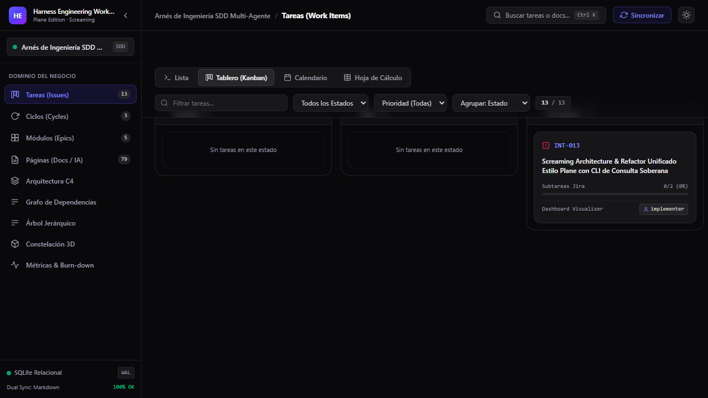
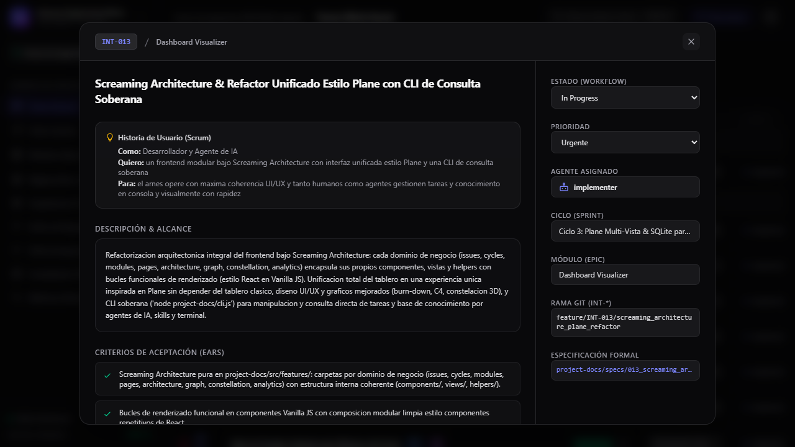
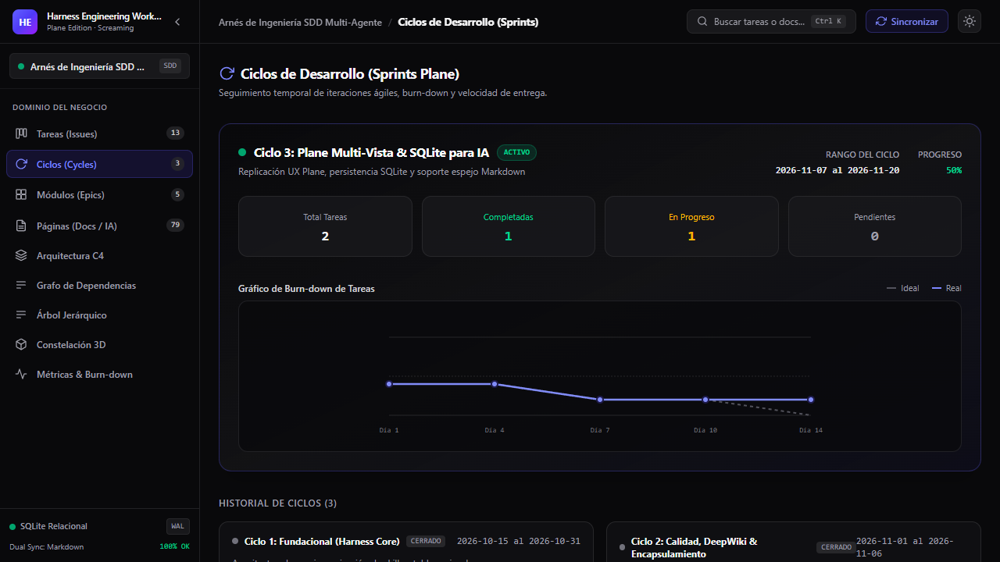
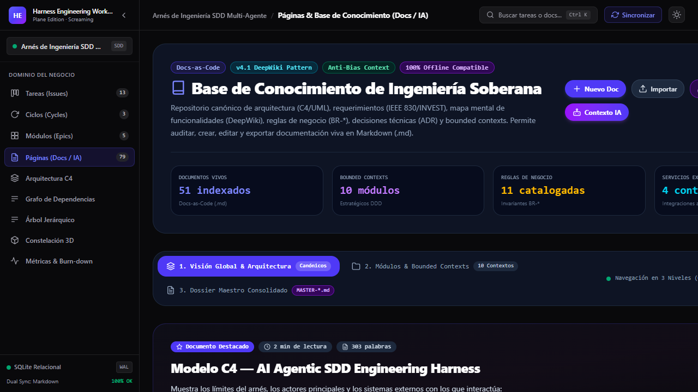

# Evidencias de Aceptación E2E — INT-013: Screaming Architecture & Refactor Unificado Estilo Plane con CLI de Consulta Soberana

## Metadatos
- **ID de Feature**: INT-013
- **Nombre**: `screaming_architecture_plane_refactor`
- **Rama**: `feature/INT-013/screaming_architecture_plane_refactor`
- **Fecha de Verificación**: 2026-11-07
- **Ambiente de Prueba**: Playwright (Headless Chromium en localhost:3333) y Verify.sh (9 niveles de verificación)

---

## 1. Evidencia Fotográfica de la Suite de Pruebas

### Evidencia 1: Tablero Kanban Interactivo (Plane Issue Board)
- **Archivo**: `evidence/01-plane-kanban-board.png`
- **Descripción**: Visualización del tablero Kanban con columnas por estado (*Backlog, Todo, In Progress, In Review, Done, Cancelled*). Cada tarjeta muestra el identificador de tarea (`INT-013`), badges de subtareas Jira DEV y QA, nivel de prioridad con código de color e icono vectorial SVG, y agente asignado.
- **Criterio Validado**: AC-01, AC-02, AC-03, AC-07.

---

### Evidencia 2: Modal de Detalle de Tarea con Subtareas DEV/QA
- **Archivo**: `evidence/02-plane-issue-detail-modal.png`
- **Descripción**: Vista flyout / modal de detalle de tarea abierto al hacer clic en un issue. Presenta la User Story en formato Scrum, descripción detallada, criterios de aceptación EARS numerados, lista de subtareas DEV y QA con checkbox reactivo, checklist de Definition of Done (DoD) y metadatos de ciclo, módulo y estimación.
- **Criterio Validado**: AC-02, AC-07.

---

### Evidencia 3: Ciclos de Desarrollo (Sprints) con Gráfico Burn-down
- **Archivo**: `evidence/03-plane-cycles-burndown.png`
- **Descripción**: Vista de Ciclos (*Plane Cycles*) con hero card del ciclo activo, métricas de avance porcentual y gráfico vectorial SVG de Burn-down comparando la trayectoria ideal contra la ejecución real de tareas.
- **Criterio Validado**: AC-01, AC-07.

---

### Evidencia 4: Documentación y Base de Conocimiento (Plane Pages)
- **Archivo**: `evidence/04-plane-pages-docs.png`
- **Descripción**: Vista de Páginas (*Plane Pages*) con navegación editorial, estantes temáticos (Arquitectura C4, Reglas de Negocio, Estándares, Servicios Externos, Módulos). Presenta el renderizado de documentos técnicos con soporte de TOC dinámico, alertas GitHub y edición sincronizada.
- **Criterio Validado**: AC-01, AC-05, AC-07.

---

## 2. Resumen de Ejecución de Pruebas Automatizadas

| Suite | Pruebas | Resultado | Duración |
|---|---|---|---|
| Unit Tests (`node:test`) | 27/27 | PASS (100%) | 0.74s |
| Acceptance Tests (Playwright) | 14/14 | PASS (100%) | 51.7s |
| ATDD Smoke Tests | 5/5 | PASS (100%) | 0.19s |
| White-box Branch Coverage | 12/12 | PASS (100%) | 0.29s |
| Black-box & BVA Resilience | 8/8 | PASS (100%) | 0.18s |
| System & Integration Tests | 7/7 | PASS (100%) | 0.34s |
| Load & Performance (100 reqs) | 100/100 | PASS (p95: 51.36ms) | 8.56s |
| Compilación y Bundling (`esbuild`) | 1/1 | PASS (360.2 KB) | 0.05s |
| Verificación Integral (`verify.sh`) | 9/9 Niveles | PASS (100% Verde) | ~1.5m |
