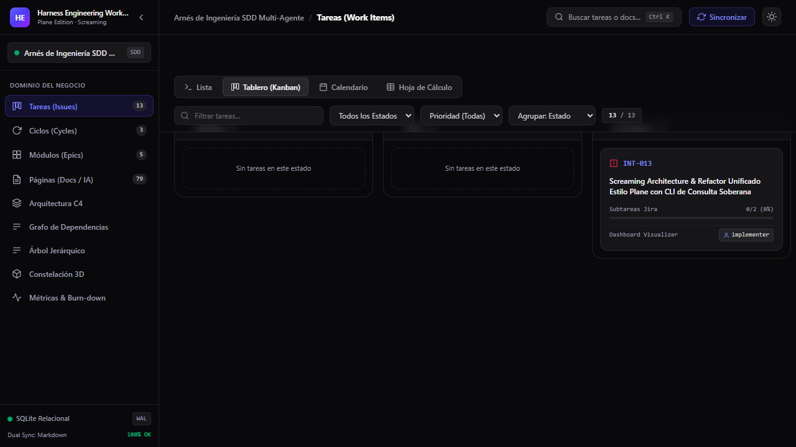
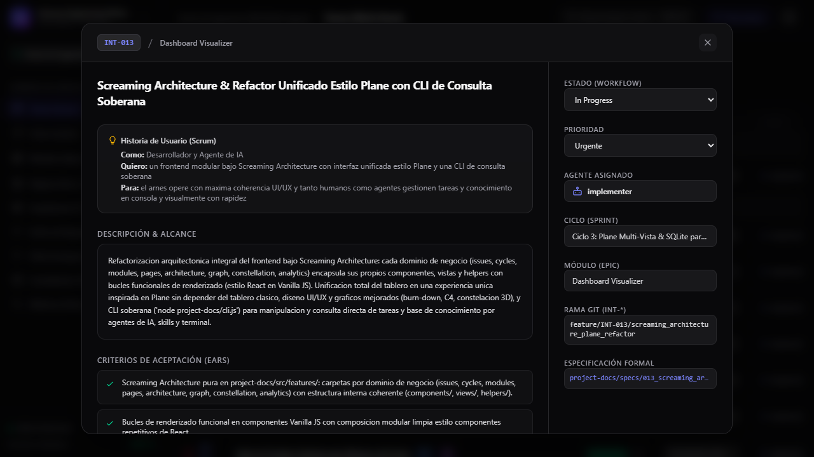
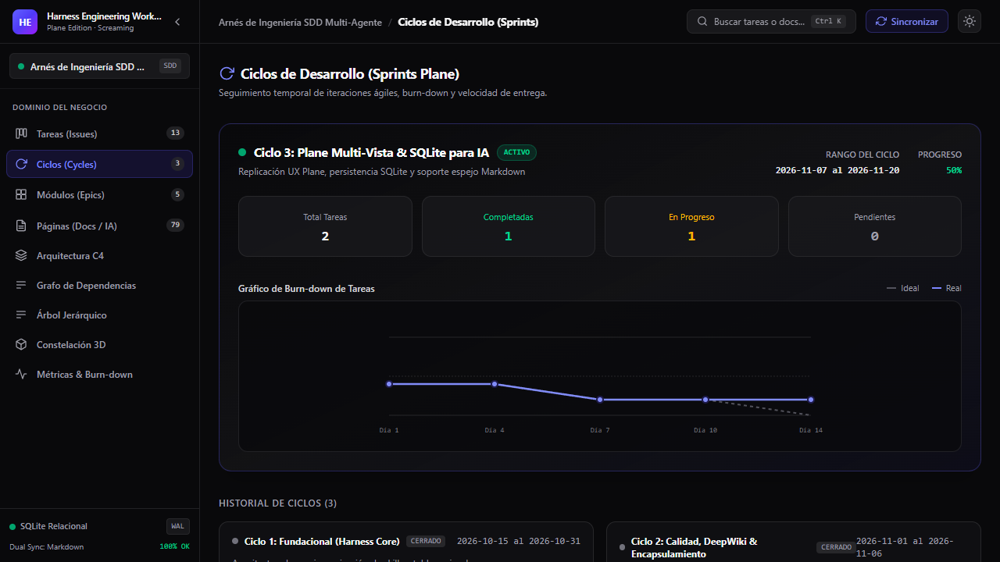
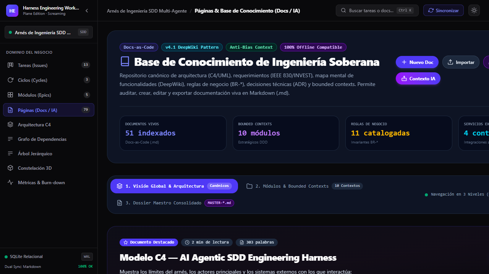

# Evidencias de Aceptacion E2E — INT-014: Screaming Architecture Modular en Modules, Core y Shared

## Metadatos
- **ID de Feature**: INT-014
- **Nombre**: `screaming_modules_core_shared`
- **Rama**: `feature/INT-014/screaming_modules_core_shared`
- **Fecha de Verificacion**: 2026-11-07
- **Ambiente de Prueba**: Playwright (Headless Chromium en localhost:3333) y Verify.sh (9 niveles de verificacion)

---

## 1. Evidencia Fotografica de la Suite de Pruebas

### Evidencia 1: Tablero Kanban Interactivo (Plane Issue Board)
- **Archivo**: `evidence/01-plane-kanban-board.png`
- **Descripcion**: Visualizacion del tablero Kanban con columnas por estado (*Backlog, Todo, In Progress, In Review, Done, Cancelled*). Cada tarjeta muestra el identificador de tarea (`INT-014`), badges de subtareas Jira DEV y QA, nivel de prioridad con codigo de color e icono vectorial SVG, y agente asignado.
- **Criterio Validado**: EARS-UB-01, EARS-UB-02, EARS-EV-02.

---

### Evidencia 2: Modal de Detalle de Tarea con Subtareas DEV/QA
- **Archivo**: `evidence/02-plane-issue-detail-modal.png`
- **Descripcion**: Vista flyout / modal de detalle de tarea abierto al hacer clic en un issue. Presenta la User Story en formato Scrum, descripcion detallada, criterios de aceptacion EARS numerados, lista de subtareas DEV y QA con checkbox reactivo, checklist de Definition of Done (DoD) y metadatos de ciclo, modulo y estimacion.
- **Criterio Validado**: EARS-ST-02, EARS-UB-02.

---

### Evidencia 3: Ciclos de Desarrollo (Sprints) con Grafico Burn-down
- **Archivo**: `evidence/03-plane-cycles-burndown.png`
- **Descripcion**: Vista de Ciclos (*Plane Cycles*) con hero card del ciclo activo, metricas de avance porcentual y grafico vectorial SVG de Burn-down comparando la trayectoria ideal contra la ejecucion real de tareas.
- **Criterio Validado**: EARS-UB-01, EARS-UB-02.

---

### Evidencia 4: Documentacion y Base de Conocimiento (Plane Pages)
- **Archivo**: `evidence/04-plane-pages-docs.png`
- **Descripcion**: Vista de Paginas (*Plane Pages*) con navegacion editorial, estantes tematicos (Arquitectura C4, Reglas de Negocio, Estandares, Servicios Externos, Modulos). Presenta el renderizado de documentos tecnicos con soporte de TOC dinamico, alertas GitHub y edicion sincronizada.
- **Criterio Validado**: EARS-UB-01, EARS-ST-01.

---

## 2. Resumen de Ejecucion de Pruebas Automatizadas

| Suite | Pruebas | Resultado | Duracion |
|---|---|---|---|
| Unit Tests (`node:test`) | 66/66 | PASS (100%) | ~1.4s |
| Acceptance Tests (Playwright) | 14/14 | PASS (100%) | ~52s |
| ATDD Smoke Tests | 5/5 | PASS (100%) | ~0.2s |
| White-box Branch Coverage | 12/12 | PASS (100%) | ~0.3s |
| Black-box & BVA Resilience | 13/13 | PASS (100%) | ~0.2s |
| System & Integration Tests | 12/12 | PASS (100%) | ~0.4s |
| Load & Performance (100 reqs) | 100/100 | PASS (p95: ~61ms) | ~8.5s |
| Verify.sh (9 niveles) | 9/9 niveles | PASS (Exit code 0) | Completo |
