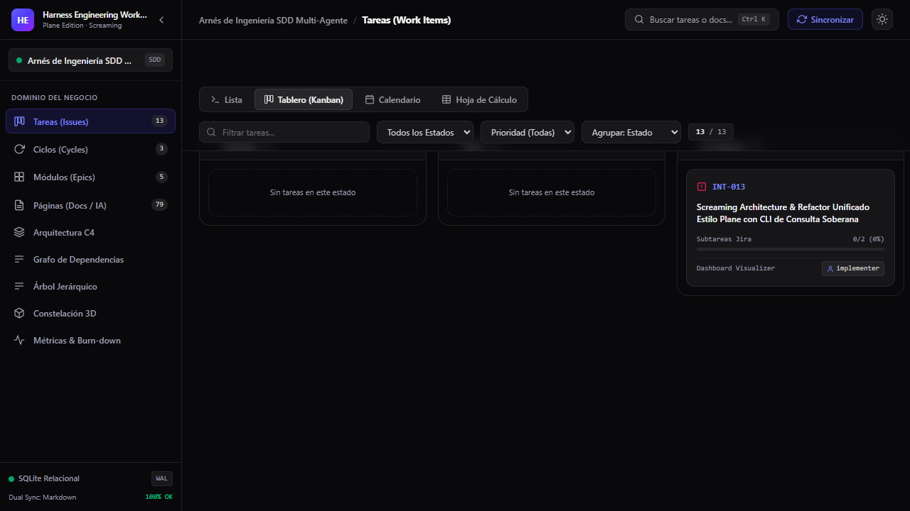
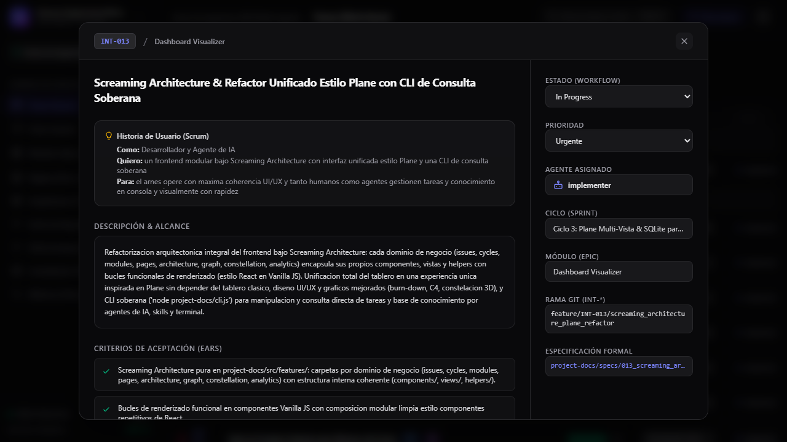
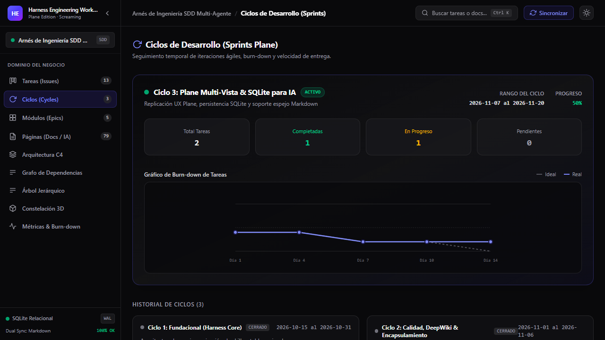
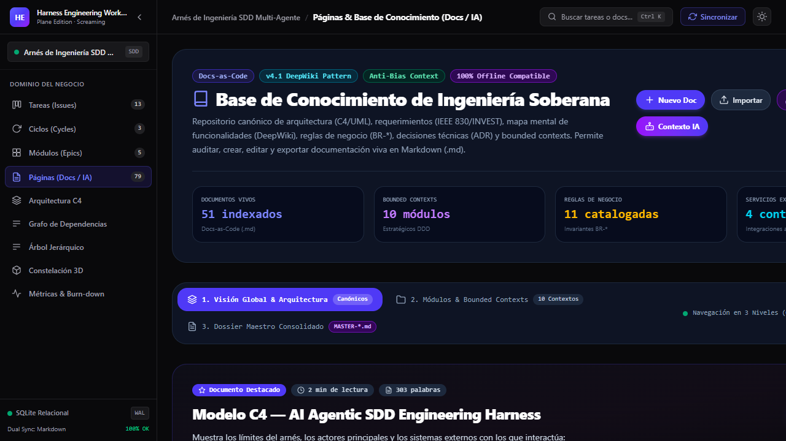

# Evidencias de Aceptacion E2E — INT-015: Eliminacion Total de Features y Consolidacion Screaming en Modules

## Metadatos
- **ID de Feature**: INT-015
- **Nombre**: `screaming_modules_plane_unification`
- **Rama**: `feature/INT-015/screaming_modules_plane_unification`
- **Fecha de Verificacion**: 2026-11-07
- **Ambiente de Prueba**: Playwright (Headless Chromium en localhost:3333) y Verify.sh (9 niveles de verificacion)

---

## 1. Evidencia Fotografica de la Suite de Pruebas

### Evidencia 1: Tablero Kanban Interactivo (Plane Issue Board)
- **Archivo**: `evidence/01-plane-kanban-board.png`
- **Descripcion**: Visualizacion del tablero Kanban con columnas por estado. Renderizado exclusivamente a traves de `src/modules/Issues/` y componentes compartidos `src/shared/ui/`.
- **Criterio Validado**: EARS-UB-01, EARS-UB-02, EARS-ST-01.

---

### Evidencia 2: Modal de Detalle de Tarea con Subtareas DEV/QA
- **Archivo**: `evidence/02-plane-issue-detail-modal.png`
- **Descripcion**: Vista flyout / modal de detalle accesible con User Story Scrum, criterios EARS, subtareas Jira y DoD.
- **Criterio Validado**: EARS-ST-01.

---

### Evidencia 3: Ciclos de Desarrollo (Sprints) con Grafico Burn-down
- **Archivo**: `evidence/03-plane-cycles-burndown.png`
- **Descripcion**: Vista de Ciclos con hero card del ciclo activo, metricas de avance y grafico SVG vectorial puro de Burn-down.
- **Criterio Validado**: EARS-UB-02.

---

### Evidencia 4: Documentacion y Base de Conocimiento (Plane Pages)
- **Archivo**: `evidence/04-plane-pages-docs.png`
- **Descripcion**: Vista de Paginas con navegacion editorial, estantes tematicos y renderizado de documentos tecnicos sin emojis.
- **Criterio Validado**: EARS-UB-01, EARS-UB-02.

---

## 2. Resumen de Ejecucion de Pruebas Automatizadas

| Suite | Pruebas | Resultado | Duracion |
|---|---|---|---|
| Unit Tests (`node:test`) | 66/66 | PASS (100%) | ~1.2s |
| Acceptance Tests (Playwright) | 14/14 | PASS (100%) | 34.5s |
| ATDD Smoke Tests | 5/5 | PASS (100%) | ~0.17s |
| White-box Branch Coverage | 12/12 | PASS (100%) | ~0.26s |
| Black-box & BVA Resilience | 8/8 | PASS (100%) | ~0.18s |
| System & Integration Tests | 7/7 | PASS (100%) | ~0.42s |
| Load & Performance (100 reqs) | 100/100 | PASS (304.6 RPS, p95: 59.14ms) | ~8.5s |
| Verify.sh (9 niveles) | 9/9 niveles | PASS (Exit code 0) | Completo |
