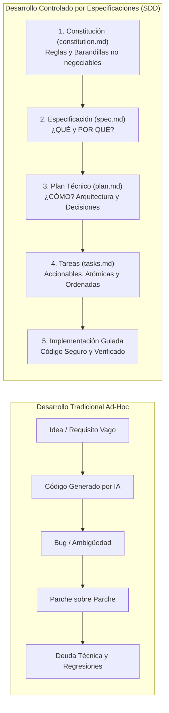

# 📘 Spec-Driven Development (SDD) con GitHub Spec Kit para Desarrolladores Enterprise

> **Guía Metodológica de Ingeniería, Artefactos Ejecutables y Manual de Operación**  
> **Proyecto:** IurisTrack (FrontendConsultaJuridica)  
> **Metodología:** Desarrollo Controlado por Especificaciones (Spec-Driven Development - SDD)  
> **Herramientas:** GitHub Spec Kit, GitHub Copilot Chat, Visual Studio Code & Entornos Enterprise  
> **Versión:** 1.0.0 (Enterprise Specification Framework)  
> **Fecha:** 2026-10-04  

---

## 1. 🌟 Introducción y Fundamentos de Spec-Driven Development (SDD)

### 1.1. ¿Qué es el Desarrollo Controlado por Especificaciones (SDD)?
El **Desarrollo Controlado por Especificaciones (Spec-Driven Development - SDD)** es un cambio de paradigma en la construcción de software para proyectos empresariales a gran escala.

En el desarrollo de software tradicional asistido por IA, los desarrolladores suelen solicitar a GitHub Copilot fragmentos de código aislados ("prompts ad-hoc"), descubriendo requisitos sobre la marcha. Esto provoca:
- **Alucinaciones y Desfase Arquitectónico**: La IA sugiere tecnologías incompatibles o almacena secretos en código fuente.
- **Regresiones Continuas**: La solución a una tarea rompe módulos previamente desarrollados.
- **Código Huérfano y Deuda Técnica**: El código se convierte en la única fuente de verdad desactualizada, mientras que los documentos de planeación se descartan.

**SDD invierte esta relación de poder**:
> **Las especificaciones se convierten en la fuente central y ejecutable de la verdad (Single Source of Truth).**  
> El código pasa a ser simplemente la expresión compilable de la especificación en un lenguaje y framework determinados (Angular 22, Node.js Express, TypeScript). Mantener y evolucionar el software significa evolucionar las especificaciones, no solo parchar código en caliente.



### 1.2. Principios Fundamentales de SDD
1. **Especificaciones como Artefacto Principal**: La especificación es viva, autoritativa y versionada en Git.
2. **Especificaciones Ejecutables**: Deben ser precisas, completas e inequívocas para que los agentes de IA (GitHub Copilot) puedan generar implementaciones listas para producción sin conjeturas.
3. **Documentación Dinámica**: Corregir un bug de diseño significa corregir la especificación que generó el código.
4. **Colaboración Humano-IA Estructurada**: La IA es el motor de traducción mecánica y síntesis; el ingeniero humano establece la constitución, valida los planes y supervisa los hitos de calidad.

---

## 2. 🔄 El Ciclo de Vida de 4 Fases con GitHub Spec Kit

GitHub Spec Kit estructura el ciclo de vida del software mediante comandos integrados en **GitHub Copilot Chat**:

| Fase | Comando de Spec Kit | Artefacto Generado | Propósito y Pregunta Clave |
| :---: | :---: | :---: | :--- |
| **0. Constitución** | `/speckit.constitution` | `constitution.md` | **¿Cuáles son las reglas inmutables?** Principios no negociables de seguridad, arquitectura y rendimiento. |
| **1. Especificar** | `/speckit.specify`<br>`/speckit.clarify` | `spec.md` | **¿Qué y por qué se construye?** Resumen, User Stories (INVEST), Criterios de Aceptación y Casos Extremos. |
| **2. Planear** | `/speckit.plan` | `plan.md` | **¿Cómo se construye arquitectónicamente?** Stack técnico, decisiones justificadas, secuencia y Constitution Check. |
| **3. Analizar** | `/speckit.analyze` | Reporte en Chat | **¿Hay incoherencias?** Cruce automático entre `spec.md`, `plan.md` y `constitution.md` para detectar desviaciones. |
| **4. Tareas** | `/speckit.tasks` | `tasks.md` | **¿Cuáles son los pasos atómicos?** Lista desglosada por fases (Setup, Core, UI, Hardening, QA). |
| **5. Implementar** | `/speckit.implement` | Código Fuente | **¿Cómo se ejecuta?** Generación guiada y verificación progresiva tarea por tarea. |

---

## 3. 📜 Constitución del Proyecto (`constitution.md`) — Caso IurisTrack

La **Constitución** representa las barandillas (guardrails) arquitectónicas, de cumplimiento y de ingeniería que ningún agente de IA ni desarrollador puede violar.

### 3.1. Constitución Oficial de IurisTrack

```markdown
# Constitución del Proyecto IurisTrack (Enterprise Edition)

## 1. Estándares Tecnológicos y de Plataforma
- Frontend: Angular 22 en modalidad Standalone Components, reactividad estricta con Signals (`signal`, `computed`), PrimeNG v19+ para componentes UI y Tailwind CSS v4 para diseño responsivo.
- Backend / BFF: Node.js Express SSR como pasarela intermedia (BFF) para eludir bloqueos de CORS del navegador y gestionar streaming binario.
- Base de Datos: Google Cloud Firestore operada bajo modelado relacional estricto con claves foráneas explícitas.
- Almacenamiento: Firebase Cloud Storage con políticas de seguridad y retención perpetua de providencias.
- Inteligencia Artificial: Integración exclusiva con Google Gemini API (@google/genai) modelo gemini-2.5-flash.
- Mapas: Implementación 100% de código abierto con Leaflet y OpenStreetMap (prohibido el uso de APIs comerciales que generen cobros por consulta).

## 2. Principios de Base de Datos y Normalización (Regla No Negociable)
- ERADICACIÓN TOTAL DE RELACIONES M:N DIRECTAS: En la base de datos Firestore, queda terminantemente prohibido crear arrays embebidos infinitos o relaciones directas de Muchos a Muchos.
- Toda relación M:N debe ser descompuesta mediante entidades asociativas explícitas:
  * Usuario ⟷ Casos: desarticulada en la colección asociativa `user_cases` (userId, caseId, linkedAt).
  * Casos ⟷ Sujetos: desacoplada en entidades relacionales de partes procesales.
  * Despachos ⟷ Especialidades: claves foráneas canónicas en `courts` apuntando a `specialties` y `account_types`.
- Integridad Referencial: Todos los documentos deben contener identificadores únicos autogenerados (`id`) y claves foráneas canónicas (`*Id`).

## 3. Seguridad, Cumplimiento y Habeas Data (Colombia)
- Cumplimiento de la Ley Estatutaria 1581 de 2012 y Ley 2213 de 2022.
- Si un proceso judicial retorna el flag `esPrivado: true`, el sistema DEBE ofuscar automáticamente la identidad de los sujetos procesales en consultas públicas y restringir la descarga exclusivamente al apoderado autenticado.
- Todas las comunicaciones cliente-servidor deben usar HTTPS con TLS 1.3.
- Ninguna clave de API privada, token ni secreto de Firebase o Gemini debe ser quemado (hardcoded) en el código fuente; deben ser inyectados mediante variables de entorno seguras.
- Aislamiento en Firestore Rules: Un usuario autenticado solo puede leer o escribir expedientes si existe un registro válido que lo vincule en `user_cases`.

## 4. Rendimiento, Resiliencia y Control Anti-Baneo de APIs Estatales
- Rate Limiting de Salida Obligatorio: El gateway backend debe limitar el tráfico saliente a un máximo de 3 req/s hacia CPNJ v2 (puerto 448) y 5 req/s hacia SIUGJ SGDE.
- Circuit Breaker: Ante 5 errores consecutivos o timeouts mayores a 10s en la Rama Judicial, el circuito se abre por 60 segundos, sirviendo de inmediato la última copia persistida en Firestore/Caché.
- Request Coalescing: Consultas simultáneas hacia un mismo radicado de 23 dígitos deben compartir la misma promesa HTTP en vuelo sin duplicar llamadas externas.
- Caché Persistente: Toda providencia descargada debe almacenarse en el disco local (`.cache/judicial-downloads/`) para garantizar disponibilidad del 100% ante caídas de la Rama Judicial.

## 5. Estándares de Codificación y Calidad de Software
- TypeScript en modo estricto (`strict: true`). Cero errores en `npx tsc --noEmit`.
- Principios SOLID y separación por capas (Dominio, Infraestructura, Aplicación, Presentación).
- Prohibición de funciones obsoletas de color en renderizado de documentos: Todos los colores en utilidades de impresión (jsPDF / html2canvas) deben sanitizarse de OKLab/OKLCh a RGB estándar, contando con un generador vectorial de respaldo (fallback) que garantice que nunca falle la descarga de un PDF.
- Cobertura de pruebas unitarias mínima del 85% en repositorios y servicios de orquestación.
```

---

## 4. 📄 Especificación Ejecutable (`spec.md`) — Caso: Motor Dual y Visor In-App

Al ejecutar `/speckit.specify`, GitHub Spec Kit genera la especificación centrada en **qué** hace el sistema y **por qué**:

### 4.1. Estructura de `spec.md`

```markdown
# Feature Specification: Consulta Judicial Dual y Visualizador In-App de Providencias

## Summary
Permite a los litigantes consultar procesos judiciales ingresando un radicado de 23 dígitos. El sistema consulta en paralelo la Consulta Nacional (CPNJ v2) y SIUGJ SGDE, unifica actuaciones y documentos, normaliza las relaciones territoriales en Firestore y ofrece dos opciones inmediatas por archivo: "Visualizar" dentro de un modal integrado en PDF o "Descargar" directamente en el dispositivo con respaldo perpetuo en caché.

## User Stories
- Como abogado litigante, quiero consultar un radicado de 23 dígitos para que el sistema consulte en ambas plataformas judiciales a la vez, para no perder actuaciones si el caso solo está en una de ellas.
- Como usuario revisando un expediente, quiero visualizar providencias en PDF dentro de un visor integrado en la pantalla o descargarlas, para verificar los autos judiciales de inmediato sin enlaces rotos.
- Como litigante, quiero recibir alertas por correo cuando se registre una nueva providencia, con un botón directo (CTA) para descargar el archivo.

## Acceptance Criteria
- El sistema valida que el radicado contenga exactamente 23 dígitos numéricos antes de disparar la consulta.
- La consulta dual ejecuta CPNJ v2 y SIUGJ SGDE en paralelo mediante Promise.allSettled.
- Si una actuación contiene documentos adjuntos, se presentan dos botones independientes: [Visualizar] y [Descargar].
- Al pulsar [Visualizar], se abre un modal in-app con un visor PDF (iframe sanitizado), barra de metadatos, procedencia (Consulta Nac. / SGDE) y spinner de carga.
- Al pulsar [Descargar], se transfiere el archivo binario oficial en streaming con extensión .pdf.
- Toda providencia descargada queda registrada en la caché persistente local (.cache/) del proxy.
- Si se detectan nuevas actuaciones frente a la consulta previa, se emite un correo transaccional con botón CTA "Descargar Archivo de la Novedad".
- Las claves foráneas de departamento, municipio y juzgado se resuelven automáticamente a partir de los primeros 12 dígitos del CUI.

## Functional Requirements
### 1. Validación y Orquestación Dual
- Validar formato CUI 23 dígitos mediante RegExp: `^[0-9]{23}$`.
- Backend BFF /api/judicial-search recibe radicado y consulta simultáneamente CPNJ v2 (puerto 448) y SIUGJ SGDE.
- Etiquetar procedencia en el expediente (`fuenteConsulta: 'consulta_nacional' | 'sgde' | 'ambas'`).

### 2. Gestión Documental y Visor In-App
- Endpoint /api/judicial-download entrega archivos en streaming con Content-Type: application/pdf.
- Sub-diálogo PrimeNG `p-dialog` embebe el documento mediante `DomSanitizer.bypassSecurityTrustResourceUrl`.
- Botones de acción integrados en la cabecera del visor: Descargar archivo y Abrir en pestaña nueva.

### 3. Normalización Relacional NoSQL
- Guardar caso en `cases` como documento canónico único indexado por `radicado`.
- Asociar el usuario en la tabla de unión `user_cases` con `userId` y `caseId`.

## Non-Functional Requirements
- Rendimiento: Streaming de documentos ya cacheados en disco debe iniciar en menos de 100 ms.
- Resiliencia: Tasa máxima hacia la Rama Judicial limitada a 3 req/s en CPNJ y 5 req/s en SGDE mediante Token Bucket.
- Seguridad: Reglas de Firestore restringen el acceso a expedientes solo a usuarios vinculados en `user_cases`.

## Edge Cases
- Servidor CPNJ v2 caído (Timeout > 10s): El sistema procesa los resultados de SIUGJ SGDE marcando `fuenteConsulta: 'sgde'` sin mostrar error al usuario.
- Servidor SIUGJ inaccesible: El sistema procesa los resultados de CPNJ v2 marcando `fuenteConsulta: 'consulta_nacional'`.
- Archivo binario corrupto o bloqueado: Si el PDF oficial no responde, se notifica al usuario ofreciendo reintento posterior sin tumbar la aplicación.
- Radicado inexistente en ambas fuentes: Se muestra mensaje amigable: "El número de radicación no fue encontrado en las plataformas de la Rama Judicial".
- Proceso con reserva legal (esPrivado = true): Los nombres de las partes se ofuscan y la visualización documental se restringe al apoderado autenticado.
```

### 4.2. Refinamiento Interactivo con `/speckit.clarify`
Cuando se invoca `/speckit.clarify` en GitHub Copilot Chat:
1. El agente examina `spec.md` y detecta posibles ambigüedades.
2. Plantea preguntas clave:
   - *¿Cuánto tiempo se conservan los archivos en caché local?* ➜ Decisión: Retención perpetua o hasta purga explícita.
   - *¿Qué sucede si un archivo supera los 50 MB?* ➜ Decisión: Streaming directo en chunks para no saturar memoria RAM del servidor SSR.
   - *¿Cómo se maneja la concurrencia si 50 usuarios sincronizan a la vez?* ➜ Decisión: Encolamiento con Token Bucket y concurrencia máxima 2 en tareas de fondo.
3. El agente actualiza automáticamente `spec.md` con las respuestas acordadas.

---

## 5. 🏗️ Plan Técnico de Implementación (`plan.md`) — Escenario Brownfield

Al ejecutar `/speckit.plan`, GitHub Spec Kit elabora el diseño técnico que tiende el puente entre **qué** se necesita y **cómo** se implementa dentro del código existente de IurisTrack.

### 5.1. Estructura de `plan.md`

```markdown
# Technical Plan: Consulta Judicial Dual y Visor In-App (Brownfield)

## Architecture Overview
La arquitectura integra el frontend Angular 22 existente con el gateway BFF Node.js Express SSR. Cuando el cliente solicita la consulta o descarga de un expediente, la petición viaja hacia los endpoints protegidos del proxy (/api/judicial-search y /api/judicial-download). El gateway incorpora un middleware Token Bucket y Circuit Breaker para evitar sobrecargar los servidores de la Rama Judicial. Los expedientes se persisten en Firestore bajo un modelo relacional normalizado mediante `cases` y `user_cases`.

## Technology Stack & Architectural Decisions
- Frontend: Angular 22 Signals (`signal`, `computed`), PrimeNG Dialogs (`p-dialog`), Tailwind CSS v4.
- Backend BFF: Node.js Express SSR (`src/server.ts`), Axios / Fetch con agentes HTTPS personalizados (rechazo de SSL laxo solo para certificados internos de la Rama).
- Almacenamiento y Caché: Disco local `.cache/judicial-downloads/` para almacenamiento binario persistente y Firebase Storage como repositorio secundario.
- Base de Datos: Cloud Firestore con índices compuestos y reglas de seguridad validadas.

### Alternativas Consideradas y Rechazadas:
- Descarga directa desde el navegador hacia Rama Judicial: Rechazada rotundamente debido a bloqueos de CORS en el puerto 448 y certificados SSL.
- Guardar archivos PDF como Base64 en Firestore: Rechazada debido al límite de 1 MB por documento de Firestore y sobrecosto de lectura.
- Relación Muchos a Muchos con arrays de UIDs en `cases`: Rechazada por violar principios de normalización, riesgo de contención de escritura y límite de 1 MB en documentos de Firestore.

## Implementation Sequence
1. Capa de Datos (Data Layer):
   - Actualizar modelo `case.model.ts` con tipado de fuentes duales y documentos.
   - Configurar repositorio `CaseRepository` para orquestar persistencia en `cases` y `user_cases`.
2. Capa Backend / BFF Gateway (`src/server.ts`):
   - Implementar limitador Token Bucket y deduplicador en vuelo.
   - Implementar endpoint `/api/judicial-search` con `Promise.allSettled`.
   - Implementar endpoint `/api/judicial-download` con streaming y caché en `.cache/judicial-downloads/`.
3. Capa de Presentación (Frontend Components):
   - Actualizar `case-detail-dialog.component.ts` con señales reactivas para el visor (`viewerVisible`, `activeDoc`, `safeDocUrl`).
   - Implementar modal con visor PDF embebido (`<iframe>`) con sanitización `DomSanitizer`.
   - Incorporar acciones duales [Visualizar] y [Descargar] en pestaña de documentos y actuaciones.
4. Capa de Reportes y Fallback PDF:
   - Corregir `createComputedStyleProxy` en `pdf-export.utils.ts` eliminando `Illegal invocation`.
   - Implementar generador vectorial de respaldo `generateFallbackJudicialPdf` con jsPDF.
5. Endurecimiento de Seguridad y Notificaciones:
   - Integrar detección de actuaciones nuevas y despacho de correos corporativos con botón CTA.
   - Aplicar reglas de seguridad en `firestore.rules`.

## Constitution Verification (Comprobación de Constitución)
- Cumplimiento de Normalización: Se utiliza `user_cases` para desacoplar usuarios de expedientes (Cumple Constitución art. 2).
- Cumplimiento de Rate Limiting: Se implementa Token Bucket con máx. 3 req/s hacia CPNJ (Cumple Constitución art. 4).
- Cumplimiento de Disponibilidad: Se almacena caché persistente en disco para providencias (Cumple Constitución art. 4).
- Cumplimiento de Calidad de Código: 0 errores en TypeScript y fallback vectorial en PDFs (Cumple Constitución art. 5).

## Assumptions & Open Questions
- Suposición: El directorio `.cache/judicial-downloads/` tiene permisos de escritura en el entorno del servidor SSR.
- Pregunta Abierta: ¿Se debe sincronizar automáticamente en segundo plano todos los casos a las 2:00 AM? ➜ Sí, mediante cron escalonado con concurrencia 2.
```

---

## 6. 📋 Lista de Tareas Accionables (`tasks.md`)

Al ejecutar `/speckit.tasks`, GitHub Spec Kit desglosa el plan técnico en tareas discretas, atómicas, verificables y ordenadas lógicamente por fases:

### 6.1. Estructura de `tasks.md`

```markdown
# Implementation Tasks: Consulta Dual y Visor In-App

## Fase 1: Configuración Base y Modelos (Setup & Foundation)
- [x] T001: Actualizar entidad `Case` y `DocumentoProcesal` en `case.model.ts` con tipado de fuente dual (`fuenteConsulta`).
- [x] T002: Crear estructura de directorios y permisos para caché persistente en `.cache/judicial-downloads/`.
- [x] T003: Configurar variables de entorno y cabeceras CORS en `src/server.ts`.

## Fase 2: Backend BFF y Gateway Resiliente (Core Functionality)
- [x] T004: Implementar algoritmo Token Bucket para regular tasa máxima hacia CPNJ (:448) y SGDE en `src/server.ts`.
- [x] T005: Implementar deduplicador de solicitudes en vuelo (Request Coalescing) por radicado de 23 dígitos.
- [x] T006: Desarrollar endpoint `/api/judicial-search` con `Promise.allSettled` consultando en paralelo CPNJ v2 y SIUGJ SGDE.
- [x] T007: Desarrollar endpoint `/api/judicial-download` con streaming binario hacia el cliente y persistencia en `.cache/`.

## Fase 3: Frontend y Visor In-App Embebido (UI & Integration)
- [x] T008: Agregar señales reactivas (`viewerVisible`, `activeDoc`, `safeDocUrl`, `viewerLoading`) en `case-detail-dialog.component.ts`.
- [x] T009: Implementar métodos `openViewer(doc)` y `downloadDocument(doc)` en el controlador del diálogo.
- [x] T010: Integrar sub-diálogo `<p-dialog>` en `case-detail-dialog.component.html` con `<iframe>` sanitizado para visualización de PDF.
- [x] T011: Agregar barra de herramientas del visor con título, procedencia (Consulta Nac. / SGDE), botón descargar y abrir en nueva pestaña.
- [x] T012: Actualizar pestañas "Documentos del proceso" y "Actuaciones" para renderizar botones duales [Visualizar] y [Descargar].

## Fase 4: Exportación Segura a PDF y Fallback Vectorial (Hardening)
- [x] T013: Corregir `createComputedStyleProxy` en `pdf-export.utils.ts` sustituyendo `Reflect.get` por `target[prop]` para eliminar error "Illegal invocation".
- [x] T014: Implementar convertidor matemático de colores modernos OKLab/OKLCh a sRGB estándar compatible con `html2canvas`.
- [x] T015: Desarrollar función `generateFallbackJudicialPdf` en `pdf-export.utils.ts` con jsPDF vectorial ante fallos imprevistos de canvas.
- [x] T016: Pasar `this.caseItem` a `exportHtmlToPdf` en `case-detail-dialog.component.ts`.

## Fase 5: Normalización, Alertas y Verificación (QA & Compliance)
- [x] T017: Verificar persistencia desacoplada M:N en `user_cases` y `cases` en `CaseRepository`.
- [x] T018: Implementar detector de novedades procesales y despacho de correo transaccional con botón CTA de descarga.
- [x] T019: Ejecutar verificación estricta de tipos de TypeScript con `npx tsc --noEmit` (0 errores).
- [x] T020: Validar compilación de producción con `npm run build`.
```

---

## 7. 🤖 Flujo de Comandos en Visual Studio Code con GitHub Copilot

Para los desarrolladores del equipo, el flujo diario de trabajo con GitHub Spec Kit se opera directamente desde la interfaz de **GitHub Copilot Chat** en Visual Studio Code:

```
┌────────────────────────────────────────────────────────────────────────┐
│  GITHUB COPILOT CHAT - WORKFLOW SPEC-DRIVEN DEVELOPMENT (SDD)          │
├────────────────────────────────────────────────────────────────────────┤
│                                                                        │
│  1. /speckit.constitution                                              │
│     Valida o genera los principios y restricciones del proyecto        │
│                                                                        │
│  2. /speckit.specify <descripción de la característica>                │
│     Genera spec.md con User Stories, Criterios de Aceptación y Edges   │
│                                                                        │
│  3. /speckit.clarify                                                   │
│     La IA interroga sobre ambigüedades, políticas y casos extremos     │
│                                                                        │
│  4. /speckit.plan                                                      │
│     Diseña la arquitectura, decisiones de stack y chequeo constitucional│
│                                                                        │
│  5. /speckit.analyze                                                   │
│     Audita la coherencia entre spec.md, plan.md y constitution.md      │
│                                                                        │
│  6. /speckit.tasks                                                     │
│     Desglosa el plan en tareas atómicas y ordenadas (tasks.md)         │
│                                                                        │
│  7. /speckit.implement T001 - T005                                     │
│     Genera e implementa el código respetando especificación y tareas  │
│                                                                        │
└────────────────────────────────────────────────────────────────────────┘
```

### Ejemplo de Prompting Empresarial:
```plaintext
/speckit.specify Implementar una funcionalidad de alerta judicial por correo electrónico. Cuando se detecte una nueva actuación en un proceso de la colección cases, identificar a todos los usuarios vinculados en user_cases y despachar un correo corporativo con el resumen de la última actuación y un botón CTA directo para descargar la providencia desde el proxy /api/judicial-download. Cumplir con la constitución del proyecto en cuanto a no duplicar relaciones M:N y no exponer datos de procesos con reserva legal.
```

---

## 8. 🏢 Extensión Enterprise: CI/CD, DevOps y Colaboración Multi-Agente

### 8.1. Trazabilidad en Pull Requests (PR Governance)
En un flujo empresarial de GitHub Enterprise:
1. Ningún PR se aprueba si modifica código sin haber actualizado previamente `spec.md`, `plan.md` o `tasks.md`.
2. La descripción del Pull Request incluye automáticamente la trazabilidad:
   `Closes Task T013 | Spec: spec.md#exportacion-pdf | Verified against: constitution.md#estandares-calidad`.

### 8.2. Pipeline de Integración Continua (GitHub Actions)
```yaml
name: Spec-Driven Enterprise CI

on:
  push:
    branches: [ main, develop ]
  pull_request:
    branches: [ main ]

jobs:
  validate-spec-and-build:
    runs-on: ubuntu-latest
    steps:
      - name: Checkout Código y Especificaciones
        uses: actions/checkout@v4

      - name: Configurar Node.js 20 LTS
        uses: actions/setup-node@v4
        with:
          node-version: 20
          cache: 'npm'

      - name: Instalar Dependencias
        run: npm ci

      - name: Verificación Estricta de Tipos TypeScript (Constitution Check)
        run: npx tsc --noEmit

      - name: Ejecutar Pruebas Unitarias de Regresión
        run: npm test -- --watch=false --browsers=ChromeHeadless

      - name: Compilación de Producción Angular SSR
        run: npm run build
```

---

*IurisTrack — Documento de Metodología Spec-Driven Development (SDD) con GitHub Spec Kit para Desarrolladores Enterprise. Todos los derechos reservados.*
