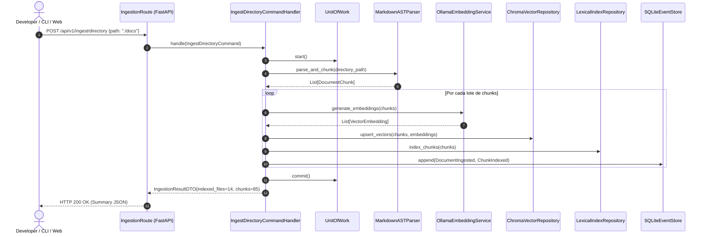
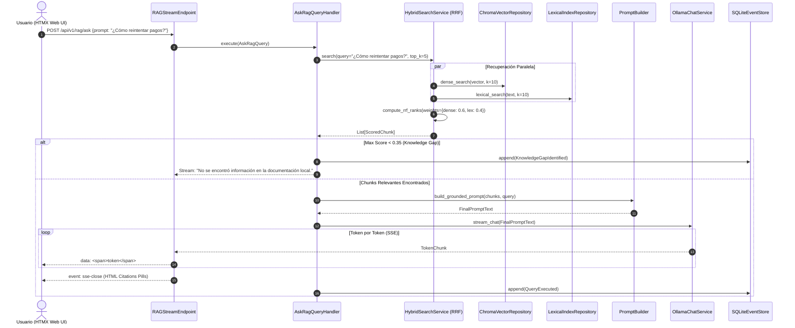

# 🏗️ Plan Técnico de Arquitectura: ContextForge (Fase 2: plan.md)

> **Proyecto:** ContextForge — Local Knowledge RAG & Context Builder  
> **Rol:** Principal Software Architect & Senior Full-Stack Engineer  
> **Versión:** 1.0.0 (Technical Blueprint)  
> **Estado:** Listo para Aprobación  
> **Metodología:** Spec-Driven Development (SDD) — Fase 2  

---

## 1. Decisiones de Clarificación Adoptadas

1. **Directorio Base de Documentación (`DOCS_ROOT_PATH`):**  
   - Enfoque **híbrido y desacoplado**. Por defecto apunta a `./docs` en la raíz del proyecto para entornos autocontenidos y demos. Se configura mediante la variable de entorno `DOCS_ROOT_PATH` para aceptar rutas absolutas hacia cualquier repositorio local del sistema de archivos corporativo (ej. `/home/user/monorepo/docs` o `C:\Users\...\docs`).
2. **Streaming con HTMX (`hx-ext="sse"`):**  
   - Aprobado y adoptado. Se implementa un canal Server-Sent Events (SSE) en `/api/v1/rag/stream/{session_id}`. HTMX escucha el evento `sse-message` para realizar append progresivo del contenido en el DOM sin necesidad de JavaScript pesado en el cliente, culminando con un evento `sse-close` que inyecta las píldoras de citas en el partial de la vista.
3. **Persistencia de Context Bundles:**  
   - Enfoque **dual (Persistencia Local + Descarga HTTP)**. El caso de uso compila y persiste el archivo en el disco local (`./bundles/context_bundle_<module>_<timestamp>.md`) para permitir el acceso directo por herramientas CLI o agentes de IDE (Aider, Cursor), y simultáneamente la respuesta web proporciona un encabezado `Content-Disposition: attachment` para descarga manual desde el navegador.

---

## 2. Mapa de Screaming Architecture y Flujo de Componentes

```mermaid
flowchart TD
    subgraph Presentation ["Capa de Presentación (FastAPI + SSR)"]
        UI["Jinja2 + Tailwind v4 + Preline UI"]
        HTMX["HTMX SSE Handler"]
        API["FastAPI REST & SSE Endpoints"]
        Middleware["Middlewares (Timing, RFC 7807, Entra ID)"]
    end

    subgraph Application ["Capa de Aplicación (CQRS & UoW)"]
        Cmds["Command Handlers (Ingest, Index, Bundle)"]
        Queries["Query Handlers (Search, Ask RAG, Audit)"]
        UoW["Unit of Work (IUnitOfWork)"]
        Services["Domain Services (AST Parser, RRF, PromptBuilder)"]
    end

    subgraph Domain ["Capa de Dominio (Núcleo Puro)"]
        Entities["Entities (MarkdownDoc, Chunk, Bundle)"]
        Events["Domain Events (DocumentIngested, KnowledgeGap)"]
        Interfaces["Repository & Service Protocols"]
    end

    subgraph Infrastructure ["Capa de Infraestructura"]
        Chroma["ChromaDB PersistentClient"]
        BM25["Rank-BM25 In-Memory/Disk Index"]
        Ollama["Ollama Async HTTP Client"]
        FS["Local FileSystem Repo"]
        EventStore["SQLite Append-Only Event Store"]
    end

    UI --> API
    HTMX --> API
    API --> Middleware
    API --> Cmds
    API --> Queries
    Cmds --> UoW
    Queries --> Services
    UoW --> Interfaces
    Services --> Interfaces
    Interfaces <|-- Chroma
    Interfaces <|-- BM25
    Interfaces <|-- Ollama
    Interfaces <|-- FS
    Interfaces <|-- EventStore
    Entities --> Events
```

---

## 3. Modelo CQRS y Flujos de Ejecución

### 3.1. Flujo de Comandos (Escritura e Indexación)



### 3.2. Flujo de Consultas (Lectura, Búsqueda Híbrida y RAG)



---

## 4. Event Sourcing Adaptado para Gobernanza del Conocimiento

Se implementa una base de datos SQLite ligera (`contextforge_events.db`) con un esquema **append-only inmutable**.

### 4.1. Esquema de Persistencia del Almacén de Eventos
```sql
CREATE TABLE IF NOT EXISTS domain_events (
    event_id TEXT PRIMARY KEY,
    stream_id TEXT NOT NULL,
    stream_type TEXT NOT NULL,
    event_type TEXT NOT NULL,
    payload JSON NOT NULL,
    occurred_at TIMESTAMP NOT NULL DEFAULT CURRENT_TIMESTAMP,
    metadata JSON
);

CREATE INDEX IF NOT EXISTS idx_stream ON domain_events(stream_id, stream_type);
CREATE INDEX IF NOT EXISTS idx_event_type ON domain_events(event_type);
CREATE INDEX IF NOT EXISTS idx_occurred_at ON domain_events(occurred_at);
```

### 4.2. Contrato Inmutable de Eventos de Dominio
```python
from dataclasses import dataclass
from datetime import datetime
from typing import Any, Mapping
import uuid

@dataclass(frozen=True)
class DomainEvent:
    event_id: str
    stream_id: str
    event_type: str
    occurred_at: datetime
    payload: Mapping[str, Any]

@dataclass(frozen=True)
class DocumentIngestedEvent(DomainEvent):
    pass

@dataclass(frozen=True)
class KnowledgeGapIdentifiedEvent(DomainEvent):
    pass
```

### 4.3. Proyección de Lectura: Detección de Vacíos de Documentación
Una vista materializada en memoria o consulta indexada permite al Tech Lead listar preguntas sin respuesta:
```sql
-- Identificación de preguntas con bajo score para alimentar el backlog de documentación
SELECT 
    json_extract(payload, '$.query_text') AS user_query,
    json_extract(payload, '$.max_score') AS relevance_score,
    COUNT(*) as occurrences,
    MAX(occurred_at) as last_asked
FROM domain_events
WHERE event_type = 'KnowledgeGapIdentified'
GROUP BY user_query
ORDER BY occurrences DESC, last_asked DESC;
```

---

## 5. Contratos de Interfaces e Inversión de Dependencias (DI)

Todas las dependencias de I/O se declaran como protocolos o clases abstractas en la capa de Dominio:

### 5.1. Repositorio del Sistema de Archivos
```python
from typing import Protocol, Sequence
from contextforge.markdown_ingestion.domain.models import MarkdownDocument

class IDocumentFileSystemRepository(Protocol):
    async def list_markdown_files(self, base_path: str) -> Sequence[str]: ...
    async def read_file(self, file_path: str) -> str: ...
    async def file_exists(self, file_path: str) -> bool: ...
```

### 5.2. Repositorio Vectorial (ChromaDB)
```python
from typing import Protocol, Sequence
from contextforge.rag_engine.domain.models import DocumentChunk, RetrievalResult

class IVectorRepository(Protocol):
    async def upsert_chunks(self, chunks: Sequence[DocumentChunk], embeddings: Sequence[list[float]]) -> None: ...
    async def search_dense(self, query_embedding: list[float], top_k: int) -> Sequence[RetrievalResult]: ...
    async def delete_by_document(self, document_id: str) -> None: ...
```

### 5.3. Repositorio de Búsqueda Léxica (BM25)
```python
from typing import Protocol, Sequence
from contextforge.rag_engine.domain.models import DocumentChunk, RetrievalResult

class ILexicalIndexRepository(Protocol):
    async def index_chunks(self, chunks: Sequence[DocumentChunk]) -> None: ...
    async def search_lexical(self, query_text: str, top_k: int) -> Sequence[RetrievalResult]: ...
```

### 5.4. Cliente Ollama (Local AI Engine)
```python
from typing import AsyncGenerator, Protocol, Sequence

class IOllamaClient(Protocol):
    async def generate_embedding(self, text: str, model: str = "nomic-embed-text") -> list[float]: ...
    async def generate_embeddings_batch(self, texts: Sequence[str], model: str = "nomic-embed-text") -> Sequence[list[float]]: ...
    async def stream_chat(self, prompt: str, system_prompt: str, model: str = "qwen2.5-coder:7b") -> AsyncGenerator[str, None]: ...
```

### 5.5. Unit of Work (Consistencia Transaccional)
```python
from typing import Protocol

class IUnitOfWork(Protocol):
    async def __aenter__(self) -> "IUnitOfWork": ...
    async def __aexit__(self, exc_type: object, exc_val: object, exc_tb: object) -> None: ...
    async def commit(self) -> None: ...
    async def rollback(self) -> None: ...
```

---

## 6. Estrategia de Chunking Semántico y Parser AST

El procesador de Markdown `SemanticChunker` garantiza que ningún fragmento pierda coherencia de dominio ni parta código:

```
[Documento Markdown]
   │
   ▼
[Parser AST (Mistletoe / Marko)]
   ├── 1. Extrae YAML Frontmatter -> Metadatos globales (módulo, tags, autor)
   ├── 2. Segmenta en bloques de encabezados H1 (#), H2 (##), H3 (###)
   │      Guarda jerarquía contextual: "Facturación > Políticas > Reintentos"
   └── 3. Detecta Bloques de Código Cercados (```lang ... ```)
          REGLA INQUEBRANTABLE: El bloque de código es una unidad indivisible.
          Si el tamaño del bloque excede el tamaño ideal (600 tokens), 
          se preserva completo como un chunk autónomo.
```

### Reglas de Tokenización y Overlap
- **Ventana Objetivo por Chunk:** 500 – 700 tokens (calculados con `tiktoken` codificación `cl100k_base`).
- **Overlap:** 100 tokens de solapamiento hacia el siguiente chunk para preservar transiciones lógicas (únicamente en texto de prosa, no en código).
- **Enriquecimiento del Chunk:** Cada fragmento vectorial incluye como prefijo su contexto jerárquico:  
  `[Ruta: {module}/{file}.md | Sección: {h1} > {h2}] \n\n {contenido_chunk}`.

---

## 7. Fusión de Búsqueda Híbrida: Reciprocal Rank Fusion (RRF)

Se balancea la precisión léxica de BM25 con la comprensión semántica de ChromaDB mediante la siguiente implementación matemática:

$$\text{RRF Score}(d) = \frac{0.6}{60 + \text{rank}_{\text{dense}}(d)} + \frac{0.4}{60 + \text{rank}_{\text{bm25}}(d)}$$

```python
def reciprocal_rank_fusion(
    dense_results: Sequence[RetrievalResult],
    lexical_results: Sequence[RetrievalResult],
    k: int = 60,
    dense_weight: float = 0.6,
    lexical_weight: float = 0.4
) -> list[RetrievalResult]:
    scores: dict[str, float] = {}
    items: dict[str, RetrievalResult] = {}

    for rank, item in enumerate(dense_results, start=1):
        scores[item.chunk_id] = scores.get(item.chunk_id, 0.0) + (dense_weight / (k + rank))
        items[item.chunk_id] = item

    for rank, item in enumerate(lexical_results, start=1):
        scores[item.chunk_id] = scores.get(item.chunk_id, 0.0) + (lexical_weight / (k + rank))
        if item.chunk_id not in items:
            items[item.chunk_id] = item

    sorted_chunks = sorted(items.values(), key=lambda x: scores[x.chunk_id], reverse=True)
    for chunk in sorted_chunks:
        chunk.fused_score = scores[chunk.chunk_id]
    return sorted_chunks
```

---

## 8. Arquitectura de Interfaz de Usuario (Jinja2 + HTMX + Preline UI)

```
┌────────────────────────────────────────────────────────────────────────┐
│                        ContextForge Web Shell                          │
├───────────────┬────────────────────────────────────────────────────────┤
│ Barra Lateral │ Panel de Contenido Principal (HTMX Target)             │
│ ├── 💬 Chat   │                                                        │
│ ├── 🔍 Buscar │ ┌────────────────────────────────────────────────────┐ │
│ ├── 📦 Bundles│ │ Historial de Mensajes Chat (Jinja2 SSR)            │ │
│ └── 📊 Gaps   │ │  [User]: ¿Cómo reintentar cobros con Stripe?      │ │
│               │ │  [Assistant (HTMX SSE Streaming)]:                  │ │
│               │ │   El flujo estipula 3 reintentos antes de emitir...│ │
│               │ │   Fuentes: [billing/retry_policy.md]               │ │
│               │ └────────────────────────────────────────────────────┘ │
│               │ ┌────────────────────────────────────────────────────┐ │
│               │ │ Prompt Input (hx-post="/api/v1/rag/ask")           │ │
│               │ └────────────────────────────────────────────────────┘ │
└───────────────┴────────────────────────────────────────────────────────┘
```

- **Manejo de SSE en HTMX:**
  ```html
  <div hx-ext="sse" sse-connect="/api/v1/rag/stream/{{ session_id }}">
      <div id="chat-stream-target" sse-swap="sse-message" hx-swap="beforeend"></div>
      <div id="citations-target" sse-swap="sse-close" hx-swap="innerHTML"></div>
  </div>
  ```

---

## 9. Mapeo de Excepciones a RFC 7807 (Problem Details)

Se centralizan todas las anomalías en un middleware de FastAPI que captura excepciones de dominio y emite respuestas con `Content-Type: application/problem+json`:

```python
from fastapi import Request
from fastapi.responses import JSONResponse
from contextforge.shared_kernel.domain.exceptions import DomainException

async def problem_details_exception_handler(request: Request, exc: DomainException) -> JSONResponse:
    problem = {
        "type": exc.error_type,
        "title": exc.title,
        "status": exc.status_code,
        "detail": exc.detail,
        "instance": str(request.url.path),
        "code": exc.code
    }
    return JSONResponse(
        status_code=exc.status_code,
        content=problem,
        headers={"Content-Type": "application/problem+json"}
    )
```

---

## 10. Verificación Constitucional (Constitution Check)

| Cláusula Constitucional (Fase 0) | Estrategia de Cumplimiento en el Plan Técnico | Estado |
| :--- | :--- | :---: |
| **Soberanía y Fuga Cero (Zero-Leakage)** | Inferencia y embeddings delegados 100% a la instancia local de Ollama en `localhost:11434`. ChromaDB persistido en disco local. Cero llamadas HTTP externas. | ✅ CUMPLE |
| **Docs-as-Code como Única Fuente de Verdad** | No se utiliza base relacional para documentos. Todo proviene de archivos `.md` en disco. Si el `.md` se borra, se elimina del vector store. | ✅ CUMPLE |
| **Screaming Architecture & Clean Architecture** | Paquetes organizados por subdominios (`markdown_ingestion`, `rag_engine`, `context_builder`, `knowledge_governance`, `identity_access`). Capa de Dominio 100% pura. | ✅ CUMPLE |
| **CQRS y Unit of Work** | Separación explícita de Command Handlers y Query Handlers. Transacciones de indexación protegidas por `IUnitOfWork`. | ✅ CUMPLE |
| **Event Sourcing Adaptado** | Registro inmutable de Domain Events en SQLite (`domain_events`) para auditoría y observabilidad de `KnowledgeGapIdentified`. | ✅ CUMPLE |
| **Errores RFC 7807** | Middleware global que convierte cualquier excepción en el schema estándar Problem Details con `application/problem+json`. | ✅ CUMPLE |
| **Frontend SSR + HTMX + Preline UI** | Jinja2 para SSR, Tailwind v4 + Preline UI para componentes visuales accesibles y HTMX SSE para reactividad en tiempo real sin SPAs complejas. | ✅ CUMPLE |
| **Tipado Estricto y TDD** | Mypy en modo estricto, interfaces con `typing.Protocol`, y mocks en memoria (`InMemory*Repo`) para TDD integral con `pytest`. | ✅ CUMPLE |

